Continuación de [Árboles](./arboles.md). Resumen basado en el libro de texto (de la Cueva et al., *Estructura de datos y algoritmos fundamentales*), secciones 9.2.2–9.6, y en Goodrich, *Data Structures and Algorithms in Java*, sección 11.1 (Binary Search Trees). El libro de texto presenta el código en C++; aquí se muestra en Java.

Se asume la terminología, la [altura](./arboles.md#profundidad-nivel-y-altura) (una hoja mide 0) y los [recorridos](./arboles.md#recorridos) de la primera parte.

En los diagramas, los nodos en **amarillo** son los que cambian en cada operación, los **rojos** los que violan una propiedad y los **rectángulos grises** representan subárboles completos.

## Árbol binario de búsqueda (BST)

Un **árbol binario de búsqueda** (*Binary Search Tree*) cumple, **para cada nodo**:

- todos los datos de su **subárbol izquierdo** son **menores** que el dato del nodo, y
- todos los datos de su **subárbol derecho** son **mayores**.

El árbol que se usó en los [recorridos](./arboles.md#recorridos) (figura 9.8 del libro de texto) es un BST:

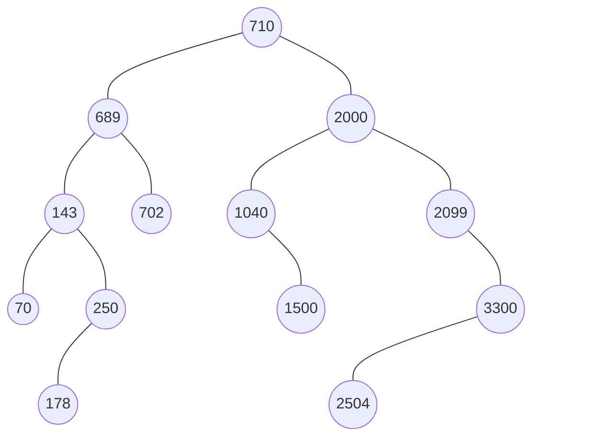

Observe, por ejemplo, que 702 está a la izquierda de 710 (es menor) y a la derecha de 689 (es mayor). Su recorrido en inorden da los datos ordenados: 70 143 178 250 689 702 710 1040 1500 2000 2099 2504 3300.

El ADT de un BST es el mismo que el de cualquier árbol binario. Lo que cambia son las operaciones, que deben **mantener la propiedad** del BST. Supondremos que no hay datos repetidos.

### El BST según Goodrich

Goodrich (sección 11.1) usa el BST para implementar un **mapa ordenado** (*sorted map*): cada nodo guarda un par **(clave, valor)** y el orden lo dan las claves. Las tres operaciones fundamentales de un mapa son:

| Método | Descripción |
|---|---|
| `get(k)` | devuelve el valor asociado a la clave k, o `null` si no existe |
| `put(k, v)` | asocia v con k; si k ya existía, **reemplaza** su valor y devuelve el anterior |
| `remove(k)` | elimina la entrada con clave k y devuelve su valor, o `null` si no existe |

Un mapa **ordenado** además garantiza que al iterarlo las claves salen **en orden**, y permite búsquedas como "la mayor clave ≤ k" (`floorEntry`) o "todas las claves entre k1 y k2" (`subMap`).

Goodrich define el BST como un árbol binario **propio** en el que solo los **nodos internos** guardan entradas. Las hojas son **centinelas** vacíos que marcan "aquí no hay nada" (ver [centinelas en listas](./listas-enlazadas.md)). Así, una búsqueda fallida termina en una hoja, y esa hoja es justo donde se insertaría la clave. En la práctica las hojas centinela se pueden representar con `null`, lo que ahorra la mitad de los nodos. Esa es la versión que se implementa en este documento.

Usaremos el árbol de ejemplo de Goodrich (figura 11.1):

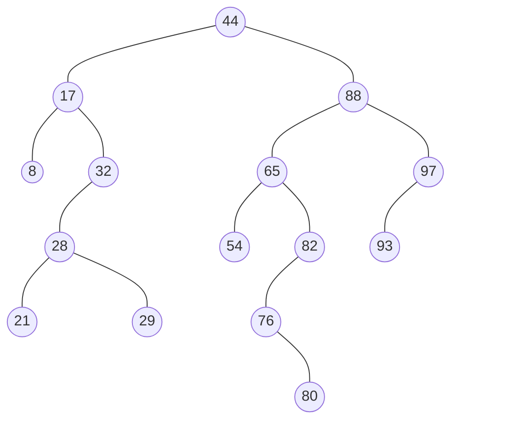

### Clase en Java

Los datos deben ser comparables, así que el tipo se acota con `Comparable` (ver [tipos acotados](./genericos.md)):

```java
public class BST<E extends Comparable<E>> {
    private static class Nodo<E> {
        E info;
        Nodo<E> izq, der;
        Nodo(E info) { this.info = info; }
    }

    private Nodo<E> raiz = null;

    // buscar, insertar, eliminar y recorridos
}
```

### Búsqueda

Si el dato es menor que el del nodo actual, se busca en el subárbol izquierdo; si es mayor, en el derecho; si es igual, se encontró. Si se llega a un nodo nulo, el dato no está.

Ejemplo: buscar 1040. 1040 > 710 → derecha. 1040 < 2000 → izquierda. 1040 = 1040 → encontrado.

```java
public boolean buscar(E dato) { return buscar(raiz, dato) != null; }

private Nodo<E> buscar(Nodo<E> p, E dato) {
    if (p == null) return null;                    // no está
    int c = dato.compareTo(p.info);
    if (c < 0) return buscar(p.izq, dato);         // buscar a la izquierda
    if (c > 0) return buscar(p.der, dato);         // buscar a la derecha
    return p;                                      // encontrado
}
```

Como el método recursivo necesita el nodo actual, y el usuario solo debería dar el dato, se usa un método público que llama al privado con la raíz. El método devuelve el nodo, que es útil si después se quiere usar su información.

Un BST se puede ver como un **árbol de decisión**: en cada nodo se pregunta si el dato es menor, igual o mayor.

En el árbol de Goodrich, buscar 65 sigue el camino 44 → 88 → 65 (éxito). Buscar 68 sigue el camino 44 → 88 → 65 → 82 → 76 y termina en el hijo izquierdo vacío de 76 (fracaso).

Goodrich llama a esta búsqueda `TreeSearch(p, k)`. Cuando falla, no devuelve `null`: devuelve la **última hoja** visitada, para que `put` sepa dónde insertar:

```
TreeSearch(p, k):
  si p es hoja: devolver p                  { búsqueda fallida }
  si k == clave(p): devolver p              { búsqueda exitosa }
  si k < clave(p): devolver TreeSearch(izquierdo(p), k)
  si no: devolver TreeSearch(derecho(p), k)
```

#### Búsqueda sin recursión

Cada llamada recursiva baja un nivel, así que en un árbol muy desbalanceado (alto) la recursión puede llenar la pila de llamadas de Java (`StackOverflowError`). Como la llamada recursiva es lo último que hace el método, se convierte fácilmente en un ciclo:

```java
public boolean buscar(E dato) {
    Nodo<E> p = raiz;
    while (p != null) {
        int c = dato.compareTo(p.info);
        if (c == 0) return true;
        p = (c < 0) ? p.izq : p.der;
    }
    return false;
}
```

### Inserción

Se baja por el árbol igual que en la búsqueda hasta llegar a un **lugar vacío** (nulo), y ahí se crea el nodo nuevo. Si se encuentra el dato, ya existe y no se inserta.

Ejemplo: insertar 1500. 1500 > 710 → derecha. 1500 < 2000 → izquierda. 1500 > 1040 → derecha, que está vacío: ahí se inserta.

```java
public void insertar(E dato) { raiz = insertar(raiz, dato); }

private Nodo<E> insertar(Nodo<E> p, E dato) {
    if (p == null) return new Nodo<>(dato);        // lugar vacío: crear el nodo
    int c = dato.compareTo(p.info);
    if (c < 0) p.izq = insertar(p.izq, dato);
    else if (c > 0) p.der = insertar(p.der, dato);
    // c == 0: el dato ya está, no se inserta
    return p;
}
```

El método recursivo **devuelve la raíz del subárbol** ya actualizado. Así, el padre reasigna su hijo (`p.izq = ...`) y la raíz del árbol se actualiza en el método público.

En Goodrich, `put(k, v)` primero hace `TreeSearch`. Si encuentra la clave, **reemplaza su valor**. Si no, la búsqueda terminó en una hoja y esa hoja se **expande** (`expandExternal`): se guarda la entrada ahí y se le agregan dos hojas centinela como hijos. Insertar 68 en el árbol de ejemplo lo deja como hijo izquierdo de 76:

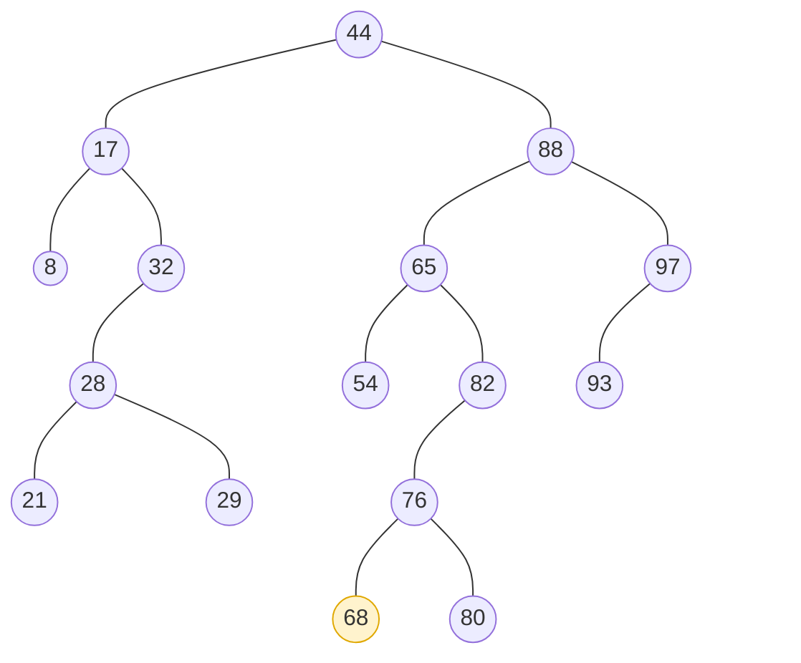

### Eliminación

Es la operación más complicada. Primero se busca el nodo; luego hay tres casos:

1. **Es hoja**: se elimina directamente (el padre apunta a `null`).
2. **Tiene un solo hijo**: se reemplaza por ese hijo.
3. **Tiene dos hijos**: se reemplaza su **información** por la del nodo **más a la derecha de su subárbol izquierdo** (el mayor de los menores), y luego se elimina ese nodo, que tiene a lo más un hijo. También se puede usar el más a la izquierda del subárbol derecho (el menor de los mayores).

Ejemplo del libro: eliminar 689 del árbol anterior. Tiene dos hijos. El más a la derecha de su subárbol izquierdo es **250**. Se copia 250 en el lugar de 689 y se elimina el nodo 250 original, cuyo hijo 178 pasa a ser hijo derecho de 143:

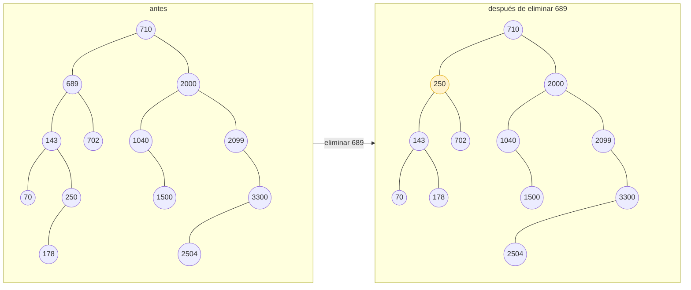

```java
public void eliminar(E dato) { raiz = eliminar(raiz, dato); }

private Nodo<E> eliminar(Nodo<E> p, E dato) {
    if (p == null) return null;                    // el dato no está
    int c = dato.compareTo(p.info);
    if (c < 0) p.izq = eliminar(p.izq, dato);
    else if (c > 0) p.der = eliminar(p.der, dato);
    else {                                         // encontrado
        if (p.izq == null) return p.der;           // hoja o solo hijo derecho
        if (p.der == null) return p.izq;           // solo hijo izquierdo
        Nodo<E> max = p.izq;                       // dos hijos:
        while (max.der != null) max = max.der;     //   el más a la derecha del izquierdo
        p.info = max.info;                         //   copiar su información
        p.izq = eliminar(p.izq, max.info);         //   y eliminarlo de allá
    }
    return p;
}
```

Observe que `if (p.izq == null) return p.der;` cubre dos casos: si el nodo es hoja devuelve `null`, y si solo tiene hijo derecho devuelve ese hijo.

**Memoria.** En C++ hay que liberar el nodo eliminado con `delete`; si no, se produce una **fuga de memoria** (*leak*). Java tiene **recolector de basura**: basta con que ninguna variable apunte al nodo.

Goodrich usa el mismo algoritmo y explica por qué funciona. El nodo más a la derecha del subárbol izquierdo es el **predecesor** de p: la mayor clave que es menor que la de p. Al ponerlo en lugar de p, todo lo que queda a la izquierda sigue siendo menor y todo lo de la derecha sigue siendo mayor. Además, ese nodo **no tiene hijo derecho** (si no, no sería el más a la derecha), así que eliminarlo cae en el caso fácil.

Ejemplo de Goodrich, partiendo del árbol con 68 ya insertado:

- **Eliminar 32** (un solo hijo): su hijo 28 sube a ocupar su lugar.
- **Eliminar 88** (dos hijos): su predecesor es **82**, el más a la derecha del subárbol izquierdo (65). Se copia 82 en el lugar de 88, y el hijo izquierdo de 82 (76) pasa a ser hijo derecho de 65.

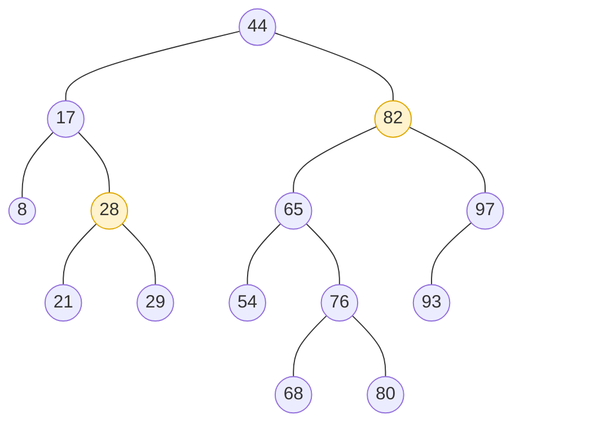

Las tres operaciones (buscar, insertar y eliminar) recorren **un solo camino** de la raíz hacia abajo.

### El BST como mapa ordenado

Para usar el BST como mapa, el nodo guarda una clave y un valor. `get` es la búsqueda y `put` es la inserción, que ahora **reemplaza** el valor si la clave ya existe (en la versión del libro de texto, un dato repetido simplemente se ignoraba):

```java
public class BSTMap<K extends Comparable<K>, V> {
    private static class Nodo<K, V> {
        K clave;
        V valor;
        Nodo<K, V> izq, der;
        Nodo(K clave, V valor) { this.clave = clave; this.valor = valor; }
    }

    private Nodo<K, V> raiz = null;
    private int n = 0;
    private V anterior;          // valor reemplazado por el último put

    public int size() { return n; }

    public V get(K clave) {
        Nodo<K, V> p = raiz;
        while (p != null) {
            int c = clave.compareTo(p.clave);
            if (c == 0) return p.valor;
            p = (c < 0) ? p.izq : p.der;
        }
        return null;
    }

    public V put(K clave, V valor) {
        anterior = null;
        raiz = put(raiz, clave, valor);
        return anterior;
    }

    private Nodo<K, V> put(Nodo<K, V> p, K clave, V valor) {
        if (p == null) { n++; return new Nodo<>(clave, valor); }   // clave nueva
        int c = clave.compareTo(p.clave);
        if (c < 0) p.izq = put(p.izq, clave, valor);
        else if (c > 0) p.der = put(p.der, clave, valor);
        else { anterior = p.valor; p.valor = valor; }             // reemplazar
        return p;
    }
}
```

`remove(k)` es igual a `eliminar`, devolviendo el valor del nodo eliminado.

El orden del BST permite operaciones que un mapa con tabla hash no puede hacer eficientemente. Se muestran sobre el `BST<E>` de la sección anterior:

**Mínimo y máximo.** El mínimo es el nodo más a la izquierda y el máximo el más a la derecha. Goodrich llama a este último `treeMax`, y es el mismo que se usa para encontrar el predecesor al eliminar.

```java
public E minimo() {
    if (raiz == null) return null;
    Nodo<E> p = raiz;
    while (p.izq != null) p = p.izq;
    return p.info;
}

public E maximo() {
    if (raiz == null) return null;
    Nodo<E> p = raiz;
    while (p.der != null) p = p.der;
    return p.info;
}
```

**Piso e inferior** (`floorEntry` y `lowerEntry`). El **piso** de k es la mayor clave **≤ k**, y el **inferior** es la mayor clave **< k**. Se baja como en una búsqueda y, cada vez que se va a la derecha, el nodo actual es un candidato (es menor que k, y todo lo que sigue es mayor que él):

```java
/** La mayor clave <= dato, o null si no hay. */
public E piso(E dato) {
    E candidato = null;
    Nodo<E> p = raiz;
    while (p != null) {
        int c = dato.compareTo(p.info);
        if (c == 0) return p.info;               // coincidencia exacta
        if (c < 0) p = p.izq;
        else { candidato = p.info; p = p.der; }  // p es menor: candidato
    }
    return candidato;
}

/** La mayor clave < dato, o null si no hay. */
public E inferior(E dato) {
    E candidato = null;
    Nodo<E> p = raiz;
    while (p != null) {
        if (dato.compareTo(p.info) <= 0) p = p.izq;
        else { candidato = p.info; p = p.der; }
    }
    return candidato;
}
```

En el árbol de ejemplo: `piso(68)` = 65, `piso(65)` = 65, `piso(5)` = `null`, `inferior(65)` = 54 e `inferior(44)` = 32. `techo` (mayor o igual) y `superior` (mayor estricto) son simétricos.

**Rango** (`subMap(k1, k2)`). Devuelve en orden las claves del intervalo **[k1, k2)**. Es un inorden que **poda** los subárboles que no pueden tener claves en el rango: si la clave del nodo es menor que k1, todo su subárbol izquierdo también lo es, y se descarta.

```java
public List<E> rango(E desde, E hasta) {
    List<E> r = new ArrayList<>();
    rango(raiz, desde, hasta, r);
    return r;
}

private void rango(Nodo<E> p, E desde, E hasta, List<E> r) {
    if (p == null) return;
    if (p.info.compareTo(desde) < 0) {           // p y su izquierdo están antes del rango
        rango(p.der, desde, hasta, r);
        return;
    }
    rango(p.izq, desde, hasta, r);
    if (p.info.compareTo(hasta) < 0) {           // p está en el rango
        r.add(p.info);
        rango(p.der, desde, hasta, r);
    }
}
```

En el árbol de ejemplo, `rango(30, 80)` devuelve `[32, 44, 54, 65, 76]`.

**Recorrer todas las entradas** (`entrySet`) es un inorden, así que salen ordenadas por clave.

Goodrich implementa todo esto en su clase `TreeMap<K,V>`, sobre un `LinkedBinaryTree` con hojas centinela. Sus métodos llaman a `rebalanceAccess`, `rebalanceInsert` y `rebalanceDelete`, que en el BST no hacen nada. Son "ganchos" (*hooks*) que las subclases AVL, splay y rojo-negro redefinen para rebalancear el árbol.

### Costo

Buscar, insertar y eliminar recorren un camino de la raíz hacia abajo: son **O(h)**, donde h es la altura.

- Si el árbol está **balanceado**, h ≈ log n y las operaciones son **O(log n)**, como la búsqueda binaria.
- Si está **desbalanceado**, h puede llegar a n − 1 y las operaciones son **O(n)**, como en una lista.

Costos del BST como mapa ordenado (Goodrich, tabla 11.1), donde s es el número de claves que devuelve `subMap`:

| Método | Tiempo |
|---|---|
| `size`, `isEmpty` | O(1) |
| `get`, `put`, `remove` | O(h) |
| `firstEntry`, `lastEntry` (mínimo, máximo) | O(h) |
| `floorEntry`, `ceilingEntry`, `lowerEntry`, `higherEntry` | O(h) |
| `subMap` (rango) | O(s + h) |
| `entrySet`, `keySet`, `values` (inorden) | O(n) |

Espacio: **O(n)**. En el mejor caso h = ⌈log(n + 1)⌉ − 1. Si las inserciones y eliminaciones son **aleatorias**, la altura esperada es **O(log n)**. Pero si no se puede garantizar que lo sean (por ejemplo, si las claves llegan ordenadas), conviene usar un árbol que garantice altura O(log n) en el **peor caso**.

La forma del árbol depende **del orden en que se insertan los datos**:

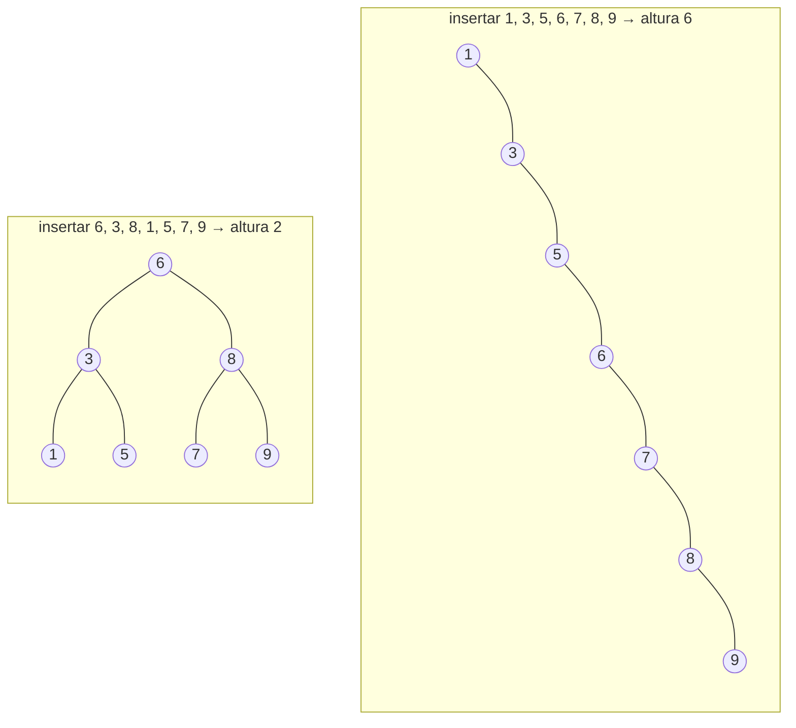

Insertar datos ya ordenados convierte al BST en una lista. Para evitarlo están los árboles **balanceados**, como el AVL.

## Árboles AVL

En 1962, Adelson-Velski y Landis propusieron una forma de insertar y eliminar en un BST manteniendo el **balance** dentro de ciertos límites. A estos árboles se les llama **AVL**, por sus iniciales.

### Factor de equilibrio

Para cada nodo se define su **factor de equilibrio (FE)**:

```
FE = altura del subárbol derecho − altura del subárbol izquierdo
```

Una hoja tiene altura 0, y a un subárbol vacío se le asigna altura −1, de modo que una hoja tiene FE = (−1) − (−1) = 0.

Un BST es **AVL** si **todos** sus nodos cumplen **\|FE\| ≤ 1**, es decir, FE ∈ {−1, 0, 1}.

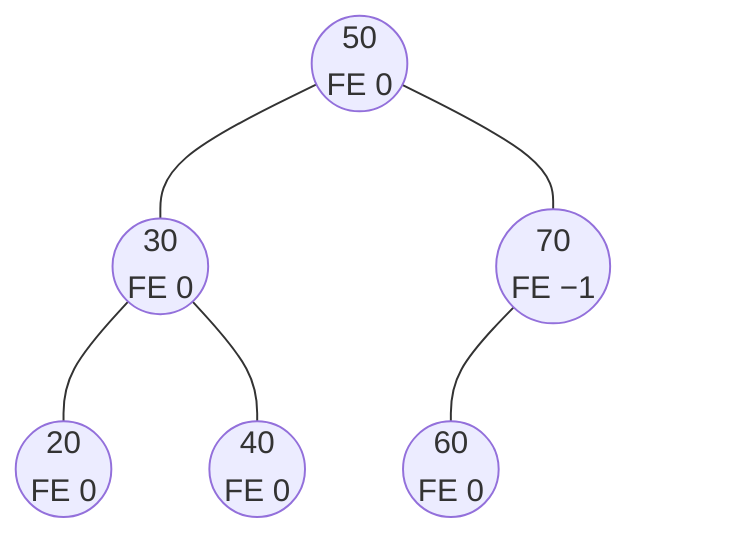

Con esta condición, la altura de un AVL es **O(log n)**, así que buscar, insertar y eliminar son **O(log n)**.

Cada nodo guarda su altura (o su FE) para no tener que recalcularla:

```java
private static class Nodo {
    int info;
    int altura = 0;              // un nodo nuevo es hoja
    Nodo izq, der;
    Nodo(int info) { this.info = info; }
}

private int h(Nodo p) { return p == null ? -1 : p.altura; }
private int fe(Nodo p) { return h(p.der) - h(p.izq); }
private void actualizar(Nodo p) { p.altura = 1 + Math.max(h(p.izq), h(p.der)); }
```

### Rotaciones básicas

Si una inserción o eliminación desbalancea el árbol, se usan **rotaciones**: movimientos de apuntadores que cambian la forma del árbol **sin romper la propiedad del BST**.

**Rotación derecha** sobre la raíz: el hijo izquierdo pasa a ser la nueva raíz.

1. `temp = raiz.izq`
2. `raiz.izq = temp.der`
3. `temp.der = raiz`
4. `raiz = temp`

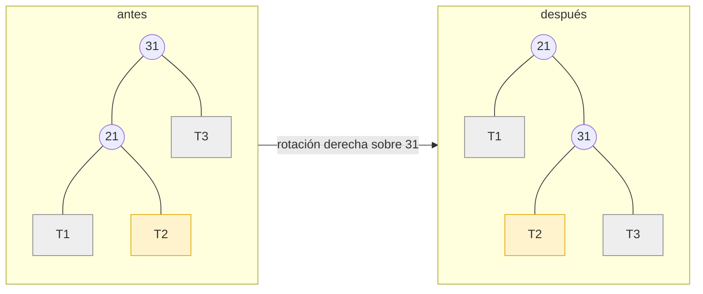

**Rotación izquierda** sobre la raíz: el hijo derecho pasa a ser la nueva raíz (es simétrica).

1. `temp = raiz.der`
2. `raiz.der = temp.izq`
3. `temp.izq = raiz`
4. `raiz = temp`

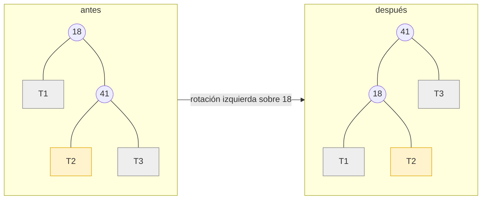

El subárbol T2 cambia de padre, pero sigue entre los dos nodos, así que el árbol sigue siendo un BST.

```java
private Nodo rotarDerecha(Nodo raiz) {
    Nodo temp = raiz.izq;
    raiz.izq = temp.der;
    temp.der = raiz;
    actualizar(raiz);
    actualizar(temp);
    return temp;                 // nueva raíz del subárbol
}

private Nodo rotarIzquierda(Nodo raiz) {
    Nodo temp = raiz.der;
    raiz.der = temp.izq;
    temp.izq = raiz;
    actualizar(raiz);
    actualizar(temp);
    return temp;
}
```

### Los cuatro casos de desbalance

Se inserta o elimina como en un BST. Después, si algún nodo queda con \|FE\| = 2, se revisa su FE y el de su hijo en el lado más alto:

| Caso | FE del padre | FE del hijo | Solución |
|---|---|---|---|
| **I-I** (izquierda-izquierda) | −2 | −1 (hijo izq.) | rotación **derecha** sobre el padre |
| **D-D** (derecha-derecha) | +2 | +1 (hijo der.) | rotación **izquierda** sobre el padre |
| **I-D** (izquierda-derecha) | −2 | +1 (hijo izq.) | rotación **izquierda** sobre el hijo y luego **derecha** sobre el padre |
| **D-I** (derecha-izquierda) | +2 | −1 (hijo der.) | rotación **derecha** sobre el hijo y luego **izquierda** sobre el padre |

Los dos primeros son **rotaciones simples** y los dos últimos **rotaciones compuestas** (dos rotaciones seguidas, que afectan las ligas de tres nodos).

Ejemplo D-D: insertar 10, 20, 30.

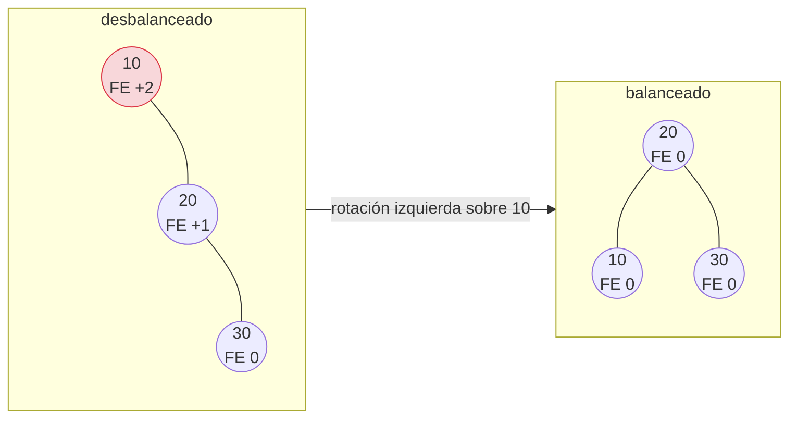

Ejemplo D-I: insertar 10, 30, 20. Una sola rotación izquierda no basta; primero se rota a la derecha el hijo:

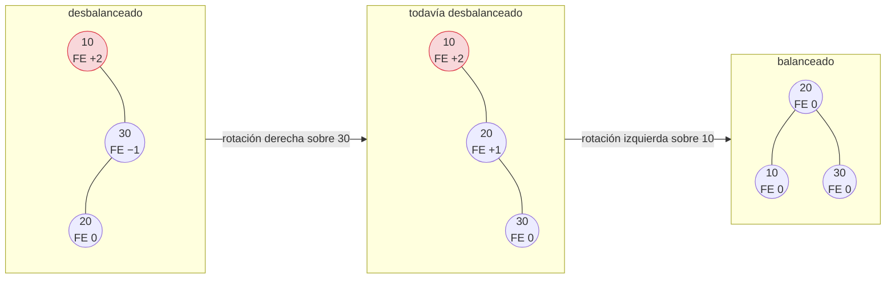

Existen dos casos más que solo aparecen al **eliminar**: padre +2 con hijo 0 (se resuelve como D-D) y padre −2 con hijo 0 (como I-I).

Al **insertar**, una rotación (simple o compuesta) basta para balancear todo el árbol. Al **eliminar**, puede que haya que rotar varias veces, desde el primer nodo desbalanceado hacia arriba hasta la raíz.

### Inserción en un AVL

El libro de texto deja la implementación fuera de su alcance. Con las rotaciones anteriores, la inserción recursiva queda corta: después de insertar en un subárbol, cada nodo del camino de regreso se **rebalancea**.

```java
private Nodo balancear(Nodo p) {
    actualizar(p);
    if (fe(p) == -2) {                             // cargado a la izquierda
        if (fe(p.izq) > 0) p.izq = rotarIzquierda(p.izq);   // caso I-D
        return rotarDerecha(p);                             // caso I-I
    }
    if (fe(p) == 2) {                              // cargado a la derecha
        if (fe(p.der) < 0) p.der = rotarDerecha(p.der);     // caso D-I
        return rotarIzquierda(p);                           // caso D-D
    }
    return p;                                      // ya está balanceado
}

public void insertar(int dato) { raiz = insertar(raiz, dato); }

private Nodo insertar(Nodo p, int dato) {
    if (p == null) return new Nodo(dato);
    if (dato < p.info) p.izq = insertar(p.izq, dato);
    else if (dato > p.info) p.der = insertar(p.der, dato);
    else return p;                                 // repetido
    return balancear(p);
}
```

Si se insertan 1, 3, 5, 6, 7, 8, 9 (el caso que degeneraba en lista en un BST), el AVL queda con altura mínima:

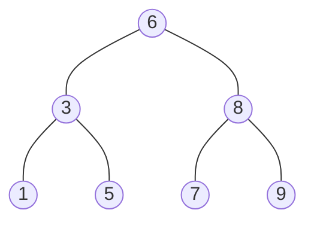

La eliminación es igual a la del BST, llamando a `balancear(p)` antes de cada `return p`.

## Árboles heap

Un **heap** (montículo) es un árbol binario que cumple dos reglas:

1. **Orden**: cada padre tiene **mayor prioridad** que sus hijos. Según la aplicación, la prioridad puede ser el valor **mayor** (*max-heap*) o el **menor** (*min-heap*).
2. **Forma**: es un árbol **completo**: todos los niveles están llenos excepto quizá el último, y las hojas del último nivel están **lo más a la izquierda posible**.

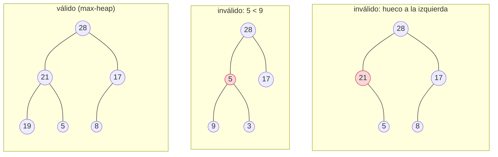

Ojo: un heap **no** es un BST. Solo garantiza que cada padre es mayor que sus hijos; no hay orden entre hermanos.

### Representación en arreglo

Como el heap es completo, se guarda en un arreglo **sin huecos**. El libro de texto empieza en la posición 1 (la 0 no se usa):

- hijos de k: **2k** y **2k + 1**
- padre de k: **k / 2** (división entera)

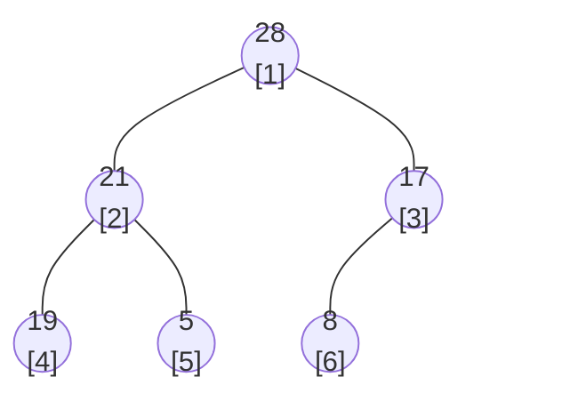

| posición | 1 | 2 | 3 | 4 | 5 | 6 |
|---|---|---|---|---|---|---|
| dato | 28 | 21 | 17 | 19 | 5 | 8 |

Por ejemplo, 21 está en la posición 2 y sus hijos en 2·2 = 4 y 2·2 + 1 = 5.

Las hojas ocupan la segunda mitad del arreglo: son las posiciones **n/2 + 1** a **n**.

### Reacomodo hacia abajo y hacia arriba

Dos operaciones auxiliares restauran la regla de orden:

- **Reacomodo hacia abajo** (*sift-down*): si un nodo tiene menor prioridad que alguno de sus hijos, se intercambia con el hijo de mayor prioridad, y se repite con ese hijo. Termina cuando el padre ya es mayor que sus hijos o cuando llega a una hoja.
- **Reacomodo hacia arriba** (*sift-up*): si un nodo tiene mayor prioridad que su padre (posición k/2), se intercambian, y se repite hacia arriba. Termina cuando el padre es mayor o cuando llega a la raíz.

Ambos recorren a lo más la altura del árbol, que es log n: son **O(log n)**.

### Construir un heap a partir de una lista

Las hojas ya cumplen la regla (no tienen hijos). Se toman los nodos padre **de la posición n/2 hacia la 1** (de abajo hacia arriba y de derecha a izquierda) y a cada uno se le aplica el reacomodo hacia abajo.

Ejemplo del libro: construir un max-heap con 8, 5, 17, 19, 21, 28 (n = 6, se empieza en 6/2 = 3):

| Paso | Nodo | Acción | Arreglo |
|---|---|---|---|
| inicial | | | 8, 5, 17, 19, 21, 28 |
| k = 3 | 17 | su hijo 28 es mayor: intercambiar | 8, 5, **28**, 19, 21, **17** |
| k = 2 | 5 | el mayor de sus hijos (19, 21) es 21: intercambiar | 8, **21**, 28, 19, **5**, 17 |
| k = 1 | 8 | el mayor de sus hijos (21, 28) es 28: intercambiar | **28**, 21, **8**, 19, 5, 17 |
| | 8 | su hijo 17 es mayor: intercambiar | 28, 21, **17**, 19, 5, **8** |

Resultado: `28, 21, 17, 19, 5, 8`.

### Cola de prioridad con un heap

Una **cola de prioridad** (fila priorizada) siempre saca el elemento de **mayor prioridad**, sin importar cuándo entró. El heap la implementa directamente.

**Sacar (`pop`)**: el de mayor prioridad es la raíz.

1. Guardar el valor de la raíz.
2. Mover la **última hoja** (el último del arreglo) a la raíz y eliminar esa hoja.
3. Aplicar el reacomodo hacia abajo desde la raíz.

**Agregar (`push`)**:

1. Insertar el dato como **última hoja** (al final del arreglo).
2. Aplicar el reacomodo hacia arriba desde esa posición.

Ejemplo sobre `28, 21, 17, 19, 5, 8`:

| Operación | Arreglo |
|---|---|
| `push(20)`: va al final, en la posición 7 | 28, 21, 17, 19, 5, 8, **20** |
| su padre (posición 3) es 17 < 20: intercambiar | 28, 21, **20**, 19, 5, 8, **17** |
| su padre (posición 1) es 28 > 20: termina | 28, 21, 20, 19, 5, 8, 17 |
| `pop()` devuelve 28; el último (17) sube a la raíz | **17**, 21, 20, 19, 5, 8 |
| el mayor de sus hijos es 21: intercambiar | **21**, **17**, 20, 19, 5, 8 |
| el mayor de sus hijos es 19: intercambiar | 21, **19**, 20, **17**, 5, 8 |

```java
public class MaxHeap {
    private int[] a;             // a[0] no se usa
    private int n = 0;           // número de elementos

    public MaxHeap(int capacidad) { a = new int[capacidad + 1]; }

    /** Construye un heap a partir de una lista de datos. */
    public MaxHeap(int[] datos) {
        a = new int[datos.length + 1];
        n = datos.length;
        System.arraycopy(datos, 0, a, 1, n);
        for (int k = n / 2; k >= 1; k--)           // de los padres hacia la raíz
            bajar(k);
    }

    public boolean vacio() { return n == 0; }

    public void push(int dato) {
        if (n == a.length - 1) a = Arrays.copyOf(a, 2 * a.length);   // crecer
        a[++n] = dato;           // última hoja
        subir(n);
    }

    public int pop() {
        if (vacio()) throw new NoSuchElementException("Heap vacío");
        int max = a[1];
        a[1] = a[n--];           // la última hoja pasa a la raíz
        bajar(1);
        return max;
    }

    private void subir(int k) {
        while (k > 1 && a[k / 2] < a[k]) {
            intercambiar(k, k / 2);
            k = k / 2;
        }
    }

    private void bajar(int k) {
        while (2 * k <= n) {                       // mientras tenga hijos
            int hijo = 2 * k;
            if (hijo + 1 <= n && a[hijo + 1] > a[hijo]) hijo++;   // el hijo mayor
            if (a[k] >= a[hijo]) break;
            intercambiar(k, hijo);
            k = hijo;
        }
    }

    private void intercambiar(int i, int j) { int t = a[i]; a[i] = a[j]; a[j] = t; }
}
```

| Operación | Tiempo |
|---|---|
| `push` | O(log n) |
| `pop` | O(log n) |
| consultar el máximo (`a[1]`) | O(1) |
| construir a partir de una lista | O(n) |

Comparado con una lista: si la lista está ordenada, sacar es O(1) pero insertar es O(n); si no está ordenada, insertar es O(1) pero sacar es O(n). El heap hace ambas en O(log n).

En Java, `java.util.PriorityQueue` es un heap. Por omisión es un **min-heap**; para que saque el mayor se le pasa un comparador:

```java
PriorityQueue<Integer> pq = new PriorityQueue<>(Comparator.reverseOrder());
pq.offer(8); pq.offer(21); pq.offer(5);
System.out.println(pq.poll());   // 21
```

## Trie

El **trie** (de *retrieval*, recuperación), o **árbol de prefijos**, sirve para problemas con **cadenas**: diccionarios, autocompletado, corrector ortográfico.

- Cada nodo representa **un carácter**.
- Los hijos de un nodo son los caracteres que pueden seguir a ese prefijo.
- La raíz es el **carácter vacío** (está al principio de cualquier palabra).
- Cada nodo indica si en él **termina una palabra**.

Trie con las palabras *loco, loca, lapiz, poca, pozo* (en verde, los nodos donde termina una palabra):

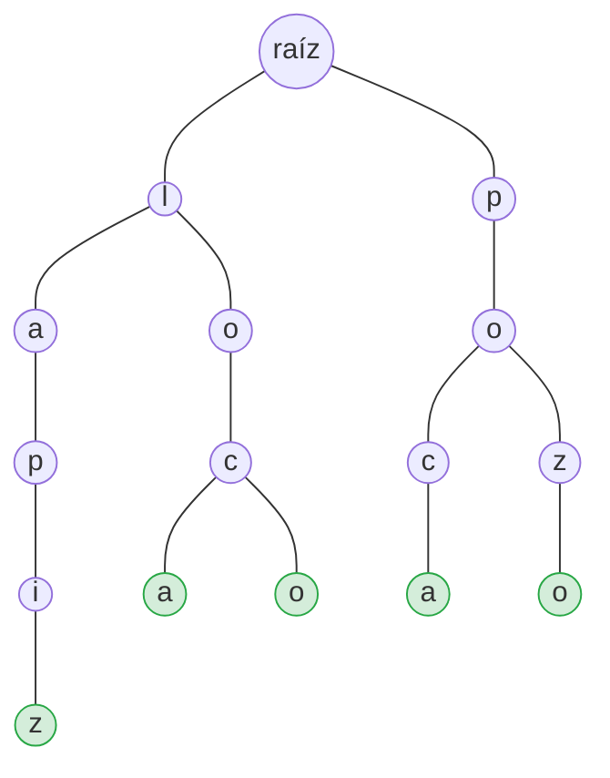

Las palabras que comparten prefijo (*loco* y *loca* comparten *loc*) comparten nodos.

```java
public class Trie {
    private static class Nodo {
        Map<Character, Nodo> hijos = new TreeMap<>();
        boolean finDePalabra = false;
    }

    private final Nodo raiz = new Nodo();

    public void insertar(String palabra) {
        Nodo p = raiz;
        for (char c : palabra.toCharArray())
            p = p.hijos.computeIfAbsent(c, k -> new Nodo());   // getChild o addChild
        p.finDePalabra = true;
    }

    /** Baja por el trie siguiendo s; devuelve null si el camino no existe. */
    private Nodo recorrer(String s) {
        Nodo p = raiz;
        for (char c : s.toCharArray()) {
            p = p.hijos.get(c);
            if (p == null) return null;
        }
        return p;
    }

    public boolean buscar(String palabra) {
        Nodo p = recorrer(palabra);
        return p != null && p.finDePalabra;
    }

    public boolean empiezaCon(String prefijo) { return recorrer(prefijo) != null; }
}
```

Con el trie del ejemplo: `buscar("loca")` es `true`, `buscar("lo")` es `false` (es prefijo, pero no palabra) y `empiezaCon("lo")` es `true`.

Insertar o buscar una palabra de longitud m es **O(m)**, sin importar cuántas palabras tenga el trie.

## Splay tree

Un **splay tree** es un BST que, cada vez que se **busca o inserta** un elemento, lo **sube hasta la raíz** con rotaciones. Así, los elementos usados recientemente quedan cerca de la raíz y buscarlos de nuevo es más rápido. La forma del árbol cambia según los accesos.

La operación **splay** sube el nodo x uno o dos niveles por paso, según su posición respecto a su padre y su abuelo:

| Caso | Situación | Acción |
|---|---|---|
| **Zig** (o Zag) | x es hijo de la raíz (no tiene abuelo) | una rotación simple |
| **Zig-Zig** (o Zag-Zag) | x y su padre son ambos hijos izquierdos (o ambos derechos) | primero se rota el abuelo y luego el padre |
| **Zig-Zag** (o Zag-Zig) | x es hijo derecho y su padre es hijo izquierdo (o al revés) | primero se rota el padre y luego el abuelo |

**Zig-Zig**: x es hijo izquierdo de un hijo izquierdo.

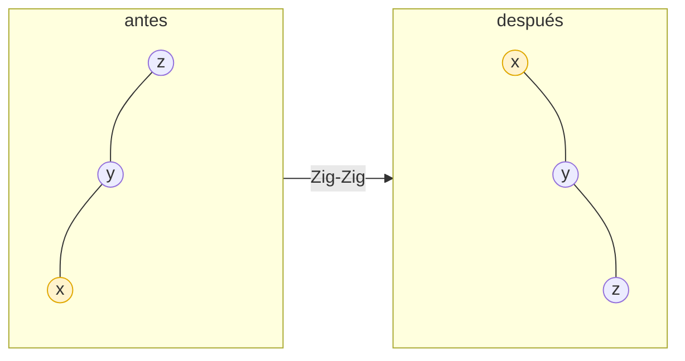

**Zig-Zag**: x es hijo derecho de un hijo izquierdo.

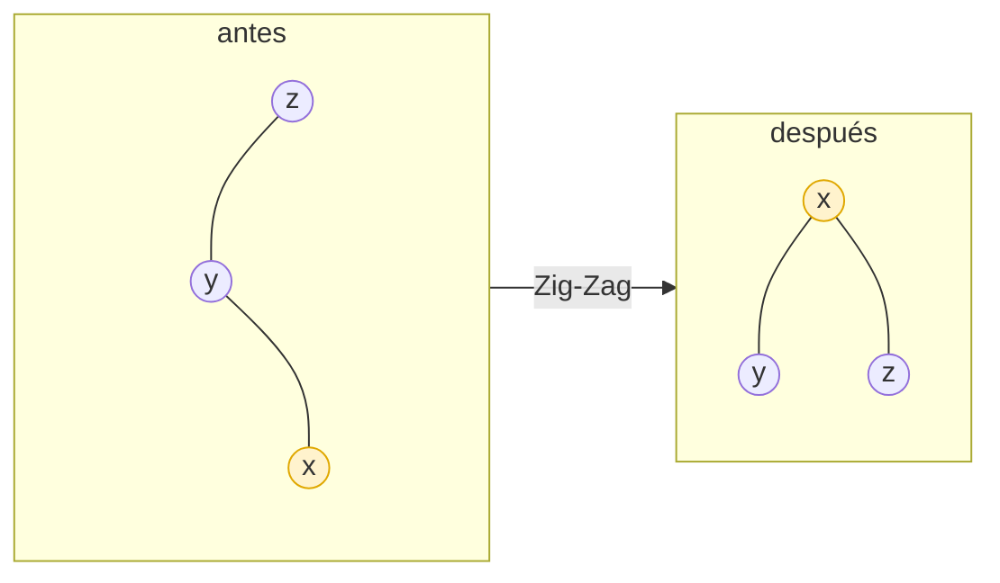

No garantiza que cada operación sea O(log n), pero con **análisis amortizado** se demuestra que una secuencia de m operaciones sobre un árbol de n nodos cuesta **O((m + n) log(n + m))**: en promedio, **O(log n)** por operación. Las rotaciones dobles (y no subir el nodo con rotaciones simples) son las que logran que el árbol tienda a acortarse.

## En la biblioteca de Java

| Estructura | Clase de `java.util` | Implementación |
|---|---|---|
| Conjunto ordenado | `TreeSet<E>` | árbol rojo-negro (un BST balanceado) |
| Mapa ordenado | `TreeMap<K, V>` | árbol rojo-negro |
| Cola de prioridad | `PriorityQueue<E>` | heap binario en arreglo |

```java
TreeSet<Integer> s = new TreeSet<>(List.of(710, 689, 2000, 143, 702));
System.out.println(s);              // [143, 689, 702, 710, 2000]  (inorden)
System.out.println(s.first());      // 143
System.out.println(s.ceiling(700)); // 702: el menor que es ≥ 700
```

## Resumen de costos

| Estructura | Buscar | Insertar | Eliminar |
|---|---|---|---|
| BST (promedio) | O(log n) | O(log n) | O(log n) |
| BST (peor caso) | O(n) | O(n) | O(n) |
| AVL | O(log n) | O(log n) | O(log n) |
| Splay tree (amortizado) | O(log n) | O(log n) | O(log n) |
| Heap | O(n) (O(1) para el máximo) | O(log n) | O(log n) (el máximo) |
| Trie (palabra de longitud m) | O(m) | O(m) | O(m) |

## Ejercicios

Del libro de texto:

1. Para el BST de la sección [Árbol binario de búsqueda](#árbol-binario-de-búsqueda-bst) (el de raíz 710):
   1. Dibuje el árbol que resulta de insertar 10 y 900, en ese orden.
   2. Dibuje el árbol que resulta de eliminar 2000.
   3. Dibuje el árbol que resulta de eliminar 710, 143 y 3300, en ese orden.
   4. Calcule el FE de cada nodo y diga si es un AVL.
2. Dibuje el árbol AVL que resulta de insertar, en este orden: 3, 5, 7, 9, 11, 10 y 12.
3. Dibuje el max-heap y su arreglo para cada lista:
   1. 14, 10, 8, 25, 73, 5, 43, 17, 43, 23
   2. 1, 5, 2, 8, 7, 9, 10, 3, 6, 4
4. Para el heap del ejercicio 3.1, ¿cómo quedan el árbol y el arreglo después de un `pop()`?

De Goodrich:

5. Dibuje el BST que resulta de insertar las claves 1, 2, 3, 4 y 5, en ese orden.
6. Inserte en un BST vacío las claves 30, 40, 24, 58, 48, 26, 11 y 13, en ese orden. Dibuje el árbol después de cada inserción.
7. ¿Cuántos BST distintos pueden guardar las claves {1, 2, 3}?
8. Alguien afirma que el orden en que se insertan las claves en un BST no importa: siempre resulta el mismo árbol. Dé un ejemplo pequeño que demuestre que se equivoca. ¿Pasa lo mismo con un AVL?
9. En el árbol de Goodrich (figura 11.1), calcule `piso(50)`, `inferior(17)` y `rango(20, 60)`.

Programación:

1. Agregue a `BST` los métodos `altura()`, `contarHojas()`, `techo(k)` (menor clave ≥ k) y `superior(k)` (menor clave > k).
2. Escriba `insertar` sin recursión.
3. Agregue a `BSTMap` el método `remove(k)`.
4. Escriba un método que diga si un árbol binario cualquiera es un BST. (Pista: no basta con comparar cada nodo con sus hijos.)
5. Implemente `eliminar` en el AVL.
6. Ordene un arreglo usando un `MaxHeap`: construya el heap y haga `pop()` n veces. ¿Cuál es el costo?
7. Agregue al trie un método que devuelva todas las palabras que empiezan con un prefijo dado.
8. Use `TreeSet` y `PriorityQueue` para comprobar sus respuestas a los ejercicios 1 y 3.

[⬅️ Volver a Árboles](./arboles.md) · [⬅️ Volver a la Unidad II](./index.md)
