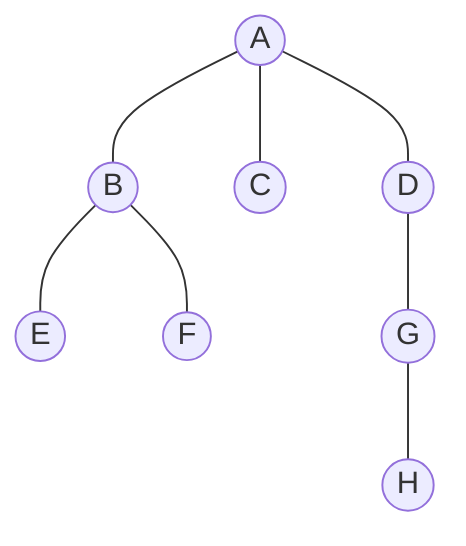
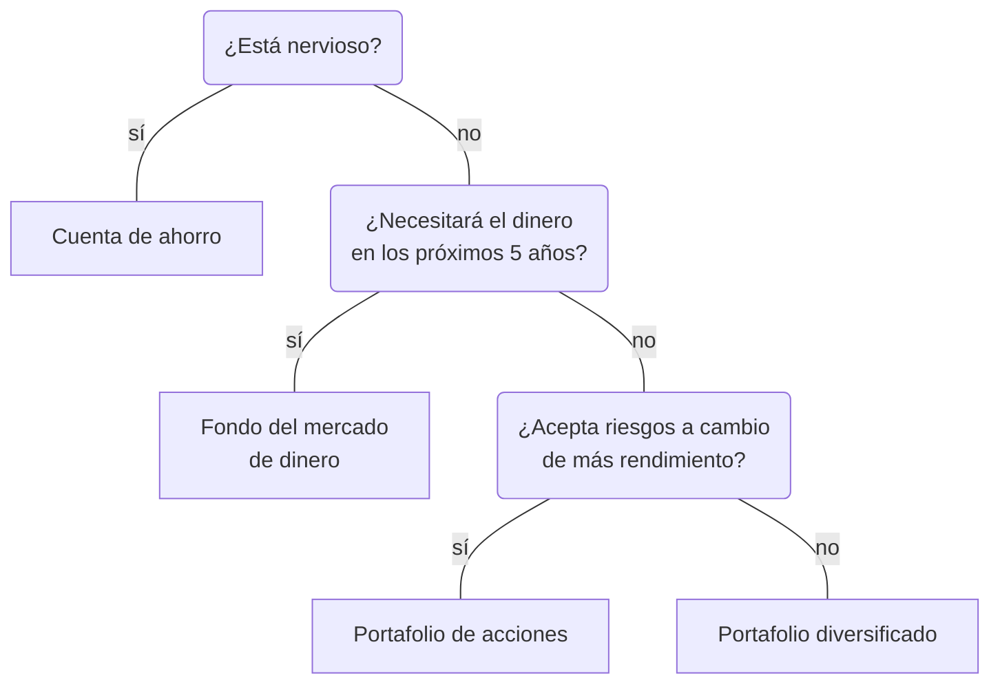
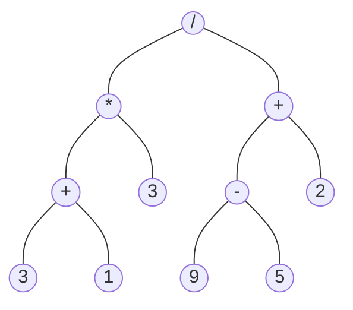
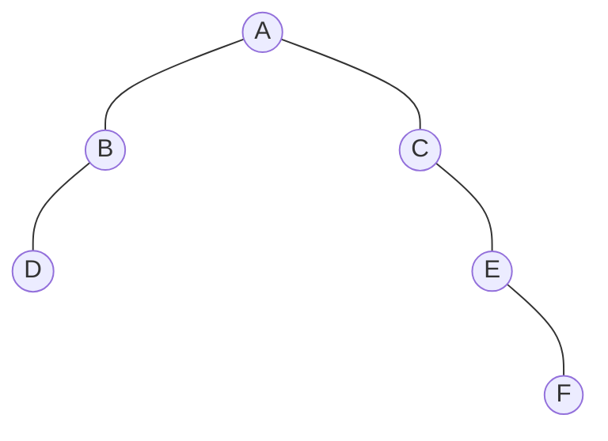
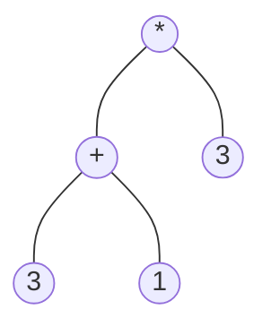
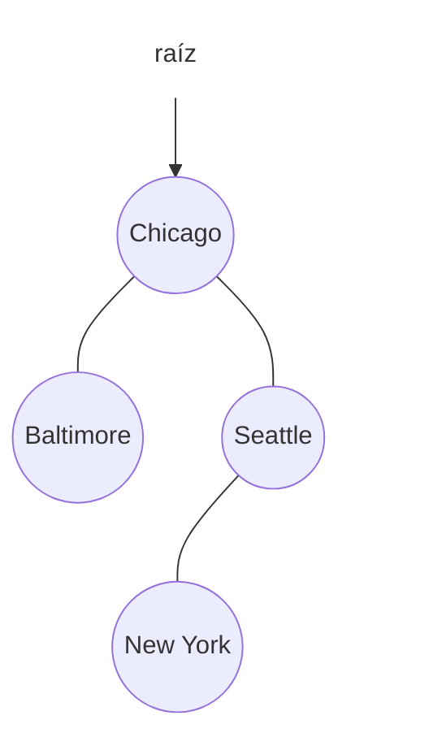
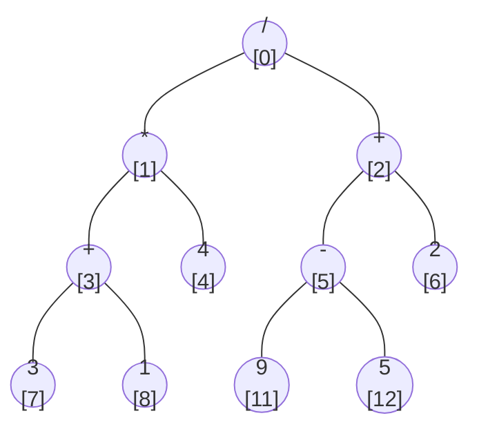
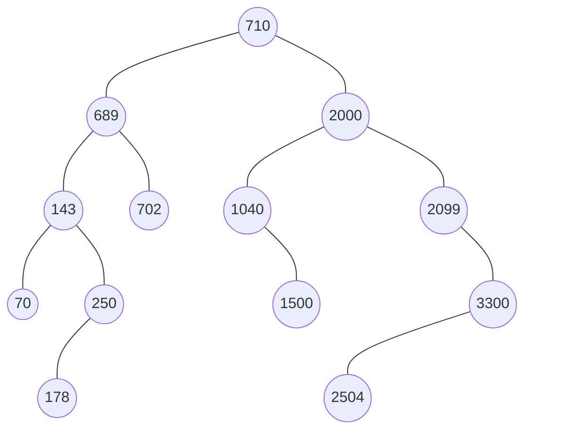
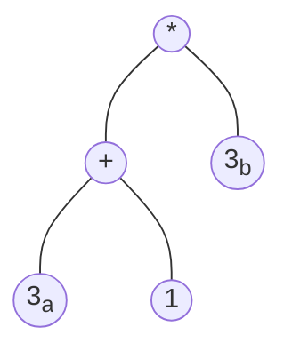
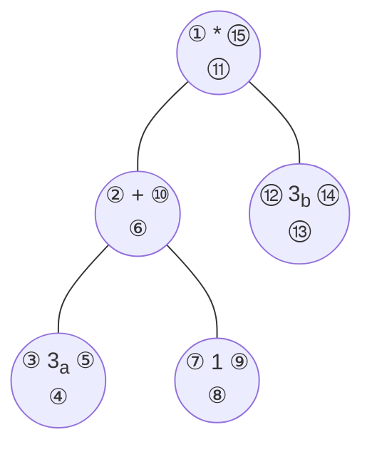

Resumen basado en el libro de texto (de la Cueva et al., *Estructura de datos y algoritmos fundamentales*), capítulo 9 (Estructuras de datos jerárquicas), y en Goodrich, *Data Structures and Algorithms in Java*, capítulo 8 (Trees). El libro de texto presenta el código en C++; aquí se muestra en Java. Todo el código usa la [recursión](./recursion.md) y los [genéricos](./genericos.md) vistos en esta unidad.

## Estructuras lineales y jerárquicas

Las estructuras que hemos visto hasta ahora ([listas](./listas-enlazadas.md), [pilas](./pilas.md), [colas](./colas.md)) son **lineales**: cada dato tiene un predecesor (excepto el primero) y un sucesor (excepto el último).

Una estructura **jerárquica** es no lineal: cada dato tiene **exactamente un predecesor**, excepto el primero, que no tiene ninguno, y puede tener **de 0 a n sucesores**. Dibujada con el primero arriba y sus sucesores hacia abajo, parece un organigrama o un árbol genealógico. Por eso se le llama **árbol**: es un árbol "al revés", con la raíz arriba y las ramas hacia abajo.

Ejemplos de árboles en computación:

- El **sistema de archivos**: los directorios son nodos internos y los archivos son hojas.
- La **estructura de un libro**: libro → partes → capítulos → secciones → párrafos.
- El **organigrama** de una empresa.
- Las **expresiones aritméticas**: los operadores son nodos internos y los operandos son hojas.
- La **jerarquía de clases** en Java.

## Definición

Goodrich define un árbol T como un conjunto de **nodos** que guardan elementos, con una relación padre-hijo que cumple:

- Si T no está vacío, tiene un nodo especial, la **raíz**, que no tiene padre.
- Cada nodo distinto de la raíz tiene **un único padre**; todo nodo cuyo padre es w es **hijo** de w.

Esto permite una **definición recursiva**: un árbol es **vacío**, o es un nodo raíz r con un conjunto (posiblemente vacío) de **subárboles** cuyas raíces son los hijos de r.

## Terminología

Usaremos este árbol de ejemplo:



| Término | Definición | En el ejemplo |
|---|---|---|
| **Nodo** | cada elemento del árbol | A, B, …, H |
| **Arco** o **arista** | línea que une a un nodo con su hijo | (A, B), (D, G), … |
| **Raíz** | el único nodo sin padre | A |
| **Hoja** (nodo externo o terminal) | nodo sin hijos | E, F, C, H |
| **Nodo interno** (intermedio) | nodo con al menos un hijo | A, B, D, G |
| **Padre** | el nodo que apunta a otro | B es padre de E |
| **Hijo** | el nodo apuntado por otro | E es hijo de B |
| **Hermanos** | nodos con el mismo padre | B, C y D |
| **Ancestro** | el padre, el padre del padre, etc. | A y D son ancestros de G |
| **Descendiente** | el hijo, el hijo del hijo, etc. | G y H son descendientes de D |
| **Subárbol** de v | v con todos sus descendientes | el subárbol de D es {D, G, H} |
| **Camino** | secuencia de nodos unidos por aristas | A-D-G-H |
| **Rama** | camino de la raíz a una hoja | A-B-E |
| **Grado de un nodo** | número de hijos | grado(A) = 3, grado(D) = 1 |
| **Grado del árbol** | el mayor grado de sus nodos | 3 |

Un árbol es **ordenado** si el orden entre los hijos de cada nodo tiene significado (primero, segundo, …), como los capítulos de un libro. Un organigrama, en cambio, suele ser un árbol no ordenado.

### Profundidad, nivel y altura

- **Profundidad** o **nivel** de un nodo: número de aristas desde la raíz hasta el nodo. La raíz tiene nivel 0. En el ejemplo, nivel(G) = 2.
- **Altura** de un nodo: número de aristas del camino más largo desde ese nodo hasta una hoja. Una hoja tiene altura 0. En el ejemplo, altura(D) = 2.
- **Altura del árbol**: la altura de la raíz, que es igual a la mayor profundidad de sus hojas. En el ejemplo es 3.

### Cálculo recursivo de profundidad y altura

Ambas se definen recursivamente:

- **Profundidad** de p: si p es la raíz, 0; si no, 1 + profundidad del padre de p.
- **Altura** de p: si p es hoja, 0; si no, 1 + la mayor altura de sus hijos.

```java
public int depth(Position<E> p) {
    if (isRoot(p)) return 0;
    return 1 + depth(parent(p));
}

public int height(Position<E> p) {
    int h = 0;                          // caso base: p es hoja
    for (Position<E> c : children(p))
        h = Math.max(h, 1 + height(c));
    return h;
}
```

- `depth(p)` es **O(d + 1)**, donde d es la profundidad de p (sube un nivel por llamada).
- `height(raíz)` es **O(n)**: visita cada nodo una vez. Esto se justifica porque la suma del número de hijos de todos los nodos es **n − 1** (cada nodo, menos la raíz, es hijo de alguien).

Goodrich muestra también un `heightBad()` que calcula `depth` de cada hoja y toma el máximo. Funciona, pero en el peor caso es **O(n²)**.

## El ADT Árbol (Goodrich)

Goodrich define el árbol usando **posiciones** (`Position<E>`), igual que en la lista posicional: una posición representa a un nodo y tiene el método `getElement()`.

| Método | Descripción |
|---|---|
| `root()` | posición de la raíz (o `null` si está vacío) |
| `parent(p)` | posición del padre de p (o `null` si p es la raíz) |
| `children(p)` | colección iterable con los hijos de p |
| `numChildren(p)` | número de hijos de p |
| `isInternal(p)` | `true` si p tiene al menos un hijo |
| `isExternal(p)` | `true` si p no tiene hijos |
| `isRoot(p)` | `true` si p es la raíz |
| `size()`, `isEmpty()` | número de nodos, ¿está vacío? |
| `iterator()`, `positions()` | iteran sobre los elementos o sobre las posiciones |

```java
public interface Tree<E> extends Iterable<E> {
    Position<E> root();
    Position<E> parent(Position<E> p) throws IllegalArgumentException;
    Iterable<Position<E>> children(Position<E> p) throws IllegalArgumentException;
    int numChildren(Position<E> p) throws IllegalArgumentException;
    boolean isInternal(Position<E> p) throws IllegalArgumentException;
    boolean isExternal(Position<E> p) throws IllegalArgumentException;
    boolean isRoot(Position<E> p) throws IllegalArgumentException;
    int size();
    boolean isEmpty();
    Iterator<E> iterator();
    Iterable<Position<E>> positions();
}
```

Muchos métodos se pueden escribir **sin saber cómo está implementado el árbol**, usando solo `root()`, `parent(p)` y `children(p)`. Por eso Goodrich los pone en una clase abstracta:

```java
public abstract class AbstractTree<E> implements Tree<E> {
    public boolean isInternal(Position<E> p) { return numChildren(p) > 0; }
    public boolean isExternal(Position<E> p) { return numChildren(p) == 0; }
    public boolean isRoot(Position<E> p) { return p == root(); }
    public boolean isEmpty() { return size() == 0; }
    // depth(p) y height(p) también van aquí
}
```

## Árbol binario

Un **árbol binario** es un árbol ordenado en el que:

1. Cada nodo tiene **como máximo dos hijos** (es un árbol de grado 2).
2. Cada hijo es **hijo izquierdo** o **hijo derecho**.
3. El hijo izquierdo va antes que el derecho.

El subárbol que cuelga del hijo izquierdo es el **subárbol izquierdo**; el del derecho, el **subárbol derecho**.

Definición recursiva: un árbol binario es **vacío**, o es un nodo raíz con dos árboles binarios (izquierdo y derecho), cualquiera de los cuales puede ser vacío.

Un árbol binario es **propio** (o **lleno**, *full*) si cada nodo tiene **0 o 2 hijos**. Si no, es **impropio**.

### Ejemplos

**Árbol de decisión.** Cada nodo interno es una pregunta de sí/no y cada hoja es una decisión. Es un árbol binario propio.



**Árbol de expresión.** Las hojas son números o variables y los nodos internos son operadores. El valor de un nodo interno es el resultado de aplicar su operador a los valores de sus hijos. Este árbol representa `((3 + 1) * 3) / ((9 - 5) + 2)`:



### El ADT Árbol binario

Agrega tres métodos al ADT Árbol:

| Método | Descripción |
|---|---|
| `left(p)` | hijo izquierdo de p (o `null`) |
| `right(p)` | hijo derecho de p (o `null`) |
| `sibling(p)` | hermano de p (o `null` si p es la raíz o es hijo único) |

```java
public interface BinaryTree<E> extends Tree<E> {
    Position<E> left(Position<E> p) throws IllegalArgumentException;
    Position<E> right(Position<E> p) throws IllegalArgumentException;
    Position<E> sibling(Position<E> p) throws IllegalArgumentException;
}
```

Con `left` y `right`, la clase abstracta puede implementar `sibling`, `numChildren` y `children`:

```java
public abstract class AbstractBinaryTree<E> extends AbstractTree<E>
                                            implements BinaryTree<E> {
    public Position<E> sibling(Position<E> p) {
        Position<E> parent = parent(p);
        if (parent == null) return null;            // p es la raíz
        if (p == left(parent)) return right(parent);
        else return left(parent);
    }

    public int numChildren(Position<E> p) {
        int count = 0;
        if (left(p) != null) count++;
        if (right(p) != null) count++;
        return count;
    }

    public Iterable<Position<E>> children(Position<E> p) {
        List<Position<E>> snapshot = new ArrayList<>(2);
        if (left(p) != null) snapshot.add(left(p));
        if (right(p) != null) snapshot.add(right(p));
        return snapshot;
    }
}
```

### Propiedades

El nivel d de un árbol binario tiene **como máximo 2^d nodos** (1, 2, 4, 8, …). De ahí salen estas relaciones, donde n es el número de nodos, h la altura, n<sub>E</sub> el número de hojas y n<sub>I</sub> el de nodos internos:

| Propiedad | Árbol binario | Árbol binario propio |
|---|---|---|
| Nodos | h + 1 ≤ n ≤ 2^(h+1) − 1 | 2h + 1 ≤ n ≤ 2^(h+1) − 1 |
| Hojas | 1 ≤ n<sub>E</sub> ≤ 2^h | h + 1 ≤ n<sub>E</sub> ≤ 2^h |
| Nodos internos | h ≤ n<sub>I</sub> ≤ 2^h − 1 | h ≤ n<sub>I</sub> ≤ 2^h − 1 |
| Altura | log(n + 1) − 1 ≤ h ≤ n − 1 | log(n + 1) − 1 ≤ h ≤ (n − 1)/2 |

Además, en un árbol binario **propio**: **n<sub>E</sub> = n<sub>I</sub> + 1** (hay una hoja más que nodos internos).

#### Ejemplo: árbol binario (impropio)



No es propio: B, C y E tienen un solo hijo. Sus medidas son n = 6, h = 3, n<sub>E</sub> = 2 (D y F) y n<sub>I</sub> = 4 (A, B, C y E).

| Propiedad | Cota | Se cumple |
|---|---|---|
| Nodos | 3 + 1 = 4 ≤ **6** ≤ 2^4 − 1 = 15 | ✓ |
| Hojas | 1 ≤ **2** ≤ 2^3 = 8 | ✓ |
| Nodos internos | 3 ≤ **4** ≤ 2^3 − 1 = 7 | ✓ |
| Altura | log(7) − 1 ≈ 1.81 ≤ **3** ≤ 6 − 1 = 5 | ✓ |

En este árbol, n<sub>E</sub> = 2 y n<sub>I</sub> + 1 = 5. La relación n<sub>E</sub> = n<sub>I</sub> + 1 **no se cumple**, porque solo vale para árboles propios.

#### Ejemplo: árbol binario propio

El árbol de expresión de `(3 + 1) * 3`:



Es propio: cada nodo tiene 0 o 2 hijos. Sus medidas son n = 5, h = 2, n<sub>E</sub> = 3 (las hojas 3, 1 y 3) y n<sub>I</sub> = 2 (`*` y `+`).

| Propiedad | Cota | Se cumple |
|---|---|---|
| Nodos | 2·2 + 1 = 5 ≤ **5** ≤ 2^3 − 1 = 7 | ✓ (en el mínimo) |
| Hojas | 2 + 1 = 3 ≤ **3** ≤ 2^2 = 4 | ✓ (en el mínimo) |
| Nodos internos | 2 ≤ **2** ≤ 2^2 − 1 = 3 | ✓ (en el mínimo) |
| Altura | log(6) − 1 ≈ 1.58 ≤ **2** ≤ (5 − 1)/2 = 2 | ✓ (en el máximo) |
| n<sub>E</sub> = n<sub>I</sub> + 1 | 3 = 2 + 1 | ✓ |

Este árbol queda justo en los extremos: es el árbol propio **más alto** que se puede formar con 5 nodos. En el otro extremo, si se completa el último nivel (agregando dos hijos a la hoja 3 de la derecha), resulta un árbol de altura 2 con el **máximo** de nodos: n = 2^3 − 1 = 7, n<sub>E</sub> = 2^2 = 4 y n<sub>I</sub> = 2^2 − 1 = 3.

En las tablas, log es logaritmo base 2.

La consecuencia más importante: la altura de un árbol binario con n nodos está entre **log n** (árbol "lleno") y **n − 1** (árbol que degenera en una lista). Las operaciones que bajan por el árbol cuestan O(h), así que conviene que el árbol sea **bajo**.

## Implementación de árboles

### Estructura enlazada para árboles binarios

Cada nodo guarda su elemento y referencias a su **padre**, su **hijo izquierdo** y su **hijo derecho** (cualquiera puede ser `null`). El árbol guarda una referencia a la **raíz** y el **tamaño**.



El libro de texto define el nodo así (ADT):

```
NodoÁrbolBinario(T)
  info: T
  hijoIzquierdo: NodoÁrbolBinario(T)
  hijoDerecho:   NodoÁrbolBinario(T)
  Constructor: recibe el dato y crea un nodo con sus dos hijos nulos
```

Goodrich implementa `LinkedBinaryTree<E>` con un nodo anidado que también es una `Position<E>`:

```java
public class LinkedBinaryTree<E> extends AbstractBinaryTree<E> {
    protected static class Node<E> implements Position<E> {
        private E element;
        private Node<E> parent, left, right;
        public Node(E e, Node<E> above, Node<E> leftChild, Node<E> rightChild) {
            element = e; parent = above; left = leftChild; right = rightChild;
        }
        public E getElement() { return element; }
        // getters y setters de parent, left, right y element
    }

    protected Node<E> root = null;
    private int size = 0;

    public int size() { return size; }
    public Position<E> root() { return root; }
    public Position<E> parent(Position<E> p) { return validate(p).getParent(); }
    public Position<E> left(Position<E> p) { return validate(p).getLeft(); }
    public Position<E> right(Position<E> p) { return validate(p).getRight(); }
    // ...
}
```

`validate(p)` convierte la posición a `Node` y lanza `IllegalArgumentException` si no es válida. Por convención, un nodo eliminado tiene `parent` apuntando a sí mismo, así se reconoce como inválido.

Métodos de actualización, todos **O(1)**:

| Método | Descripción |
|---|---|
| `addRoot(e)` | crea la raíz de un árbol vacío |
| `addLeft(p, e)` | crea el hijo izquierdo de p (error si ya tiene) |
| `addRight(p, e)` | crea el hijo derecho de p (error si ya tiene) |
| `set(p, e)` | reemplaza el elemento de p y devuelve el anterior |
| `attach(p, T1, T2)` | cuelga T1 y T2 como subárboles izquierdo y derecho de la hoja p |
| `remove(p)` | elimina p y lo reemplaza por su único hijo (error si tiene dos) |

```java
public Position<E> addLeft(Position<E> p, E e) throws IllegalArgumentException {
    Node<E> parent = validate(p);
    if (parent.getLeft() != null)
        throw new IllegalArgumentException("p ya tiene hijo izquierdo");
    Node<E> child = new Node<>(e, parent, null, null);
    parent.setLeft(child);
    size++;
    return child;
}

public E remove(Position<E> p) throws IllegalArgumentException {
    Node<E> node = validate(p);
    if (numChildren(p) == 2)
        throw new IllegalArgumentException("p tiene dos hijos");
    Node<E> child = (node.getLeft() != null ? node.getLeft() : node.getRight());
    if (child != null)
        child.setParent(node.getParent());   // el abuelo pasa a ser su padre
    if (node == root)
        root = child;
    else {
        Node<E> parent = node.getParent();
        if (node == parent.getLeft()) parent.setLeft(child);
        else parent.setRight(child);
    }
    size--;
    E temp = node.getElement();
    node.setElement(null);                   // ayuda al recolector de basura
    node.setLeft(null);
    node.setRight(null);
    node.setParent(node);                    // convención: nodo inválido
    return temp;
}
```

Ejemplo de uso, construyendo el árbol de expresión `(3 + 1) * 3`:

```java
LinkedBinaryTree<String> t = new LinkedBinaryTree<>();
Position<String> por = t.addRoot("*");
Position<String> mas = t.addLeft(por, "+");
t.addRight(por, "3");
t.addLeft(mas, "3");
t.addRight(mas, "1");
```

Costos de `LinkedBinaryTree`:

| Método | Tiempo |
|---|---|
| `size`, `isEmpty` | O(1) |
| `root`, `parent`, `left`, `right`, `sibling`, `children`, `numChildren` | O(1) |
| `isInternal`, `isExternal`, `isRoot` | O(1) |
| `addRoot`, `addLeft`, `addRight`, `set`, `attach`, `remove` | O(1) |
| `depth(p)` | O(d + 1) |
| `height` | O(n) |

Espacio: **O(n)**.

### Representación con arreglo

Se numeran las posiciones **por niveles**, de izquierda a derecha (*level numbering*). Goodrich empieza en 0:

- La raíz está en el índice **0**.
- El hijo izquierdo de i está en **2i + 1**.
- El hijo derecho de i está en **2i + 2**.
- El padre de i está en **⌊(i − 1) / 2⌋**.



| índice | 0 | 1 | 2 | 3 | 4 | 5 | 6 | 7 | 8 | 9 | 10 | 11 | 12 |
|---|---|---|---|---|---|---|---|---|---|---|---|---|---|
| dato | / | * | + | + | 4 | - | 2 | 3 | 1 | | | 9 | 5 |

El libro de texto (para el heap) empieza en **1**, sin usar la casilla 0. Entonces las fórmulas quedan más simples: hijos en **2k** y **2k + 1**, padre en **k / 2**.

Ventajas y desventajas:

- **+** Una posición es solo un entero, y `parent`, `left` y `right` son operaciones aritméticas.
- **−** Las posiciones que no existen dejan **huecos** en el arreglo. En el peor caso el arreglo necesita **2^n − 1** casillas para n nodos.
- **−** Algunas actualizaciones son caras: eliminar un nodo y subir a su hijo es **O(n)**, porque hay que mover todos sus descendientes.

Funciona muy bien para árboles **completos**, como el [heap](./arboles-busqueda.md#árboles-heap), donde no hay huecos.

### Estructura enlazada para árboles generales

Si un nodo puede tener cualquier número de hijos, cada nodo guarda una **colección** (arreglo o lista) con referencias a sus hijos:

```java
class NodoGeneral<E> {
    E element;
    NodoGeneral<E> parent;
    List<NodoGeneral<E>> children = new ArrayList<>();
}
```

`children(p)` es O(c + 1), donde c es el número de hijos de p. El resto de los accesos son O(1).

## Recorridos

Un **recorrido** visita **todos los nodos** del árbol, **una sola vez cada uno**. "Visitar" un nodo significa hacer algo con él: imprimirlo, sumarlo, borrarlo, etc. Los recorridos son O(n).

Usaremos el árbol binario de búsqueda del libro de texto (figura 9.8):



### Preorden, inorden y posorden

Los tres recorridos se definen recursivamente y se diferencian en **cuándo se visita la raíz** del subárbol actual:

| Recorrido | Algoritmo | Resultado en el ejemplo |
|---|---|---|
| **Preorden** | 1) visitar la raíz; 2) recorrer el izquierdo; 3) recorrer el derecho | 710 689 143 70 250 178 702 2000 1040 1500 2099 3300 2504 |
| **Inorden** | 1) recorrer el izquierdo; 2) visitar la raíz; 3) recorrer el derecho | 70 143 178 250 689 702 710 1040 1500 2000 2099 2504 3300 |
| **Posorden** | 1) recorrer el izquierdo; 2) recorrer el derecho; 3) visitar la raíz | 70 178 250 143 702 689 1500 1040 2504 3300 2099 2000 710 |

El **inorden** solo tiene sentido en árboles binarios (necesita "izquierdo" y "derecho"). Preorden y posorden sirven para cualquier árbol: se recorren los hijos en orden.

Para un árbol general (Goodrich):

```
preorden(p):                       posorden(p):
  visitar p                          para cada hijo c de p:
  para cada hijo c de p:               posorden(c)
    preorden(c)                      visitar p
```

#### Siguiendo las llamadas recursivas

El libro de texto rastrea el preorden numerando cada llamada (llamada.paso). Los primeros pasos:

```
1.1  visitar 710                          → 710
1.2  recorrer izquierdo de 710 (llamada 2)
  2.1  visitar 689                        → 710 689
  2.2  recorrer izquierdo de 689 (llamada 3)
    3.1  visitar 143                      → 710 689 143
    3.2  recorrer izquierdo de 143 (llamada 4)
      4.1  visitar 70                     → 710 689 143 70
      4.2  70 no tiene izquierdo
      4.3  70 no tiene derecho            (termina la llamada 4, regresa a 3.2)
    3.3  recorrer derecho de 143 (llamada 5)
      5.1  visitar 250                    → 710 689 143 70 250
      ...
```

Cuando una llamada termina, la ejecución **regresa al punto donde se hizo esa llamada**: es la [pila de llamadas](./recursion.md) en acción.

### Implementación en Java

El patrón del libro de texto: un método **público** sin parámetros, que llama a un método **privado recursivo** que recibe el nodo raíz del subárbol actual.

```java
public void preorden() { preorden(raiz); }

private void preorden(Nodo<E> p) {
    if (p == null) return;
    System.out.print(p.info + " ");   // visitar raíz
    preorden(p.izq);
    preorden(p.der);
}

public void inorden() { inorden(raiz); }

private void inorden(Nodo<E> p) {
    if (p == null) return;
    inorden(p.izq);
    System.out.print(p.info + " ");   // visitar raíz
    inorden(p.der);
}

public void posorden() { posorden(raiz); }

private void posorden(Nodo<E> p) {
    if (p == null) return;
    posorden(p.izq);
    posorden(p.der);
    System.out.print(p.info + " ");   // visitar raíz
}
```

Goodrich, en lugar de imprimir, **llena una lista** con las posiciones (un *snapshot*) y la devuelve. Así el usuario decide qué hacer con cada nodo:

```java
private void preorderSubtree(Position<E> p, List<Position<E>> snapshot) {
    snapshot.add(p);                  // en preorden se agrega p antes de los hijos
    for (Position<E> c : children(p))
        preorderSubtree(c, snapshot);
}

public Iterable<Position<E>> preorder() {
    List<Position<E>> snapshot = new ArrayList<>();
    if (!isEmpty())
        preorderSubtree(root(), snapshot);
    return snapshot;
}
```

`positions()` usa el preorden por omisión en `AbstractTree`, y `AbstractBinaryTree` lo cambia a **inorden**. Como `iterator()` se basa en `positions()`, un árbol binario se puede recorrer con un `for-each`:

```java
for (String s : arbol)        // inorden
    System.out.println(s);
```

### Recorrido por niveles (en anchura)

El recorrido **en anchura** (*breadth-first*) visita todos los nodos de profundidad d antes que los de profundidad d + 1. **No es recursivo**: usa una [cola](./colas.md).

```
porNiveles():
  encolar la raíz
  mientras la cola no esté vacía:
    p = desencolar
    visitar p
    encolar los hijos de p
```

```java
public void porNiveles() {
    if (raiz == null) return;
    Deque<Nodo<E>> cola = new ArrayDeque<>();
    cola.offer(raiz);
    while (!cola.isEmpty()) {
        Nodo<E> p = cola.poll();
        System.out.print(p.info + " ");
        if (p.izq != null) cola.offer(p.izq);
        if (p.der != null) cola.offer(p.der);
    }
}
```

En el ejemplo: `710 689 2000 143 702 1040 2099 70 250 1500 3300 178 2504`.

Se usa, por ejemplo, en juegos: la computadora explora todas las jugadas posibles, luego todas las respuestas, y así hasta donde le alcance el tiempo.

### Aplicaciones de los recorridos

**Tabla de contenido (preorden).** Si un documento se representa como árbol, el preorden produce su índice. Para indentar, se pasa la profundidad como parámetro (llamar a `depth(p)` para cada nodo costaría O(n²)):

```java
public static <E> void printPreorderIndent(Tree<E> T, Position<E> p, int d) {
    System.out.println("  ".repeat(d) + p.getElement());
    for (Position<E> c : T.children(p))
        printPreorderIndent(T, c, d + 1);
}
```

```
Paper
  Title
  Abstract
  §1
    §1.1
    §1.2
  §2
  ...
```

**Espacio en disco (posorden).** El tamaño de un directorio solo se sabe **después** de conocer el de sus hijos, así que es un posorden en el que cada llamada devuelve un valor:

```java
public static int diskSpace(Tree<Integer> T, Position<Integer> p) {
    int subtotal = p.getElement();        // espacio propio del nodo
    for (Position<Integer> c : T.children(p))
        subtotal += diskSpace(T, c);
    return subtotal;
}
```

**Representación con paréntesis (preorden).** `A (B (E, F), C, D (G (H)))` describe el árbol de ejemplo de la terminología:

```java
public static <E> void parenthesize(Tree<E> T, Position<E> p) {
    System.out.print(p.getElement());
    if (T.isInternal(p)) {
        boolean firstTime = true;
        for (Position<E> c : T.children(p)) {
            System.out.print(firstTime ? " (" : ", ");
            firstTime = false;
            parenthesize(T, c);
        }
        System.out.print(")");
    }
}
```

**Evaluar una expresión (posorden).** Para calcular el valor de un operador primero hay que conocer el valor de sus dos operandos:

```java
public static double evaluar(LinkedBinaryTree<String> T, Position<String> p) {
    if (T.isExternal(p)) return Double.parseDouble(p.getElement());
    double a = evaluar(T, T.left(p));
    double b = evaluar(T, T.right(p));
    switch (p.getElement()) {
        case "+": return a + b;
        case "-": return a - b;
        case "*": return a * b;
        default:  return a / b;
    }
}
```

**Ordenar (inorden).** El inorden de un árbol binario de búsqueda da los datos **ordenados de menor a mayor**. Insertar los datos en un [BST](./arboles-busqueda.md) y luego recorrerlo en inorden es un método de ordenamiento.

**Borrar todo el árbol (posorden).** En un lenguaje sin recolector de basura (como C++) hay que liberar nodo por nodo **de las hojas hacia la raíz**: si se borra primero un padre, se pierden las referencias a sus hijos. Ese es justo el orden del posorden: borrar el subárbol izquierdo, borrar el derecho y al final borrar la raíz. En Java basta con `raiz = null` y el recolector de basura hace el resto.

**Dibujar un árbol (inorden).** La coordenada x de un nodo puede ser el número de nodos visitados antes que él en inorden, y la coordenada y su profundidad.

### Recorrido de Euler

El **recorrido de Euler** unifica los anteriores: es "caminar alrededor" del árbol empezando por la raíz, con las aristas siempre a la izquierda. Cada nodo se encuentra varias veces:

- **Visita previa**: al llegar al nodo por primera vez (lado izquierdo). Es la visita del preorden.
- **Visita intermedia** (solo binarios): entre el subárbol izquierdo y el derecho (por debajo). Es la del inorden.
- **Visita posterior**: al terminar con sus hijos (lado derecho). Es la del posorden.

```
eulerTourBinario(p):
  visita previa de p
  si p tiene hijo izquierdo: eulerTourBinario(izquierdo)
  visita intermedia de p
  si p tiene hijo derecho: eulerTourBinario(derecho)
  visita posterior de p
```

Es O(n): recorre cada arista dos veces (bajando y subiendo). Por ejemplo, para imprimir una expresión con todos sus paréntesis, `((3+1)*3)`:

- Visita previa: si el nodo es interno, imprimir `(`.
- Visita intermedia: imprimir el valor u operador.
- Visita posterior: si el nodo es interno, imprimir `)`.

#### Ejemplo paso a paso

Usemos el árbol de expresión de `(3 + 1) * 3`. Para distinguir los dos 3, al de la izquierda lo llamamos 3<sub>a</sub> y al de la derecha 3<sub>b</sub>:



El recorrido empieza a la izquierda de `*`, baja por el lado izquierdo de cada nodo, pasa por debajo y sube por su lado derecho:



Cada número es un evento. Los que quedan a la izquierda de un nodo son visitas previas, los de abajo intermedias y los de la derecha posteriores:

| # | Nodo | Visita | Acción (paréntesis) | Salida acumulada |
|---|---|---|---|---|
| 1 | `*` | previa | interno: `(` | `(` |
| 2 | `+` | previa | interno: `(` | `((` |
| 3 | 3<sub>a</sub> | previa | hoja: nada | `((` |
| 4 | 3<sub>a</sub> | intermedia | imprimir `3` | `((3` |
| 5 | 3<sub>a</sub> | posterior | hoja: nada | `((3` |
| 6 | `+` | intermedia | imprimir `+` | `((3+` |
| 7 | 1 | previa | hoja: nada | `((3+` |
| 8 | 1 | intermedia | imprimir `1` | `((3+1` |
| 9 | 1 | posterior | hoja: nada | `((3+1` |
| 10 | `+` | posterior | interno: `)` | `((3+1)` |
| 11 | `*` | intermedia | imprimir `*` | `((3+1)*` |
| 12 | 3<sub>b</sub> | previa | hoja: nada | `((3+1)*` |
| 13 | 3<sub>b</sub> | intermedia | imprimir `3` | `((3+1)*3` |
| 14 | 3<sub>b</sub> | posterior | hoja: nada | `((3+1)*3` |
| 15 | `*` | posterior | interno: `)` | `((3+1)*3)` |

Hay 15 eventos: 3 por cada uno de los 5 nodos. Si se toma un solo tipo de visita, se obtienen los otros recorridos:

| Solo las visitas… | Orden | Recorrido |
|---|---|---|
| previas (1, 2, 3, 7, 12) | `* + 3 1 3` | preorden |
| intermedias (4, 6, 8, 11, 13) | `3 + 1 * 3` | inorden |
| posteriores (5, 9, 10, 14, 15) | `3 1 + 3 *` | posorden |

En Java, sobre el `LinkedBinaryTree` de Goodrich:

```java
public static void imprimirExpresion(LinkedBinaryTree<String> T, Position<String> p) {
    if (T.isInternal(p)) System.out.print("(");        // visita previa
    if (T.left(p) != null) imprimirExpresion(T, T.left(p));
    System.out.print(p.getElement());                  // visita intermedia
    if (T.right(p) != null) imprimirExpresion(T, T.right(p));
    if (T.isInternal(p)) System.out.print(")");        // visita posterior
}
```

#### Otro uso: contar descendientes

Con un contador global que aumenta en cada visita previa, el número de nodos del subárbol de p (p y sus descendientes) es **el valor del contador en su visita posterior menos su valor en la visita previa**. Esto funciona porque todos los nodos del subárbol de p se cuentan entre esas dos visitas.

| Nodo | Contador al llegar (previa) | Contador al salir (posterior) | Nodos del subárbol |
|---|---|---|---|
| `*` | 0 | 5 | 5 − 0 = 5 |
| `+` | 1 | 4 | 4 − 1 = 3 (`+`, 3<sub>a</sub>, 1) |
| 3<sub>a</sub> | 2 | 3 | 1 |
| 1 | 3 | 4 | 1 |
| 3<sub>b</sub> | 4 | 5 | 1 |

Así se calculan los tamaños de **todos** los subárboles en un solo recorrido, en O(n).

## Ejercicios

Del libro de texto:

1. Para el árbol de la sección [Terminología](#terminología):
   1. Diga cuál es la raíz.
   2. Dé dos ejemplos de nodos hoja y dos de nodos intermedios.
   3. Escriba los nodos de la rama que llega a H.
   4. Escriba los hijos de B y los hermanos de C.
   5. ¿Cuál es el grado del árbol? ¿Y el del nodo D?
   6. ¿Cuál es la altura del nodo D y la del árbol?
   7. ¿Cuál es el nivel del nodo G?

De Goodrich:

2. Dibuje el árbol de expresión de `((5 + 2) * (2 − 1)) / ((2 + 9) + ((7 − 2) − 1)) * 8` y escriba sus recorridos en preorden, inorden y posorden.
3. Demuestre que en un árbol binario propio n<sub>E</sub> = n<sub>I</sub> + 1.
4. ¿Cuántas casillas necesita la representación con arreglo de un árbol binario cuyos nodos forman una sola rama hacia la derecha, de n nodos?

Continúa en [BST, AVL y otros árboles](./arboles-busqueda.md).

[⬅️ Volver a la Unidad II](./index.md)
