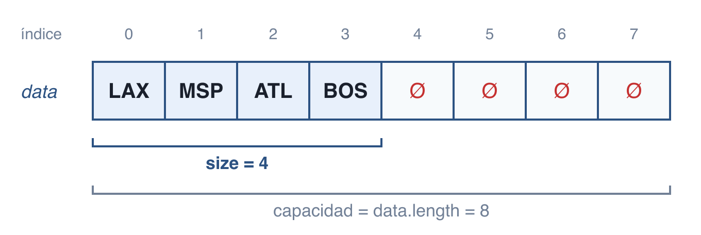
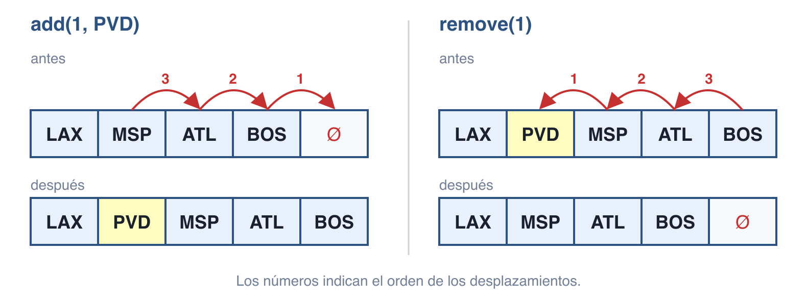
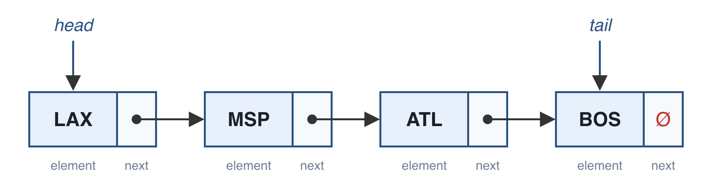
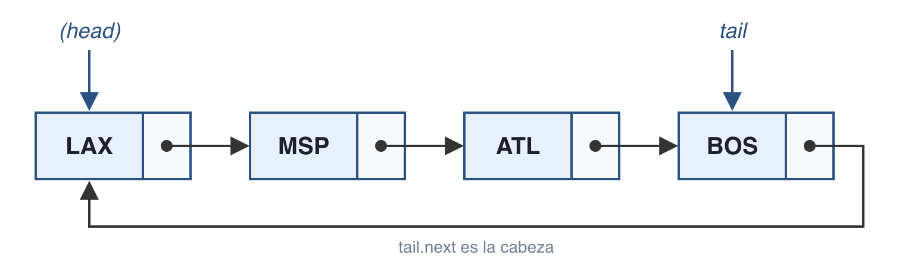
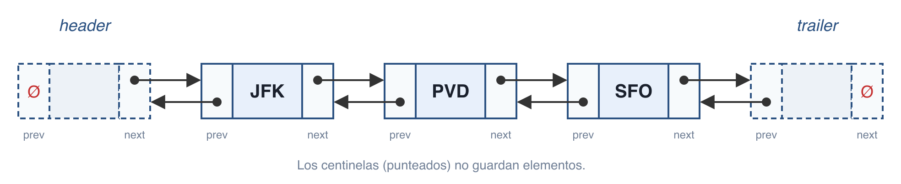

Resumen basado en Goodrich, Tamassia y Goldwasser, *Data Structures and Algorithms in Java* (6.ª ed.): secciones 7.2 (Listas con arreglo), 3.2 (Listas simplemente enlazadas), 3.3 (Listas circulares), 3.4 (Listas doblemente enlazadas) y 3.5.2 (Equivalencia en listas enlazadas).

## Lista implementada con arreglo

Antes de ver las listas enlazadas, veamos la forma más directa de implementar el [ADT Lista](./referencias-y-listas.md#el-adt-lista): un arreglo `data` donde `data[i]` guarda (una referencia a) el elemento con índice `i`. Además del arreglo, se guarda `size`, la cantidad de elementos; la **capacidad** es `data.length`.



La regla que se mantiene siempre es: **el elemento con índice `i` está en `data[i]`**, y las celdas `0` a `size - 1` están ocupadas sin huecos.

- `get(i)` y `set(i, e)` solo acceden a `data[i]`: O(1).
- `add(i, e)` debe **desplazar a la derecha** los elementos de `i` a `size - 1` para abrir un hueco.
- `remove(i)` debe **desplazar a la izquierda** los elementos de `i + 1` a `size - 1` para cerrar el hueco.



Al insertar se desplaza **empezando por el último** (de derecha a izquierda); si se empezara por `i`, se sobrescribirían elementos antes de moverlos.

### Implementación: `ArrayList` con capacidad fija

```java
public class ArrayList<E> implements List<E> {
    public static final int CAPACITY = 16;   // capacidad por defecto
    private E[] data;                        // arreglo genérico de almacenamiento
    private int size = 0;                    // cantidad actual de elementos

    public ArrayList() { this(CAPACITY); }
    public ArrayList(int capacity) {
        data = (E[]) new Object[capacity];   // cast seguro; el compilador puede advertir
    }

    public int size() { return size; }
    public boolean isEmpty() { return size == 0; }
    public E get(int i) throws IndexOutOfBoundsException {
        checkIndex(i, size);
        return data[i];
    }
    public E set(int i, E e) throws IndexOutOfBoundsException {
        checkIndex(i, size);
        E temp = data[i];
        data[i] = e;
        return temp;                         // devuelve el elemento reemplazado
    }
    public void add(int i, E e) throws IndexOutOfBoundsException, IllegalStateException {
        checkIndex(i, size + 1);             // en add, i puede valer size (al final)
        if (size == data.length)
            throw new IllegalStateException("Array is full");
        for (int k = size - 1; k >= i; k--)  // desplaza empezando por el último
            data[k + 1] = data[k];
        data[i] = e;
        size++;
    }
    public E remove(int i) throws IndexOutOfBoundsException {
        checkIndex(i, size);
        E temp = data[i];
        for (int k = i; k < size - 1; k++)   // desplaza para cerrar el hueco
            data[k] = data[k + 1];
        data[size - 1] = null;               // ayuda al recolector de basura
        size--;
        return temp;
    }

    // verifica que i esté en el rango [0, n - 1]
    protected void checkIndex(int i, int n) throws IndexOutOfBoundsException {
        if (i < 0 || i >= n)
            throw new IndexOutOfBoundsException("Illegal index: " + i);
    }
}
```

No se puede crear directamente un arreglo `new E[capacity]`; por eso se crea un `Object[]` y se hace *cast* a `E[]` (ver [Tipos Genéricos](./genericos.md)).

### Costos

| Método | Tiempo |
|---|---|
| `size()`, `isEmpty()` | O(1) |
| `get(i)`, `set(i, e)` | O(1) |
| `add(i, e)` | O(n) |
| `remove(i)` | O(n) |

En realidad `add(i, e)` y `remove(i)` toman O(n − i + 1), porque solo se desplazan los elementos desde `i` en adelante:

- El **peor caso** es `i = 0`: se desplazan todos los elementos.
- Al **final** (`add(size, e)` y `remove(size - 1)`) no se desplaza nada: O(1).
- En promedio se desplazan n/2 elementos, que sigue siendo O(n).

### Capacidad fija vs. arreglo dinámico

Esta versión tiene una limitación seria: si se llena, `add` lanza `IllegalStateException`. Si se reserva mucha capacidad se desperdicia memoria; si se reserva poca, el programa falla.

`java.util.ArrayList` lo resuelve con un **arreglo dinámico**: cuando el arreglo se llena, crea uno nuevo del **doble** de capacidad, copia los elementos y sigue usando el nuevo (el método `resize` explicado en [Arreglos e Iteradores](../unidad-1/arreglos-e-iteradores.md)). En el código anterior solo cambia `add`:

```java
if (size == data.length)
    resize(2 * data.length);   // en vez de lanzar la excepción, duplica la capacidad
```

Con esto `add` al final es O(1) **amortizado**: casi siempre es O(1), y las copias ocasionales de O(n) se reparten entre todas las inserciones.

## ¿Por qué listas enlazadas?

La lista con arreglo tiene dos desventajas:

- Su **capacidad es fija** (o hay que copiar todo el arreglo para crecer).
- Insertar o eliminar al inicio o en una posición interior es costoso, porque hay que **desplazar** elementos (O(n)).

Una **lista enlazada** es una alternativa: es una colección de **nodos** que juntos forman una secuencia lineal. No tiene tamaño fijo y usa memoria proporcional a la cantidad de elementos que guarda.

## Lista simplemente enlazada

En una **lista simplemente enlazada** (*singly linked list*) cada nodo guarda:

- `element`: una referencia al elemento de la secuencia.
- `next`: una referencia al **siguiente** nodo (o `null` si es el último).



- La lista debe guardar al menos una referencia al primer nodo, la **cabeza** (*head*). Sin ella no habría forma de llegar a ningún nodo.
- El último nodo es la **cola** (*tail*): es el que tiene `next == null`. Se puede encontrar recorriendo la lista desde `head` siguiendo los `next` (*link hopping*), pero es común guardar una referencia directa a `tail` para no recorrerla.
- También se suele guardar el **tamaño** (`size`) para no tener que contar los nodos.

### Insertar al inicio

Se crea el nodo nuevo, su `next` apunta a la cabeza actual y luego `head` apunta al nodo nuevo:

```
Algoritmo addFirst(e):
    newest = Node(e)       // crea el nodo con el elemento e
    newest.next = head     // el nuevo nodo apunta a la cabeza anterior
    head = newest          // la cabeza ahora es el nuevo nodo
    size = size + 1
```

El orden importa: se asigna `newest.next` **antes** de cambiar `head`. Si la lista estaba vacía (`head == null`), el nuevo nodo queda con `next == null`, que es lo correcto.

### Insertar al final

Si se tiene la referencia `tail`, también es O(1):

```
Algoritmo addLast(e):
    newest = Node(e)
    newest.next = null     // el nuevo nodo será el último
    tail.next = newest     // la cola anterior apunta al nuevo nodo
    tail = newest          // la cola ahora es el nuevo nodo
    size = size + 1
```

Se enlaza `tail.next` **antes** de mover `tail`. Si la lista está vacía no existe `tail`, así que ese caso se maneja aparte (`head = newest`).

### Eliminar al inicio

Es la operación inversa de `addFirst`: la cabeza pasa al siguiente nodo.

```
Algoritmo removeFirst():
    si head == null entonces
        la lista está vacía
    head = head.next       // head apunta al siguiente nodo (o a null)
    size = size - 1
```

### ¿Y eliminar al final?

**No se puede hacer de forma eficiente.** Aunque se tenga `tail`, para eliminar el último nodo hay que modificar el `next` del **penúltimo**, y desde `tail` no se puede retroceder. La única forma de llegar al penúltimo es recorrer la lista desde `head`, lo que toma O(n). Para resolverlo se usa una lista doblemente enlazada (ver abajo).

### Implementación: `SinglyLinkedList`

La clase usa genéricos (ver [Tipos Genéricos](./genericos.md)) y define `Node` como una **clase anidada privada**, para que el usuario de la lista no vea los detalles de nodos y enlaces (encapsulamiento).

| Método | Descripción |
|---|---|
| `size()` | devuelve la cantidad de elementos |
| `isEmpty()` | `true` si la lista está vacía |
| `first()` | devuelve (sin eliminar) el primer elemento, o `null` si está vacía |
| `last()` | devuelve (sin eliminar) el último elemento, o `null` si está vacía |
| `addFirst(e)` | agrega `e` al inicio |
| `addLast(e)` | agrega `e` al final |
| `removeFirst()` | elimina y devuelve el primer elemento, o `null` si está vacía |

```java
public class SinglyLinkedList<E> {
    // ---------- clase anidada Node ----------
    private static class Node<E> {
        private E element;      // elemento guardado en este nodo
        private Node<E> next;   // referencia al siguiente nodo
        public Node(E e, Node<E> n) {
            element = e;
            next = n;
        }
        public E getElement() { return element; }
        public Node<E> getNext() { return next; }
        public void setNext(Node<E> n) { next = n; }
    }

    // ---------- variables de instancia ----------
    private Node<E> head = null;   // primer nodo (null si está vacía)
    private Node<E> tail = null;   // último nodo (null si está vacía)
    private int size = 0;

    public SinglyLinkedList() { }

    // ---------- métodos de acceso ----------
    public int size() { return size; }
    public boolean isEmpty() { return size == 0; }
    public E first() {
        if (isEmpty()) return null;
        return head.getElement();
    }
    public E last() {
        if (isEmpty()) return null;
        return tail.getElement();
    }

    // ---------- métodos de actualización ----------
    public void addFirst(E e) {
        head = new Node<>(e, head);   // crea y enlaza el nuevo nodo
        if (size == 0)
            tail = head;              // caso especial: el nuevo nodo también es la cola
        size++;
    }
    public void addLast(E e) {
        Node<E> newest = new Node<>(e, null);
        if (isEmpty())
            head = newest;            // caso especial: la lista estaba vacía
        else
            tail.setNext(newest);     // el nuevo nodo va después de la cola
        tail = newest;
        size++;
    }
    public E removeFirst() {
        if (isEmpty()) return null;
        E answer = head.getElement();
        head = head.getNext();        // queda null si solo había un nodo
        size--;
        if (size == 0)
            tail = null;              // caso especial: la lista quedó vacía
        return answer;
    }
}
```

Observa los **casos especiales** con la lista vacía: al insertar el primer nodo, `head` y `tail` deben apuntar a él; al eliminar el último, ambos deben quedar en `null`.

## Lista circularmente enlazada

Hay aplicaciones donde los datos tienen un **orden cíclico**, sin principio ni fin fijos: los turnos de un juego (A, B, C, A, B, …) o la ruta de un autobús.

Un ejemplo importante es la **planificación round-robin** de un sistema operativo: cada proceso recibe un turno corto de CPU (*time slice*) y luego cede el lugar al siguiente, en orden cíclico. Con una lista normal se haría:

1. `p = L.removeFirst()`
2. Darle un turno de CPU a `p`
3. `L.addLast(p)`

Esto funciona, pero es ineficiente: se elimina un nodo solo para crear otro con el mismo elemento.

Una **lista circularmente enlazada** es una lista simplemente enlazada donde el `next` de la cola apunta de regreso a la **cabeza** (en lugar de `null`):



Agrega una operación nueva:

| Método | Descripción |
|---|---|
| `rotate()` | mueve el primer elemento al final de la lista |

Con ella, round-robin queda en dos pasos: darle turno a `C.first()` y luego `C.rotate()`.

**Optimización:** ya no hace falta guardar `head`, porque siempre es `tail.getNext()`. Guardar solo `tail` ahorra memoria y simplifica el código.

- `rotate()`: no mueve nodos ni elementos, solo avanza `tail = tail.getNext()`.
- `addFirst(e)`: enlaza el nuevo nodo justo **después** de `tail`.
- `addLast(e)`: llama a `addFirst(e)` y luego avanza `tail` para que el nuevo nodo sea el último.
- `removeFirst()`: hace que `tail.next` se salte la cabeza.

```java
public class CircularlyLinkedList<E> {
    // (clase anidada Node idéntica a la de SinglyLinkedList)
    private Node<E> tail = null;   // se guarda tail, pero no head
    private int size = 0;

    public CircularlyLinkedList() { }

    public int size() { return size; }
    public boolean isEmpty() { return size == 0; }
    public E first() {
        if (isEmpty()) return null;
        return tail.getNext().getElement();   // la cabeza está *después* de la cola
    }
    public E last() {
        if (isEmpty()) return null;
        return tail.getElement();
    }

    public void rotate() {
        if (tail != null)
            tail = tail.getNext();   // la cabeza anterior pasa a ser la cola
    }
    public void addFirst(E e) {
        if (size == 0) {
            tail = new Node<>(e, null);
            tail.setNext(tail);      // se enlaza consigo mismo
        } else {
            Node<E> newest = new Node<>(e, tail.getNext());
            tail.setNext(newest);
        }
        size++;
    }
    public void addLast(E e) {
        addFirst(e);                 // inserta al inicio...
        tail = tail.getNext();       // ...y el nuevo nodo pasa a ser la cola
    }
    public E removeFirst() {
        if (isEmpty()) return null;
        Node<E> head = tail.getNext();
        if (head == tail) tail = null;          // era el único nodo
        else tail.setNext(head.getNext());      // se salta la cabeza
        size--;
        return head.getElement();
    }
}
```

## Lista doblemente enlazada

La lista simple es **asimétrica**: desde un nodo no se puede llegar al anterior. Por eso no se puede eliminar eficientemente el último nodo ni un nodo interior conociendo solo su referencia.

En una **lista doblemente enlazada** (*doubly linked list*) cada nodo guarda dos referencias: `next` (al siguiente) y `prev` (al anterior). Así, insertar y eliminar en **cualquier posición** conocida es O(1).

### Centinelas: `header` y `trailer`

Para evitar casos especiales en los extremos se agregan dos nodos "ficticios" llamados **centinelas** (*sentinels*), que **no guardan elementos**:

- `header` al inicio: su `next` es el primer elemento real.
- `trailer` al final: su `prev` es el último elemento real.



En una lista vacía, `header.next == trailer` y `trailer.prev == header`.

**Ventaja:** los centinelas nunca cambian, solo los nodos entre ellos. Toda inserción ocurre **entre dos nodos existentes** y todo nodo a eliminar **tiene vecinos a ambos lados**, así que desaparecen los `if` de lista vacía que vimos en `SinglyLinkedList.addLast`.

### Insertar y eliminar

- **Insertar** entre `predecessor` y `successor`: se crea el nodo con `prev = predecessor` y `next = successor`, y luego los vecinos lo apuntan a él.
- **Eliminar** un nodo: sus dos vecinos se enlazan directamente entre sí, "saltándolo". El nodo queda fuera de la lista y el recolector de basura lo libera.

`addFirst` es insertar entre `header` y `header.next`; `addLast` es insertar entre `trailer.prev` y `trailer`. Lo mismo para eliminar: `removeFirst` elimina `header.next` y `removeLast` elimina `trailer.prev`.

### Implementación: `DoublyLinkedList`

Tiene los mismos métodos que `SinglyLinkedList` más `removeLast()`, que ahora sí es O(1).

```java
public class DoublyLinkedList<E> {
    // ---------- clase anidada Node ----------
    private static class Node<E> {
        private E element;
        private Node<E> prev;    // referencia al nodo anterior
        private Node<E> next;    // referencia al nodo siguiente
        public Node(E e, Node<E> p, Node<E> n) {
            element = e;
            prev = p;
            next = n;
        }
        public E getElement() { return element; }
        public Node<E> getPrev() { return prev; }
        public Node<E> getNext() { return next; }
        public void setPrev(Node<E> p) { prev = p; }
        public void setNext(Node<E> n) { next = n; }
    }

    private Node<E> header;    // centinela inicial
    private Node<E> trailer;   // centinela final
    private int size = 0;

    public DoublyLinkedList() {
        header = new Node<>(null, null, null);
        trailer = new Node<>(null, header, null);   // trailer va después de header
        header.setNext(trailer);                    // header va antes de trailer
    }

    public int size() { return size; }
    public boolean isEmpty() { return size == 0; }
    public E first() {
        if (isEmpty()) return null;
        return header.getNext().getElement();    // el primero está después de header
    }
    public E last() {
        if (isEmpty()) return null;
        return trailer.getPrev().getElement();   // el último está antes de trailer
    }

    // ---------- métodos públicos de actualización ----------
    public void addFirst(E e) { addBetween(e, header, header.getNext()); }
    public void addLast(E e) { addBetween(e, trailer.getPrev(), trailer); }
    public E removeFirst() {
        if (isEmpty()) return null;
        return remove(header.getNext());
    }
    public E removeLast() {
        if (isEmpty()) return null;
        return remove(trailer.getPrev());
    }

    // ---------- métodos privados de actualización ----------
    private void addBetween(E e, Node<E> predecessor, Node<E> successor) {
        Node<E> newest = new Node<>(e, predecessor, successor);
        predecessor.setNext(newest);
        successor.setPrev(newest);
        size++;
    }
    private E remove(Node<E> node) {
        Node<E> predecessor = node.getPrev();
        Node<E> successor = node.getNext();
        predecessor.setNext(successor);
        successor.setPrev(predecessor);
        size--;
        return node.getElement();
    }
}
```

`addBetween` y `remove` son **privados**: resuelven el caso general una sola vez, y los cuatro métodos públicos solo indican entre qué nodos operar.

## Comparar dos listas enlazadas

Dos listas se consideran **equivalentes** si tienen el mismo tamaño y sus elementos son iguales uno a uno (igual que `Arrays.equals` con arreglos). Se recorren ambas listas a la vez comparando con `equals`:

```java
public boolean equals(Object o) {
    if (o == null) return false;
    if (getClass() != o.getClass()) return false;
    SinglyLinkedList other = (SinglyLinkedList) o;   // tipo sin parametrizar
    if (size != other.size) return false;
    Node walkA = head;          // recorre esta lista
    Node walkB = other.head;    // recorre la otra lista
    while (walkA != null) {
        if (!walkA.getElement().equals(walkB.getElement())) return false;
        walkA = walkA.getNext();
        walkB = walkB.getNext();
    }
    return true;
}
```

Se usa el tipo **sin parametrizar** (`SinglyLinkedList` en vez de `SinglyLinkedList<E>`) porque en tiempo de ejecución Java no puede saber el tipo genérico de la otra lista (*type erasure*). Si los tipos no son compatibles, se detecta al comparar los elementos con `equals`.

## Resumen de costos

| Operación | Arreglo | Simple | Circular | Doble |
|---|---|---|---|---|
| `first()`, `last()` | O(1) | O(1) | O(1) | O(1) |
| `addFirst(e)` | O(n) | O(1) | O(1) | O(1) |
| `addLast(e)` | O(1)\* | O(1) | O(1) | O(1) |
| `removeFirst()` | O(n) | O(1) | O(1) | O(1) |
| `removeLast()` | O(1) | **O(n)** | **O(n)** | O(1) |
| `get(i)` (acceso por índice) | O(1) | O(n) | O(n) | O(n) |
| `rotate()` | – | – | O(1) | – |

\* Mientras haya capacidad; con un arreglo dinámico es O(1) amortizado.

Las listas enlazadas ganan en inserciones y eliminaciones en los extremos y no tienen capacidad fija; los arreglos ganan en acceso por índice. `java.util.LinkedList` es una lista **doblemente enlazada** (ver [Referencias a Objetos y Listas](./referencias-y-listas.md)).

[⬅️ Volver a la Unidad II](./index.md)
