Resumen de Goodrich, Tamassia y Goldwasser, *Data Structures and Algorithms in Java* (6.ª ed.), capítulo 11 (Search Trees), secciones 11.1 (Binary Search Trees), 11.2 (Balanced Search Trees) y 11.3 (AVL Trees).

Se asume la terminología, la altura y los recorridos de [Árboles](./arboles.md). Para practicar, usa las pestañas **BST** y **AVL** de las [animaciones](./animaciones.html).

En los diagramas, los nodos en **azul** forman el camino de una búsqueda, los **amarillos** son los que cambian, los **rojos** los que están desbalanceados y los **rectángulos grises** representan subárboles completos.

## Árbol binario de búsqueda (BST)

### El mapa ordenado

Goodrich usa el árbol de búsqueda para implementar un **mapa ordenado** (*sorted map*): una colección de pares **(clave, valor)** en la que no se repiten las claves. Las tres operaciones fundamentales de un mapa son:

| Método | Descripción |
|---|---|
| `get(k)` | devuelve el valor asociado a la clave k, o `null` si no existe |
| `put(k, v)` | asocia el valor v con la clave k; si k ya existía, **reemplaza** el valor y devuelve el anterior |
| `remove(k)` | elimina la entrada con clave k y devuelve su valor, o `null` si no existe |

Un mapa **ordenado** además garantiza que al iterarlo las claves salen **en orden**, y permite búsquedas como `floorEntry(k)` (la mayor clave ≤ k), `higherEntry(k)` (la menor clave > k) o `subMap(k1, k2)` (las claves en el rango [k1, k2)).

### Definición

Un **árbol binario de búsqueda** es un árbol binario **propio** (cada nodo tiene 0 o 2 hijos) en el que cada posición **interna** p guarda un par (k, v) tal que:

- las claves del subárbol **izquierdo** de p son **menores** que k;
- las claves del subárbol **derecho** de p son **mayores** que k.

Las **hojas** no guardan nada: son **centinelas** que marcan "aquí no hay más". Simplifican los algoritmos, porque una búsqueda fallida siempre termina en una hoja, y esa hoja es justo donde se insertaría la clave. En la práctica se pueden representar con `null`, lo que ahorra la mitad de los nodos (un árbol propio tiene más hojas que nodos internos). En los diagramas de este documento las hojas centinela **no se dibujan**.

Figura 11.1 de Goodrich (solo se muestran las claves; los valores no influyen en el orden):

Orden de inserción: **44, 17, 8, 32, 28, 21, 29, 88, 65, 54, 82, 76, 80, 97, 93**.

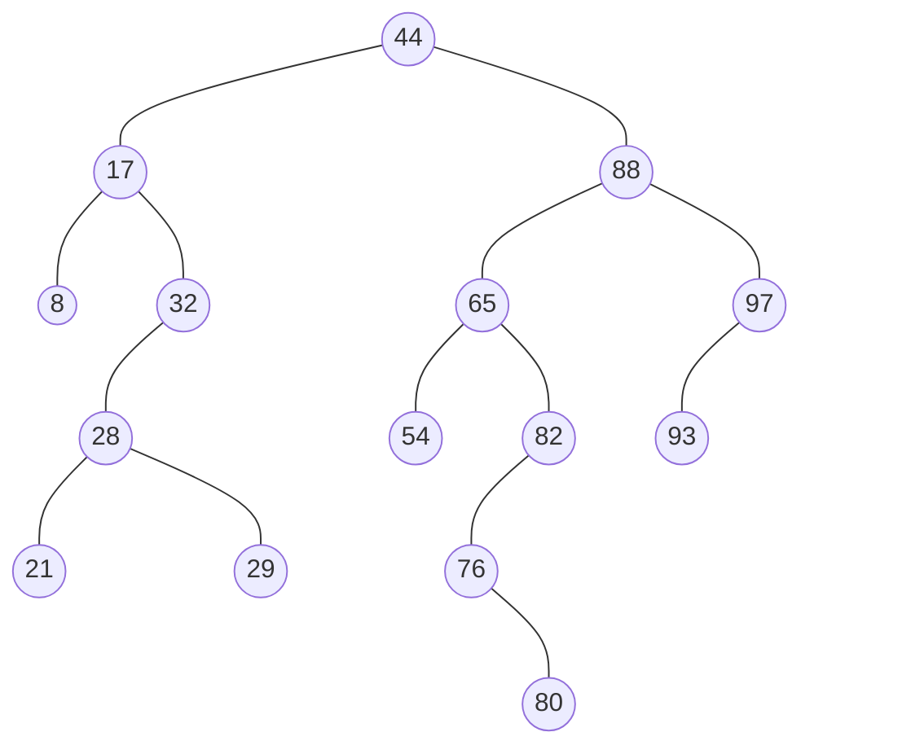

Su recorrido en **inorden** da las claves ordenadas: 8 17 21 28 29 32 44 54 65 76 80 82 88 93 97. Por eso iterar un mapa ordenado es simplemente un recorrido en inorden.

### Búsqueda

El BST funciona como un **árbol de decisión**: en cada posición p se compara la clave buscada k con `key(p)`:

- si k < key(p), la búsqueda sigue en el subárbol **izquierdo**;
- si k = key(p), la búsqueda **termina con éxito**;
- si k > key(p), la búsqueda sigue en el subárbol **derecho**;
- si se llega a una **hoja**, la búsqueda **falla**.

```
Algoritmo TreeSearch(p, k):
    si p es externo entonces
        devolver p                       {búsqueda fallida}
    si no, si k == key(p) entonces
        devolver p                       {búsqueda exitosa}
    si no, si k < key(p) entonces
        devolver TreeSearch(left(p), k)  {buscar en el subárbol izquierdo}
    si no                                {sabemos que k > key(p)}
        devolver TreeSearch(right(p), k) {buscar en el subárbol derecho}
```

Si la búsqueda falla, `TreeSearch` devuelve la **última hoja** del camino; se usará para insertar.

Ejemplos (figura 11.2):

- **Buscar 65**: 65 > 44 → derecha; 65 < 88 → izquierda; 65 = 65 → encontrado.
- **Buscar 68**: 68 > 44 → derecha; 68 < 88 → izquierda; 68 > 65 → derecha; 68 < 82 → izquierda; 68 < 76 → izquierda: es una hoja, así que **68 no está**.

Camino de la búsqueda de 68 (en azul el camino, con flechas gruesas; en gris los nodos descartados, sin sus subárboles):

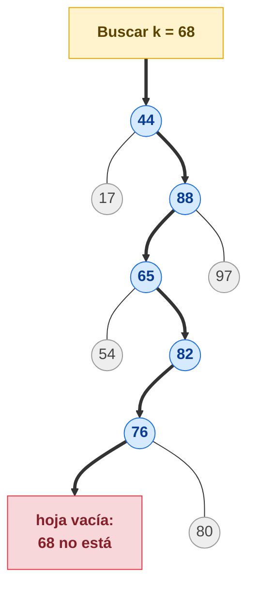

| Nodo | Comparación | Sigue por |
|------|-------------|-----------|
| 44 | 68 > 44 | derecha |
| 88 | 68 < 88 | izquierda |
| 65 | 68 > 65 | derecha |
| 82 | 68 < 82 | izquierda |
| 76 | 68 < 76 | izquierda → hoja vacía: **68 no está** |

**Costo.** Cada llamada recursiva baja un nivel y hace un trabajo constante, así que se visitan a lo más h + 1 posiciones: la búsqueda es **O(h)**, donde h es la altura del árbol (figura 11.3). Lo mismo vale para `get`, `put`, `remove` y casi todas las operaciones del mapa ordenado, porque todas empiezan con una búsqueda.

### Inserción

`put(k, v)` empieza buscando k:

- si la encuentra, **reemplaza** el valor de esa entrada;
- si no, la búsqueda terminó en una hoja p, y se **expande** esa hoja: se guarda (k, v) en p y se le agregan dos hojas centinela nuevas. La propiedad del BST se mantiene porque la clave queda exactamente donde una búsqueda la esperaría.

```
Algoritmo TreeInsert(k, v):
    p = TreeSearch(root(), k)
    si k == key(p) entonces
        cambiar el valor de p a v
    si no
        expandExternal(p, (k, v))
```

Ejemplo (figura 11.4): insertar **68**. La búsqueda anterior terminó en la hoja izquierda de 76, así que 68 queda como hijo izquierdo de 76:

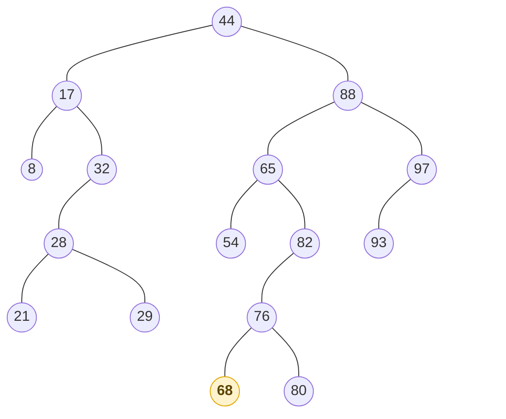

### Eliminación

Es más complicada, porque la clave a eliminar puede estar en cualquier parte del árbol (en cambio, insertar siempre ocurre en una hoja). Primero se busca k; si la búsqueda termina en una hoja, no hay nada que eliminar. Si k está en la posición p, hay dos casos:

1. **p tiene a lo más un hijo interno.** Sea r ese hijo (o cualquiera de los dos, si ambos son hojas). Se eliminan p y la hoja hermana de r, y **r sube** a ocupar el lugar de p. Toda relación ancestro-descendiente que queda ya existía antes, así que la propiedad del BST se mantiene.
2. **p tiene dos hijos internos.** No se puede quitar p sin dejar dos hijos huérfanos. En su lugar:
   1. Se busca la posición r con la **mayor clave menor que la de p**: su **predecesor**. Siempre es el nodo **más a la derecha del subárbol izquierdo** de p.
   2. Se copia la entrada de r en p. Como r tiene la clave inmediatamente anterior, todo el subárbol derecho de p sigue siendo mayor y el resto del subárbol izquierdo sigue siendo menor.
   3. Se elimina el nodo r. Como r es el más a la derecha de un subárbol, **no tiene hijo derecho interno**, así que su eliminación es el caso 1.

Los ejemplos usan el árbol de la figura 11.4 (ya con 68). Para que se vea el cambio, cada figura muestra solo el subárbol que se modifica, **antes** y **después**. En rojo el nodo que se elimina; en amarillo el que sube a ocupar su lugar; en azul el predecesor.

#### Caso 1: eliminar 32 (un solo hijo interno)

32 solo tiene hijo izquierdo (28); su hijo derecho es una hoja. Se quitan 32 y esa hoja, y **28 sube** con todo su subárbol.

Antes:

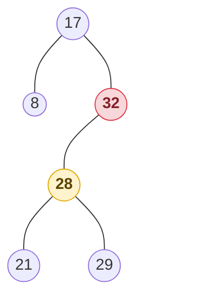

Después: 28 es ahora el hijo derecho de 17. Sigue siendo correcto, porque 21, 28 y 29 ya eran mayores que 17.

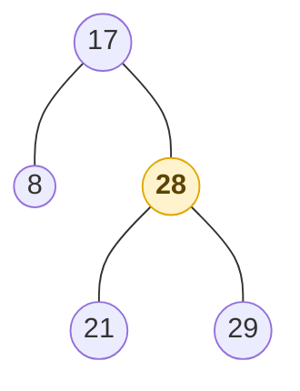

Si p **no tiene hijos internos** (es decir, sus dos hijos son hojas), es el mismo caso pero más simple: p desaparece y su lugar lo ocupa una hoja. Por ejemplo, eliminar 93 deja a 97 sin hijo izquierdo.

#### Caso 2: eliminar 88 (dos hijos internos)

88 tiene dos hijos internos (65 y 97), así que no se puede quitar directamente.

1. **Buscar el predecesor:** se baja una vez a la izquierda (65) y luego siempre a la derecha mientras se pueda: 65 → 82. Como 82 no tiene hijo derecho, **82 es el predecesor**: la mayor clave menor que 88.
2. **Copiar** 82 en el lugar de 88.
3. **Eliminar el 82 original** con el caso 1: su único hijo interno (76) sube.

Antes:

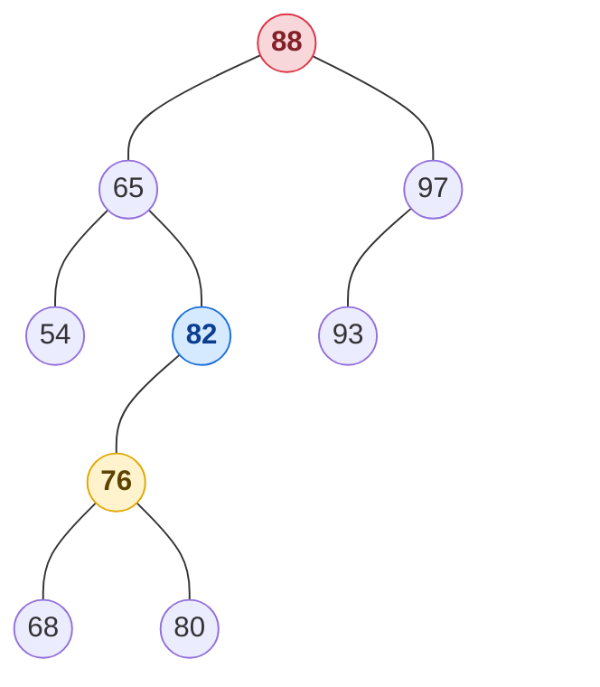

Después: 82 ocupa la posición de 88 y 76 queda como hijo derecho de 65. Todo lo de la izquierda sigue siendo menor que 82 y todo lo de la derecha (97, 93) sigue siendo mayor.

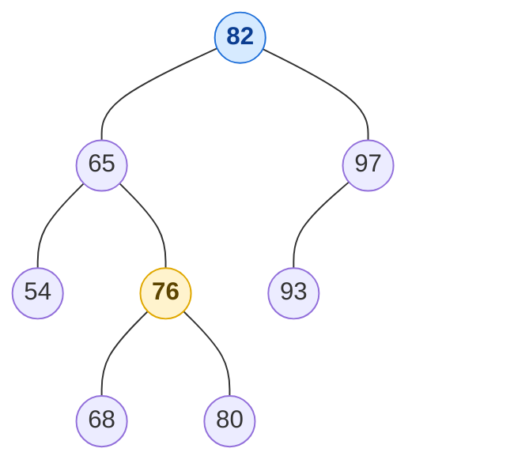

Igual que la búsqueda y la inserción, la eliminación recorre un solo camino desde la raíz: es **O(h)**.

### Costo

Casi todas las operaciones recorren un camino desde la raíz, así que dependen de la altura h (tabla 11.1):

| Método | Tiempo (peor caso) |
|---|---|
| `size`, `isEmpty` | O(1) |
| `get`, `put`, `remove` | O(h) |
| `firstEntry`, `lastEntry` | O(h) |
| `ceilingEntry`, `floorEntry`, `lowerEntry`, `higherEntry` | O(h) |
| `subMap` (reporta s entradas) | O(s + h) |
| `entrySet`, `keySet`, `values` | O(n) |

Un BST solo es eficiente si su altura es pequeña:

- **Mejor caso**: h = ⌈log(n + 1)⌉ − 1, y las operaciones son O(log n).
- **Peor caso**: h es proporcional a n, y el árbol se comporta como una lista ordenada. Ocurre, por ejemplo, al insertar las claves **en orden creciente o decreciente** (figura 11.7):

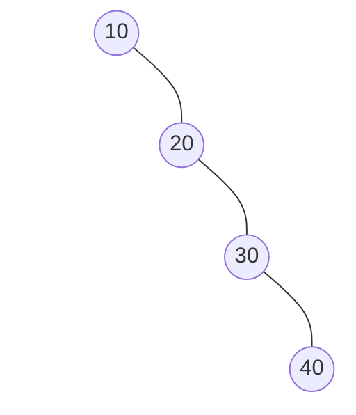

- **En promedio**, si las claves se insertan y eliminan en orden aleatorio, la altura esperada es O(log n).

Cuando no se puede garantizar ese orden aleatorio, conviene usar un árbol que garantice altura **O(log n) en el peor caso**, como el AVL.

## Árboles AVL

### ¿Qué es un árbol AVL?

Un **árbol AVL** es un **árbol binario de búsqueda que se balancea solo**. Se llama así por sus inventores, **A**del'son-**V**el'skii y **L**andis (1962), y fue el primer árbol de este tipo.

Tiene dos reglas:

1. **Es un BST**: en cada nodo, lo de la izquierda es menor y lo de la derecha es mayor.
2. **Está balanceado**: en cada nodo, la altura del lado izquierdo y la del derecho difieren **a lo más en 1**.

Para cumplir la regla 2, **cada vez que se inserta o se elimina** una clave se revisa el camino de vuelta a la raíz. Si algún nodo quedó desbalanceado, se repara con una [rotación](#rotaciones). Así el árbol nunca puede quedar "chueco": su altura es siempre **O(log n)**, y por eso buscar, insertar y eliminar cuestan **O(log n) en el peor caso**. Un BST común puede llegar a O(n).

| | BST común | AVL |
|---|---|---|
| Orden de las claves | izquierda < nodo < derecha | igual |
| Balance | no se controla | en todo nodo, FE = −1, 0 o +1 |
| Altura en el peor caso | n − 1 | ≈ 1.44 log n (aquí se demuestra a lo más 2 log n + 1) |
| Buscar, insertar, eliminar | O(n) en el peor caso | O(log n) siempre |
| Costo extra | ninguno | guardar la altura en cada nodo y rotar |

Las secciones siguientes explican qué es exactamente "balanceado", por qué la altura queda en O(log n) y cómo se reparan los desbalances.

### ¿Qué significa estar balanceado?

**El problema.** Un BST puede quedar "chueco". Si se insertan 10, 20, 30, 40, 50 en ese orden, cada clave queda como hijo derecho de la anterior: el árbol es en realidad una lista, su altura es n − 1 y buscar cuesta O(n). Un árbol **balanceado** evita eso: en cada nodo, el lado izquierdo y el derecho tienen **casi la misma altura**.

**Altura de un nodo.** Igual que en [Árboles](./arboles.md#profundidad-nivel-y-altura): es el número de aristas del camino más largo desde ese nodo hacia abajo.

- un nodo sin hijos (hoja) tiene **h = 0**;
- un hijo que no existe cuenta como **h = −1**;
- cualquier otro nodo: h = 1 + la mayor altura de sus hijos.

El −1 del hijo vacío es para que la fórmula funcione: una hoja mide 1 + máx(−1, −1) = 0.

**Factor de equilibrio.** Para cada nodo se resta la altura de sus dos hijos:

> **FE = h(hijo derecho) − h(hijo izquierdo)**

| FE | Significa | ¿Balanceado? |
|---|---|---|
| 0 | los dos lados miden lo mismo | sí |
| +1 | el derecho es 1 más alto | sí |
| −1 | el izquierdo es 1 más alto | sí |
| +2, −2 o más | un lado le saca 2 o más al otro | **no** |

Un **árbol AVL** es entonces un BST en el que **todos** los nodos tienen FE = −1, 0 o +1. Goodrich lo dice así:

> **Propiedad de balance de altura**: para todo nodo, las alturas de sus dos hijos difieren **a lo más en 1**.

**Ejemplo de un AVL** (figura 11.10). En cada nodo, su altura y su FE:

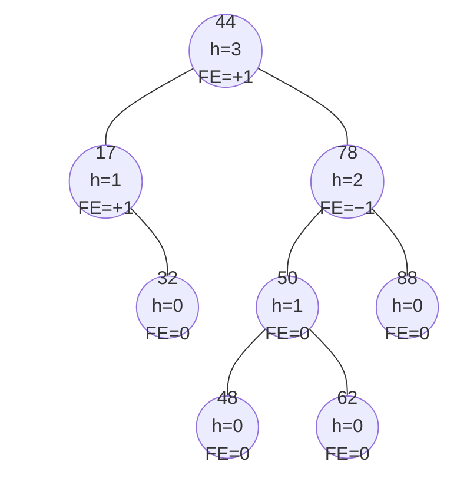

Cálculo del FE de algunos nodos, a partir de las alturas de sus hijos (FE = h(der) − h(izq)):

| Nodo | h(izq) | h(der) | FE |
|---|---|---|---|
| 17 | −1 (no tiene) | 0 (32) | 0 − (−1) = **+1** |
| 78 | 1 (50) | 0 (88) | 0 − 1 = **−1** |
| 44 | 1 (17) | 2 (78) | 2 − 1 = **+1** |

Todos los FE están entre −1 y +1, así que **es un AVL**.

**Ejemplo que no es AVL.** Si se quita el 32, el 17 queda sin hijos (h = 0). La raíz 44 tiene ahora un hijo de altura 0 y otro de altura 2: FE = 2 − 0 = **+2**, desbalanceada.

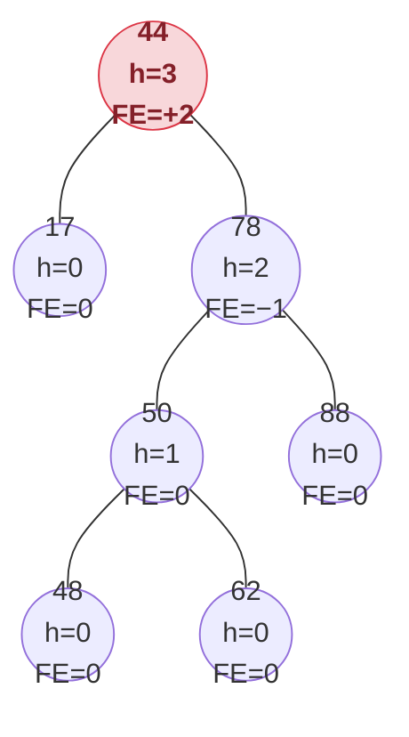

Basta **un** nodo con FE = +2 o −2 (o más) para que el árbol deje de ser AVL. Las secciones de inserción y eliminación muestran cómo se repara con una [rotación](#rotaciones).

**Si lees el libro.** Goodrich dibuja las hojas vacías (centinela) como nodos de altura 0, así que en sus figuras **todas las alturas son 1 mayores** que aquí (la hoja 32 tiene h = 1). Los FE salen iguales, porque al restar la diferencia se cancela.

### La altura es O(log n)

**Proposición 11.1**: la altura de un AVL con n entradas es **O(log n)**.

Es más fácil resolver el problema inverso: ¿cuál es el **mínimo** número de nodos n(h) de un AVL de altura h?

- n(0) = 1 (solo la raíz) y n(1) = 2 (la raíz y un hijo).
- Para h ≥ 2, el AVL más pequeño de altura h tiene la raíz y dos subárboles que son también AVL mínimos: uno de altura h − 1 y otro de altura h − 2. Entonces

  **n(h) = 1 + n(h − 1) + n(h − 2)**

  que es una recurrencia parecida a la de [Fibonacci](../unidad-2/recursion.md): crece exponencialmente.

Para demostrarlo, como n(h − 1) > n(h − 2):

n(h) > 2 · n(h − 2) > 4 · n(h − 4) > 8 · n(h − 6) > … > 2<sup>i</sup> · n(h − 2i)

Tomando i = ⌊h/2⌋, se llega a n(0) o n(1), que valen al menos 1, así que n(h) ≥ 2<sup>⌊h/2⌋</sup> ≥ 2<sup>(h − 1)/2</sup>. Sacando logaritmos:

**h ≤ 2 log n(h) + 1**

Es decir, un AVL con n entradas tiene altura **a lo más 2 log n + 1**, y `get` es O(log n). Falta ver cómo mantener la propiedad al insertar y eliminar.

### Rotaciones

Cuando un nodo queda desbalanceado, se arregla **reacomodando tres nodos** del camino: el desbalanceado **z**, su hijo **y** y su nieto **x**. La regla es una sola:

> Ordenar x, y, z por clave (a < b < c). **El del medio (b) sube**, a queda como hijo izquierdo y c como hijo derecho.

Los subárboles que colgaban de esos tres nodos se vuelven a colgar en el mismo orden de izquierda a derecha, así que el inorden no cambia y el árbol **sigue siendo un BST**. Solo se cambian unos cuantos enlaces: es **O(1)**. Goodrich llama a esta operación **`restructure(x)`**.

Con las claves 10, 20 y 30 hay cuatro formas posibles, y **las cuatro terminan igual**: 20 sube y queda con 10 a la izquierda y 30 a la derecha. En rojo el nodo desbalanceado (z); en amarillo el que sube.

<table>
<thead><tr><th>Forma de z → y → x</th><th>Antes</th><th>Después</th><th>Rotación</th></tr></thead>
<tbody>
<tr><td>izquierda-izquierda<br/><small>30 → 20 → 10</small></td><td><svg width="130" height="122" viewBox="0 0 130 122" role="img"><line x1="98" y1="22" x2="68" y2="62" stroke="#34495e" stroke-width="2"/><line x1="68" y1="62" x2="38" y2="102" stroke="#34495e" stroke-width="2"/><circle cx="98" cy="22" r="15" fill="#f8d7da" stroke="#dc3545" stroke-width="2"/><text x="98" y="27" text-anchor="middle" font-size="13" font-weight="bold" fill="#842029">30</text><text x="122" y="26" text-anchor="middle" font-size="12" font-style="italic" fill="#666">z</text><circle cx="68" cy="62" r="15" fill="#ffffff" stroke="#34495e" stroke-width="2"/><text x="68" y="67" text-anchor="middle" font-size="13" font-weight="bold" fill="#222222">20</text><text x="44" y="66" text-anchor="middle" font-size="12" font-style="italic" fill="#666">y</text><circle cx="38" cy="102" r="15" fill="#ffffff" stroke="#34495e" stroke-width="2"/><text x="38" y="107" text-anchor="middle" font-size="13" font-weight="bold" fill="#222222">10</text><text x="14" y="106" text-anchor="middle" font-size="12" font-style="italic" fill="#666">x</text></svg></td><td><svg width="130" height="102" viewBox="0 0 130 102" role="img"><line x1="67" y1="22" x2="37" y2="82" stroke="#34495e" stroke-width="2"/><line x1="67" y1="22" x2="97" y2="82" stroke="#34495e" stroke-width="2"/><circle cx="67" cy="22" r="15" fill="#fff3cd" stroke="#e0a800" stroke-width="2"/><text x="67" y="27" text-anchor="middle" font-size="13" font-weight="bold" fill="#5c4400">20</text><text x="91" y="26" text-anchor="middle" font-size="12" font-style="italic" fill="#666">y</text><circle cx="37" cy="82" r="15" fill="#ffffff" stroke="#34495e" stroke-width="2"/><text x="37" y="87" text-anchor="middle" font-size="13" font-weight="bold" fill="#222222">10</text><text x="13" y="86" text-anchor="middle" font-size="12" font-style="italic" fill="#666">x</text><circle cx="97" cy="82" r="15" fill="#ffffff" stroke="#34495e" stroke-width="2"/><text x="97" y="87" text-anchor="middle" font-size="13" font-weight="bold" fill="#222222">30</text><text x="121" y="86" text-anchor="middle" font-size="12" font-style="italic" fill="#666">z</text></svg></td><td><b>simple</b>: 20 (y) sube una vez</td></tr>
<tr><td>derecha-derecha<br/><small>10 → 20 → 30</small></td><td><svg width="130" height="122" viewBox="0 0 130 122" role="img"><line x1="40" y1="22" x2="70" y2="62" stroke="#34495e" stroke-width="2"/><line x1="70" y1="62" x2="100" y2="102" stroke="#34495e" stroke-width="2"/><circle cx="40" cy="22" r="15" fill="#f8d7da" stroke="#dc3545" stroke-width="2"/><text x="40" y="27" text-anchor="middle" font-size="13" font-weight="bold" fill="#842029">10</text><text x="64" y="26" text-anchor="middle" font-size="12" font-style="italic" fill="#666">z</text><circle cx="70" cy="62" r="15" fill="#ffffff" stroke="#34495e" stroke-width="2"/><text x="70" y="67" text-anchor="middle" font-size="13" font-weight="bold" fill="#222222">20</text><text x="94" y="66" text-anchor="middle" font-size="12" font-style="italic" fill="#666">y</text><circle cx="100" cy="102" r="15" fill="#ffffff" stroke="#34495e" stroke-width="2"/><text x="100" y="107" text-anchor="middle" font-size="13" font-weight="bold" fill="#222222">30</text><text x="124" y="106" text-anchor="middle" font-size="12" font-style="italic" fill="#666">x</text></svg></td><td><svg width="130" height="102" viewBox="0 0 130 102" role="img"><line x1="67" y1="22" x2="37" y2="82" stroke="#34495e" stroke-width="2"/><line x1="67" y1="22" x2="97" y2="82" stroke="#34495e" stroke-width="2"/><circle cx="67" cy="22" r="15" fill="#fff3cd" stroke="#e0a800" stroke-width="2"/><text x="67" y="27" text-anchor="middle" font-size="13" font-weight="bold" fill="#5c4400">20</text><text x="91" y="26" text-anchor="middle" font-size="12" font-style="italic" fill="#666">y</text><circle cx="37" cy="82" r="15" fill="#ffffff" stroke="#34495e" stroke-width="2"/><text x="37" y="87" text-anchor="middle" font-size="13" font-weight="bold" fill="#222222">10</text><text x="13" y="86" text-anchor="middle" font-size="12" font-style="italic" fill="#666">z</text><circle cx="97" cy="82" r="15" fill="#ffffff" stroke="#34495e" stroke-width="2"/><text x="97" y="87" text-anchor="middle" font-size="13" font-weight="bold" fill="#222222">30</text><text x="121" y="86" text-anchor="middle" font-size="12" font-style="italic" fill="#666">x</text></svg></td><td><b>simple</b>: 20 (y) sube una vez</td></tr>
<tr><td>izquierda-derecha<br/><small>30 → 10 → 20</small></td><td><svg width="130" height="122" viewBox="0 0 130 122" role="img"><line x1="85" y1="22" x2="45" y2="62" stroke="#34495e" stroke-width="2"/><line x1="45" y1="62" x2="75" y2="102" stroke="#34495e" stroke-width="2"/><circle cx="85" cy="22" r="15" fill="#f8d7da" stroke="#dc3545" stroke-width="2"/><text x="85" y="27" text-anchor="middle" font-size="13" font-weight="bold" fill="#842029">30</text><text x="109" y="26" text-anchor="middle" font-size="12" font-style="italic" fill="#666">z</text><circle cx="45" cy="62" r="15" fill="#ffffff" stroke="#34495e" stroke-width="2"/><text x="45" y="67" text-anchor="middle" font-size="13" font-weight="bold" fill="#222222">10</text><text x="21" y="66" text-anchor="middle" font-size="12" font-style="italic" fill="#666">y</text><circle cx="75" cy="102" r="15" fill="#ffffff" stroke="#34495e" stroke-width="2"/><text x="75" y="107" text-anchor="middle" font-size="13" font-weight="bold" fill="#222222">20</text><text x="99" y="106" text-anchor="middle" font-size="12" font-style="italic" fill="#666">x</text></svg></td><td><svg width="130" height="102" viewBox="0 0 130 102" role="img"><line x1="67" y1="22" x2="37" y2="82" stroke="#34495e" stroke-width="2"/><line x1="67" y1="22" x2="97" y2="82" stroke="#34495e" stroke-width="2"/><circle cx="67" cy="22" r="15" fill="#fff3cd" stroke="#e0a800" stroke-width="2"/><text x="67" y="27" text-anchor="middle" font-size="13" font-weight="bold" fill="#5c4400">20</text><text x="91" y="26" text-anchor="middle" font-size="12" font-style="italic" fill="#666">x</text><circle cx="37" cy="82" r="15" fill="#ffffff" stroke="#34495e" stroke-width="2"/><text x="37" y="87" text-anchor="middle" font-size="13" font-weight="bold" fill="#222222">10</text><text x="13" y="86" text-anchor="middle" font-size="12" font-style="italic" fill="#666">y</text><circle cx="97" cy="82" r="15" fill="#ffffff" stroke="#34495e" stroke-width="2"/><text x="97" y="87" text-anchor="middle" font-size="13" font-weight="bold" fill="#222222">30</text><text x="121" y="86" text-anchor="middle" font-size="12" font-style="italic" fill="#666">z</text></svg></td><td><b>doble</b>: 20 (x) sube dos veces</td></tr>
<tr><td>derecha-izquierda<br/><small>10 → 30 → 20</small></td><td><svg width="130" height="122" viewBox="0 0 130 122" role="img"><line x1="35" y1="22" x2="75" y2="62" stroke="#34495e" stroke-width="2"/><line x1="75" y1="62" x2="45" y2="102" stroke="#34495e" stroke-width="2"/><circle cx="35" cy="22" r="15" fill="#f8d7da" stroke="#dc3545" stroke-width="2"/><text x="35" y="27" text-anchor="middle" font-size="13" font-weight="bold" fill="#842029">10</text><text x="59" y="26" text-anchor="middle" font-size="12" font-style="italic" fill="#666">z</text><circle cx="75" cy="62" r="15" fill="#ffffff" stroke="#34495e" stroke-width="2"/><text x="75" y="67" text-anchor="middle" font-size="13" font-weight="bold" fill="#222222">30</text><text x="99" y="66" text-anchor="middle" font-size="12" font-style="italic" fill="#666">y</text><circle cx="45" cy="102" r="15" fill="#ffffff" stroke="#34495e" stroke-width="2"/><text x="45" y="107" text-anchor="middle" font-size="13" font-weight="bold" fill="#222222">20</text><text x="21" y="106" text-anchor="middle" font-size="12" font-style="italic" fill="#666">x</text></svg></td><td><svg width="130" height="102" viewBox="0 0 130 102" role="img"><line x1="67" y1="22" x2="37" y2="82" stroke="#34495e" stroke-width="2"/><line x1="67" y1="22" x2="97" y2="82" stroke="#34495e" stroke-width="2"/><circle cx="67" cy="22" r="15" fill="#fff3cd" stroke="#e0a800" stroke-width="2"/><text x="67" y="27" text-anchor="middle" font-size="13" font-weight="bold" fill="#5c4400">20</text><text x="91" y="26" text-anchor="middle" font-size="12" font-style="italic" fill="#666">x</text><circle cx="37" cy="82" r="15" fill="#ffffff" stroke="#34495e" stroke-width="2"/><text x="37" y="87" text-anchor="middle" font-size="13" font-weight="bold" fill="#222222">10</text><text x="13" y="86" text-anchor="middle" font-size="12" font-style="italic" fill="#666">z</text><circle cx="97" cy="82" r="15" fill="#ffffff" stroke="#34495e" stroke-width="2"/><text x="97" y="87" text-anchor="middle" font-size="13" font-weight="bold" fill="#222222">30</text><text x="121" y="86" text-anchor="middle" font-size="12" font-style="italic" fill="#666">y</text></svg></td><td><b>doble</b>: 20 (x) sube dos veces</td></tr>
</tbody>
</table>

Para saber cuál toca: si el camino va **en línea recta** (los dos pasos al mismo lado), y es el del medio y basta una rotación **simple**; si hace **zigzag**, x es el del medio y hace falta una **doble**.

### Inserción

Se inserta igual que en un BST: una hoja p se expande en un nodo interno. Esto puede romper la propiedad, pero **solo en los ancestros de p**, porque son los únicos cuyos subárboles cambiaron.

Estrategia de "**buscar y reparar**":

1. Sea **z** la primera posición desbalanceada que se encuentra **subiendo desde p** hacia la raíz.
2. Sea **y** el hijo de z con **mayor altura** (es ancestro de p).
3. Sea **x** el hijo de y con **mayor altura** (no puede haber empate; es ancestro de p o p mismo).
4. Se llama a **`restructure(x)`**.

Después de la reestructuración, x, y y z quedan balanceados, y el subárbol queda con **la misma altura que tenía z antes de insertar** (figura 11.12). Por eso los ancestros de z que se habían desbalanceado vuelven a estar balanceados: **una sola reestructuración basta** para arreglar todo el árbol.

Ejemplo (figura 11.11): insertar **54** en el AVL anterior. 54 queda como hijo izquierdo de 62. Las alturas de 62, 50, 78 y 44 aumentan, y **78** (FE = 0 − 2 = **−2**) y **44** (FE = 3 − 1 = **+2**) quedan desbalanceados:

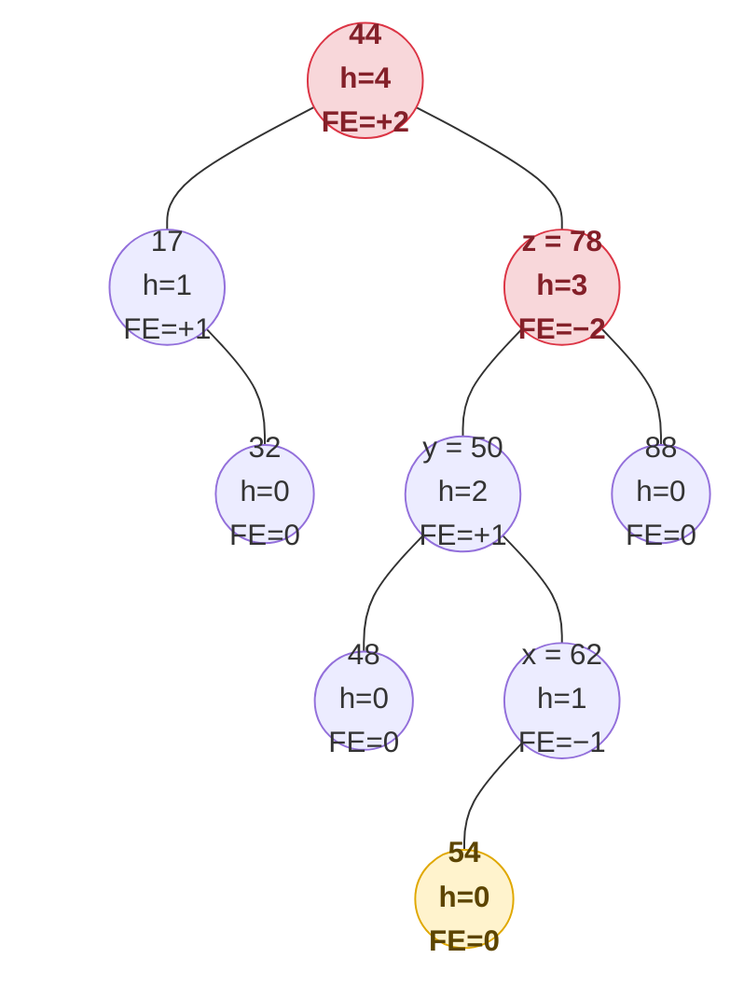

Subiendo desde 54, el primer nodo desbalanceado es **z = 78**. Su hijo más alto es **y = 50**, y el hijo más alto de 50 es **x = 62**. El camino z → y → x es **izquierda-derecha**: rotación **doble**. En inorden, a = 50, b = 62 y c = 78, así que 62 sube a la raíz del subárbol:

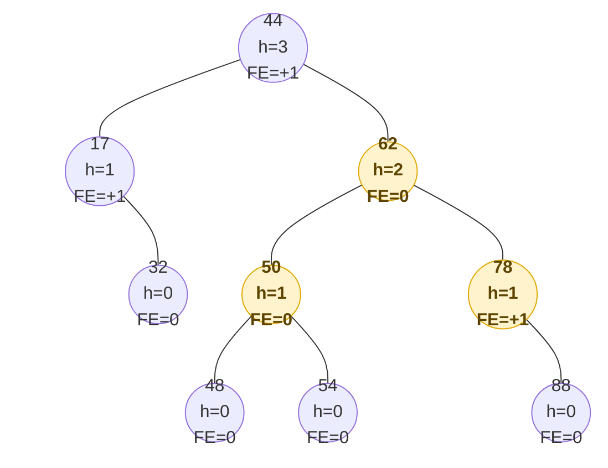

El subárbol de 62 tiene altura 2, la misma que tenía 78 antes de insertar, así que 44 también queda balanceado. Ahora todos los FE están entre −1 y +1.

### Eliminación

Se elimina igual que en un BST: se quita un nodo con a lo más un hijo interno, y ese hijo p sube a su lugar. En el camino de p a la raíz puede quedar **una** posición desbalanceada.

1. Sea **z** la primera posición desbalanceada **subiendo desde p**.
2. Sea **y** el hijo de z con **mayor altura** (esta vez **no** es ancestro de p: está del otro lado).
3. Sea **x** el hijo de y con mayor altura. **Si hay empate**, x es el hijo **del mismo lado** que y: si y es hijo izquierdo de z, x es el hijo izquierdo de y; si no, el derecho.
4. Se llama a **`restructure(x)`**.

El balance queda restaurado en el subárbol, pero la reestructuración **puede reducir en 1 su altura**, y eso puede desbalancear a un ancestro. Por eso se **sigue subiendo** hasta la raíz, reestructurando cada vez que se encuentra un nodo desbalanceado. Como la altura es O(log n), bastan **O(log n) reestructuraciones**.

Ejemplo (figura 11.13): eliminar **32** del árbol anterior. 17 queda con altura 0, y la raíz 44 tiene hijos de altura 0 y 2: FE = 2 − 0 = **+2**, así que **z = 44** está desbalanceado.

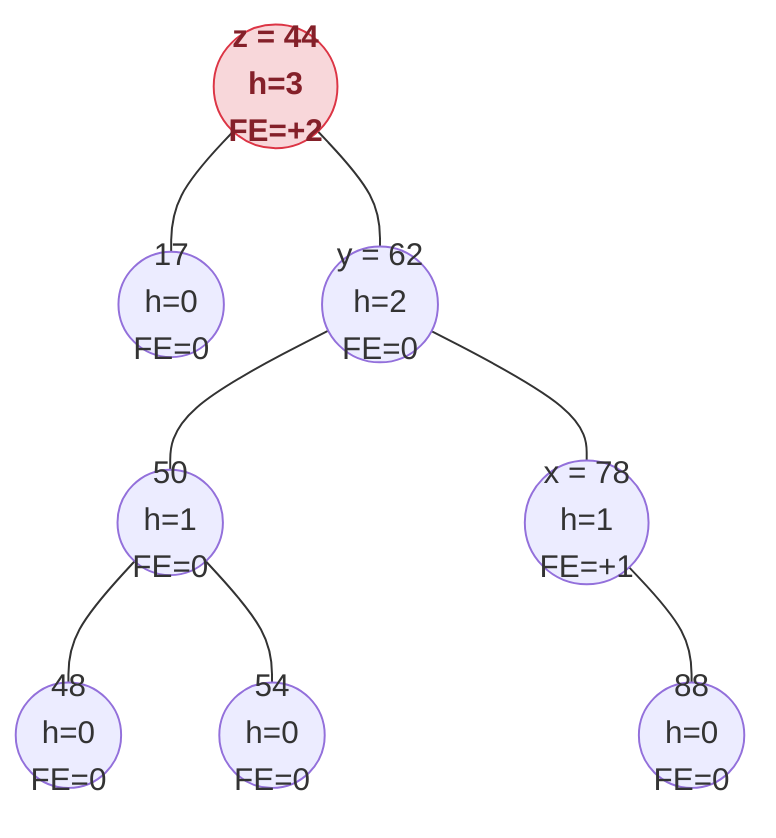

El hijo más alto de 44 es **y = 62**. Sus dos hijos tienen altura 1 (**empate**), y como y es hijo derecho, se elige el hijo derecho: **x = 78**. El camino es **derecha-derecha**: rotación **simple**, y 62 sube:

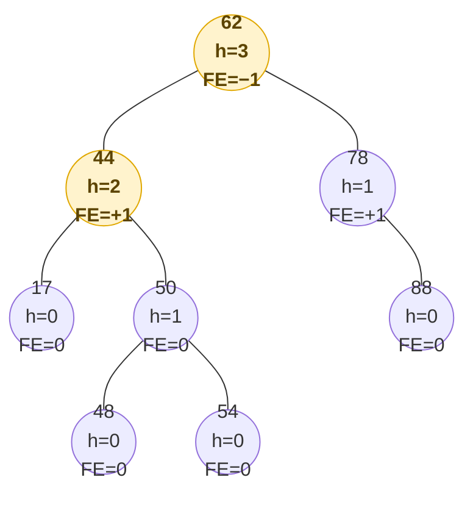

Ahora todos los FE están entre −1 y +1: el árbol vuelve a ser AVL.

¿Por qué importa la regla del empate? Si se eligiera el hijo del lado opuesto, el camino haría zigzag y la rotación doble podría dejar el árbol todavía desbalanceado. Eligiendo el del mismo lado, el camino va en línea recta y la rotación simple siempre lo arregla.

### Costo

Cada operación tiene una **fase de bajada** (la búsqueda) y una **fase de subida** (recalcular alturas y reestructurar), y cada una hace O(1) trabajo por nivel (figura 11.14). Como la altura es O(log n) (tabla 11.2):

| Método | BST | AVL |
|---|---|---|
| `size`, `isEmpty` | O(1) | O(1) |
| `get`, `put`, `remove` | O(h), O(n) en el peor caso | **O(log n)** |
| `firstEntry`, `lastEntry` | O(h) | O(log n) |
| `ceilingEntry`, `floorEntry`, `lowerEntry`, `higherEntry` | O(h) | O(log n) |
| `subMap` | O(s + h) | O(s + log n) |
| `entrySet`, `keySet`, `values` | O(n) | O(n) |


[⬅️ Volver al índice de la unidad](./index.md)
