Resumen de Goodrich, Tamassia y Goldwasser, *Data Structures and Algorithms in Java* (6.ª ed.), secciones 11.1 a 11.3. Se asume lo visto en [Árboles](./arboles.md). Para practicar, usa las pestañas **BST** y **AVL** de las [animaciones](./animaciones.html).

Colores de los diagramas: **azul** = camino de búsqueda, **amarillo** = lo que cambia, **rojo** = eliminado o desbalanceado.

## Árbol binario de búsqueda (BST)

Goodrich usa el BST para implementar un **mapa ordenado**: pares (clave, valor) sin claves repetidas, con `get(k)`, `put(k, v)` (si k existe, reemplaza el valor) y `remove(k)`. Al iterarlo, las claves salen **en orden**, y permite consultas como `floorEntry(k)` (mayor clave ≤ k) o `subMap(k1, k2)`.

### Definición

En cada nodo con clave k:

- las claves del subárbol **izquierdo** son **menores** que k;
- las del subárbol **derecho** son **mayores** que k.

Goodrich usa hojas **centinela** vacías (en código, `null`): una búsqueda fallida siempre termina en una, y ahí es donde se insertaría la clave. En los diagramas no se dibujan.

Figura 11.1, insertando **44, 17, 8, 32, 28, 21, 29, 88, 65, 54, 82, 76, 80, 97, 93**:

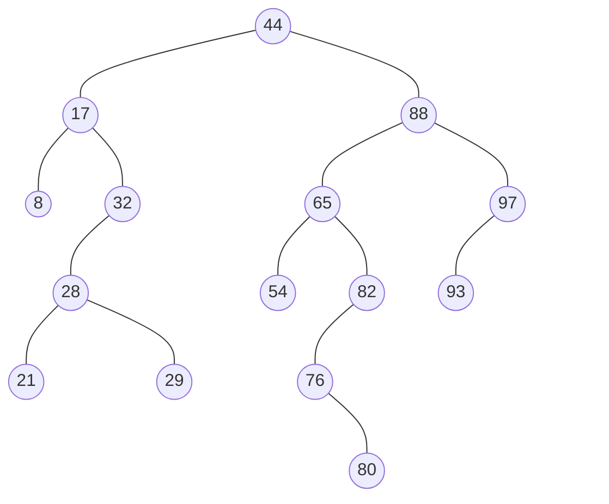

El recorrido **inorden** da las claves ordenadas: 8 17 21 28 29 32 44 54 65 76 80 82 88 93 97.

### Búsqueda

Se compara k con la clave del nodo: si es menor se baja a la izquierda, si es mayor a la derecha, si es igual se encontró. Llegar a una hoja vacía significa que **no está**.

```
Algoritmo TreeSearch(p, k):
    si p es externo:   devolver p                        {fallida}
    si k == key(p):    devolver p                        {exitosa}
    si k < key(p):     devolver TreeSearch(left(p), k)
    si no:             devolver TreeSearch(right(p), k)
```

Buscar **68** (figura 11.2):

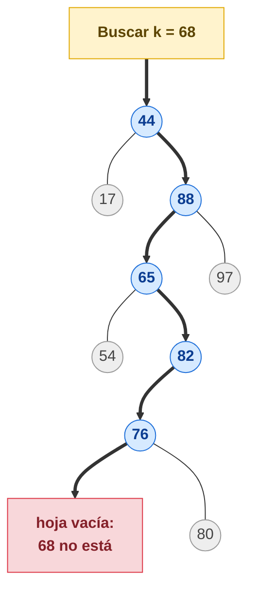

| Nodo | Comparación | Sigue por |
|------|-------------|-----------|
| 44 | 68 > 44 | derecha |
| 88 | 68 < 88 | izquierda |
| 65 | 68 > 65 | derecha |
| 82 | 68 < 82 | izquierda |
| 76 | 68 < 76 | izquierda → hoja vacía: **68 no está** |

Se visita un nodo por nivel: la búsqueda es **O(h)**, con h la altura.

### Inserción

`put(k, v)` busca k. Si la encuentra, reemplaza el valor; si no, guarda (k, v) en la hoja donde terminó la búsqueda, que es justo donde una búsqueda futura la esperaría.

Insertar **68** (figura 11.4): queda como hijo izquierdo de 76.

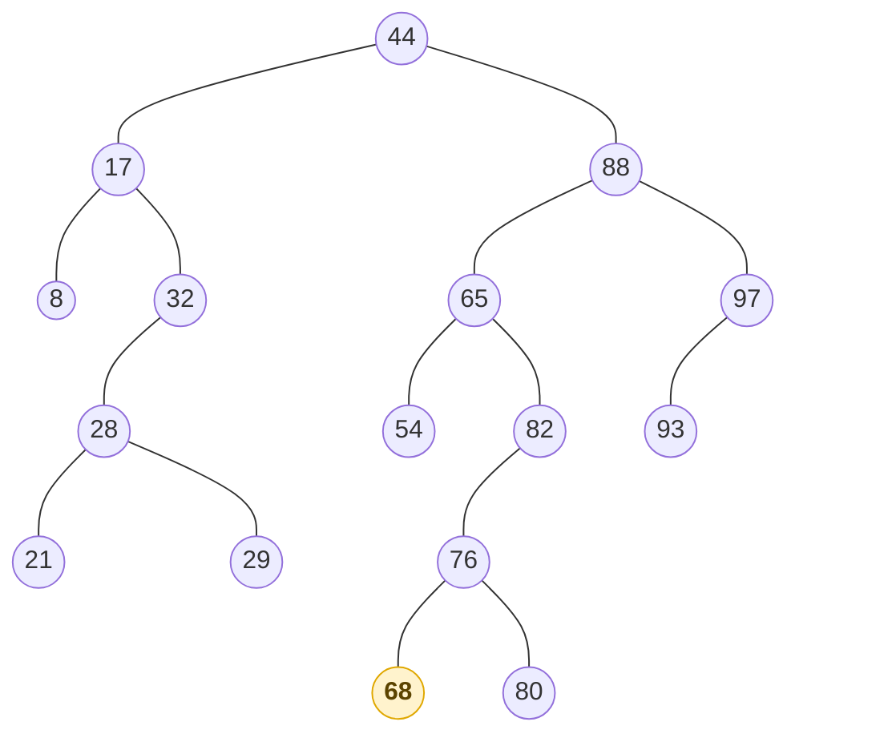

### Eliminación

Se busca k en el nodo p. Hay dos casos:

1. **p tiene a lo más un hijo.** Se quita p y su hijo (si tiene) **sube** a su lugar.
2. **p tiene dos hijos.** Se busca su **predecesor** r, el nodo **más a la derecha del subárbol izquierdo** (la mayor clave menor que la de p). Se copia r en p y se elimina r, que no tiene hijo derecho, así que es el caso 1.

#### Caso 1: eliminar 32

32 solo tiene hijo izquierdo (28): **28 sube** con su subárbol.

Antes:

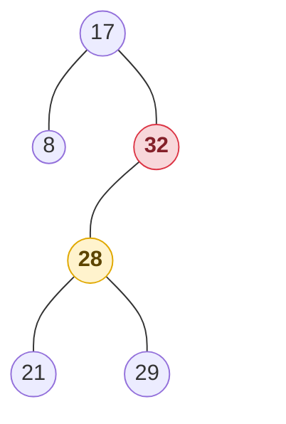

Después:

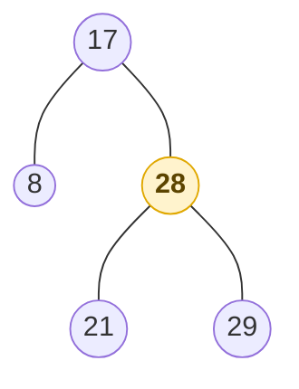

Si p es hoja, simplemente desaparece (por ejemplo, eliminar 93).

#### Caso 2: eliminar 88

Predecesor de 88: una vez a la izquierda (65) y luego a la derecha mientras se pueda → **82**. Se copia 82 en el lugar de 88 y se elimina el 82 original: su hijo 76 sube.

Antes:

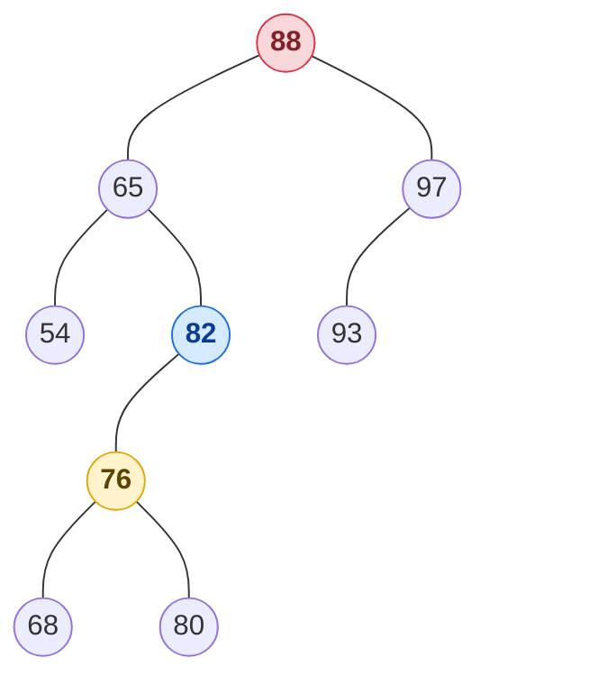

Después:

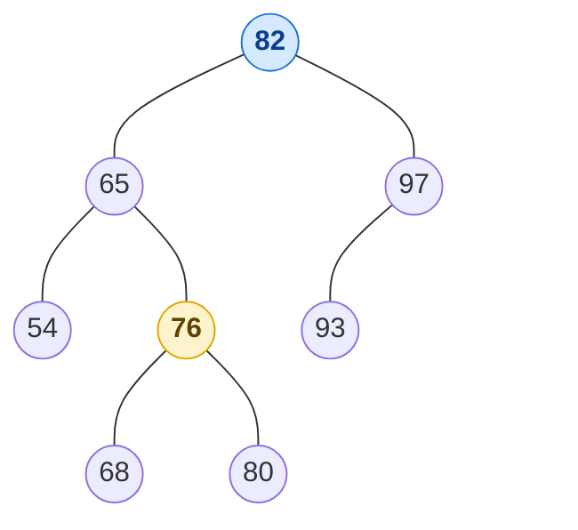

También es **O(h)**.

### Costo

Todo depende de la altura:

- **Mejor caso**: h ≈ log n, operaciones O(log n).
- **Peor caso**: h = n − 1, el árbol es una lista y todo cuesta O(n). Pasa al insertar claves **en orden** (figura 11.7):

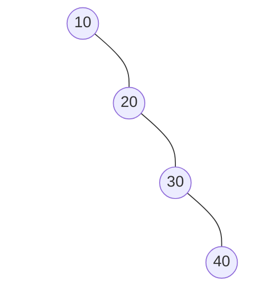

- **Promedio** (claves en orden aleatorio): altura O(log n).

Para garantizar O(log n) siempre, se usa un árbol balanceado como el AVL.

## Árboles AVL

### Definición

Un **AVL** (Adel'son-Vel'skii y Landis, 1962) es un BST que **se balancea solo**: en cada nodo, las alturas de sus dos hijos difieren **a lo más en 1**.

**Altura de un nodo**: aristas del camino más largo hacia abajo. Una hoja tiene h = 0 y un hijo que no existe cuenta como h = −1.

**Factor de equilibrio:**

> **FE = h(hijo derecho) − h(hijo izquierdo)**

Un nodo está balanceado si FE es −1, 0 o +1. Basta **un** nodo con FE = ±2 para que el árbol deje de ser AVL. Tras cada inserción o eliminación se revisa el camino a la raíz y se repara con una [rotación](#rotaciones).

| | BST común | AVL |
|---|---|---|
| Balance | no se controla | todo nodo con FE ∈ {−1, 0, +1} |
| Altura en el peor caso | n − 1 | ≤ 2 log n + 1 (en la práctica ≈ 1.44 log n) |
| Buscar, insertar, eliminar | O(n) en el peor caso | O(log n) siempre |
| Costo extra | ninguno | guardar la altura en cada nodo y rotar |

**Ejemplo de AVL** (figura 11.10):

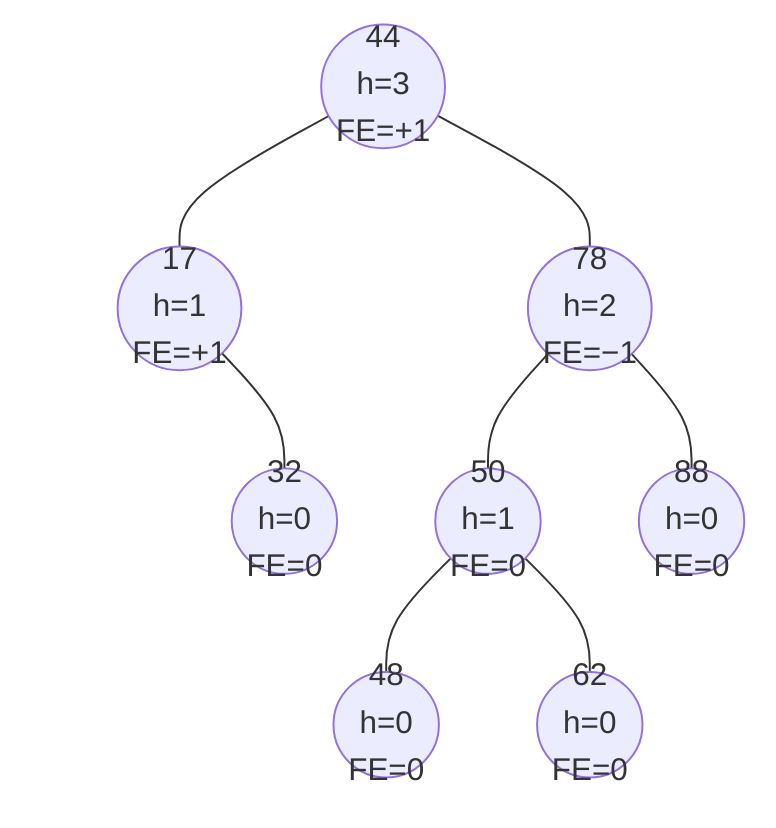

Por ejemplo, 17: FE = 0 − (−1) = +1; 78: FE = 0 − 1 = −1; 44: FE = 2 − 1 = +1. Todos entre −1 y +1.

**No es AVL**: si se quita el 32, la raíz 44 tiene hijos de altura 0 y 2, FE = **+2**.

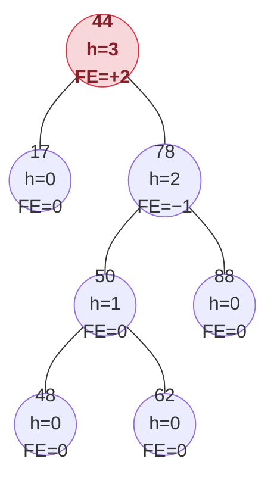

> **Si lees el libro:** Goodrich cuenta las hojas centinela como altura 0, así que sus alturas son 1 mayores que aquí. Los FE salen iguales.

### La altura es O(log n)

Sea n(h) el **mínimo** de nodos de un AVL de altura h. n(0) = 1, n(1) = 2 y, para h ≥ 2, la raíz más dos subárboles mínimos de alturas h − 1 y h − 2:

**n(h) = 1 + n(h − 1) + n(h − 2)**

Parecida a [Fibonacci](../unidad-2/recursion.md): crece exponencialmente. Como n(h − 1) > n(h − 2), se tiene n(h) > 2·n(h − 2) > … > 2<sup>⌊h/2⌋</sup>, y sacando logaritmos, **h ≤ 2 log n + 1**.

### Rotaciones

Un nodo desbalanceado **z** se arregla con su hijo **y** y su nieto **x** en el camino. La regla (Goodrich la llama **`restructure(x)`**):

> Ordenar x, y, z por clave (a < b < c). **El del medio (b) sube**, a queda a su izquierda y c a su derecha.

Los subárboles que colgaban se reacomodan en el mismo orden, así que sigue siendo BST. Es **O(1)**.

Con 10, 20 y 30 hay cuatro formas, y todas terminan igual (rojo = z, amarillo = el que sube):

<table>
<thead><tr><th>Forma de z → y → x</th><th>Antes</th><th>Después</th><th>Rotación</th></tr></thead>
<tbody>
<tr><td>izquierda-izquierda<br/><small>30 → 20 → 10</small></td><td><svg width="130" height="122" viewBox="0 0 130 122" role="img"><line x1="98" y1="22" x2="68" y2="62" stroke="#34495e" stroke-width="2"/><line x1="68" y1="62" x2="38" y2="102" stroke="#34495e" stroke-width="2"/><circle cx="98" cy="22" r="15" fill="#f8d7da" stroke="#dc3545" stroke-width="2"/><text x="98" y="27" text-anchor="middle" font-size="13" font-weight="bold" fill="#842029">30</text><text x="122" y="26" text-anchor="middle" font-size="12" font-style="italic" fill="#666">z</text><circle cx="68" cy="62" r="15" fill="#ffffff" stroke="#34495e" stroke-width="2"/><text x="68" y="67" text-anchor="middle" font-size="13" font-weight="bold" fill="#222222">20</text><text x="44" y="66" text-anchor="middle" font-size="12" font-style="italic" fill="#666">y</text><circle cx="38" cy="102" r="15" fill="#ffffff" stroke="#34495e" stroke-width="2"/><text x="38" y="107" text-anchor="middle" font-size="13" font-weight="bold" fill="#222222">10</text><text x="14" y="106" text-anchor="middle" font-size="12" font-style="italic" fill="#666">x</text></svg></td><td><svg width="130" height="102" viewBox="0 0 130 102" role="img"><line x1="67" y1="22" x2="37" y2="82" stroke="#34495e" stroke-width="2"/><line x1="67" y1="22" x2="97" y2="82" stroke="#34495e" stroke-width="2"/><circle cx="67" cy="22" r="15" fill="#fff3cd" stroke="#e0a800" stroke-width="2"/><text x="67" y="27" text-anchor="middle" font-size="13" font-weight="bold" fill="#5c4400">20</text><text x="91" y="26" text-anchor="middle" font-size="12" font-style="italic" fill="#666">y</text><circle cx="37" cy="82" r="15" fill="#ffffff" stroke="#34495e" stroke-width="2"/><text x="37" y="87" text-anchor="middle" font-size="13" font-weight="bold" fill="#222222">10</text><text x="13" y="86" text-anchor="middle" font-size="12" font-style="italic" fill="#666">x</text><circle cx="97" cy="82" r="15" fill="#ffffff" stroke="#34495e" stroke-width="2"/><text x="97" y="87" text-anchor="middle" font-size="13" font-weight="bold" fill="#222222">30</text><text x="121" y="86" text-anchor="middle" font-size="12" font-style="italic" fill="#666">z</text></svg></td><td><b>simple</b>: 20 (y) sube una vez</td></tr>
<tr><td>derecha-derecha<br/><small>10 → 20 → 30</small></td><td><svg width="130" height="122" viewBox="0 0 130 122" role="img"><line x1="40" y1="22" x2="70" y2="62" stroke="#34495e" stroke-width="2"/><line x1="70" y1="62" x2="100" y2="102" stroke="#34495e" stroke-width="2"/><circle cx="40" cy="22" r="15" fill="#f8d7da" stroke="#dc3545" stroke-width="2"/><text x="40" y="27" text-anchor="middle" font-size="13" font-weight="bold" fill="#842029">10</text><text x="64" y="26" text-anchor="middle" font-size="12" font-style="italic" fill="#666">z</text><circle cx="70" cy="62" r="15" fill="#ffffff" stroke="#34495e" stroke-width="2"/><text x="70" y="67" text-anchor="middle" font-size="13" font-weight="bold" fill="#222222">20</text><text x="94" y="66" text-anchor="middle" font-size="12" font-style="italic" fill="#666">y</text><circle cx="100" cy="102" r="15" fill="#ffffff" stroke="#34495e" stroke-width="2"/><text x="100" y="107" text-anchor="middle" font-size="13" font-weight="bold" fill="#222222">30</text><text x="124" y="106" text-anchor="middle" font-size="12" font-style="italic" fill="#666">x</text></svg></td><td><svg width="130" height="102" viewBox="0 0 130 102" role="img"><line x1="67" y1="22" x2="37" y2="82" stroke="#34495e" stroke-width="2"/><line x1="67" y1="22" x2="97" y2="82" stroke="#34495e" stroke-width="2"/><circle cx="67" cy="22" r="15" fill="#fff3cd" stroke="#e0a800" stroke-width="2"/><text x="67" y="27" text-anchor="middle" font-size="13" font-weight="bold" fill="#5c4400">20</text><text x="91" y="26" text-anchor="middle" font-size="12" font-style="italic" fill="#666">y</text><circle cx="37" cy="82" r="15" fill="#ffffff" stroke="#34495e" stroke-width="2"/><text x="37" y="87" text-anchor="middle" font-size="13" font-weight="bold" fill="#222222">10</text><text x="13" y="86" text-anchor="middle" font-size="12" font-style="italic" fill="#666">z</text><circle cx="97" cy="82" r="15" fill="#ffffff" stroke="#34495e" stroke-width="2"/><text x="97" y="87" text-anchor="middle" font-size="13" font-weight="bold" fill="#222222">30</text><text x="121" y="86" text-anchor="middle" font-size="12" font-style="italic" fill="#666">x</text></svg></td><td><b>simple</b>: 20 (y) sube una vez</td></tr>
<tr><td>izquierda-derecha<br/><small>30 → 10 → 20</small></td><td><svg width="130" height="122" viewBox="0 0 130 122" role="img"><line x1="85" y1="22" x2="45" y2="62" stroke="#34495e" stroke-width="2"/><line x1="45" y1="62" x2="75" y2="102" stroke="#34495e" stroke-width="2"/><circle cx="85" cy="22" r="15" fill="#f8d7da" stroke="#dc3545" stroke-width="2"/><text x="85" y="27" text-anchor="middle" font-size="13" font-weight="bold" fill="#842029">30</text><text x="109" y="26" text-anchor="middle" font-size="12" font-style="italic" fill="#666">z</text><circle cx="45" cy="62" r="15" fill="#ffffff" stroke="#34495e" stroke-width="2"/><text x="45" y="67" text-anchor="middle" font-size="13" font-weight="bold" fill="#222222">10</text><text x="21" y="66" text-anchor="middle" font-size="12" font-style="italic" fill="#666">y</text><circle cx="75" cy="102" r="15" fill="#ffffff" stroke="#34495e" stroke-width="2"/><text x="75" y="107" text-anchor="middle" font-size="13" font-weight="bold" fill="#222222">20</text><text x="99" y="106" text-anchor="middle" font-size="12" font-style="italic" fill="#666">x</text></svg></td><td><svg width="130" height="102" viewBox="0 0 130 102" role="img"><line x1="67" y1="22" x2="37" y2="82" stroke="#34495e" stroke-width="2"/><line x1="67" y1="22" x2="97" y2="82" stroke="#34495e" stroke-width="2"/><circle cx="67" cy="22" r="15" fill="#fff3cd" stroke="#e0a800" stroke-width="2"/><text x="67" y="27" text-anchor="middle" font-size="13" font-weight="bold" fill="#5c4400">20</text><text x="91" y="26" text-anchor="middle" font-size="12" font-style="italic" fill="#666">x</text><circle cx="37" cy="82" r="15" fill="#ffffff" stroke="#34495e" stroke-width="2"/><text x="37" y="87" text-anchor="middle" font-size="13" font-weight="bold" fill="#222222">10</text><text x="13" y="86" text-anchor="middle" font-size="12" font-style="italic" fill="#666">y</text><circle cx="97" cy="82" r="15" fill="#ffffff" stroke="#34495e" stroke-width="2"/><text x="97" y="87" text-anchor="middle" font-size="13" font-weight="bold" fill="#222222">30</text><text x="121" y="86" text-anchor="middle" font-size="12" font-style="italic" fill="#666">z</text></svg></td><td><b>doble</b>: 20 (x) sube dos veces</td></tr>
<tr><td>derecha-izquierda<br/><small>10 → 30 → 20</small></td><td><svg width="130" height="122" viewBox="0 0 130 122" role="img"><line x1="35" y1="22" x2="75" y2="62" stroke="#34495e" stroke-width="2"/><line x1="75" y1="62" x2="45" y2="102" stroke="#34495e" stroke-width="2"/><circle cx="35" cy="22" r="15" fill="#f8d7da" stroke="#dc3545" stroke-width="2"/><text x="35" y="27" text-anchor="middle" font-size="13" font-weight="bold" fill="#842029">10</text><text x="59" y="26" text-anchor="middle" font-size="12" font-style="italic" fill="#666">z</text><circle cx="75" cy="62" r="15" fill="#ffffff" stroke="#34495e" stroke-width="2"/><text x="75" y="67" text-anchor="middle" font-size="13" font-weight="bold" fill="#222222">30</text><text x="99" y="66" text-anchor="middle" font-size="12" font-style="italic" fill="#666">y</text><circle cx="45" cy="102" r="15" fill="#ffffff" stroke="#34495e" stroke-width="2"/><text x="45" y="107" text-anchor="middle" font-size="13" font-weight="bold" fill="#222222">20</text><text x="21" y="106" text-anchor="middle" font-size="12" font-style="italic" fill="#666">x</text></svg></td><td><svg width="130" height="102" viewBox="0 0 130 102" role="img"><line x1="67" y1="22" x2="37" y2="82" stroke="#34495e" stroke-width="2"/><line x1="67" y1="22" x2="97" y2="82" stroke="#34495e" stroke-width="2"/><circle cx="67" cy="22" r="15" fill="#fff3cd" stroke="#e0a800" stroke-width="2"/><text x="67" y="27" text-anchor="middle" font-size="13" font-weight="bold" fill="#5c4400">20</text><text x="91" y="26" text-anchor="middle" font-size="12" font-style="italic" fill="#666">x</text><circle cx="37" cy="82" r="15" fill="#ffffff" stroke="#34495e" stroke-width="2"/><text x="37" y="87" text-anchor="middle" font-size="13" font-weight="bold" fill="#222222">10</text><text x="13" y="86" text-anchor="middle" font-size="12" font-style="italic" fill="#666">z</text><circle cx="97" cy="82" r="15" fill="#ffffff" stroke="#34495e" stroke-width="2"/><text x="97" y="87" text-anchor="middle" font-size="13" font-weight="bold" fill="#222222">30</text><text x="121" y="86" text-anchor="middle" font-size="12" font-style="italic" fill="#666">y</text></svg></td><td><b>doble</b>: 20 (x) sube dos veces</td></tr>
</tbody>
</table>

Si el camino va **en línea recta**, basta una rotación **simple**; si hace **zigzag**, hace falta una **doble**.

### Inserción

Se inserta como en un BST y se sube desde el nuevo nodo:

1. **z** = primer nodo desbalanceado.
2. **y** = hijo de z con mayor altura; **x** = hijo de y con mayor altura.
3. `restructure(x)`.

El subárbol recupera la altura que tenía antes de insertar, así que **una sola rotación basta**.

Insertar **54** (figura 11.11): 78 y 44 quedan con FE = ±2.

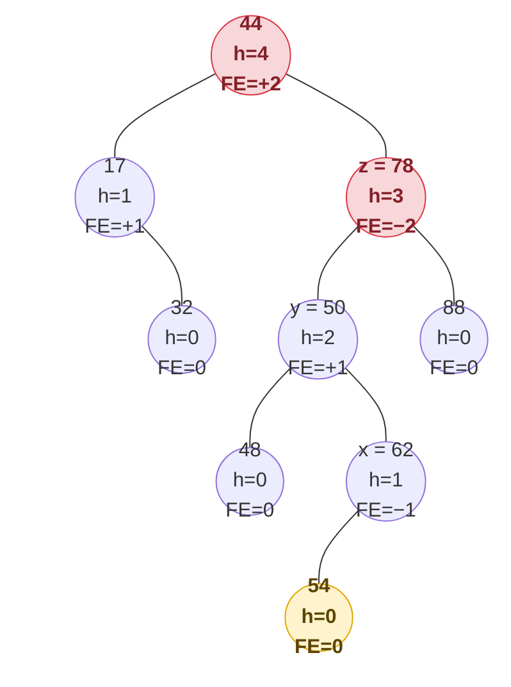

z = 78, y = 50, x = 62. El camino es izquierda-derecha (zigzag): **doble**, y 62 sube:

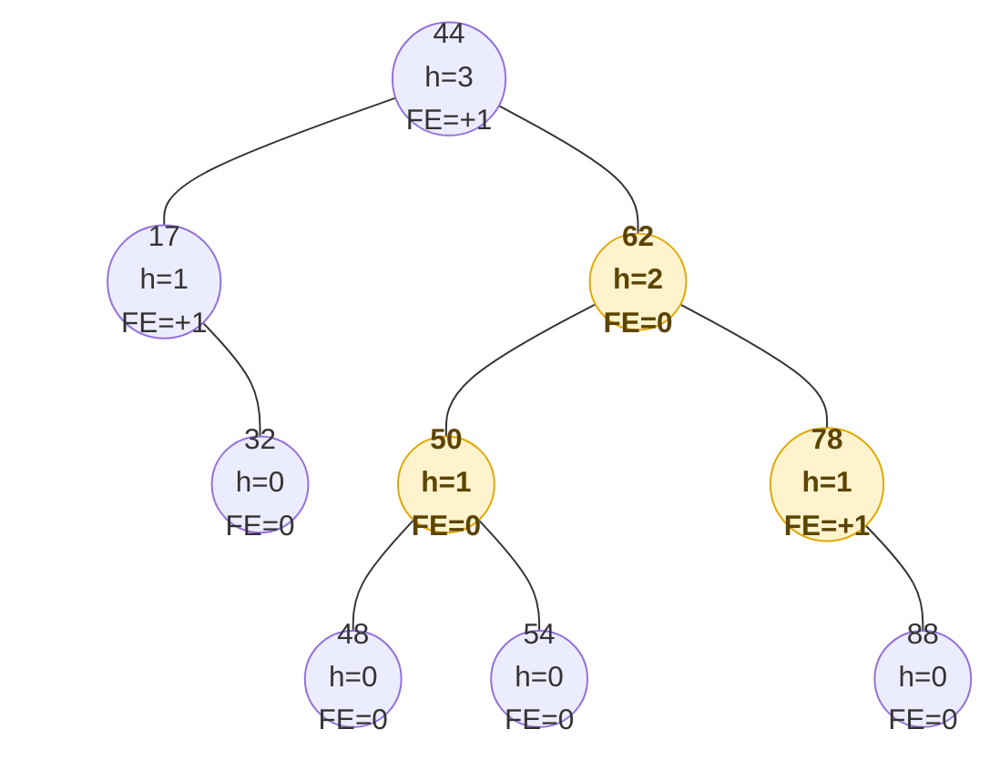

### Eliminación

Se elimina como en un BST y se sube desde el lugar del nodo quitado, con la misma elección de z, y, x. Dos diferencias:

- Si los hijos de y **empatan** en altura, x es el del **mismo lado** que y, para que la rotación sea simple y siempre funcione.
- La rotación puede **bajar en 1** la altura del subárbol, así que hay que **seguir subiendo** hasta la raíz: hasta O(log n) rotaciones.

Eliminar **32** (figura 11.13): z = 44 con FE = +2.

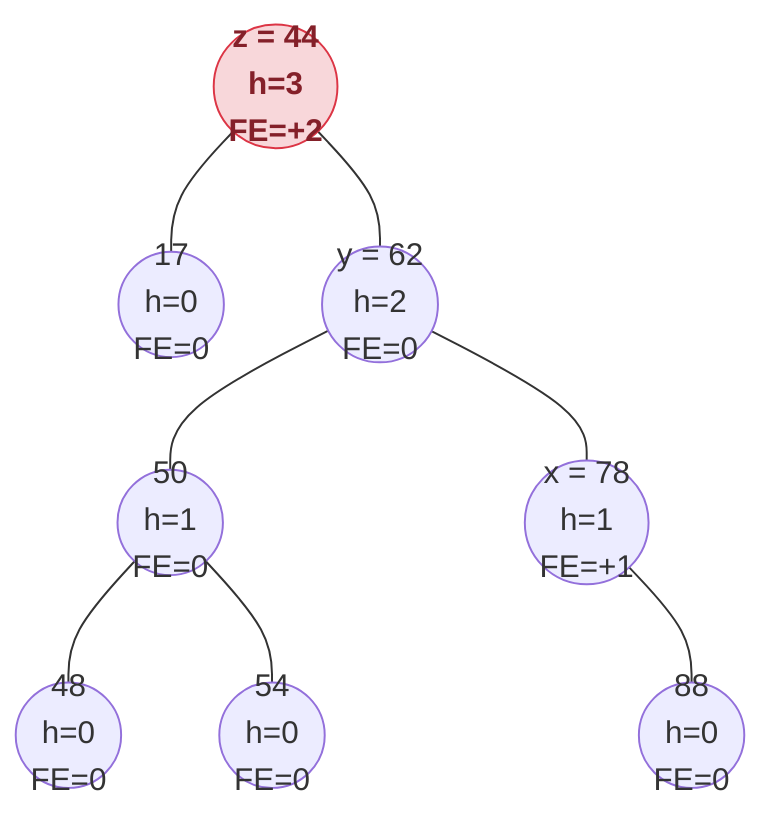

y = 62. Sus hijos empatan (altura 1) y y es hijo derecho, así que x = 78. Camino derecha-derecha: **simple**, y 62 sube:

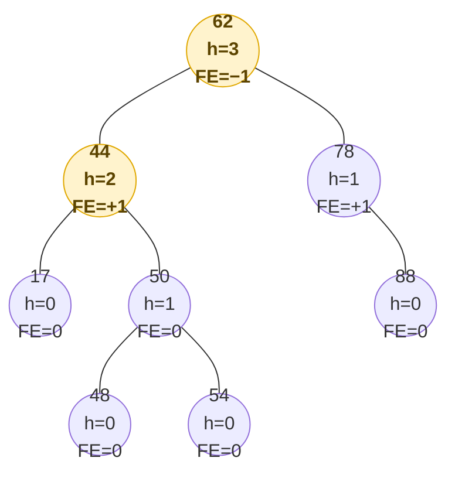

### Costo

Cada operación baja buscando y sube recalculando alturas, con O(1) por nivel (tabla 11.2):

| Método | BST | AVL |
|---|---|---|
| `size`, `isEmpty` | O(1) | O(1) |
| `get`, `put`, `remove` | O(h), O(n) en el peor caso | **O(log n)** |
| `firstEntry`, `floorEntry`, `higherEntry`… | O(h) | O(log n) |
| `subMap` (s entradas) | O(s + h) | O(s + log n) |
| `entrySet`, `keySet`, `values` | O(n) | O(n) |

[⬅️ Volver al índice de la unidad](./index.md)
