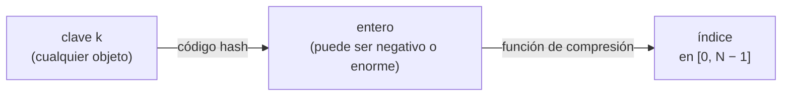
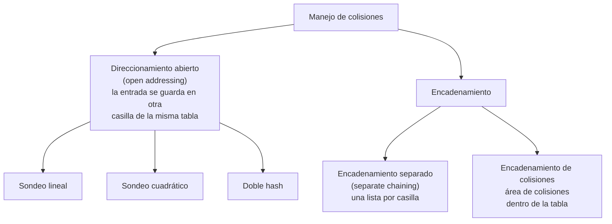

Resumen de Goodrich, Tamassia y Goldwasser, *Data Structures and Algorithms in Java* (6.ª ed.), sección 10.2, con la sección 11.1 de de la Cueva, González y Salinas, *Estructuras de datos y algoritmos fundamentales*. Para practicar, usa la pestaña **Hash** de las [animaciones](./animaciones.html).

## La idea

### El ADT Mapa

Una tabla hash implementa un **mapa**: entradas (clave, valor) **sin claves repetidas**.

| Método | Descripción |
|---|---|
| `put(k, v)` | agrega (k, v) y devuelve `null`; si k ya existe, **reemplaza** el valor y devuelve el anterior |
| `get(k)` | valor asociado a k, o `null` |
| `remove(k)` | elimina k y devuelve su valor, o `null` |
| `size()`, `isEmpty()` | cantidad de entradas / si está vacío |
| `keySet()`, `values()`, `entrySet()` | claves, valores o entradas, **sin orden garantizado** |

Ejemplo sobre un mapa vacío:

| Operación | Devuelve | Contenido |
|---|---|---|
| `put(5, A)` | null | {(5,A)} |
| `put(7, B)` | null | {(5,A), (7,B)} |
| `put(2, C)` | null | {(5,A), (7,B), (2,C)} |
| `put(2, E)` | C | {(5,A), (7,B), (2,E)} |
| `get(7)` | B | {(5,A), (7,B), (2,E)} |
| `get(4)` | null | {(5,A), (7,B), (2,E)} |
| `remove(5)` | A | {(7,B), (2,E)} |

La misma técnica implementa un **conjunto** (solo claves): `add(e)`, `remove(e)` y `contains(e)` (pertenencia).

### De la consulta directa a la función hash

Si las claves fueran enteros entre 0 y N − 1, bastaría guardar la clave k en la casilla k: todo O(1). Figura 10.3 de Goodrich, entradas (1,D), (3,Z), (6,C) y (7,Q):

| 0 | 1 | 2 | 3 | 4 | 5 | 6 | 7 | 8 | 9 | 10 |
|---|---|---|---|---|---|---|---|---|---|---|
| | D | | Z | | | C | Q | | | |
{: .arreglo}

Pero si el rango es enorme (un número de cuenta de 11 dígitos pediría 10¹¹ casillas) o las claves no son enteros, no sirve.

La solución es una **función hash** h que convierte cualquier clave en un índice de [0, N − 1] y guardar (k, v) en `A[h(k)]`. Como hay muchas más claves posibles que casillas, dos claves pueden caer en la misma casilla: una **colisión**. Hace falta entonces:

1. una **buena función hash**: rápida y que reparta las claves uniformemente;
2. una **estrategia para las colisiones**.

## Funciones hash

Se separa en dos etapas:

El código hash no depende de N; solo la compresión. Si la tabla crece, basta volver a comprimir.

### Códigos hash

Si dos claves chocan en el código hash, ninguna compresión las separa.

- **Bits como entero.** Un dato de 32 bits se lee como entero. Uno de 64 bits se parte en dos mitades que se suman o se combinan con ⊕ (o exclusivo).
- **Sumar los caracteres no sirve**: `"stop"`, `"pots"`, `"tops"` y `"spot"` suman 454.
- **Polinomial.** Cada carácter se multiplica por una potencia de una constante a según su posición. Con la **regla de Horner**: h = 0 y, por cada carácter, h ← h·a + xᵢ. Para `"stop"` con a = 33: 115 → 3 911 → 129 174 → **4 262 854**, mientras `"pots"` da 4 149 766. El desbordamiento se ignora. Java usa a = 31.
- **Corrimiento cíclico.** En lugar de multiplicar, se rotan los bits (por ejemplo 5) antes de sumar el siguiente carácter. En 230 000 palabras, sin rotar chocan 234 735; rotando 5 bits, 190.

**Regla:** si x es igual a y, entonces código(x) = código(y). Si no, `get` no encontraría lo que `put` guardó.

### Funciones de compresión

- **División:** h(k) = k mod N, con **N primo**, sin importar cómo se manejen las colisiones: si N es compuesto, las claves que comparten factores con N se amontonan en pocas casillas. Con N = 10, las claves 10, 20, 30, 40 y 50 caen todas en la 0; con N = 11, en 10, 9, 8, 7 y 6. Con N = 100, las claves 200, 205, …, 600 chocan de a cuatro; con N = 101, ninguna.
- **MAD:** h(k) = [(a·k + b) mod p] mod N, con p primo mayor que N, y a > 0 y b al azar en [0, p − 1]. El azar rompe patrones.
- **Sobre los dígitos:**

| Método | Idea | Ejemplo |
|---|---|---|
| Selección de dígitos | tomar algunos dígitos | 123456789, posiciones 2, 5 y 8 → **258** |
| Cuadrado medio | elevar al cuadrado y tomar los dígitos centrales | 4567² = 20 8**57** 489 → **57** |
| Plegamiento | sumar grupos de dígitos | 123 + 456 + 789 = 1368 → **368** |

## Manejo de colisiones

### Encadenamiento separado

Cada casilla `A[j]` guarda una **lista** con las entradas cuya clave cumple h(k) = j. `put`, `get` y `remove` calculan h(k) y operan **solo en esa lista**. Figura 10.6 de Goodrich, N = 13, h(k) = k mod 13:

![Tabla de 13 cubetas: A[2] → 54 → 28 → 41, A[5] → 18, A[10] → 10 → 36, A[12] → 25 → 38 → 12 → 90; las demás vacías](../../assets/encadenamiento-separado.svg)

Con una buena función hash cada lista mide en promedio n/N.

En el **encadenamiento de colisiones** no hay listas aparte: la tabla reserva una zona para las claves que chocan, y cada casilla guarda el índice de la siguiente de su cadena.

### Direccionamiento abierto

Cada entrada vive directamente en una casilla (requiere n ≤ N). Si h(k) está ocupada, se **sondea** otra casilla, tratando la tabla como circular.

#### Sondeo lineal

Se prueban h(k), h(k) + 1, h(k) + 2, … (mod N). Ejemplo: N = 11, h(k) = k mod 11, insertando 7, 17, 6, 33, 28, 52, 21.

| Clave | h(k) | Casillas probadas | Queda en |
|---|---|---|---|
| 7 | 7 | 7 | 7 |
| 17 | 6 | 6 | 6 |
| 6 | 6 | 6 ✗, 7 ✗, 8 | 8 |
| 33 | 0 | 0 | 0 |
| 28 | 6 | 6 ✗, 7 ✗, 8 ✗, 9 | 9 |
| 52 | 8 | 8 ✗, 9 ✗, 10 | 10 |
| 21 | 10 | 10 ✗, 0 ✗, 1 | 1 (dio la vuelta) |

| 0 | 1 | 2 | 3 | 4 | 5 | 6 | 7 | 8 | 9 | 10 |
|---|---|---|---|---|---|---|---|---|---|---|
| 33 | 21 | | | | | 17 | 7 | 6 | 28 | 52 |
{: .arreglo}

**Búsqueda:** desde h(k) hasta encontrar k o una casilla **vacía** (entonces no está).

**Borrado con DEFUNCT.** Figura 10.7 de Goodrich:

| 0 | 1 | 2 | 3 | 4 | 5 | 6 | 7 | 8 | 9 | 10 |
|---|---|---|---|---|---|---|---|---|---|---|
| | | 13 | | 26 | 5 | 37 | 16 | **15** | | 21 |
{: .arreglo}

h(15) = 4, pero quedó en la 8. Si se borra el 37 dejando la 6 vacía, buscar 15 pararía en la 6: "no está". **Error.** Por eso lo borrado se marca **DEFUNCT**:

- `get` salta las DEFUNCT y solo se detiene en una casilla vacía;
- `put` también sigue, pero recuerda la primera DEFUNCT y, si la clave no aparece, inserta ahí;
- `remove` marca la casilla DEFUNCT en vez de vaciarla.

**Agrupamiento primario:** el sondeo lineal forma bloques de casillas ocupadas (en el ejemplo, 6 a 1). Cada clave que cae ahí los alarga y las búsquedas se vuelven lentas.

#### Sondeo cuadrático

Se prueban (h(k) + i²) mod N: saltos de 1, 4, 9… Evita los bloques, pero claves con la misma base siguen la misma secuencia (**agrupamiento secundario**). Con N primo y la tabla a menos de la mitad, siempre encuentra casilla.

#### Doble hash

El salto lo da una segunda función: (h(k) + i·h′(k)) mod N. Cada clave salta distinto, así que no hay agrupamiento. h′ nunca debe dar 0; una opción común es h′(k) = q − (k mod q), con q primo menor que N.

## Factor de carga y rehashing

El **factor de carga** λ = n / N mide qué tan llena está la tabla y determina el costo. Goodrich recomienda λ < 0.9 con encadenamiento (Java usa 0.75) y λ < 0.5 con sondeo lineal.

Si una inserción pasa el umbral, se hace **rehashing**: se crea una tabla de tamaño ≈ 2N (idealmente primo) y se **reinserta** todo, porque la compresión depende de N.

Ejemplo con sondeo lineal, umbral 0.5: con N = 5 se insertan 3, 8 y 12.

| 0 | 1 | 2 | 3 | 4 |
|---|---|---|---|---|
| | | 12 | 3 | 8 |
{: .arreglo}

λ = 3/5 = 0.6 > 0.5. Con N = 11: 3 → 3, 8 → 8, 12 → 1, y λ ≈ 0.27.

| 0 | 1 | 2 | 3 | 4 | 5 | 6 | 7 | 8 | 9 | 10 |
|---|---|---|---|---|---|---|---|---|---|---|
| | 12 | | 3 | | | | | 8 | | |
{: .arreglo}

Reinsertar cuesta O(n), pero como se duplica el tamaño, ocurre cada vez menos: suma O(1) **amortizado** a cada `put`.

## Eficiencia

Con una buena función hash y λ acotado, cada cubeta tiene O(1) entradas. En el peor caso todas las claves caen en la misma casilla y la tabla se vuelve una lista (tabla 10.2):

| Método | Lista sin orden | Tabla hash (esperado) | Tabla hash (peor caso) |
|---|---|---|---|
| `get`, `put`, `remove` | O(n) | **O(1)** | O(n) |
| `size`, `isEmpty` | O(1) | O(1) | O(1) |
| `entrySet`, `keySet`, `values` | O(n) | O(n) | O(n) |

Lo que **no** ofrece es orden: no hay forma eficiente de recorrer en orden ni pedir un rango. Para eso está el [BST/AVL](./bst-avl.md).

**Anécdota (Goodrich):** en 2011 se atacaron servidores web enviando miles de parámetros con el mismo código hash; cada inserción pasaba a O(n). Java respondió agregando aleatoriedad a los códigos hash.

## Ejercicios

Las claves se insertan en este orden: **5, 100, 43, 26, 29, 52, 29, 44, 3, 10, 113, 126**.

**1.** Tabla de 13 posiciones, h(k) = k mod 13, direccionamiento abierto con sondeo de salto 2: se prueban (h(k) + 2i) mod 13 para i = 0, 1, 2, … Mostrar cómo queda la tabla.

Solución

| Clave | h(k) | Casillas probadas | Queda en |
|---|---|---|---|
| 5 | 5 | 5 | 5 |
| 100 | 9 | 9 | 9 |
| 43 | 4 | 4 | 4 |
| 26 | 0 | 0 | 0 |
| 29 | 3 | 3 | 3 |
| 52 | 0 | 0 ✗, 2 | 2 |
| 29 | 3 | 3 (ya está) | no se inserta: es un conjunto |
| 44 | 5 | 5 ✗, 7 | 7 |
| 3 | 3 | 3 ✗, 5 ✗, 7 ✗, 9 ✗, 11 | 11 |
| 10 | 10 | 10 | 10 |
| 113 | 9 | 9 ✗, 11 ✗, 0 ✗, 2 ✗, 4 ✗, 6 | 6 |
| 126 | 9 | 9 ✗, 11 ✗, 0 ✗, 2 ✗, 4 ✗, 6 ✗, 8 | 8 |

| 0 | 1 | 2 | 3 | 4 | 5 | 6 | 7 | 8 | 9 | 10 | 11 | 12 |
|---|---|---|---|---|---|---|---|---|---|---|---|---|
| 26 | | 52 | 29 | 43 | 5 | 113 | 44 | 126 | 100 | 10 | 3 | |
{: .arreglo}

Saltar de 2 en 2 funciona porque 13 es primo: el salto recorre todas las casillas antes de repetir. Con N par, un salto de 2 solo visitaría la mitad de la tabla.

**2.** Tabla de 13 posiciones, h(k) = k mod 13, encadenamiento separado. Mostrar cómo queda la tabla.

Solución

| Casilla | Lista |
|---|---|
| 0 | 26 → 52 |
| 1, 2 | — |
| 3 | 29 → 3 |
| 4 | 43 |
| 5 | 5 → 44 |
| 6, 7, 8 | — |
| 9 | 100 → 113 → 126 |
| 10 | 10 |
| 11, 12 | — |

El segundo 29 no se agrega porque ya está en la lista de la casilla 3.

**3.** Con la tabla del ejercicio 1, borrar el 52 y luego buscar el 113. ¿Qué pasa si la casilla 2 se deja vacía en lugar de marcarla DEFUNCT?

**4.** Calcular λ al final de los ejercicios 1 y 2. Según Goodrich, ¿ya habría que hacer rehashing en alguno de los dos?

[⬅️ Volver al índice de la unidad](./index.md)
