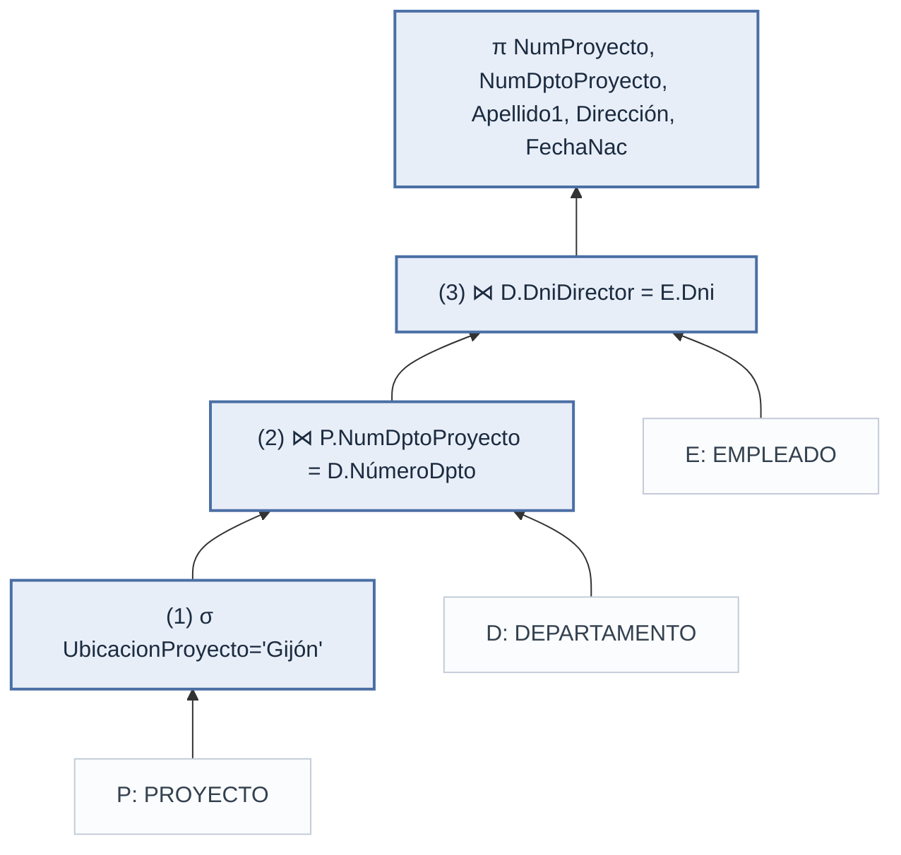

## ¿Qué es el álgebra relacional?

- Es el **conjunto de operaciones básicas** del modelo relacional: permite especificar peticiones de recuperación
- Cada operación recibe una o dos relaciones y **produce una nueva relación** → las operaciones se pueden encadenar
- Una secuencia de operaciones forma una **expresión de álgebra relacional**
- Es importante porque:
  1. Da el **fundamento formal** de las operaciones del modelo relacional
  2. Es la base para la **implementación y optimización de consultas** en los RDBMS
  3. Varios de sus conceptos están incorporados en **SQL**
- Es **procedimental**: indica *cómo* (en qué orden) obtener el resultado. El cálculo relacional, en cambio, solo indica *qué* debe contener

### Dos grupos de operaciones

| Grupo | Operaciones |
| --- | --- |
| Teoría de conjuntos | UNIÓN (∪), INTERSECCIÓN (∩), DIFERENCIA (−), PRODUCTO CARTESIANO (×) |
| Específicas de bases de datos relacionales | SELECCIÓN (σ), PROYECCIÓN (π), RENOMBRAR (ρ), CONCATENACIÓN / JOIN (⋈), DIVISIÓN (÷) |

## Esquema de trabajo: EMPRESA

```text
EMPLEADO(Nombre, Apellido1, Apellido2, Dni, FechaNac, Dirección, Sexo, Sueldo, SuperDni, Dno)
DEPARTAMENTO(NombreDpto, NúmeroDpto, DniDirector, FechaIngresoDirector)
LOCALIZACIONES_DPTO(NúmeroDpto, UbicaciónDpto)
PROYECTO(NombreProyecto, NumProyecto, UbicacionProyecto, NumDptoProyecto)
TRABAJA_EN(DniEmpleado, NumProy, Horas)
SUBORDINADO(DniEmpleado, NombreSubordinado, Sexo, FechaNac, Relación)
```

## Operaciones unarias

### SELECCIÓN (σ)

- Elige un **subconjunto de tuplas** que cumplen una condición → es un **filtro** (partición *horizontal*)
- Forma general:

```text
σ<condición de selección>(R)
```

- La condición se forma con cláusulas `<atributo> <op> <constante>` o `<atributo> <op> <atributo>`, con `op ∈ {=, <, ≤, >, ≥, ≠}`, unidas con **AND**, **OR** y **NOT**
- En dominios **no ordenados** (p. ej. colores) solo tienen sentido `=` y `≠`

```text
σDno=4(EMPLEADO)
σSueldo>30000(EMPLEADO)
σ(Dno=4 AND Sueldo>25000) OR (Dno=5 AND Sueldo>30000)(EMPLEADO)
```

Propiedades:

- El resultado tiene los **mismos atributos** (mismo grado) que R
- `|σc(R)| ≤ |R|`; la fracción de tuplas seleccionadas es la **selectividad** de la condición
- Se evalúa **tupla por tupla**: una condición no puede involucrar a más de una tupla
- Es **conmutativa**: `σc1(σc2(R)) = σc2(σc1(R))`
- Una cascada de selecciones se combina con AND: `σc1(σc2(…σcn(R))) = σc1 AND c2 AND … AND cn(R)`

### PROYECCIÓN (π)

- Elige ciertas **columnas** y descarta las demás (partición *vertical*)
- Forma general:

```text
π<lista de atributos>(R)
```

```text
πApellido1, Nombre, Sueldo(EMPLEADO)
πSexo, Sueldo(EMPLEADO)
```

Propiedades:

- El resultado tiene solo los atributos de la lista, **en ese orden**; su grado es el tamaño de la lista
- **Elimina duplicados**: si la lista no incluye una clave pueden aparecer tuplas repetidas y se dejan una sola vez (sin esto el resultado sería un *multiconjunto* o *bolsa*)
- `|π(R)| ≤ |R|`; si la lista es una **superclave**, el resultado tiene exactamente `|R|` tuplas
- `π<lista1>(π<lista2>(R)) = π<lista1>(R)` siempre que `<lista2>` contenga a `<lista1>`
- **No** es conmutativa

| Sexo | Sueldo |
| --- | --- |
| H | 30000 |
| H | 40000 |
| M | 25000 |
| M | 43000 |
| H | 38000 |
| H | 25000 |
| H | 55000 |

> `πSexo, Sueldo(EMPLEADO)`: la tupla `<M, 25000>` aparece una sola vez aunque en EMPLEADO esté dos veces.

### Secuencias de operaciones y RENOMBRAR (ρ)

Una consulta se puede escribir como **una sola expresión anidada**:

```text
πNombre, Apellido1, Sueldo(σDno=5(EMPLEADO))
```

o como una **secuencia con relaciones intermedias** usando la asignación `←`:

```text
DEP5_EMPS ← σDno=5(EMPLEADO)
RESULTADO ← πNombre, Apellido1, Sueldo(DEP5_EMPS)
```

En la asignación también se pueden **renombrar atributos**:

```text
TEMP ← σDno=5(EMPLEADO)
R(NuevoNombre, NuevoApellido, NuevoSueldo) ← πNombre, Apellido1, Sueldo(TEMP)
```

El operador RENOMBRAR (ρ) aplicado a una relación R de grado n tiene tres formas:

| Notación | Renombra |
| --- | --- |
| `ρS(B1, B2, …, Bn)(R)` | la relación y sus atributos |
| `ρS(R)` | solo la relación |
| `ρ(B1, B2, …, Bn)(R)` | solo los atributos |

## Operaciones de la teoría de conjuntos

### UNIÓN, INTERSECCIÓN y DIFERENCIA

- Son **binarias** y exigen **compatibilidad de unión**: `R(A1, …, An)` y `S(B1, …, Bn)` tienen el **mismo grado** y `dom(Ai) = dom(Bi)` para todo i
- Por convenio, el resultado usa los nombres de atributo de **R**

| Operación | Notación | Resultado |
| --- | --- | --- |
| UNIÓN | `R ∪ S` | Tuplas que están en R, en S o en ambas (sin duplicados) |
| INTERSECCIÓN | `R ∩ S` | Tuplas que están en R **y** en S |
| DIFERENCIA (MENOS) | `R − S` | Tuplas que están en R pero **no** en S |

Ejemplo: Dni de los empleados que trabajan en el departamento 5 **o** que supervisan directamente a alguno de ellos.

```text
DEP5_EMPS      ← σDno=5(EMPLEADO)
RESULTADO1     ← πDni(DEP5_EMPS)
RESULTADO2(Dni) ← πSuperDni(DEP5_EMPS)
RESULTADO      ← RESULTADO1 ∪ RESULTADO2
```

Propiedades:

- ∪ y ∩ son **conmutativas**: `R ∪ S = S ∪ R`, `R ∩ S = S ∩ R`
- ∪ y ∩ son **asociativas** (se pueden aplicar a n relaciones): `R ∪ (S ∪ T) = (R ∪ S) ∪ T`
- − **no** es conmutativa: en general `R − S ≠ S − R`
- La intersección se puede expresar con unión y diferencia: `R ∩ S = (R ∪ S) − ((R − S) ∪ (S − R))`

### PRODUCTO CARTESIANO (×)

- También llamado *producto cruzado* o *CROSS JOIN*; **no** requiere compatibilidad de unión
- `R(A1, …, An) × S(B1, …, Bm)` produce `Q(A1, …, An, B1, …, Bm)` con **una tupla por cada combinación** de una tupla de R y una de S
- Si `|R| = nR` y `|S| = nS`, entonces `|R × S| = nR · nS`
- Por sí solo no tiene sentido; es útil cuando va **seguido de una SELECCIÓN** que relaciona atributos de ambas relaciones

Ejemplo: nombres de los subordinados de cada empleada.

```text
EMPLEADAS_FEMENINAS    ← σSexo='M'(EMPLEADO)
NOMBRES_EMPLEADOS      ← πNombre, Apellido1, Dni(EMPLEADAS_FEMENINAS)
EMPLEADOS_SUBORDINADOS ← NOMBRES_EMPLEADOS × SUBORDINADO
SUBORDINADOS_ACTUALES  ← σDni=DniEmpleado(EMPLEADOS_SUBORDINADOS)
RESULTADO              ← πNombre, Apellido1, NombreSubordinado(SUBORDINADOS_ACTUALES)
```

> `EMPLEADOS_SUBORDINADOS` combina a cada empleada con **todos** los subordinados (21 tuplas sin sentido); la selección deja solo las que coinciden por Dni.

## Operaciones binarias: CONCATENACIÓN y DIVISIÓN

### CONCATENACIÓN (JOIN, ⋈)

- Combina **tuplas relacionadas** de dos relaciones en una sola; es la operación clave para procesar las relaciones entre tablas
- Forma general:

```text
R ⋈<condición de conexión> S
```

- Equivale a un **producto cartesiano seguido de una selección**: `R ⋈c S ≡ σc(R × S)`
- El resultado tiene `n + m` atributos, pero solo las combinaciones que **cumplen la condición**
- Las tuplas con NULL en los atributos de conexión, o cuya condición es falsa, **no aparecen** → el JOIN no preserva necesariamente toda la información

Ejemplo: nombre del director de cada departamento.

```text
DIRECTOR_DPTO ← DEPARTAMENTO ⋈DniDirector=Dni EMPLEADO
RESULTADO     ← πNombreDpto, Apellido1, Nombre(DIRECTOR_DPTO)
```

> DniDirector es una **foreign key**: la integridad referencial garantiza que cada director tiene su tupla en EMPLEADO.

El ejemplo del producto cartesiano se reduce a una sola operación:

```text
SUBORDINADOS_ACTUALES ← NOMBRES_EMPLEADOS ⋈Dni=DniEmpleado SUBORDINADO
```

### Variantes de la concatenación

| Variante | Condición | Característica |
| --- | --- | --- |
| **THETA JOIN** (asociación) | `Ai θ Bj`, con `θ ∈ {=, <, ≤, >, ≥, ≠}`, unidas con AND | Forma general |
| **EQUIJOIN** | Solo comparaciones de **igualdad** | Quedan pares de atributos con valores idénticos (uno es superfluo) |
| **CONCATENACIÓN NATURAL** (`*`) | Igualdad entre atributos con el **mismo nombre** | Equijoin que **elimina** el atributo de conexión repetido |

Si los atributos de conexión no se llaman igual, primero se **renombra**:

```text
DEPT          ← ρ(NombreDpto, NumDptoProyecto, DniDirector, FechaIngresoDirector)(DEPARTAMENTO)
PROYECTO_DPTO ← PROYECTO * DEPT
```

Si ya se llaman igual, basta con:

```text
LOC_DPTO ← DEPARTAMENTO * LOCALIZACIONES_DPTO
```

Otras ideas:

- El resultado de `R ⋈ S` tiene entre **0** y `nR · nS` tuplas; el cociente *tamaño esperado / (nR · nS)* es la **selectividad de concatenación**
- Sin condición, el JOIN **degenera** en un producto cartesiano
- Estas son **concatenaciones internas** (*inner joins*), en contraste con las externas (ver más abajo)
- Se pueden encadenar (**concatenación de n vías**):

```text
((PROYECTO ⋈NumDptoProyecto=NúmeroDpto DEPARTAMENTO) ⋈DniDirector=Dni EMPLEADO)
```

### Conjunto completo de operaciones

- `{σ, π, ∪, −, ×}` es un **conjunto completo**: cualquier otra operación del álgebra se puede expresar con ellas
  - `R ∩ S ≡ (R ∪ S) − ((R − S) ∪ (S − R))`
  - `R ⋈c S ≡ σc(R × S)`
  - CONCATENACIÓN NATURAL = RENOMBRAR + × + σ + π
- Las demás (∩, ⋈, ÷) se mantienen por **conveniencia**, porque se usan muchísimo

### DIVISIÓN (÷)

- Útil para consultas con **“todos”** (cuantificación universal)
- `R(Z) ÷ S(X)` con `X ⊆ Z`; sea `Y = Z − X`. El resultado `T(Y)` contiene una tupla t si t aparece en R **combinada con cada una** de las tuplas de S

Ejemplo: empleados que trabajan en **todos** los proyectos en los que trabaja José Pérez.

```text
PEREZ       ← σNombre='José' AND Apellido1='Pérez'(EMPLEADO)
PEREZ_PNOS  ← πNumProy(TRABAJA_EN ⋈DniEmpleado=Dni PEREZ)
DNI_PNOS    ← πDniEmpleado, NumProy(TRABAJA_EN)
DNIS(Dni)   ← DNI_PNOS ÷ PEREZ_PNOS
RESULTADO   ← πNombre, Apellido1(DNIS * EMPLEADO)
```

Ejemplo abstracto (X = {A}, Y = {B}):

| R.A | R.B |
| --- | --- |
| a1 | b1 |
| a2 | b1 |
| a3 | b1 |
| a4 | b1 |
| a1 | b2 |
| a3 | b2 |
| a2 | b3 |
| a3 | b3 |
| a4 | b3 |
| a1 | b4 |
| a2 | b4 |
| a3 | b4 |

`S = {a1, a2, a3}` → `T = R ÷ S = {b1, b4}`, porque solo b1 y b4 aparecen con **las tres** tuplas de S.

La división se puede expresar con π, × y −:

```text
T1 ← πY(R)
T2 ← πY((S × T1) − R)
T  ← T1 − T2
```

> La mayoría de los RDBMS con SQL **no** implementan la división directamente; SQL la resuelve por otro camino.

### Resumen de operaciones

| Operación | Objetivo | Notación |
| --- | --- | --- |
| SELECCIÓN | Tuplas de R que cumplen la condición | `σ<cond>(R)` |
| PROYECCIÓN | Algunos atributos de R, sin duplicados | `π<atributos>(R)` |
| THETA JOIN | Combinaciones de R1 y R2 que cumplen la condición | `R1 ⋈<cond> R2` |
| EQUIJOIN | Theta join solo con igualdades | `R1 ⋈<cond> R2` |
| CONCATENACIÓN NATURAL | Equijoin sin repetir los atributos de conexión | `R1 * R2` |
| UNIÓN | Tuplas de R1, de R2 o de ambas (compatibles) | `R1 ∪ R2` |
| INTERSECCIÓN | Tuplas en R1 y en R2 (compatibles) | `R1 ∩ R2` |
| DIFERENCIA | Tuplas de R1 que no están en R2 (compatibles) | `R1 − R2` |
| PRODUCTO CARTESIANO | Todas las combinaciones de tuplas de R1 y R2 | `R1 × R2` |
| DIVISIÓN | Tuplas t[X] de R1(Z) que aparecen con cada tupla de R2(Y), Z = X ∪ Y | `R1(Z) ÷ R2(Y)` |

## Árboles de consulta

- Representación interna de una expresión de álgebra relacional en un RDBMS
- **Hojas** = relaciones de entrada; **nodos internos** = operaciones
- Se ejecuta de abajo hacia arriba: un nodo se evalúa cuando sus operandos están disponibles; termina al ejecutar la **raíz**

Consulta Q2: para cada proyecto ubicado en Gijón, su número, el departamento que lo controla y apellido, dirección y fecha de nacimiento del director.

```text
πNumProyecto, NumDptoProyecto, Apellido1, Dirección, FechaNac(
    ((σUbicacionProyecto='Gijón'(PROYECTO))
        ⋈NumDptoProyecto=NúmeroDpto DEPARTAMENTO)
    ⋈DniDirector=Dni EMPLEADO)
```



> Los árboles de consulta se retoman en el procesamiento y optimización de consultas.

## Operaciones relacionales adicionales

Peticiones comunes que **no** se pueden expresar con el álgebra original.

### Proyección generalizada

- Permite **funciones de atributos** (y constantes) en la lista de proyección: `πF1, F2, …, Fn(R)`
- Útil para informes con columnas calculadas

```text
EMPLEADO(Dni, Sueldo, Deducción, Antiguedad)

INFORME ← ρ(Dni, SalarioNeto, Gratificaciones, Impuestos)(
            πDni, Sueldo − Deducción, 2000 * Antiguedad, 0.25 * Sueldo(EMPLEADO))
```

### Funciones de agregación y agrupamiento (ℑ)

- Funciones: **SUMA, MEDIA, MÁXIMO, MÍNIMO, CONTAR**
- Forma general:

```text
<atributos de agrupamiento> ℑ <lista de funciones>(R)
```

```text
ρR(Dno, NumEmpleados, MediaSueldos)(Dno ℑ COUNT Dni, AVERAGE Sueldo(EMPLEADO))
```

| Dno | NumEmpleados | MediaSueldos |
| --- | --- | --- |
| 5 | 4 | 33250 |
| 4 | 3 | 31000 |
| 1 | 1 | 55000 |

- Sin renombrar, las columnas se llaman `<función>_<atributo>` (notación sugerida, no estándar)
- Sin atributos de agrupamiento, la función se aplica a **toda la relación** → una sola tupla (`ℑ COUNT Dni, AVERAGE Sueldo(EMPLEADO)` → 8, 35125)
- Los duplicados **no se eliminan** antes de agregar
- El resultado es **una relación**, no un escalar → el álgebra sigue siendo un **sistema cerrado**

### Cierre recursivo

- Aplica a relaciones **recursivas** entre tuplas del mismo tipo (p. ej. empleado–supervisor vía SuperDni)
- Obtener los supervisados a un **nivel fijo** es directo; a **todos los niveles** no se puede sin un mecanismo de bucle

```text
DNI_OCHOA            ← πDni(σNombre='Eduardo' AND Apellido1='Ochoa'(EMPLEADO))
SUPERVISION(Dni1, Dni2) ← πDni, SuperDni(EMPLEADO)
RESULTADO1(Dni)      ← πDni1(SUPERVISION ⋈Dni2=Dni DNI_OCHOA)      -- nivel 1
RESULTADO2(Dni)      ← πDni1(SUPERVISION ⋈Dni2=Dni RESULTADO1)     -- nivel 2
RESULTADO            ← RESULTADO2 ∪ RESULTADO1
```

> Se propuso el **cierre transitivo** de relaciones para recorrer la recursión completa.

### CONCATENACIÓN EXTERNA (OUTER JOIN)

- El JOIN interno descarta tuplas **sin pareja** (o con NULL en la conexión) → pérdida de información en informes
- Las concatenaciones externas **conservan** esas tuplas rellenando con NULL

| Operación | Símbolo | Conserva todas las tuplas de |
| --- | --- | --- |
| LEFT OUTER JOIN | `⟕` | la relación izquierda (R) |
| RIGHT OUTER JOIN | `⟖` | la relación derecha (S) |
| FULL OUTER JOIN | `⟗` | ambas relaciones |

Ejemplo: todos los empleados y, si dirigen uno, el nombre de su departamento.

```text
TEMP      ← EMPLEADO ⟕Dni=DniDirector DEPARTAMENTO
RESULTADO ← πNombre, Apellido1, Apellido2, NombreDpto(TEMP)
```

| Nombre | Apellido1 | NombreDpto |
| --- | --- | --- |
| José | Pérez | NULL |
| Alberto | Campos | Investigación |
| Alicia | Jiménez | NULL |
| Juana | Sainz | Administración |
| Fernando | Ojeda | NULL |
| Aurora | Oliva | NULL |
| Luis | Pajares | NULL |
| Eduardo | Ochoa | Sede Central |

### UNIÓN EXTERNA (OUTER UNION)

- Unión de relaciones **parcialmente compatibles**: `R(X, Y)` y `S(X, Z)` → `T(X, Y, Z)`
- Tuplas con el mismo valor en X se **combinan** en una; las que no coinciden se rellenan con NULL

```text
ESTUDIANTE(Nombre, Dni, Departamento, Tutor)
PROFESOR(Nombre, Dni, Departamento, Cargo)
→ ESTUDIANTE_O_PROFESOR(Nombre, Dni, Departamento, Tutor, Cargo)
```

- Solo estudiante → `Cargo = NULL`; solo profesor → `Tutor = NULL`; ambos → todos los valores
- Equivale a un **FULL OUTER JOIN** si los atributos de conexión son todos los atributos comunes

## Ejemplos de consultas

**Q1.** Nombre y dirección de los empleados del departamento Investigación.

```text
DPTO_INVESTIGACION ← σNombreDpto='Investigación'(DEPARTAMENTO)
EMPS_INVESTIGACION ← DPTO_INVESTIGACION ⋈NúmeroDpto=Dno EMPLEADO
RESULTADO          ← πNombre, Apellido1, Dirección(EMPS_INVESTIGACION)
```

**Q3.** Empleados que trabajan en **todos** los proyectos del departamento 5 (división).

```text
PROYECTOS_DEPT5(NumProy)   ← πNumProyecto(σNumDptoProyecto=5(PROYECTO))
EMP_PROYECTO(Dni, NumProy) ← πDniEmpleado, NumProy(TRABAJA_EN)
DNI_EMPS_RESULTADO         ← EMP_PROYECTO ÷ PROYECTOS_DEPT5
RESULTADO                  ← πApellido1, Nombre(DNI_EMPS_RESULTADO * EMPLEADO)
```

**Q4.** Proyectos en los que participa algún Pérez, como trabajador o como director del departamento que lo controla (unión).

```text
PEREZ(DniEmpleado)                     ← πDni(σApellido1='Pérez'(EMPLEADO))
PROYS_PEREZ                            ← πNumProy(TRABAJA_EN * PEREZ)
DIRECTORES                             ← πApellido1, NúmeroDpto(EMPLEADO ⋈Dni=DniDirector DEPARTAMENTO)
DEPTS_ADMINISTRADOS_PEREZ(NumDptoProyecto) ← πNúmeroDpto(σApellido1='Pérez'(DIRECTORES))
DEPTS_DIRECTOR_PEREZ(NumProy)          ← πNumProyecto(DEPTS_ADMINISTRADOS_PEREZ * PROYECTO)
RESULTADO                              ← PROYS_PEREZ ∪ DEPTS_DIRECTOR_PEREZ
```

**Q5.** Empleados con dos o más subordinados (agregación).

```text
T1(Dni, NumSubordinados) ← DniEmpleado ℑ COUNT NombreSubordinado(SUBORDINADO)
T2                       ← σNumSubordinados≥2(T1)
RESULTADO                ← πApellido1, Nombre(T2 * EMPLEADO)
```

**Q6.** Empleados **sin** subordinados (diferencia).

```text
TODOS_EMPLEADOS            ← πDni(EMPLEADO)
EMPS_CON_SUBORDINADOS(Dni) ← πDniEmpleado(SUBORDINADO)
EMPS_SIN_SUBORDINADOS      ← TODOS_EMPLEADOS − EMPS_CON_SUBORDINADOS
RESULTADO                  ← πApellido1, Nombre(EMPS_SIN_SUBORDINADOS * EMPLEADO)
```

**Q7.** Directores con al menos un subordinado (intersección).

```text
DIRECTORES(Dni)             ← πDniDirector(DEPARTAMENTO)
EMPS_CON_SUBORDINADOS(Dni)  ← πDniEmpleado(SUBORDINADO)
DIRECTORES_CON_SUBORDINADOS ← DIRECTORES ∩ EMPS_CON_SUBORDINADOS
RESULTADO                   ← πApellido1, Nombre(DIRECTORES_CON_SUBORDINADOS * EMPLEADO)
```

> Una misma consulta admite varias formulaciones: se puede cambiar el orden de las operaciones o sustituir unas por otras (p. ej. la ∩ de Q7 por una concatenación natural).

## Preguntas de repaso

1. Enumere las operaciones del álgebra relacional y el objetivo de cada una.
2. ¿Qué es la compatibilidad de unión? ¿Por qué la necesitan UNIÓN, INTERSECCIÓN y DIFERENCIA?
3. ¿En qué consultas es necesario renombrar atributos?
4. Compare THETA JOIN, EQUIJOIN y CONCATENACIÓN NATURAL. ¿Por qué hace falta el THETA JOIN?
5. ¿Qué papel juega la foreign key al especificar las concatenaciones más comunes?
6. ¿Qué es la operación FUNCIÓN AGREGADA? ¿Para qué se usa?
7. ¿En qué se diferencian la CONCATENACIÓN EXTERNA y la INTERNA? ¿Y la UNIÓN EXTERNA de la UNIÓN?

[⬅️ Volver a Unidad I](./index.md)
