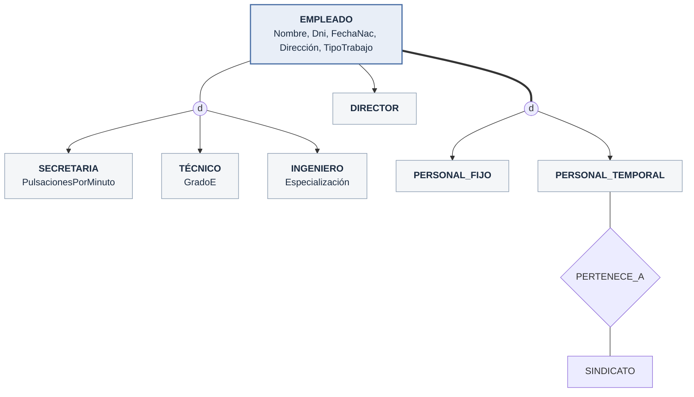
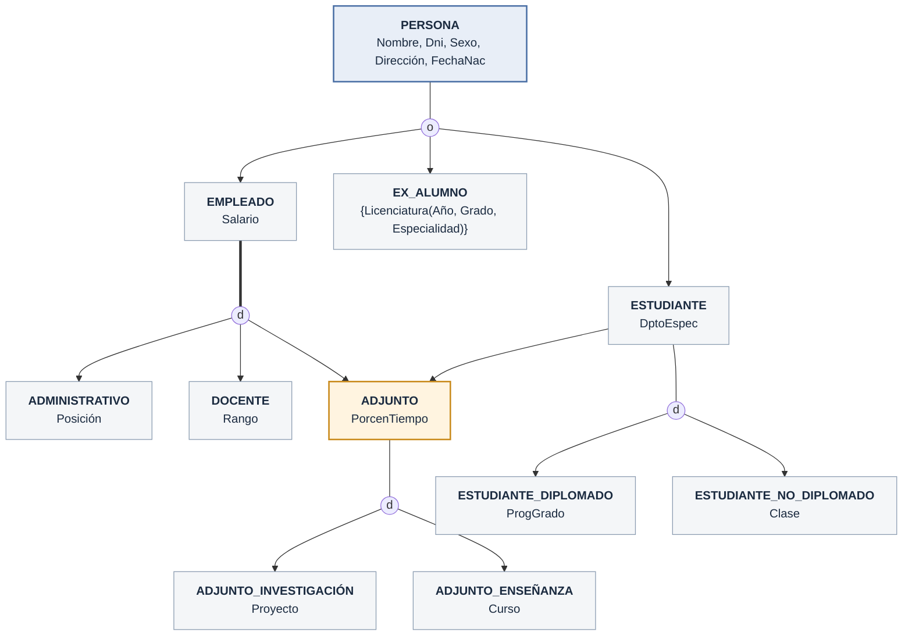
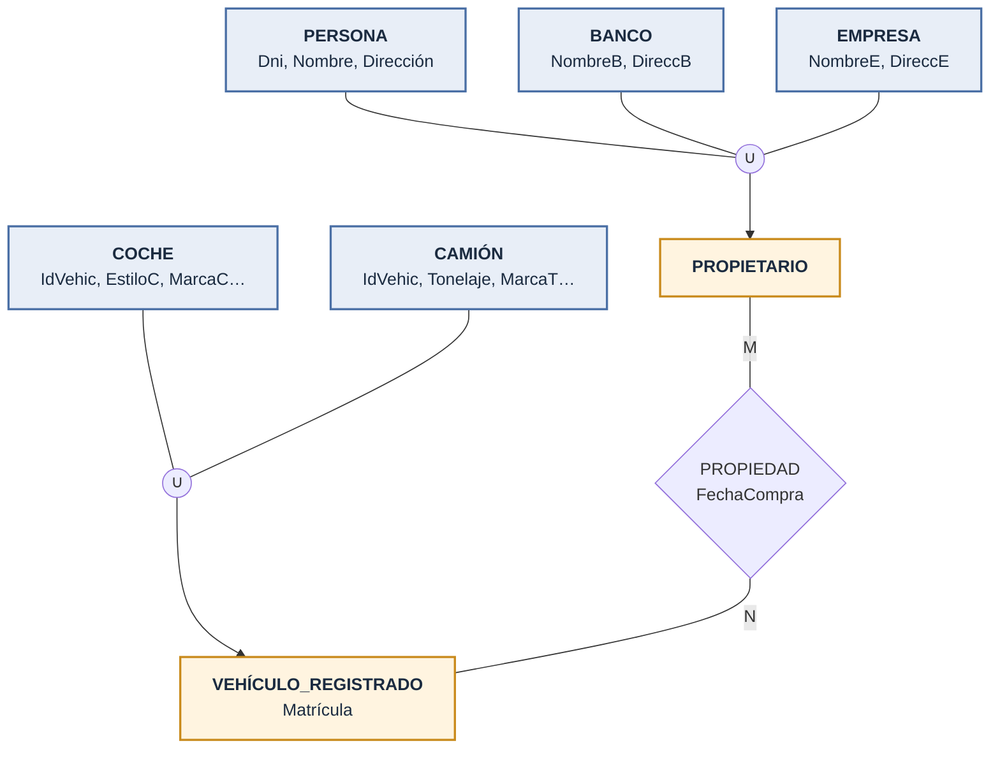

## ¿Por qué extender el ER?

- Aplicaciones más complejas (CAD/CAM, telecomunicaciones, GIS) necesitan **más semántica**
- **EER** (*Enhanced* o *Extended* ER) = todo el ER **+**:
  - **Subclases y superclases**
  - **Especialización** y **generalización**
  - **Categorías** (tipos unión)
  - **Herencia** de atributos y relaciones

## Subclases, superclases y herencia

- **Subclase**: subgrupo significativo de entidades de un tipo (`SECRETARIA`, `INGENIERO`, `TÉCNICO`)
- **Superclase**: el tipo general que las contiene (`EMPLEADO`)
- **Relación clase/subclase** o **ES-UN**: *una SECRETARIA **es un** EMPLEADO*
- Un miembro de la subclase es **la misma entidad** del mundo real, en un **papel específico**
  - La SECRETARIA ‘Laura Logano’ *es* el EMPLEADO ‘Laura Logano’
- Reglas:
  - Una entidad **no puede** existir solo en la subclase; también debe estar en la superclase
  - Una entidad **puede** estar en varias subclases (`INGENIERO` y `PERSONAL_FIJO`)
  - **No es obligatorio** que toda entidad de la superclase esté en alguna subclase
- **Herencia**: la subclase hereda **todos los atributos y relaciones** de la superclase

| Clase/subclase | Relación 1:1 |
| --- | --- |
| Es **la misma** entidad en otro papel | Une **dos** entidades distintas |

## Especialización y generalización

### Especialización

- Proceso de **definir subclases** de un tipo de entidad según una característica distintiva
- Puede haber **varias** especializaciones del mismo tipo:
  - Por tipo de trabajo → {`SECRETARIA`, `INGENIERO`, `TÉCNICO`}
  - Por tipo de contrato → {`PERSONAL_FIJO`, `PERSONAL_TEMPORAL`}
- Permite:
  - **Atributos específicos** (locales): `PulsacionesPorMinuto` solo en `SECRETARIA`
  - **Relaciones específicas**: solo `PERSONAL_TEMPORAL` participa en `PERTENECE_A` con `SINDICATO`

> Línea doble (`===`) = especialización **total**. Con **una sola** subclase (`DIRECTOR`) no se dibuja el círculo.

### Generalización

- Proceso **inverso**: identificar lo común entre varias entidades y crear una **superclase**
- `COCHE` + `CAMIÓN` → `VEHÍCULO`

| Especialización | Generalización |
| --- | --- |
| De arriba **abajo** | De abajo **arriba** |
| **Refinamiento** conceptual | **Síntesis** conceptual |
| Superclase → subclases | Subclases → superclase |

- El resultado estructural puede ser **idéntico**; en la práctica se combinan ambos

## Restricciones de la especialización

### ¿Cómo se decide quién pertenece?

- **Predicado definido** (condición definida): una condición sobre un atributo de la superclase
  - `SECRETARIA` ↔ `TipoTrabajo = 'Secretaria'`
- **Atributo definido**: *todas* las subclases usan el **mismo** atributo → **atributo definitorio** (en UML: *discriminador*)
- **Definido por usuario**: sin condición; el usuario decide al insertar

### Disyunción y completitud

- **Disyunción** (`d`): una entidad está en **como máximo una** subclase
- **Solapamiento** (`o`): puede estar en **varias** (*por defecto*)
- **Total** (línea doble): toda entidad de la superclase está en **al menos una** subclase
- **Parcial** (línea sencilla): puede no estar en ninguna

| | Total | Parcial |
| --- | --- | --- |
| **Disyunción** | {`PERSONAL_FIJO`, `PERSONAL_TEMPORAL`} | {`SECRETARIA`, `INGENIERO`, `TÉCNICO`} |
| **Solapamiento** | — | {`PARTE_FABRICADA`, `PARTE_COMPRADA`}, {`EMPLEADO`, `EX_ALUMNO`, `ESTUDIANTE`} |

- Las dos restricciones son **independientes** → 4 combinaciones
- Atributo definitorio **monovalor** ⇒ disyunción automática
- Generalización ⇒ normalmente **total** (la superclase sale de las subclases)

### Reglas de inserción y borrado

- **Borrar** de la superclase ⇒ se borra de **todas** sus subclases
- **Insertar** en la superclase ⇒ se inserta en toda subclase de **predicado definido** cuyo predicado cumpla
- **Insertar** en una especialización **total** ⇒ debe entrar en **al menos una** subclase

## Jerarquías y entramados

- **Jerarquía**: cada subclase tiene **un solo padre** → árbol (**herencia simple**)
- **Entramado** (*lattice*): una subclase con **varios padres** → **subclase compartida** (**herencia múltiple**)
  - `INGENIERO_JEFE` es `INGENIERO`, `DIRECTOR` y `PERSONAL_FIJO` a la vez
- La subclase hereda de **todos** sus ancestros, no solo del padre directo
- Atributo heredado por **varios caminos** desde el mismo origen → se incluye **una sola vez**
- **Nodo hoja**: clase sin subclases; una entidad puede estar en varias hojas

### Caso UNIVERSIDAD

- `ADJUNTO` es **subclase compartida** (de `EMPLEADO` y `ESTUDIANTE`) → el esquema es un **entramado**
- Sin herencia múltiple, el solapamiento {E, A, S} obligaría a **7 subclases**: E, A, S, E_A, E_S, A_S, E_A_S

## Categorías (tipos unión)

- **Categoría**: subclase de la **unión** de **varias superclases distintas**
- Ej.: `PROPIETARIO` de un vehículo puede ser `PERSONA`, `BANCO` **o** `EMPRESA`
- Notación: círculo con **∪**, superclases unidas al círculo

| Subclase compartida | Categoría |
| --- | --- |
| Subconjunto de la **intersección** | Subconjunto de la **unión** |
| `INGENIERO_JEFE` debe estar en **todas** sus superclases | `PROPIETARIO` está en **solo una** |
| Hereda atributos de **todas** | Herencia **selectiva**: solo de la superclase a la que pertenece |

- **Total** (línea doble): contiene la unión completa; **parcial**: solo un subconjunto
- Las superclases pueden tener **claves distintas** (`PROPIETARIO`) o **la misma** (`VEHÍCULO_REGISTRADO`)
- `VEHÍCULO_REGISTRADO` ≠ `VEHÍCULO` generalizado: solo *algunos* coches y camiones, y **nada más**
- Categoría total ↔ puede representarse como **generalización total**:
  - Mismo tipo de entidad y muchos atributos/claves comunes → **generalización**
  - Si no → **categoría**

## Guías de diseño

- Muchas subclases = modelo fiel pero **confuso**
- Subclase con atributos locales pero **sin relaciones propias** → fusionar en la superclase con un **atributo tipo** (acepta `NULL`)
  - Ej.: fusionar todo en `EMPLEADO` con `TipoTrabajo`, `TipoContrato`, `EsJefe`
- Evitar categorías salvo que sean **necesarias**; preferir especialización/generalización
- Sin requisitos claros → **solapamiento parcial** (no impone restricción)

## Definiciones formales

- **Clase**: conjunto de entidades (tipo de entidad, subclase, superclase o categoría)
- **Subclase** S de C: `S ⊆ C`
- **Especialización** Z = {S₁, …, Sₙ} con superclase G:
  - **Total**: `S₁ ∪ … ∪ Sₙ = G`
  - **Disyunta**: `Sᵢ ∩ Sⱼ = ∅` para `i ≠ j`
- **Predicado definido**: `S = C[p]`
- **Atributo definido**: predicado `A = cᵢ` para cada Sᵢ
- **Categoría** T: `T ⊆ (D₁ ∪ D₂ ∪ … ∪ Dₙ)`, `n > 1`
- Los tipos de relación ahora aceptan **cualquier clase**, no solo tipos de entidad

## EER vs UML

| EER | UML |
| --- | --- |
| Círculo de especialización | **Triángulo** hacia la superclase |
| Disyunción `d` | Triángulo **en blanco** |
| Solapamiento `o` | Triángulo **relleno** |
| Superclase raíz | **Clase base** |
| Nodo hoja | **Clase hoja** |
| Atributo definitorio | **Discriminador** |

- Tipos de clase en UML:
  - **Abstracta**: define atributos/operaciones, **sin objetos** propios
  - **Concreta**: tiene objetos (las que se guardan en la BD)
  - **Plantilla**: patrón para definir otras clases

## Abstracción de datos

| Abstracción | Inversa / par | En EER | Relación |
| --- | --- | --- | --- |
| **Clasificación** | Instanciación | Tipos de entidad y de relación | ES-UNA-INSTANCIA-DE |
| **Identificación** | — | Nombres únicos, claves, claves parciales | — |
| **Especialización** | Generalización | Subclases | ES-UN |
| **Agregación** | — | Atributos compuestos, relaciones | ES-UNA-PARTE-DE |
| **Asociación** | — | Tipos de relación | ESTÁ-ASOCIADA-CON |

### Agregación vs. asociación

- Problema: relacionar `ENTREVISTA` (relación entre `EMPRESA` y `ASPIRANTE_TRABAJO`) con `OFERTA_TRABAJO`
  - Ternaria → ❌ obliga a que **toda** entrevista tenga oferta
  - Relación entre relaciones → ❌ **no permitido** en ER
  - Agregación (objeto compuesto) → ❌ no en EER, sí en algunos modelos
  - ✅ Convertir `ENTREVISTA` en **entidad débil** y relacionarla con `OFERTA_TRABAJO`
- Al **borrar**:
  - **Asociación** → los participantes **siguen existiendo**
  - **Agregación** → borrar `COCHE` borra `MOTOR`, `CHASIS`, `RUEDAS`

### Ontología

- **Ontología** = *especificación de una conceptualización*
- Similar a un esquema conceptual, pero **más general**, con reglas y excepciones
- Formas: diccionario de sinónimos, **taxonomía** (≈ especialización), esquema de BD, teoría lógica
- Base de la **Web semántica**

## Resumen

- EER = ER **+** subclases, herencia, especialización/generalización y categorías
- Restricciones: **disyunción/solapamiento** y **total/parcial**; predicado o atributo definido
- Jerarquías (herencia simple) vs. entramados (herencia múltiple)
- Siguiente paso: **mapeo ER/EER → relacional** (capítulo 7)

[⬅️ Volver a Unidad I](./index.md)
