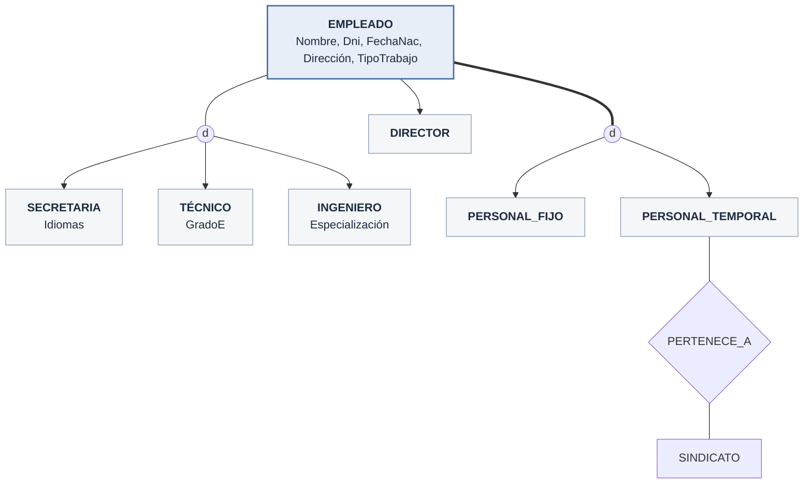
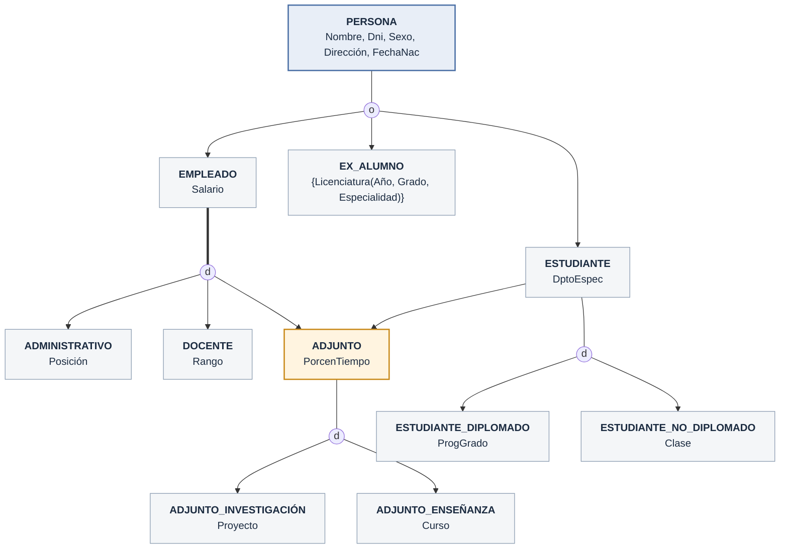
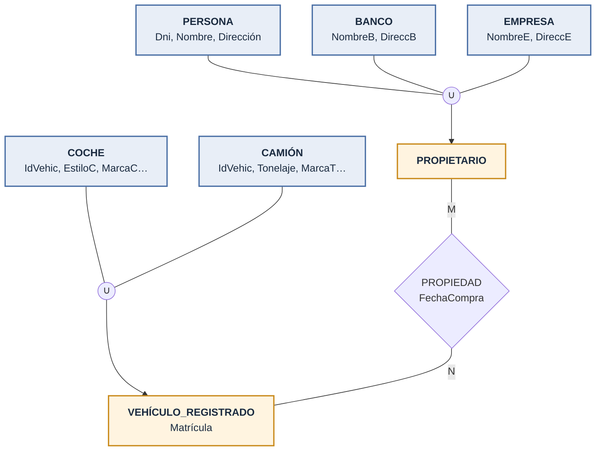

## ¿Por qué extender el ER?

- Algunas aplicaciones (CAD, telecomunicaciones, mapas) necesitan modelar **más detalles**
- **EER** = el modelo ER **+**:
  - **Subclases y superclases**
  - **Especialización** y **generalización**
  - **Categorías**
  - **Herencia**

## Subclases, superclases y herencia

- **Superclase**: tipo general (`EMPLEADO`)
- **Subclase**: grupo dentro de ese tipo (`SECRETARIA`, `INGENIERO`, `TÉCNICO`)
- Se leen como **ES-UN**: *una SECRETARIA **es un** EMPLEADO*
- Es **la misma persona** vista en otro papel
  - La secretaria ‘Laura Logano’ *es* el empleado ‘Laura Logano’
- Reglas:
  - Todo lo que está en la subclase también está en la superclase
  - Una entidad puede estar en **varias** subclases
  - Una entidad puede **no** estar en ninguna subclase
- **Herencia**: la subclase recibe **todos** los atributos y relaciones de la superclase

| Clase/subclase | Relación 1:1 |
| --- | --- |
| **Una** entidad en otro papel | **Dos** entidades distintas |

## Especialización y generalización

### Especialización

- Dividir un tipo de entidad en **subclases** según una característica
- Se puede dividir de **varias formas**:
  - Por trabajo → {`SECRETARIA`, `INGENIERO`, `TÉCNICO`}
  - Por contrato → {`PERSONAL_FIJO`, `PERSONAL_TEMPORAL`}
- Sirve para:
  - Atributos propios: `Idiomas` solo en `SECRETARIA`
  - Relaciones propias: solo `PERSONAL_TEMPORAL` se relaciona con `SINDICATO`

> Línea doble = especialización **total**. Si hay **una sola** subclase (`DIRECTOR`), no se dibuja el círculo.

### Generalización

- Lo **contrario**: juntar lo común de varias entidades en una superclase
- `COCHE` + `CAMIÓN` → `VEHÍCULO`

| Especialización | Generalización |
| --- | --- |
| De arriba hacia abajo | De abajo hacia arriba |
| Superclase → subclases | Subclases → superclase |

- El resultado puede ser **el mismo**; en la práctica se usan ambas

## Restricciones de la especialización

### ¿Quién entra en cada subclase?

- **Por condición**: se cumple una regla sobre un atributo
  - `SECRETARIA` si `TipoTrabajo = 'Secretaria'`
- **Por atributo**: todas las subclases usan el **mismo** atributo (en UML: *discriminador*)
- **Por usuario**: no hay regla; el usuario decide

### Disyunción y completitud

- **Disjunta** (`d`): la entidad está en **una sola** subclase como máximo
- **Solapada** (`o`): puede estar en **varias**
- **Total** (línea doble): toda entidad está en **al menos una** subclase
- **Parcial** (línea sencilla): puede no estar en ninguna

| | Total | Parcial |
| --- | --- | --- |
| **Disjunta** | {`PERSONAL_FIJO`, `PERSONAL_TEMPORAL`} | {`SECRETARIA`, `INGENIERO`, `TÉCNICO`} |
| **Solapada** | — | {`EMPLEADO`, `EX_ALUMNO`, `ESTUDIANTE`} |

- Son dos restricciones independientes → 4 combinaciones
- La generalización suele ser **total**

### Insertar y borrar

- **Borrar** de la superclase → se borra también de sus subclases
- **Insertar** en la superclase → entra automáticamente en las subclases cuya condición cumpla
- En una especialización **total**, debe entrar en **al menos una** subclase

## Jerarquías y entramados

- **Jerarquía**: cada subclase tiene **un solo padre** (herencia simple)
- **Entramado**: una subclase tiene **varios padres** (herencia múltiple)
  - `INGENIERO_JEFE` es `INGENIERO`, `DIRECTOR` y `PERSONAL_FIJO`
- La subclase hereda de **todos** sus ancestros
- Si un atributo llega por varios caminos, se incluye **una sola vez**

### Ejemplo: UNIVERSIDAD

- `ADJUNTO` tiene dos padres (`EMPLEADO` y `ESTUDIANTE`) → es un **entramado**

## Categorías

- **Categoría**: subclase que viene de **una de varias** superclases distintas
- Ej.: el `PROPIETARIO` de un vehículo puede ser una `PERSONA`, un `BANCO` **o** una `EMPRESA`
- Se dibuja con un círculo con **∪**

| Herencia múltiple | Categoría |
| --- | --- |
| Está en **todas** sus superclases | Está en **solo una** |
| Hereda de **todas** | Hereda solo de la suya |

## Consejos de diseño

- Demasiadas subclases confunden
- Si una subclase no tiene relaciones propias → mejor un **atributo tipo** en la superclase
  - Ej.: `EMPLEADO` con `TipoTrabajo` y `TipoContrato`
- Usar categorías solo si son **necesarias**
- Si no hay reglas claras → usar **solapada y parcial**

## EER vs UML

| EER | UML |
| --- | --- |
| Círculo de especialización | **Triángulo** hacia la superclase |
| Disjunta `d` | Triángulo **vacío** |
| Solapada `o` | Triángulo **relleno** |
| Atributo de especialización | **Discriminador** |

## Abstracción de datos

| Concepto | En EER | Se lee como |
| --- | --- | --- |
| **Clasificación** | Tipos de entidad | ES-UNA-INSTANCIA-DE |
| **Identificación** | Claves | — |
| **Especialización** | Subclases | ES-UN |
| **Agregación** | Atributos compuestos | ES-UNA-PARTE-DE |
| **Asociación** | Relaciones | ESTÁ-ASOCIADA-CON |

- Al **borrar**:
  - **Asociación** → lo relacionado **sigue existiendo**
  - **Agregación** → borrar `COCHE` borra `MOTOR` y `RUEDAS`

## Resumen

- EER = ER **+** subclases, herencia, especialización/generalización y categorías
- Restricciones: **disjunta/solapada** y **total/parcial**
- Jerarquía = un padre; entramado = varios padres
- Siguiente paso: **pasar el EER a tablas**

[⬅️ Volver a Unidad I](./index.md)
