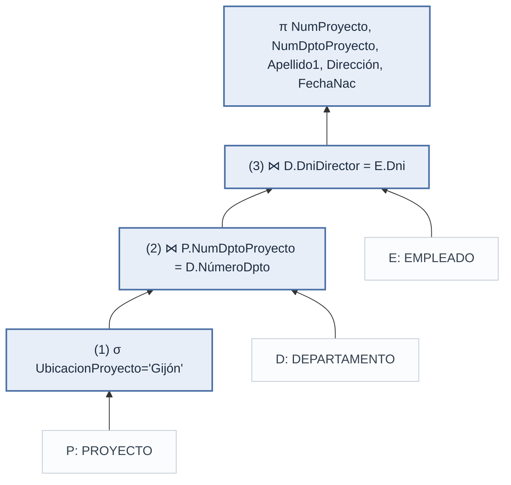

## Antecedentes: conceptos del modelo relacional

El álgebra relacional opera sobre **relaciones**, así que primero conviene fijar el vocabulario del modelo relacional (capítulo 5 del libro).

### Terminología formal e informal

| Término formal | Término informal | Ejemplo en EMPRESA |
| --- | --- | --- |
| Relación | Tabla | EMPLEADO |
| Tupla | Fila | `<José, Pérez, Pérez, 123456789, …, 5>` |
| Atributo | Columna (cabecera) | Sueldo |
| Dominio | Tipo de dato de la columna | *DocumentoNacionalIdentidad* para Dni |
| Esquema de relación | Definición de la tabla | `EMPLEADO(Nombre, Apellido1, …, Dno)` |
| Estado de relación | Contenido actual de la tabla | Las 8 filas de EMPLEADO en el anexo |

### Definiciones

- **Dominio (D)**: conjunto de valores **atómicos** (indivisibles). Tiene un nombre, un tipo de dato y un formato. Ej.: *DocumentoNacionalIdentidad* = conjunto de DNI válidos
- **Atributo (Ai)**: nombre del **papel** que juega un dominio dentro de una relación; su dominio se escribe `dom(Ai)`. Varios atributos pueden compartir dominio (Dni y SuperDni)
- **Esquema de relación**: `R(A1, A2, …, An)`, un nombre de relación más una lista de atributos. Describe la relación y es relativamente **estático**
- **Grado (aridad)**: número de atributos `n` del esquema. EMPLEADO tiene grado 10
- **Tupla**: lista ordenada de n valores `t = <v1, v2, …, vn>`, donde cada `vi` pertenece a `dom(Ai)` o es **NULL**. Representa un **hecho** del mundo real (un empleado, un departamento…)
- **Relación (estado de relación)** `r(R)`: **conjunto** de tuplas `r = {t1, t2, …, tm}`. Cambia con el tiempo, a medida que cambia el mundo real
  - Formalmente es un subconjunto del producto cartesiano de los dominios: `r(R) ⊆ dom(A1) × dom(A2) × … × dom(An)`
  - El número de tuplas de r se escribe `|r|` (en EMPLEADO, `|r| = 8`)

### Características de las relaciones

Una relación **parece** una tabla, pero no es exactamente lo mismo: como se define como un **conjunto** de tuplas, hereda las propiedades de los conjuntos matemáticos. Estas son las consecuencias.

#### 1. Las tuplas no tienen orden

- En un conjunto los elementos no están en ninguna posición: `{a, b, c}` y `{c, a, b}` son el **mismo** conjunto
- Igual con una relación: si mostramos EMPLEADO ordenado por Apellido1, por Sueldo o tal como se insertó, sigue siendo **la misma relación**
- El orden que vemos en pantalla es solo una forma de **presentarla**; no forma parte de los datos
- Consecuencia práctica: no se puede preguntar por “la tercera fila” ni depender de que las filas salgan en cierto orden. En SQL, si se necesita un orden, hay que pedirlo explícitamente con `ORDER BY`

#### 2. El orden de los valores dentro de una tupla

- En la definición formal, una tupla es una lista **ordenada** `<v1, v2, …, vn>`: el primer valor corresponde a A1, el segundo a A2, etc. Si se intercambian dos valores, cambia el significado
  - `<José, Pérez, …, 30000, …>` dice que José gana 30000; mover el 30000 a la posición de Dni no tendría sentido
- Hay una definición alternativa en la que la tupla es un **conjunto de pares** `(atributo, valor)`: `t = {(Nombre, José), (Sueldo, 30000), (Dno, 5), …}`. Ahí el orden de las columnas tampoco importa, porque cada valor va acompañado de su atributo
- En la práctica se usa la primera (es más simple de escribir), pero hay que tener claro que lo que identifica un valor es **su atributo**, no su posición

#### 3. No hay tuplas duplicadas

- Un conjunto no puede contener dos veces el mismo elemento, así que una relación **no tiene dos tuplas idénticas** en todos sus atributos
- Por eso **toda relación tiene al menos una superclave**: el conjunto de todos sus atributos (ver [Claves](#claves))
- Efecto en el álgebra: cuando una operación produciría filas repetidas, el resultado las **elimina**. Ej.: `π Sexo, Sueldo (EMPLEADO)` produce `<M, 25000>` una sola vez, aunque Alicia Jiménez y Aurora Oliva tienen ese mismo par
- Diferencia con SQL: una tabla SQL sí puede tener filas repetidas (es un *multiconjunto* o *bolsa*); para eliminarlas hay que usar `DISTINCT`

#### 4. Los valores son atómicos

- Cada valor de una tupla es **indivisible** desde el punto de vista del modelo: un solo número, una sola fecha, un solo texto
- No se permiten:
  - **Atributos compuestos** (un valor con partes): en el modelo ER, *Nombre* podría componerse de nombre + apellidos; en el modelo relacional se guardan como atributos separados (Nombre, Apellido1, Apellido2)
  - **Atributos multivalor** (varios valores en una celda): un departamento puede tener varias ubicaciones, pero no se puede guardar `{Valencia, Sevilla, Madrid}` en una sola celda de DEPARTAMENTO
- La solución para el multivalor es crear **otra relación** con una tupla por valor. Por eso existe LOCALIZACIONES_DPTO, donde el departamento 5 aparece tres veces:

| NúmeroDpto | UbicaciónDpto |
| --- | --- |
| 5 | Valencia |
| 5 | Sevilla |
| 5 | Madrid |

- A esta regla se le llama **principio de la primera forma normal (1FN)**; se estudia a fondo en normalización

#### 5. Valores NULL

- **NULL** es un valor especial que indica que **no hay valor**. Puede significar tres cosas distintas:

| Significado | Ejemplo |
| --- | --- |
| **No aplicable**: el atributo no tiene sentido para esa tupla | SuperDni de Eduardo Ochoa: es el jefe máximo, no tiene supervisor |
| **Desconocido**: el valor existe pero no lo sabemos | Horas de Eduardo Ochoa en el proyecto 20 (TRABAJA_EN): trabaja en él, pero no se registraron sus horas |
| **No disponible**: existe, se conoce, pero no se ha guardado | El teléfono de un empleado que no lo quiso dar |

- NULL **no es cero ni cadena vacía**: `Sueldo = 0` significa “gana cero”, `Sueldo = NULL` significa “no sabemos/no aplica”
- Comparar con NULL no da verdadero ni falso: `NULL = NULL` es **desconocido**. Por eso una SELECCIÓN como `σ SuperDni = '333445555' (EMPLEADO)` nunca devuelve a Eduardo Ochoa, y en SQL hay que usar `IS NULL` en vez de `= NULL`
- Conviene evitar NULL cuando sea posible, porque complica el significado de las consultas

#### 6. Interpretación (significado) de una relación

- El **esquema** se lee como una **afirmación** general:
  > EMPLEADO(Nombre, …, Sueldo, SuperDni, Dno): “existe un empleado con este nombre, que gana este sueldo, lo supervisa este Dni y trabaja en este departamento”
- Cada **tupla** es un **hecho** concreto que cumple esa afirmación:
  > `<José, Pérez, Pérez, 123456789, …, 30000, 333445555, 5>`: “José Pérez gana 30000, lo supervisa Alberto Campos y trabaja en el departamento 5”
- Algunas relaciones representan **entidades** (EMPLEADO, DEPARTAMENTO) y otras **relaciones entre entidades** (TRABAJA_EN dice qué empleado trabaja en qué proyecto y cuántas horas)
- Visto así, una relación es un conjunto de **proposiciones verdaderas**: lo que está en la tabla es cierto; lo que no está, se asume falso (*suposición de mundo cerrado*)

#### Resumen: relación vs. tabla

| Propiedad | Relación (modelo formal) | Tabla SQL |
| --- | --- | --- |
| Orden de filas | No existe | No garantizado, se usa `ORDER BY` |
| Filas duplicadas | No permitidas | Permitidas, se eliminan con `DISTINCT` |
| Valores en una celda | Atómicos | Atómicos (en el uso normal) |
| Valor ausente | NULL | NULL |

### Notación

| Notación | Significado |
| --- | --- |
| `Q, R, S` | Nombres de relación (esquemas) |
| `q, r, s` | Estados de relación |
| `t, u, v` | Tuplas |
| `R.A` | Atributo A de la relación R (ej. `EMPLEADO.Sueldo`); útil cuando dos relaciones usan el mismo nombre de atributo |
| `t[Ai]` o `t.Ai` | Valor del atributo Ai en la tupla t |
| `t[Au, Aw, …, Az]` | Subtupla de t con solo esos atributos |

Ejemplo: si t es la tupla de José Pérez en EMPLEADO, entonces `t[Sueldo] = 30000` y `t[Nombre, Dno] = <José, 5>`.

### Claves

Todas las claves responden a la misma pregunta: **¿qué atributos bastan para distinguir una tupla de las demás?** Lo que cambia entre un tipo y otro es si sobran atributos, si hay varias opciones y cuál se elige.

- **Superclave (SK)**: conjunto de atributos tal que dos tuplas distintas nunca tienen el mismo valor: `t1[SK] ≠ t2[SK]`
  - Basta con que **identifique**; puede tener atributos de **sobra**
  - Toda relación tiene al menos una: el conjunto de **todos** sus atributos (porque no hay tuplas duplicadas)
  - Ej. en EMPLEADO: `{Dni}`, `{Dni, Nombre}`, `{Dni, Sueldo, Dno}` y `{Nombre, Apellido1, …, Dno}` son superclaves
- **Clave**: superclave **mínima**; si se le quita cualquier atributo deja de ser superclave
  - No tiene atributos de sobra: **todos** son necesarios para identificar
  - `{Dni}` es clave de EMPLEADO; `{Dni, Nombre}` es superclave pero **no** clave, porque al quitar Nombre, `{Dni}` sigue identificando
  - Una clave puede tener varios atributos: en TRABAJA_EN la clave es `{DniEmpleado, NumProy}`; ninguno de los dos por separado identifica una tupla (un empleado trabaja en varios proyectos y un proyecto tiene varios empleados)
- **Clave candidata**: nombre que reciben las claves cuando una relación tiene **más de una**
  - En DEPARTAMENTO, tanto `{NúmeroDpto}` como `{NombreDpto}` son claves (no hay dos departamentos con el mismo número ni con el mismo nombre) → ambas son candidatas
  - En PROYECTO pasa lo mismo con `{NumProyecto}` y `{NombreProyecto}`
- **Clave principal (primary key)**: la clave candidata **elegida** por el diseñador para identificar las tuplas; se indica **subrayando** sus atributos en el esquema
  - Se suele preferir la candidata con **menos atributos** o la más **estable** (un número de departamento cambia menos que su nombre) → en DEPARTAMENTO se elige `NúmeroDpto`
  - Las demás candidatas pasan a ser **claves alternativas** (o *únicas*: `UNIQUE` en SQL)
  - Por la **integridad de entidad**, ningún atributo de la clave principal puede ser NULL: si lo fuera, no se podría identificar la tupla
- **Foreign key (FK)**: atributos de R1 que **hacen referencia** a la clave principal de R2 (mismo dominio); su valor debe existir en R2 o ser NULL (**integridad referencial**)
  - Ej.: `EMPLEADO.Dno` → `DEPARTAMENTO.NúmeroDpto`: un empleado solo puede estar en un departamento que exista
  - A diferencia de las anteriores, **no identifica** tuplas de su propia relación: puede repetirse (varios empleados tienen `Dno = 5`) y puede ser NULL
  - Puede referenciar a la **misma** relación: `EMPLEADO.SuperDni` → `EMPLEADO.Dni`

> La superclave y la clave se deciden por el **significado** de los atributos (el esquema), no por los datos actuales. Aunque hoy no haya dos empleados con el mismo Sueldo, `{Sueldo}` **no** es clave, porque nada impide que mañana dos empleados ganen lo mismo.

Relación entre los conceptos:

```
Superclaves  ⊇  Claves (= claves candidatas)  ⊇  Clave principal (una sola)
```

| Concepto | ¿Identifica tuplas? | ¿Puede tener atributos de sobra? | ¿Cuántas por relación? | ¿Admite NULL? |
| --- | --- | --- | --- | --- |
| Superclave | Sí | Sí | Muchas (al menos una) | — |
| Clave / clave candidata | Sí | No (es mínima) | Una o más | — |
| Clave principal | Sí | No | Exactamente una | No |
| Clave alternativa | Sí | No | Cero o más | Según el diseño |
| Foreign key | No (en su relación) | — | Cero o más | Sí |

### Base de datos relacional

- **Esquema de base de datos**: conjunto de esquemas de relación más las restricciones de integridad. Ej.: `EMPRESA = {EMPLEADO, DEPARTAMENTO, LOCALIZACIONES_DPTO, PROYECTO, TRABAJA_EN, SUBORDINADO}`
- **Estado de base de datos**: conjunto de estados de relación en un momento dado. El [anexo](#anexo-estado-de-la-base-de-datos-empresa) muestra un estado posible de EMPRESA

## ¿Qué es el álgebra relacional?

- Es el **conjunto de operaciones básicas** del modelo relacional: permite especificar peticiones de recuperación
- Cada operación recibe una o dos relaciones y **produce una nueva relación** → las operaciones se pueden encadenar
- Una secuencia de operaciones forma una **expresión de álgebra relacional**
- Es importante porque:
  1. Da el **fundamento formal** de las operaciones del modelo relacional
  2. Es la base para la **implementación y optimización de consultas** en los RDBMS
  3. Varios de sus conceptos están incorporados en **SQL**
- Es **procedimental**: indica *cómo* (en qué orden) obtener el resultado. El cálculo relacional, en cambio, solo indica *qué* debe contener

### Dos grupos de operaciones

| Grupo | Operaciones |
| --- | --- |
| Teoría de conjuntos | UNIÓN (∪), INTERSECCIÓN (∩), DIFERENCIA (−), PRODUCTO CARTESIANO (×) |
| Específicas de bases de datos relacionales | SELECCIÓN (σ), PROYECCIÓN (π), RENOMBRAR (ρ), CONCATENACIÓN / JOIN (⋈), DIVISIÓN (÷) |

## Esquema de trabajo: EMPRESA

```text
EMPLEADO(Nombre, Apellido1, Apellido2, Dni, FechaNac, Dirección, Sexo, Sueldo, SuperDni, Dno)

DEPARTAMENTO(NombreDpto, NúmeroDpto, DniDirector, FechaIngresoDirector)

LOCALIZACIONES_DPTO(NúmeroDpto, UbicaciónDpto)

PROYECTO(NombreProyecto, NumProyecto, UbicacionProyecto, NumDptoProyecto)

TRABAJA_EN(DniEmpleado, NumProy, Horas)

SUBORDINADO(DniEmpleado, NombreSubordinado, Sexo, FechaNac, Relación)
```

> Los datos de cada tabla están en el [anexo](#anexo-estado-de-la-base-de-datos-empresa).

## Operaciones unarias

### SELECCIÓN (σ)

- Elige un **subconjunto de tuplas** que cumplen una condición → es un **filtro** (partición *horizontal*)
- Forma general:

```text
σ<condición de selección>(R)
```

- La condición se forma con cláusulas `<atributo> <op> <constante>` o `<atributo> <op> <atributo>`, con `op ∈ {=, <, ≤, >, ≥, ≠}`, unidas con **AND**, **OR** y **NOT**
- En dominios **no ordenados** (p. ej. colores) solo tienen sentido `=` y `≠`

```text
σDno=4(EMPLEADO)
σSueldo>30000(EMPLEADO)
σ(Dno=4 AND Sueldo>25000) OR (Dno=5 AND Sueldo>30000)(EMPLEADO)
```

> Con los datos del anexo, la última selección devuelve a Alberto Campos, Juana Sainz y Fernando Ojeda.

Propiedades:

- El resultado tiene los **mismos atributos** (mismo grado) que R
- `|σc(R)| ≤ |R|`; la fracción de tuplas seleccionadas es la **selectividad** de la condición
- Se evalúa **tupla por tupla**: una condición no puede involucrar a más de una tupla
- Es **conmutativa**: `σc1(σc2(R)) = σc2(σc1(R))`
- Una cascada de selecciones se combina con AND: `σc1(σc2(…σcn(R))) = σc1 AND c2 AND … AND cn(R)`

### PROYECCIÓN (π)

- Elige ciertas **columnas** y descarta las demás (partición *vertical*)
- Forma general:

```text
π<lista de atributos>(R)
```

```text
πApellido1, Nombre, Sueldo(EMPLEADO)
πSexo, Sueldo(EMPLEADO)
```

Propiedades:

- El resultado tiene solo los atributos de la lista, **en ese orden**; su grado es el tamaño de la lista
- **Elimina duplicados**: si la lista no incluye una clave pueden aparecer tuplas repetidas y se dejan una sola vez (sin esto el resultado sería un *multiconjunto* o *bolsa*)
- `|π(R)| ≤ |R|`; si la lista es una **superclave**, el resultado tiene exactamente `|R|` tuplas
- `π<lista1>(π<lista2>(R)) = π<lista1>(R)` siempre que `<lista2>` contenga a `<lista1>`
- **No** es conmutativa

| Sexo | Sueldo |
| --- | --- |
| H | 30000 |
| H | 40000 |
| M | 25000 |
| M | 43000 |
| H | 38000 |
| H | 25000 |
| H | 55000 |

> `πSexo, Sueldo(EMPLEADO)`: la tupla `<M, 25000>` aparece una sola vez aunque en EMPLEADO esté dos veces.

### Secuencias de operaciones y RENOMBRAR (ρ)

Una consulta se puede escribir como **una sola expresión anidada**:

```text
πNombre, Apellido1, Sueldo(σDno=5(EMPLEADO))
```

o como una **secuencia con relaciones intermedias** usando la asignación `←`:

```text
DEP5_EMPS ← σDno=5(EMPLEADO)
RESULTADO ← πNombre, Apellido1, Sueldo(DEP5_EMPS)
```

En la asignación también se pueden **renombrar atributos**:

```text
TEMP ← σDno=5(EMPLEADO)
R(NuevoNombre, NuevoApellido, NuevoSueldo) ← πNombre, Apellido1, Sueldo(TEMP)
```

El operador RENOMBRAR (ρ) aplicado a una relación R de grado n tiene tres formas:

| Notación | Renombra |
| --- | --- |
| `ρS(B1, B2, …, Bn)(R)` | la relación y sus atributos |
| `ρS(R)` | solo la relación |
| `ρ(B1, B2, …, Bn)(R)` | solo los atributos |

## Operaciones de la teoría de conjuntos

### UNIÓN, INTERSECCIÓN y DIFERENCIA

- Son **binarias** y exigen **compatibilidad de unión**: `R(A1, …, An)` y `S(B1, …, Bn)` tienen el **mismo grado** y `dom(Ai) = dom(Bi)` para todo i
- Por convenio, el resultado usa los nombres de atributo de **R**

| Operación | Notación | Resultado |
| --- | --- | --- |
| UNIÓN | `R ∪ S` | Tuplas que están en R, en S o en ambas (sin duplicados) |
| INTERSECCIÓN | `R ∩ S` | Tuplas que están en R **y** en S |
| DIFERENCIA (MENOS) | `R − S` | Tuplas que están en R pero **no** en S |

Ejemplo: Dni de los empleados que trabajan en el departamento 5 **o** que supervisan directamente a alguno de ellos.

```text
DEP5_EMPS      ← σDno=5(EMPLEADO)
RESULTADO1     ← πDni(DEP5_EMPS)
RESULTADO2(Dni) ← πSuperDni(DEP5_EMPS)
RESULTADO      ← RESULTADO1 ∪ RESULTADO2
```

> Resultado: 123456789, 333445555, 666884444, 453453453 y 888665555. El Dni 333445555 está en ambos operandos, pero aparece una sola vez.

Propiedades:

- ∪ y ∩ son **conmutativas**: `R ∪ S = S ∪ R`, `R ∩ S = S ∩ R`
- ∪ y ∩ son **asociativas** (se pueden aplicar a n relaciones): `R ∪ (S ∪ T) = (R ∪ S) ∪ T`
- − **no** es conmutativa: en general `R − S ≠ S − R`
- La intersección se puede expresar con unión y diferencia: `R ∩ S = (R ∪ S) − ((R − S) ∪ (S − R))`

### PRODUCTO CARTESIANO (×)

- También llamado *producto cruzado* o *CROSS JOIN*; **no** requiere compatibilidad de unión
- `R(A1, …, An) × S(B1, …, Bm)` produce `Q(A1, …, An, B1, …, Bm)` con **una tupla por cada combinación** de una tupla de R y una de S
- Si `|R| = nR` y `|S| = nS`, entonces `|R × S| = nR · nS`
- Por sí solo no tiene sentido; es útil cuando va **seguido de una SELECCIÓN** que relaciona atributos de ambas relaciones

Ejemplo: nombres de los subordinados de cada empleada.

```text
EMPLEADAS_FEMENINAS    ← σSexo='M'(EMPLEADO)
NOMBRES_EMPLEADOS      ← πNombre, Apellido1, Dni(EMPLEADAS_FEMENINAS)
EMPLEADOS_SUBORDINADOS ← NOMBRES_EMPLEADOS × SUBORDINADO
SUBORDINADOS_ACTUALES  ← σDni=DniEmpleado(EMPLEADOS_SUBORDINADOS)
RESULTADO              ← πNombre, Apellido1, NombreSubordinado(SUBORDINADOS_ACTUALES)
```

> `EMPLEADOS_SUBORDINADOS` combina a cada empleada con **todos** los subordinados (21 tuplas sin sentido); la selección deja solo las que coinciden por Dni. Resultado: Juana Sainz con su subordinado Alfonso.

## Operaciones binarias: CONCATENACIÓN y DIVISIÓN

### CONCATENACIÓN (JOIN, ⋈)

- Combina **tuplas relacionadas** de dos relaciones en una sola; es la operación clave para procesar las relaciones entre tablas
- Forma general:

```text
R ⋈<condición de conexión> S
```

- Equivale a un **producto cartesiano seguido de una selección**: `R ⋈c S ≡ σc(R × S)`
- El resultado tiene `n + m` atributos, pero solo las combinaciones que **cumplen la condición**
- Las tuplas con NULL en los atributos de conexión, o cuya condición es falsa, **no aparecen** → el JOIN no preserva necesariamente toda la información

Ejemplo: nombre del director de cada departamento.

```text
DIRECTOR_DPTO ← DEPARTAMENTO ⋈DniDirector=Dni EMPLEADO
RESULTADO     ← πNombreDpto, Apellido1, Nombre(DIRECTOR_DPTO)
```

> Resultado: Investigación–Campos, Alberto; Administración–Sainz, Juana; Sede Central–Ochoa, Eduardo.

> DniDirector es una **foreign key**: la integridad referencial garantiza que cada director tiene su tupla en EMPLEADO.

El ejemplo del producto cartesiano se reduce a una sola operación:

```text
SUBORDINADOS_ACTUALES ← NOMBRES_EMPLEADOS ⋈Dni=DniEmpleado SUBORDINADO
```

### Variantes de la concatenación

| Variante | Condición | Característica |
| --- | --- | --- |
| **THETA JOIN** (asociación) | `Ai θ Bj`, con `θ ∈ {=, <, ≤, >, ≥, ≠}`, unidas con AND | Forma general |
| **EQUIJOIN** | Solo comparaciones de **igualdad** | Quedan pares de atributos con valores idénticos (uno es superfluo) |
| **CONCATENACIÓN NATURAL** (`*`) | Igualdad entre atributos con el **mismo nombre** | Equijoin que **elimina** el atributo de conexión repetido |

Si los atributos de conexión no se llaman igual, primero se **renombra**:

```text
DEPT          ← ρ(NombreDpto, NumDptoProyecto, DniDirector, FechaIngresoDirector)(DEPARTAMENTO)
PROYECTO_DPTO ← PROYECTO * DEPT
```

Si ya se llaman igual, basta con:

```text
LOC_DPTO ← DEPARTAMENTO * LOCALIZACIONES_DPTO
```

> Resultado: 5 tuplas, una por cada localización (Investigación aparece 3 veces: Valencia, Sevilla y Madrid).

Otras ideas:

- El resultado de `R ⋈ S` tiene entre **0** y `nR · nS` tuplas; el cociente *tamaño esperado / (nR · nS)* es la **selectividad de concatenación**
- Sin condición, el JOIN **degenera** en un producto cartesiano
- Estas son **concatenaciones internas** (*inner joins*), en contraste con las externas (ver más abajo)
- Se pueden encadenar (**concatenación de n vías**):

```text
((PROYECTO ⋈NumDptoProyecto=NúmeroDpto DEPARTAMENTO) ⋈DniDirector=Dni EMPLEADO)
```

### Conjunto completo de operaciones

- `{σ, π, ∪, −, ×}` es un **conjunto completo**: cualquier otra operación del álgebra se puede expresar con ellas
  - `R ∩ S ≡ (R ∪ S) − ((R − S) ∪ (S − R))`
  - `R ⋈c S ≡ σc(R × S)`
  - CONCATENACIÓN NATURAL = RENOMBRAR + × + σ + π
- Las demás (∩, ⋈, ÷) se mantienen por **conveniencia**, porque se usan muchísimo

### DIVISIÓN (÷)

- Útil para consultas con **“todos”** (cuantificación universal)
- `R(Z) ÷ S(X)` con `X ⊆ Z`; sea `Y = Z − X`. El resultado `T(Y)` contiene una tupla t si t aparece en R **combinada con cada una** de las tuplas de S

Ejemplo: empleados que trabajan en **todos** los proyectos en los que trabaja José Pérez.

```text
PEREZ       ← σNombre='José' AND Apellido1='Pérez'(EMPLEADO)
PEREZ_PNOS  ← πNumProy(TRABAJA_EN ⋈DniEmpleado=Dni PEREZ)
DNI_PNOS    ← πDniEmpleado, NumProy(TRABAJA_EN)
DNIS(Dni)   ← DNI_PNOS ÷ PEREZ_PNOS
RESULTADO   ← πNombre, Apellido1(DNIS * EMPLEADO)
```

> `PEREZ_PNOS = {1, 2}`; los únicos que trabajan en ambos proyectos son 123456789 y 453453453 → José Pérez y Aurora Oliva.

Ejemplo abstracto (X = {A}, Y = {B}):

| R.A | R.B |
| --- | --- |
| a1 | b1 |
| a2 | b1 |
| a3 | b1 |
| a4 | b1 |
| a1 | b2 |
| a3 | b2 |
| a2 | b3 |
| a3 | b3 |
| a4 | b3 |
| a1 | b4 |
| a2 | b4 |
| a3 | b4 |

`S = {a1, a2, a3}` → `T = R ÷ S = {b1, b4}`, porque solo b1 y b4 aparecen con **las tres** tuplas de S.

La división se puede expresar con π, × y −:

```text
T1 ← πY(R)
T2 ← πY((S × T1) − R)
T  ← T1 − T2
```

> La mayoría de los RDBMS con SQL **no** implementan la división directamente; SQL la resuelve por otro camino.

### Resumen de operaciones

| Operación | Objetivo | Notación |
| --- | --- | --- |
| SELECCIÓN | Tuplas de R que cumplen la condición | `σ<cond>(R)` |
| PROYECCIÓN | Algunos atributos de R, sin duplicados | `π<atributos>(R)` |
| THETA JOIN | Combinaciones de R1 y R2 que cumplen la condición | `R1 ⋈<cond> R2` |
| EQUIJOIN | Theta join solo con igualdades | `R1 ⋈<cond> R2` |
| CONCATENACIÓN NATURAL | Equijoin sin repetir los atributos de conexión | `R1 * R2` |
| UNIÓN | Tuplas de R1, de R2 o de ambas (compatibles) | `R1 ∪ R2` |
| INTERSECCIÓN | Tuplas en R1 y en R2 (compatibles) | `R1 ∩ R2` |
| DIFERENCIA | Tuplas de R1 que no están en R2 (compatibles) | `R1 − R2` |
| PRODUCTO CARTESIANO | Todas las combinaciones de tuplas de R1 y R2 | `R1 × R2` |
| DIVISIÓN | Tuplas t[X] de R1(Z) que aparecen con cada tupla de R2(Y), Z = X ∪ Y | `R1(Z) ÷ R2(Y)` |

## Árboles de consulta

- Representación interna de una expresión de álgebra relacional en un RDBMS
- **Hojas** = relaciones de entrada; **nodos internos** = operaciones
- Se ejecuta de abajo hacia arriba: un nodo se evalúa cuando sus operandos están disponibles; termina al ejecutar la **raíz**

Consulta Q2: para cada proyecto ubicado en Gijón, su número, el departamento que lo controla y apellido, dirección y fecha de nacimiento del director.

```text
πNumProyecto, NumDptoProyecto, Apellido1, Dirección, FechaNac(
    ((σUbicacionProyecto='Gijón'(PROYECTO))
        ⋈NumDptoProyecto=NúmeroDpto DEPARTAMENTO)
    ⋈DniDirector=Dni EMPLEADO)
```



> Resultado de Q2: proyectos 10 y 30, ambos del departamento 4, dirigido por Sainz (Cerquillas, 67; 20-06-1941).

> Los árboles de consulta se retoman en el procesamiento y optimización de consultas.

## Operaciones relacionales adicionales

Peticiones comunes que **no** se pueden expresar con el álgebra original.

### Proyección generalizada

- Permite **funciones de atributos** (y constantes) en la lista de proyección: `πF1, F2, …, Fn(R)`
- Útil para informes con columnas calculadas

```text
EMPLEADO(Dni, Sueldo, Deducción, Antiguedad)

INFORME ← ρ(Dni, SalarioNeto, Gratificaciones, Impuestos)(
            πDni, Sueldo − Deducción, 2000 * Antiguedad, 0.25 * Sueldo(EMPLEADO))
```

### Funciones de agregación y agrupamiento (ℑ)

- Funciones: **SUMA, MEDIA, MÁXIMO, MÍNIMO, CONTAR**
- Forma general:

```text
<atributos de agrupamiento> ℑ <lista de funciones>(R)
```

```text
ρR(Dno, NumEmpleados, MediaSueldos)(Dno ℑ COUNT Dni, AVERAGE Sueldo(EMPLEADO))
```

| Dno | NumEmpleados | MediaSueldos |
| --- | --- | --- |
| 5 | 4 | 33250 |
| 4 | 3 | 31000 |
| 1 | 1 | 55000 |

- Sin renombrar, las columnas se llaman `<función>_<atributo>` (notación sugerida, no estándar)
- Sin atributos de agrupamiento, la función se aplica a **toda la relación** → una sola tupla (`ℑ COUNT Dni, AVERAGE Sueldo(EMPLEADO)` → 8, 35125)
- Los duplicados **no se eliminan** antes de agregar
- El resultado es **una relación**, no un escalar → el álgebra sigue siendo un **sistema cerrado**

### Cierre recursivo

- Aplica a relaciones **recursivas** entre tuplas del mismo tipo (p. ej. empleado–supervisor vía SuperDni)
- Obtener los supervisados a un **nivel fijo** es directo; a **todos los niveles** no se puede sin un mecanismo de bucle

```text
DNI_OCHOA            ← πDni(σNombre='Eduardo' AND Apellido1='Ochoa'(EMPLEADO))
SUPERVISION(Dni1, Dni2) ← πDni, SuperDni(EMPLEADO)
RESULTADO1(Dni)      ← πDni1(SUPERVISION ⋈Dni2=Dni DNI_OCHOA)      -- nivel 1
RESULTADO2(Dni)      ← πDni1(SUPERVISION ⋈Dni2=Dni RESULTADO1)     -- nivel 2
RESULTADO            ← RESULTADO2 ∪ RESULTADO1
```

> Nivel 1: 333445555 y 987654321. Nivel 2: 123456789, 999887777, 666884444, 453453453 y 987987987.

> Se propuso el **cierre transitivo** de relaciones para recorrer la recursión completa.

### CONCATENACIÓN EXTERNA (OUTER JOIN)

- El JOIN interno descarta tuplas **sin pareja** (o con NULL en la conexión) → pérdida de información en informes
- Las concatenaciones externas **conservan** esas tuplas rellenando con NULL

| Operación | Símbolo | Conserva todas las tuplas de |
| --- | --- | --- |
| LEFT OUTER JOIN | `⟕` | la relación izquierda (R) |
| RIGHT OUTER JOIN | `⟖` | la relación derecha (S) |
| FULL OUTER JOIN | `⟗` | ambas relaciones |

Ejemplo: todos los empleados y, si dirigen uno, el nombre de su departamento.

```text
TEMP      ← EMPLEADO ⟕Dni=DniDirector DEPARTAMENTO
RESULTADO ← πNombre, Apellido1, Apellido2, NombreDpto(TEMP)
```

| Nombre | Apellido1 | Apellido2 | NombreDpto |
| --- | --- | --- | --- |
| José | Pérez | Pérez | NULL |
| Alberto | Campos | Sastre | Investigación |
| Alicia | Jiménez | Celaya | NULL |
| Juana | Sainz | Oreja | Administración |
| Fernando | Ojeda | Ordóñez | NULL |
| Aurora | Oliva | Avezuela | NULL |
| Luis | Pajares | Morera | NULL |
| Eduardo | Ochoa | Paredes | Sede Central |

### UNIÓN EXTERNA (OUTER UNION)

- Unión de relaciones **parcialmente compatibles**: `R(X, Y)` y `S(X, Z)` → `T(X, Y, Z)`
- Tuplas con el mismo valor en X se **combinan** en una; las que no coinciden se rellenan con NULL

```text
ESTUDIANTE(Nombre, Dni, Departamento, Tutor)
PROFESOR(Nombre, Dni, Departamento, Cargo)
→ ESTUDIANTE_O_PROFESOR(Nombre, Dni, Departamento, Tutor, Cargo)
```

- Solo estudiante → `Cargo = NULL`; solo profesor → `Tutor = NULL`; ambos → todos los valores
- Equivale a un **FULL OUTER JOIN** si los atributos de conexión son todos los atributos comunes

## Ejemplos de consultas

**Q1.** Nombre y dirección de los empleados del departamento Investigación.

```text
DPTO_INVESTIGACION ← σNombreDpto='Investigación'(DEPARTAMENTO)
EMPS_INVESTIGACION ← DPTO_INVESTIGACION ⋈NúmeroDpto=Dno EMPLEADO
RESULTADO          ← πNombre, Apellido1, Dirección(EMPS_INVESTIGACION)
```

> Resultado: José Pérez, Alberto Campos, Fernando Ojeda y Aurora Oliva, con sus direcciones.

**Q3.** Empleados que trabajan en **todos** los proyectos del departamento 5 (división).

```text
PROYECTOS_DEPT5(NumProy)   ← πNumProyecto(σNumDptoProyecto=5(PROYECTO))
EMP_PROYECTO(Dni, NumProy) ← πDniEmpleado, NumProy(TRABAJA_EN)
DNI_EMPS_RESULTADO         ← EMP_PROYECTO ÷ PROYECTOS_DEPT5
RESULTADO                  ← πApellido1, Nombre(DNI_EMPS_RESULTADO * EMPLEADO)
```

> Resultado: **relación vacía**. Los proyectos del departamento 5 son {1, 2, 3} y ningún empleado trabaja en los tres.

**Q4.** Proyectos en los que participa algún Pérez, como trabajador o como director del departamento que lo controla (unión).

```text
PEREZ(DniEmpleado)                     ← πDni(σApellido1='Pérez'(EMPLEADO))
PROYS_PEREZ                            ← πNumProy(TRABAJA_EN * PEREZ)
DIRECTORES                             ← πApellido1, NúmeroDpto(EMPLEADO ⋈Dni=DniDirector DEPARTAMENTO)
DEPTS_ADMINISTRADOS_PEREZ(NumDptoProyecto) ← πNúmeroDpto(σApellido1='Pérez'(DIRECTORES))
DEPTS_DIRECTOR_PEREZ(NumProy)          ← πNumProyecto(DEPTS_ADMINISTRADOS_PEREZ * PROYECTO)
RESULTADO                              ← PROYS_PEREZ ∪ DEPTS_DIRECTOR_PEREZ
```

> Resultado: {1, 2}. José Pérez trabaja en 1 y 2, y ningún Pérez dirige un departamento.

**Q5.** Empleados con dos o más subordinados (agregación).

```text
T1(Dni, NumSubordinados) ← DniEmpleado ℑ COUNT NombreSubordinado(SUBORDINADO)
T2                       ← σNumSubordinados≥2(T1)
RESULTADO                ← πApellido1, Nombre(T2 * EMPLEADO)
```

> Resultado: Campos, Alberto (3 subordinados) y Pérez, José (3 subordinados).

**Q6.** Empleados **sin** subordinados (diferencia).

```text
TODOS_EMPLEADOS            ← πDni(EMPLEADO)
EMPS_CON_SUBORDINADOS(Dni) ← πDniEmpleado(SUBORDINADO)
EMPS_SIN_SUBORDINADOS      ← TODOS_EMPLEADOS − EMPS_CON_SUBORDINADOS
RESULTADO                  ← πApellido1, Nombre(EMPS_SIN_SUBORDINADOS * EMPLEADO)
```

> Resultado: Jiménez, Alicia; Ojeda, Fernando; Oliva, Aurora; Pajares, Luis; Ochoa, Eduardo.

**Q7.** Directores con al menos un subordinado (intersección).

```text
DIRECTORES(Dni)             ← πDniDirector(DEPARTAMENTO)
EMPS_CON_SUBORDINADOS(Dni)  ← πDniEmpleado(SUBORDINADO)
DIRECTORES_CON_SUBORDINADOS ← DIRECTORES ∩ EMPS_CON_SUBORDINADOS
RESULTADO                   ← πApellido1, Nombre(DIRECTORES_CON_SUBORDINADOS * EMPLEADO)
```

> Resultado: Campos, Alberto y Sainz, Juana.

> Una misma consulta admite varias formulaciones: se puede cambiar el orden de las operaciones o sustituir unas por otras (p. ej. la ∩ de Q7 por una concatenación natural).

## Preguntas de repaso

1. Enumere las operaciones del álgebra relacional y el objetivo de cada una.
2. ¿Qué es la compatibilidad de unión? ¿Por qué la necesitan UNIÓN, INTERSECCIÓN y DIFERENCIA?
3. ¿En qué consultas es necesario renombrar atributos?
4. Compare THETA JOIN, EQUIJOIN y CONCATENACIÓN NATURAL. ¿Por qué hace falta el THETA JOIN?
5. ¿Qué papel juega la foreign key al especificar las concatenaciones más comunes?
6. ¿Qué es la operación FUNCIÓN AGREGADA? ¿Para qué se usa?
7. ¿En qué se diferencian la CONCATENACIÓN EXTERNA y la INTERNA? ¿Y la UNIÓN EXTERNA de la UNIÓN?

## Anexo: estado de la base de datos EMPRESA

Datos de ejemplo sobre los que se evalúan todas las consultas de esta nota (Figura 5.6 del libro).

### EMPLEADO

| Nombre | Apellido1 | Apellido2 | Dni | FechaNac | Dirección | Sexo | Sueldo | SuperDni | Dno |
| --- | --- | --- | --- | --- | --- | --- | --- | --- | --- |
| José | Pérez | Pérez | 123456789 | 01-09-1965 | Eloy I, 98 | H | 30000 | 333445555 | 5 |
| Alberto | Campos | Sastre | 333445555 | 08-12-1955 | Avda. Ríos, 9 | H | 40000 | 888665555 | 5 |
| Alicia | Jiménez | Celaya | 999887777 | 12-05-1968 | Gran Vía, 38 | M | 25000 | 987654321 | 4 |
| Juana | Sainz | Oreja | 987654321 | 20-06-1941 | Cerquillas, 67 | M | 43000 | 888665555 | 4 |
| Fernando | Ojeda | Ordóñez | 666884444 | 15-09-1962 | Portillo, s/n | H | 38000 | 333445555 | 5 |
| Aurora | Oliva | Avezuela | 453453453 | 31-07-1972 | Antón, 6 | M | 25000 | 333445555 | 5 |
| Luis | Pajares | Morera | 987987987 | 29-03-1969 | Enebros, 90 | H | 25000 | 987654321 | 4 |
| Eduardo | Ochoa | Paredes | 888665555 | 10-11-1937 | Las Peñas, 1 | H | 55000 | NULL | 1 |

### DEPARTAMENTO

| NombreDpto | NúmeroDpto | DniDirector | FechaIngresoDirector |
| --- | --- | --- | --- |
| Investigación | 5 | 333445555 | 22-05-1988 |
| Administración | 4 | 987654321 | 01-01-1995 |
| Sede Central | 1 | 888665555 | 19-06-1981 |

### LOCALIZACIONES_DPTO

| NúmeroDpto | UbicaciónDpto |
| --- | --- |
| 1 | Madrid |
| 4 | Gijón |
| 5 | Valencia |
| 5 | Sevilla |
| 5 | Madrid |

### PROYECTO

| NombreProyecto | NumProyecto | UbicacionProyecto | NumDptoProyecto |
| --- | --- | --- | --- |
| ProductoX | 1 | Valencia | 5 |
| ProductoY | 2 | Sevilla | 5 |
| ProductoZ | 3 | Madrid | 5 |
| Computación | 10 | Gijón | 4 |
| Reorganización | 20 | Madrid | 1 |
| Comunicaciones | 30 | Gijón | 4 |

### TRABAJA_EN

| DniEmpleado | NumProy | Horas |
| --- | --- | --- |
| 123456789 | 1 | 32,5 |
| 123456789 | 2 | 7,5 |
| 666884444 | 3 | 40,0 |
| 453453453 | 1 | 20,0 |
| 453453453 | 2 | 20,0 |
| 333445555 | 2 | 10,0 |
| 333445555 | 3 | 10,0 |
| 333445555 | 10 | 10,0 |
| 333445555 | 20 | 10,0 |
| 999887777 | 30 | 30,0 |
| 999887777 | 10 | 10,0 |
| 987987987 | 10 | 35,0 |
| 987987987 | 30 | 5,0 |
| 987654321 | 30 | 20,0 |
| 987654321 | 20 | 15,0 |
| 888665555 | 20 | NULL |

### SUBORDINADO

| DniEmpleado | NombreSubordinado | Sexo | FechaNac | Relación |
| --- | --- | --- | --- | --- |
| 333445555 | Alicia | M | 05-04-1986 | Hija |
| 333445555 | Teodoro | H | 25-10-1983 | Hijo |
| 333445555 | Luisa | M | 03-05-1958 | Esposa |
| 987654321 | Alfonso | H | 28-02-1942 | Esposo |
| 123456789 | Miguel | H | 04-01-1988 | Hijo |
| 123456789 | Alicia | M | 30-12-1988 | Hija |
| 123456789 | Elisa | M | 05-05-1967 | Esposa |

[⬅️ Volver a Unidad I](./index.md)
