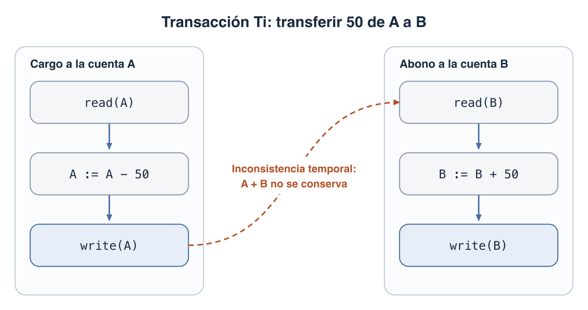
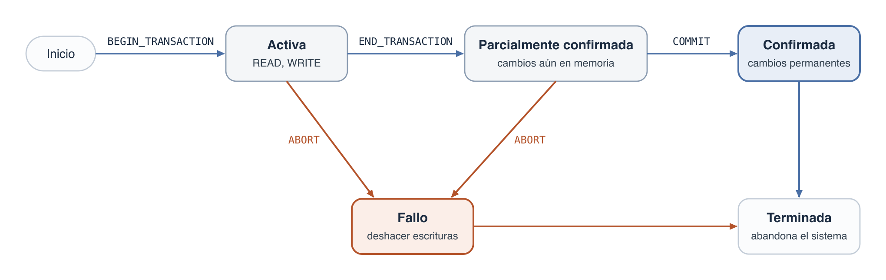

## ¿Qué es una transacción?

- Una **transacción** es un programa en ejecución que constituye una **unidad lógica** de procesamiento de la base de datos: o se completa **en su totalidad**, o no se lleva a cabo en absoluto
- Incluye una o más operaciones de acceso: inserción, eliminación, modificación o recuperación
- Una transacción que solo recupera datos es **de solo lectura**
- Ejemplos: reservas en aerolíneas, banca, tarjetas de crédito, bolsa de valores → cientos de usuarios simultáneos que necesitan alta disponibilidad y respuesta rápida

- Los ejemplos SQL usan el esquema **EMPRESA** de la [página de DDL](./sql-ddl.md); las **notas** indican diferencias entre **SQL Server**, **PostgreSQL**, **Oracle** y **SQLite**

**Ejemplo clásico:** transferir 50 de la cuenta *A* a la cuenta *B* (Silberschatz). Son dos actualizaciones, pero una sola unidad lógica:



- El cargo y el abono por separado **no** son transacciones: ninguno lleva por sí solo a la base de datos de un estado consistente a otro
- Durante la ejecución se permite una **inconsistencia temporal**: entre `write(A)` y `write(B)` falta dinero, y es inevitable porque una de las dos escrituras va primero

### Modelo simplificado: lectura y escritura

Para explicar los conceptos, la base de datos se ve como una colección de **elementos de datos** con nombre (X, Y). El tamaño de un elemento (campo, registro o bloque de disco) es su **granularidad**. Solo hay dos operaciones:


- El paso 4 es el que explica casi todo lo demás: una transacción puede haber "escrito" y sus datos seguir **solo en memoria**
- **Conjunto de lectura** (*read-set*): elementos que la transacción lee. **Conjunto de escritura** (*write-set*): los que escribe

### Sistemas monousuario y multiusuario

- **Monousuario**: un solo usuario a la vez. **Multiusuario**: varios simultáneamente (casi todos los DBMS)
- Con una sola CPU, la **multiprogramación** ejecuta algunos comandos de un proceso, lo suspende y sigue con otro: la concurrencia es **interpolada**
- Con varias CPU también hay procesamiento **paralelo**. La teoría de concurrencia se desarrolla sobre el modelo interpolado

## ¿Por qué hacen falta control de concurrencia y recuperación?

### Problemas de concurrencia

Se usa una base de datos de reservas: X e Y son las plazas reservadas en dos vuelos. Dos transacciones:

```text
T1 (transfiere N reservas de X a Y)    T2 (reserva M plazas en X)
read_item(X);                          read_item(X);
X := X - N;                            X := X + M;
write_item(X);                         write_item(X);
read_item(Y);
Y := Y + N;
write_item(Y);
```

**Pérdida de actualización.** Con X = 80, N = 5 y M = 4, el resultado correcto es **79**. Con esta interpolación queda en **84**: T2 sobrescribe el cambio de T1.

| T1 | T2 | X en la BD |
| --- | --- | --- |
| `read_item(X)` → 80 | | 80 |
| `X := 80 - 5` | | 80 |
| | `read_item(X)` → 80 | 80 |
| | `X := 80 + 4` | 80 |
| `write_item(X)` | | 75 |
| `read_item(Y)` | | 75 |
| | `write_item(X)` | **84** |
| `Y := Y + 5` | | 84 |
| `write_item(Y)` | | 84 |

**Actualización temporal o lectura sucia.** T2 lee un valor de una transacción que todavía no se ha confirmado y que luego falla. Ese valor es un **dato sucio**.

| T1 | T2 | X en la BD |
| --- | --- | --- |
| `read_item(X)` → 80 | | 80 |
| `X := 80 - 5` | | 80 |
| `write_item(X)` | | 75 |
| | `read_item(X)` → **75** | 75 |
| | `X := 75 + 4` | 75 |
| | `write_item(X)` | 79 |
| **T1 falla**: X debe volver a su valor antiguo | | — |

**Suma incorrecta.** T3 calcula el total de reservas mientras T1 se ejecuta. Si lee X **después** de restar N e Y **antes** de sumar N, el total queda desfasado en N, aunque T1 no cambie el total real.

**Lectura irrepetible.** T lee un elemento dos veces y otra transacción lo modifica entre ambas lecturas: T recibe valores distintos. Por ejemplo, un cliente consulta las plazas de un vuelo y, al confirmar la reserva, la transacción lee otro número.

### Tipos de fallos

El DBMS no debe permitir que **algunas** operaciones de una transacción se apliquen y otras no. Una transacción puede fallar a mitad de ejecución por:

| # | Fallo | Ejemplo |
| --- | --- | --- |
| 1 | Fallo del computador | Error de hardware, software o red; fallo de memoria |
| 2 | Error de la transacción o del sistema | Desbordamiento, división por cero, parámetro erróneo, el usuario la interrumpe |
| 3 | Condición de excepción detectada por la transacción | Datos no encontrados, saldo insuficiente |
| 4 | Control de concurrencia | El sistema la aborta por violar la serialización o por un interbloqueo |
| 5 | Fallo del disco | Bloques que pierden datos |
| 6 | Problemas físicos y catástrofes | Corte eléctrico, incendio, robo, sobrescritura de cintas |

- Los tipos 1 a 4 son los más comunes: el sistema debe guardar información suficiente para recuperarse de ellos
- Una condición de excepción bien programada (tipo 3) no se considera un fallo: la transacción decide cancelarse

## Propiedades ACID

Toda transacción debe cumplirlas; las garantizan el control de concurrencia y los métodos de recuperación del DBMS.

| Propiedad | Significado | ¿Quién la garantiza? |
| --- | --- | --- |
| **A**tomicidad | Se ejecuta **en su totalidad o no se ejecuta** | Subsistema de **recuperación** |
| **C**onsistencia | Lleva la base de datos de un estado consistente a **otro** estado consistente | **Programador** y módulo de restricciones de integridad |
| a**I**slamiento | Parece ejecutarse sola: no interfiere con las transacciones simultáneas | Subsistema de **control de concurrencia** |
| **D**urabilidad | Los cambios **confirmados** persisten, aunque ocurra un fallo | Subsistema de **recuperación** |

Aplicadas a la transferencia, con *A* = 1000 y *B* = 2000:

- **Atomicidad**: si el sistema falla después de `write(A)` y antes de `write(B)`, quedaría *A* = 950 y *B* = 2000, y se habrían perdido 50. El sistema debe **deshacer** el cargo
- **Consistencia**: la suma *A* + *B* = 3000 debe conservarse. Es tarea del programador: una transacción que solo hiciera el cargo se ejecutaría sin error, pero sería incorrecta
- **Aislamiento**: otra transacción que lea entre `write(A)` y `write(B)` vería *A* + *B* = 2950. Ejecutarlas en serie lo evita, pero la concurrencia mejora el rendimiento; el sistema debe lograr que el **resultado** sea equivalente a una ejecución en serie
- **Durabilidad**: una vez que se avisa al usuario de que la transferencia se hizo, ningún fallo puede hacerla desaparecer

Un **estado consistente** satisface las restricciones del esquema y cualquier otra regla que deba cumplirse. Las restricciones de la [página de DDL](./sql-ddl.md) cubren una parte; "*A* + *B* no cambia" la cubre el programa. La consistencia se exige al **terminar** la transacción, no a cada paso.

## Estados de una transacción

Para poder recuperarse, el sistema hace seguimiento de estas operaciones:

| Operación | Significado |
| --- | --- |
| `BEGIN_TRANSACTION` | Inicio de la ejecución |
| `READ`, `WRITE` | Lecturas y escrituras de la transacción |
| `END_TRANSACTION` | Terminaron las lecturas y escrituras; falta comprobar si se puede confirmar |
| `COMMIT_TRANSACTION` | Finalización **satisfactoria**: los cambios no se desharán |
| `ROLLBACK` (o `ABORT`) | Finalización **no satisfactoria**: hay que deshacer los cambios |



- **Activa**: estado inicial, mientras emite lecturas y escrituras
- **Parcialmente confirmada**: ejecutó su última operación, pero los cambios pueden seguir en memoria; un fallo todavía puede impedir que se confirme
- **Confirmada**: alcanzó su punto de confirmación y sus cambios son permanentes
- **Fallo**: falló una comprobación o se canceló; hay que deshacer sus escrituras
- **Terminada**: abandonó el sistema y se borra su información de las tablas del sistema

Los dos libros nombran los estados de forma distinta:

| Elmasri & Navathe | Silberschatz |
| --- | --- |
| Activa | Activa |
| Parcialmente confirmada | Parcialmente comprometida |
| Confirmada | Comprometida |
| Fallo | Fallida |
| Terminada (abandona el sistema, tras confirmarse o fallar) | Abortada (tras deshacerse) |

Silberschatz agrega qué hacer después de abortar y después de confirmar:

- Una transacción abortada puede **reiniciarse** (como transacción nueva) si falló por hardware o software ajeno a su lógica, o **cancelarse** si tiene un error lógico interno
- Una transacción confirmada **no se puede deshacer**. Para revertir sus efectos se ejecuta una **transacción compensadora**: otra transacción que hace lo contrario (por ejemplo, reintegrar lo cargado)
- Las **escrituras externas observables**, como entregar dinero en un cajero, solo deben ocurrir **después** de confirmar, porque no se pueden deshacer

## Cómo se implementan la atomicidad y la durabilidad

### El registro del sistema (log)

El **registro** (*log*, o diario) guarda en disco todas las operaciones que cambian valores. Solo lo afectan los fallos de disco o catastróficos, y por eso también se respalda periódicamente.

```text
[start_transaction, T]
[write_item, T, X, valor_antiguo, valor_nuevo]
[read_item, T, X]                                (no siempre se registra)
[commit, T]
[abort, T]
```

Mover 10 horas de un proyecto a otro quedaría así:

```text
[start_transaction, T1]
[write_item, T1, X, 32.5, 22.5]
[write_item, T1, Y, 7.5, 17.5]
[commit, T1]
```

Con el valor antiguo y el nuevo, el sistema puede recuperarse en ambos sentidos:

- **Deshacer** (*undo*): recorrer el registro **hacia atrás** y restaurar cada `valor_antiguo`
- **Rehacer** (*redo*): recorrer el registro **hacia delante** y aplicar cada `valor_nuevo`

### Punto de confirmación

- Una transacción alcanza su **punto de confirmación** cuando todas sus operaciones se han ejecutado y su efecto se ha **grabado en el registro**. Entonces escribe `[commit, T]`
- Tras una caída, el sistema busca en el registro:

| En el registro hay... | Acción | Motivo |
| --- | --- | --- |
| `start_transaction` **sin** `commit` | Deshacer | No se confirmó: atomicidad |
| `start_transaction` **con** `commit` | Rehacer | Se confirmó, pero sus datos quizá no llegaron al disco: durabilidad |

- El registro también pasa por búferes de memoria, y lo que hay en memoria se pierde en una caída. Por eso, **antes** de confirmar, todo lo pendiente del registro se escribe en disco: es la **escritura forzosa** del registro

### Copia en la sombra

Silberschatz presenta primero un esquema más simple, sin registro:

1. Un puntero en disco (`db-pointer`) señala la copia actual de la base de datos
2. La transacción hace una **copia completa** y solo modifica la copia
3. Para confirmar, se escriben en disco todas las páginas de la copia y luego se actualiza `db-pointer` para que apunte a ella
4. Se borra la copia antigua

- **Atomicidad**: si falla antes de actualizar el puntero, la copia actual sigue intacta. La escritura del puntero es atómica porque ocupa un solo sector de disco
- **Durabilidad**: tras actualizar el puntero, la nueva copia ya está en disco
- **Límites**: copiar toda la base de datos es muy costoso y solo admite una transacción a la vez. Lo usan los editores de texto, no los DBMS; estos usan el registro

## Transacciones en SQL

- Una transacción SQL es una unidad lógica de trabajo con atomicidad garantizada
- Una **sentencia SQL individual siempre es atómica**: si falla, no deja cambios a medias, aunque afecte a muchas filas
- Toda transacción debe terminar con una sentencia explícita: `COMMIT` o `ROLLBACK`

### COMMIT: confirmar

```sql
-- Mover 10 horas del proyecto 1 al proyecto 2 (32.5 / 7.5 → 22.5 / 17.5)
BEGIN TRANSACTION;

UPDATE TRABAJA_EN SET Horas = Horas - 10
WHERE  DniEmpleado = '123456789' AND NumProy = 1;

UPDATE TRABAJA_EN SET Horas = Horas + 10
WHERE  DniEmpleado = '123456789' AND NumProy = 2;

COMMIT;
```

- Después de `COMMIT`, los cambios son **permanentes** y visibles para las demás transacciones
- Ya no se pueden deshacer con `ROLLBACK`

### ROLLBACK: deshacer

```sql
BEGIN TRANSACTION;

DELETE FROM TRABAJA_EN WHERE DniEmpleado = '123456789';

-- Dentro de la transacción, las filas ya no están
SELECT COUNT(*) FROM TRABAJA_EN WHERE DniEmpleado = '123456789';   -- 0

ROLLBACK;

-- La base de datos vuelve al estado anterior al inicio
SELECT COUNT(*) FROM TRABAJA_EN WHERE DniEmpleado = '123456789';   -- 2
```

- Sirve de red de seguridad ante el `UPDATE` o `DELETE` **sin `WHERE`** de la [página de DML](./sql-dml.md): se ejecuta dentro de una transacción, se revisa y se confirma solo si está bien

### Inicio de la transacción y autocommit

- El libro indica que SQL no tiene sentencia explícita de inicio: la transacción empieza **implícitamente** con ciertas sentencias. Desde SQL:1999, el estándar también ofrece `START TRANSACTION`
- En modo **autocommit**, cada sentencia suelta es su propia transacción y se confirma sola: si no se inicia una transacción, **no hay `ROLLBACK` posible**

| Motor | Iniciar | Autocommit por defecto | Terminar |
| --- | --- | --- | --- |
| PostgreSQL | `BEGIN` o `START TRANSACTION` | Sí | `COMMIT` / `ROLLBACK` |
| SQL Server | `BEGIN TRANSACTION` | Sí | `COMMIT` / `ROLLBACK` |
| Oracle | Implícito, con la primera sentencia SQL ejecutable | No | `COMMIT` / `ROLLBACK` |
| SQLite | `BEGIN TRANSACTION` | Sí | `COMMIT` / `ROLLBACK` |

> **Nota:**
>
> - **Oracle**: el DML queda pendiente hasta el `COMMIT`. Además, toda sentencia **DDL** hace un `COMMIT` implícito, antes y después: un `CREATE TABLE` confirma lo que estuviera pendiente y no se puede deshacer. En **PostgreSQL**, **SQL Server** y **SQLite**, el DDL sí se puede deshacer con `ROLLBACK`
> - **Oracle**: `BEGIN` inicia un bloque PL/SQL, no una transacción

### Errores dentro de una transacción

El libro presenta un ejemplo en SQL embebido. Si cualquier sentencia falla, el programa salta a `ROLLBACK` y se deshacen **ambas**:

```sql
EXEC SQL WHENEVER SQLERROR GOTO UNDO;
EXEC SQL SET TRANSACTION
    READ WRITE,
    DIAGNOSTICS SIZE 5,
    ISOLATION LEVEL SERIALIZABLE;
EXEC SQL INSERT INTO EMPLEADO (Nombre, Apellido1, Dni, Dno, Sueldo)
    VALUES ('Luis', 'Campos', '991004321', 5, 35000);
EXEC SQL UPDATE EMPLEADO
    SET Sueldo = Sueldo * 1.1 WHERE Dno = 5;
EXEC SQL COMMIT;
GOTO THE_END;
UNDO: EXEC SQL ROLLBACK;
THE_END: ... ;
```

Ese salto lo programa el desarrollador: **un error no anula por sí solo la transacción** en la mayoría de los motores. Si se ignora el error y se ejecuta `COMMIT`, la parte que sí funcionó **queda guardada**:

```sql
BEGIN TRANSACTION;

UPDATE TRABAJA_EN SET Horas = Horas - 5
WHERE  DniEmpleado = '123456789' AND NumProy = 1;      -- Correcto

INSERT INTO TRABAJA_EN (DniEmpleado, NumProy, Horas)
VALUES ('123456789', 99, 5.0);                         -- Error: no existe el proyecto 99

COMMIT;                                                -- ¿Qué ocurre?
```

| Motor | Tras el error | Resultado del `COMMIT` |
| --- | --- | --- |
| SQLite, Oracle | Se anula solo la sentencia fallida; la transacción sigue abierta | **Guarda el `UPDATE`: se perdieron 5 horas** |
| SQL Server | Igual, salvo con `SET XACT_ABORT ON` | **Guarda el `UPDATE`** |
| PostgreSQL | La transacción queda abortada y rechaza toda sentencia hasta terminarla | Equivale a `ROLLBACK`: no guarda nada |

Por eso se captura el error y se decide de forma explícita:

```sql
-- SQL Server
BEGIN TRY
  BEGIN TRANSACTION;
  UPDATE TRABAJA_EN SET Horas = Horas - 5
  WHERE  DniEmpleado = '123456789' AND NumProy = 1;
  INSERT INTO TRABAJA_EN (DniEmpleado, NumProy, Horas)
  VALUES ('123456789', 99, 5.0);
  COMMIT;
END TRY
BEGIN CATCH
  IF @@TRANCOUNT > 0 ROLLBACK;
  THROW;
END CATCH;
```

### SET TRANSACTION y niveles de aislamiento

`SET TRANSACTION` fija tres características de la transacción:

- **Modo de acceso**: `READ WRITE` (por defecto) o `READ ONLY`. Con `READ UNCOMMITTED` se asume `READ ONLY`
- **Tamaño del área de diagnóstico** (`DIAGNOSTICS SIZE n`): cuántas condiciones de error o excepción se conservan. Ninguno de los cuatro motores lo acepta
- **Nivel de aislamiento**: cuánta interferencia se tolera a cambio de más rendimiento

```sql
SET TRANSACTION ISOLATION LEVEL SERIALIZABLE;
```

Bajar de `SERIALIZABLE` permite estas violaciones:

- **Lectura sucia**: T1 lee un valor de T2 sin confirmar; si T2 se cancela, T1 leyó un valor que no existe
- **Lectura irrepetible**: T1 lee un valor, T2 lo actualiza, y T1 ve otro valor al releerlo
- **Fantasma**: T1 lee filas según un `WHERE`, T2 inserta una fila que cumple la condición, y T1 la ve al repetir la lectura

| Nivel de aislamiento | Lectura sucia | Lectura irrepetible | Fantasma |
| --- | --- | --- | --- |
| `READ UNCOMMITTED` | Sí | Sí | Sí |
| `READ COMMITTED` | No | Sí | Sí |
| `REPEATABLE READ` | No | No | Sí |
| `SERIALIZABLE` | No | No | No |

- `READ UNCOMMITTED` es el nivel más permisivo y `SERIALIZABLE` el más restrictivo
- El estándar define `SERIALIZABLE` como predeterminado, pero varios motores no lo siguen:

| Motor | Por defecto | Particularidades |
| --- | --- | --- |
| PostgreSQL | `READ COMMITTED` | `READ UNCOMMITTED` se comporta como `READ COMMITTED`; `REPEATABLE READ` tampoco permite fantasmas. `SET TRANSACTION` va **dentro** de la transacción |
| SQL Server | `READ COMMITTED` | Los cuatro niveles. `SET TRANSACTION` va **antes** de `BEGIN TRANSACTION`, vale para toda la sesión y solo admite el nivel de aislamiento |
| Oracle | `READ COMMITTED` | Solo `READ COMMITTED` y `SERIALIZABLE`, además de `READ ONLY`. `SET TRANSACTION` debe ser la **primera** sentencia y admite una sola opción |
| SQLite | `SERIALIZABLE` | No tiene `SET TRANSACTION` |

## Resumen

| Concepto | Idea clave |
| --- | --- |
| Transacción | Unidad lógica de trabajo: todo o nada |
| Atomicidad / Durabilidad | Las garantiza la recuperación, mediante el registro |
| Consistencia | La garantizan el programador y las restricciones de integridad |
| Aislamiento | Lo garantiza el control de concurrencia; se regula con los niveles de aislamiento |
| Punto de confirmación | El efecto de la transacción ya está en el registro, en disco |
| Deshacer / Rehacer | Sin `commit` en el registro se deshace; con `commit`, se rehace |
| Transacción compensadora | Única forma de revertir algo ya confirmado |

| Comando | Uso |
| --- | --- |
| `BEGIN` / `BEGIN TRANSACTION` / `START TRANSACTION` | Iniciar una transacción (según el motor) |
| `COMMIT` | Confirmar: los cambios son permanentes |
| `ROLLBACK` | Anular: deshace los cambios de la transacción |
| `SET TRANSACTION ...` | Fijar el modo de acceso y el nivel de aislamiento |

[⬅️ Volver a Unidad II](./index.md)
