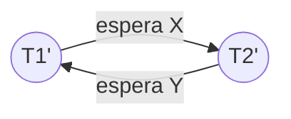

Resumen de las secciones 18.1 y 17.6 de Elmasri & Navathe. Continúa la página de [transacciones](./transacciones.md).

- Primero, **cómo** evita el DBMS que las transacciones se estorben: bloqueos (18.1)
- Después, **cuánto** aislamiento pide el programador desde SQL (17.6)
- Los recuadros **Explicación** aclaran el porqué; los marcados con *(fuera del libro)* son un complemento

## Ideas previas

| Término | Significado |
| --- | --- |
| **Planificación** | Orden en que se intercalan las operaciones de varias transacciones |
| **En serie** | Se ejecuta una transacción completa y luego la otra, sin intercalar |
| **Serializable** | Se intercalan, pero el resultado equivale al de **alguna** planificación en serie |
| **Estricta** | Nadie lee ni escribe X hasta que termine la última transacción que escribió X |

La meta: permitir que se intercalen (más rendimiento) con un resultado **serializable** (correcto).

## Bloqueos

- Un **bloqueo** es una variable asociada a un elemento de datos X que indica qué operaciones se le pueden aplicar
- El **gestor de bloqueos** del DBMS los concede y los lleva en una **tabla de bloqueo**. Lo que no aparece en la tabla está desbloqueado
- Bloquear y desbloquear son operaciones **indivisibles**: nada se intercala en medio
- Si el bloqueo no está disponible, la transacción **espera** en una cola

### Bloqueo binario

Solo dos estados: **bloqueado** (1) o **desbloqueado** (0).

```text
bloquear_elemento(X)       si X está libre, lo toma; si no, espera
desbloquear_elemento(X)    libera X y despierta a una transacción en espera
```

Reglas para cada transacción T:

1. Bloquear X **antes** de leerlo o escribirlo
2. Desbloquear X **después** de terminar de usarlo
3. No volver a bloquear X si ya lo tiene
4. No desbloquear X si no lo tiene

Es fácil de implementar, pero **demasiado restrictivo**: ni siquiera dos lecturas pueden ser simultáneas. Por eso no se usa en la práctica.

### Bloqueo compartido/exclusivo

También llamado de **lectura/escritura**. Es el que se usa en la práctica.

| Operación | Tipo | Permite |
| --- | --- | --- |
| `bloquear_lectura(X)` | **Compartido** | Leer. Varias transacciones a la vez |
| `bloquear_escritura(X)` | **Exclusivo** | Leer y escribir. Una sola transacción |
| `desbloquear(X)` | — | Libera el bloqueo |

¿Se concede lo que pide T2 si T1 ya tiene bloqueado X?

| T1 tiene ↓ / T2 pide → | Lectura | Escritura |
| --- | --- | --- |
| **Nada** | Sí | Sí |
| **Lectura** | Sí | Espera |
| **Escritura** | Espera | Espera |

Reglas:

1. Para **leer** X: tener un bloqueo de lectura o de escritura
2. Para **escribir** X: tener un bloqueo de escritura
3. Desbloquear X al terminar de usarlo
4. No pedir un bloqueo sobre X si ya se tiene uno (se relaja con la conversión)
5. No desbloquear X si no se tiene bloqueado

La tabla de bloqueo guarda, por cada elemento bloqueado: nombre, estado, número de lecturas y qué transacciones lo tienen.

### Conversión de bloqueos

| Conversión | De → a | Condición |
| --- | --- | --- |
| **Promoción** | Lectura → escritura | T es la **única** con bloqueo de lectura sobre X; si no, espera |
| **Degradación** | Escritura → lectura | T ya tiene el bloqueo de escritura |

## Bloquear no es suficiente

T1 hace `X := X + Y`. T2 hace `Y := X + Y`. Ambas cumplen **todas** las reglas anteriores. Valores iniciales: X = 20, Y = 30.

| T1 | T2 | Valores |
| --- | --- | --- |
| `bloquear_lectura(Y)` | | |
| `leer_elemento(Y)` → 30 | | |
| `desbloquear(Y)` **← muy pronto** | | |
| | `bloquear_lectura(X)` | |
| | `leer_elemento(X)` → 20 | |
| | `desbloquear(X)` **← muy pronto** | |
| | `bloquear_escritura(Y)` | |
| | `leer_elemento(Y)` → 30 | |
| | `Y := 20 + 30` | |
| | `escribir_elemento(Y)` | Y = 50 |
| | `desbloquear(Y)` | |
| `bloquear_escritura(X)` | | |
| `leer_elemento(X)` → 20 | | |
| `X := 20 + 30` | | |
| `escribir_elemento(X)` | | X = 50 |
| `desbloquear(X)` | | |

| Ejecución | X | Y |
| --- | --- | --- |
| En serie: T1 y luego T2 | 50 | 80 |
| En serie: T2 y luego T1 | 70 | 50 |
| La de arriba | **50** | **50** |

> **Explicación:** el resultado no coincide con ninguna ejecución en serie, así que es **incorrecto**. T1 soltó Y y luego usó el valor viejo (30), cuando T2 ya lo había cambiado a 50. El error no fue bloquear mal, sino **soltar antes de tiempo**.

## Bloqueo en dos fases (2PL)

> **Regla:** en una transacción, **todos** los bloqueos van **antes** del **primer** desbloqueo.

| Fase | Se puede | No se puede | Conversión permitida |
| --- | --- | --- | --- |
| 1. **Expansión** | Adquirir bloqueos | Liberar | Promoción |
| 2. **Reducción** | Liberar bloqueos | Adquirir | Degradación |

Las mismas transacciones, ahora con 2PL:

| T1' | T2' |
| --- | --- |
| `bloquear_lectura(Y)` | `bloquear_lectura(X)` |
| `leer_elemento(Y)` | `leer_elemento(X)` |
| **`bloquear_escritura(X)`** | **`bloquear_escritura(Y)`** |
| `desbloquear(Y)` | `desbloquear(X)` |
| `leer_elemento(X)` | `leer_elemento(Y)` |
| `X := X + Y` | `Y := X + Y` |
| `escribir_elemento(X)` | `escribir_elemento(Y)` |
| `desbloquear(X)` | `desbloquear(Y)` |

- Si **todas** las transacciones cumplen 2PL, la planificación es **serializable**. No hace falta comprobarlo
- **Precio 1**: menos concurrencia. X sigue bloqueado aunque T ya no lo use
- **Precio 2**: prohíbe algunas planificaciones que sí eran serializables
- **Precio 3**: puede haber interbloqueo e inanición

> **Explicación:** T1' ya tiene X **antes** de soltar Y. Cuando T2' pueda modificar Y, no podrá leer X hasta que T1' termine con él, así que T2' ve todo el trabajo de T1' o nada. Ya no puede meterse **a la mitad**.

2PL **no** es lo mismo que la *confirmación en dos fases* (2PC), que es de bases de datos distribuidas.

### Variantes

| Variante | Regla | ¿Planificación estricta? | ¿Sin interbloqueos? |
| --- | --- | --- | --- |
| **Básico** | Bloquear todo antes del primer desbloqueo | No | No |
| **Conservador** (estático) | Bloquear **todo antes de empezar**; si algo falta, no bloquea nada y espera | No | **Sí** |
| **Estricto** | Básico + no liberar los bloqueos de **escritura** hasta confirmar o abortar | **Sí** | No |
| **Riguroso** | No liberar **ningún** bloqueo hasta confirmar o abortar | **Sí** | No |

- **Estricto** es el más popular en la práctica
- **Riguroso** es más restrictivo, pero más fácil de implementar
- **Conservador** casi no se usa: rara vez se sabe de antemano todo lo que se va a leer y escribir

> **Explicación:** ¿por qué importa que sea estricta? Porque nadie puede leer un dato sin confirmar. Si T1 aborta, basta con deshacer T1: no hay otras transacciones que anular por haber leído un valor que ya no existe.

### ¿Quién pide los bloqueos?

Normalmente el **DBMS**, no el programador. Con 2PL estricto, ante cada operación de T:

| T ejecuta | El sistema intenta | Si otra transacción tiene X |
| --- | --- | --- |
| `leer_elemento(X)` | `bloquear_lectura(X)` | Para **escritura**: T espera. Para lectura: se concede |
| `escribir_elemento(X)` | `bloquear_escritura(X)` | Para lectura o escritura: T espera |

Si T es la única que lo tiene para lectura y quiere escribir, el sistema **promociona** su bloqueo.

## Interbloqueo (*deadlock*)

Dos o más transacciones se esperan **entre sí** y ninguna puede avanzar.

| T1' | T2' |
| --- | --- |
| `bloquear_lectura(Y)` | |
| `leer_elemento(Y)` | |
| | `bloquear_lectura(X)` |
| | `leer_elemento(X)` |
| `bloquear_escritura(X)` → **espera a T2'** | |
| | `bloquear_escritura(Y)` → **espera a T1'** |

**Gráfico de espera**: un nodo por transacción y una flecha Ti → Tj si Ti espera un elemento que tiene Tj. Hay interbloqueo **si y solo si hay un ciclo**.



Hay tres formas de tratarlo: **prevenir**, **detectar** o usar **tiempos limitados**.

### Prevención

Evita que llegue a formarse un ciclo. Según el libro, estos protocolos casi no se usan en la práctica.

**Sin marcas de tiempo:**

| Protocolo | Si Ti no obtiene el bloqueo que tiene Tj |
| --- | --- |
| **Bloquear todo antes** (2PL conservador) | No bloquea nada, espera y reintenta |
| **Ordenar los elementos** | No aplica: todas bloquean en el mismo orden, así que no hay ciclos |
| **No espera** | Ti aborta de inmediato y se reinicia después |
| **Espera cautelosa** | Si Tj **no** está esperando a nadie, Ti espera; si Tj está esperando, Ti aborta |

**Con marcas de tiempo.** Cada transacción recibe TS(T) al iniciar: **menor TS = más antigua**. Ti pide un elemento que tiene Tj:

| Protocolo | Ti es **más antigua** | Ti es **más nueva** |
| --- | --- | --- |
| **Esperar-morir** | Ti espera | Ti aborta (*muere*) |
| **Herir-esperar** | Aborta Tj (*Ti la hiere*) | Ti espera |

Ejemplo con TS(T1) = 5 (antigua) y TS(T2) = 8 (nueva):

| Situación | Esperar-morir | Herir-esperar |
| --- | --- | --- |
| T1 pide lo que tiene T2 | T1 espera | T2 aborta |
| T2 pide lo que tiene T1 | T2 aborta | T2 espera |

- En ambos se aborta **la más nueva**, que se reinicia con **la misma marca de tiempo**
- Desventaja: pueden abortar transacciones que nunca habrían causado un interbloqueo

> **Explicación:** no hay ciclos porque todas las esperas van en **un solo sentido**: en esperar-morir solo la antigua espera a la nueva; en herir-esperar, solo la nueva a la antigua. Y se conserva la marca de tiempo para que la abortada envejezca: en algún momento será la más antigua y ya nadie la abortará. Así se evita la inanición.

### Detección

1. El sistema revisa el gráfico de espera cada cierto tiempo
2. Si hay un ciclo, elige una **víctima** y la aborta
3. Conviene elegir una que lleve **poco tiempo** y haya hecho **pocos cambios**

| Conviene | Cuando |
| --- | --- |
| **Detectar** | Transacciones cortas, pocos elementos, poca carga |
| **Prevenir** | Transacciones largas, muchos elementos, mucha carga |

### Tiempos limitados (*timeout*)

Si una transacción espera más de cierto tiempo, se **supone** que está interbloqueada y se aborta, lo esté o no. Es simple y con poca sobrecarga.

## Inanición

Una transacción **nunca avanza** mientras las demás sí.

| Causa | Solución |
| --- | --- |
| Espera injusta: otras pasan siempre primero | Cola: el primero en llegar es el primero en ser atendido |
| Prioridades fijas | Subir la prioridad de la que más ha esperado |
| Siempre es la víctima elegida | Dar más prioridad a la que ya fue abortada varias veces |

> **Explicación:** en el **interbloqueo** todas las implicadas están detenidas y no se resuelve solo. En la **inanición** el sistema sigue funcionando, pero una transacción queda relegada.

## Transacciones en SQL (17.6)

Los ejemplos de `COMMIT`, `ROLLBACK` y manejo de errores por motor están en [transacciones](./transacciones.md#transacciones-en-sql). Lo esencial:

- Una **sentencia SQL individual siempre es atómica**
- Según el libro, el inicio es **implícito**; el final es **explícito**: `COMMIT` o `ROLLBACK`

`SET TRANSACTION` fija tres características:

| Característica | Valores | Por defecto |
| --- | --- | --- |
| **Modo de acceso** | `READ ONLY` (solo recuperar), `READ WRITE` (también modificar y crear) | `READ WRITE`; con `READ UNCOMMITTED` se asume `READ ONLY` |
| **Área de diagnóstico** | `DIAGNOSTICS SIZE n`: cuántas condiciones de error o excepción se guardan | — |
| **Nivel de aislamiento** | Los cuatro de abajo | `SERIALIZABLE` (algunos sistemas usan `READ COMMITTED`) |

### Niveles de aislamiento

Bajar de nivel da más rendimiento, pero permite estas violaciones:

| Violación | Qué pasa | Ejemplo |
| --- | --- | --- |
| **Lectura sucia** | T1 lee un cambio de T2 **sin confirmar** y T2 se cancela | T1 vio un saldo que nunca existió |
| **Lectura irrepetible** | T1 lee dos veces la **misma fila** y T2 la **modificó** en medio | Saldo: primero 1000, luego 900 |
| **Fantasma** | T1 repite una **consulta con condición** y T2 **insertó** una fila que la cumple | Empleados del departamento 5: primero 4, luego 5 |

| Nivel | Lectura sucia | Lectura irrepetible | Fantasma |
| --- | --- | --- | --- |
| `READ UNCOMMITTED` | Sí | Sí | Sí |
| `READ COMMITTED` | No | Sí | Sí |
| `REPEATABLE READ` | No | No | Sí |
| `SERIALIZABLE` | No | No | No |

> **Explicación:** *irrepetible* y *fantasma* se confunden. En la primera cambia una fila que **ya se había leído**; en la segunda **aparece una nueva**. La nueva no se podía bloquear porque todavía no existía: por eso `REPEATABLE READ` no evita fantasmas.

> **Explicación:** el `SERIALIZABLE` de SQL se define por **no permitir esas tres violaciones**. Según el libro, no es idéntico a la serialización teórica (equivaler a una ejecución en serie).

### Cómo se relacionan con los bloqueos

> **Explicación** *(fuera del libro)*: en un motor que usa bloqueos, cada nivel equivale a **cuánto tiempo se retienen los bloqueos de lectura**. Los de escritura siempre se retienen hasta el final, como en 2PL estricto.

| Nivel | Bloqueos de lectura |
| --- | --- |
| `READ UNCOMMITTED` | No se piden |
| `READ COMMITTED` | Se liberan al terminar de leer |
| `REPEATABLE READ` | Se retienen hasta el final |
| `SERIALIZABLE` | Se retienen hasta el final y además cubren **rangos**, para impedir fantasmas |

PostgreSQL y Oracle no siguen esta tabla: usan **versiones** de las filas (sección 18.3 del libro), y sus lecturas normales no bloquean a los escritores.

### Interbloqueo en SQL *(fuera del libro)*

Dos sesiones actualizan las mismas filas en orden contrario:

| Sesión 1 | Sesión 2 |
| --- | --- |
| `BEGIN;` | `BEGIN;` |
| `UPDATE CUENTA SET Saldo = Saldo - 50 WHERE NumCuenta = 'A';` | |
| | `UPDATE CUENTA SET Saldo = Saldo - 30 WHERE NumCuenta = 'B';` |
| `UPDATE CUENTA SET Saldo = Saldo + 50 WHERE NumCuenta = 'B';` → espera | |
| | `UPDATE CUENTA SET Saldo = Saldo + 30 WHERE NumCuenta = 'A';` → **interbloqueo** |

| Motor | Qué hace |
| --- | --- |
| PostgreSQL | Detecta el ciclo y cancela una transacción (`deadlock detected`, 40P01) |
| SQL Server | Detecta el ciclo y elige una víctima (error 1205); deshace su transacción |
| Oracle | Detecta el ciclo (ORA-00060), pero deshace solo la **sentencia**; hay que hacer `ROLLBACK` |
| SQLite | No ocurre a nivel de filas: solo hay un escritor a la vez. La otra sesión recibe `database is locked` |

Para evitarlo: actualizar siempre en el **mismo orden** (primero A, luego B), usar transacciones **cortas** y **reintentar** si el motor aborta la transacción.

## Resumen

| Concepto | Idea clave |
| --- | --- |
| Bloqueo compartido / exclusivo | Muchos leen, o uno escribe |
| 2PL | Primero se adquiere todo, después se libera: garantiza serialización |
| 2PL estricto | Los bloqueos de escritura se liberan al terminar; el más usado |
| Interbloqueo | Ciclo en el gráfico de espera: se previene, se detecta o se corta por tiempo |
| Esperar-morir / herir-esperar | Siempre se aborta la más nueva y conserva su marca de tiempo |
| Inanición | Una nunca avanza: cola justa o subir su prioridad |
| Nivel de aislamiento | Cuántas violaciones se toleran a cambio de rendimiento |

[⬅️ Volver a Unidad III](./index.md)
