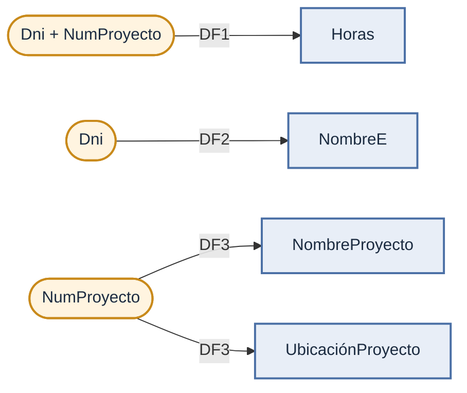
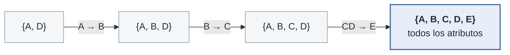
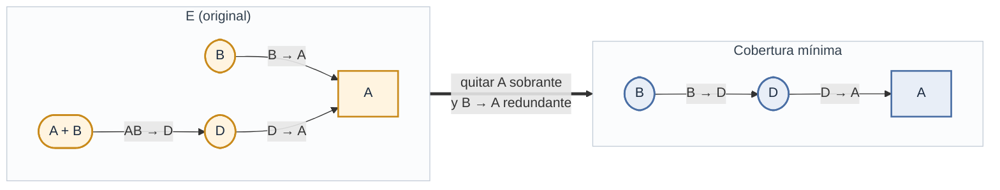
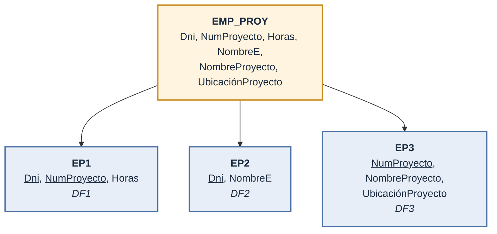
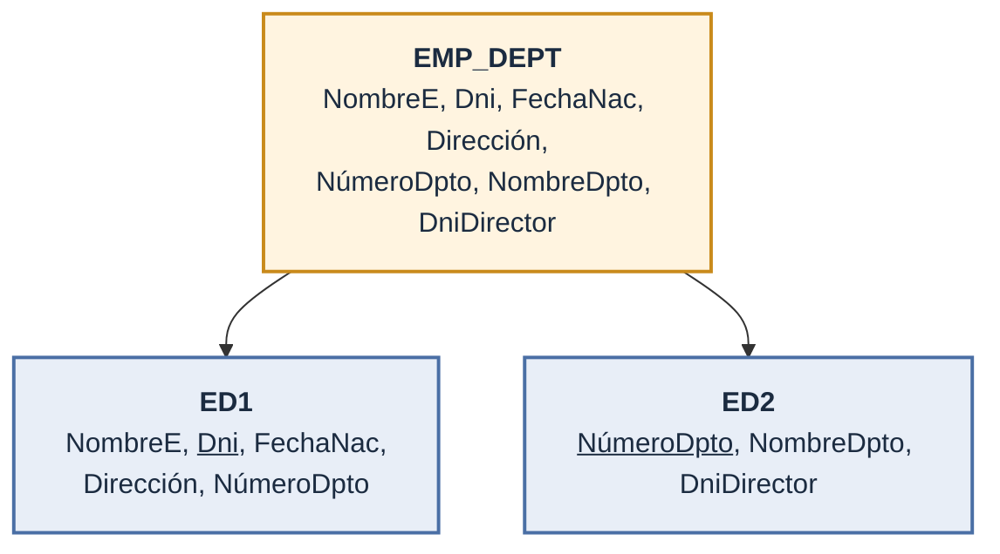
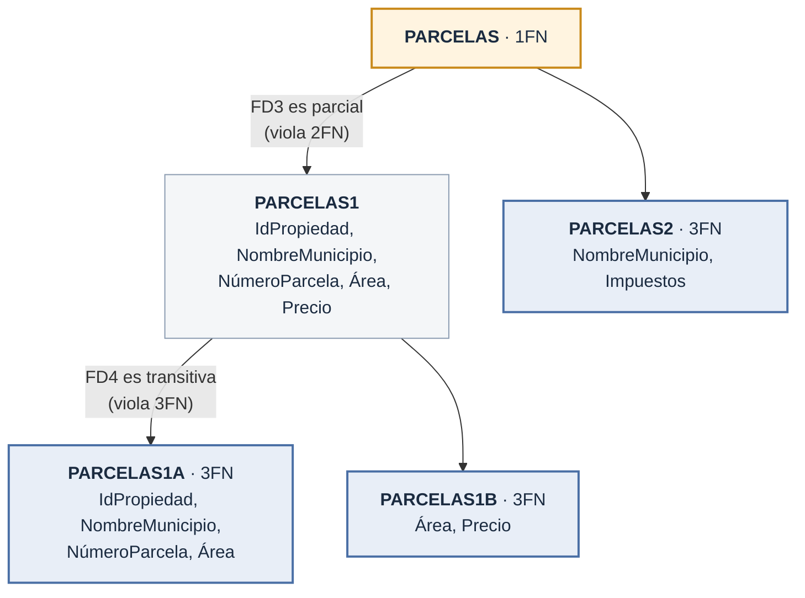

## ¿Por qué normalizar?

- Hasta ahora juzgábamos un diseño por **intuición**
- La normalización da criterios **formales** para decidir si un esquema de relación es bueno
- Se evalúa en dos niveles:
  - **Lógico**: ¿los usuarios entienden qué significa cada atributo?
  - **Implementación**: ¿cómo se almacenan y actualizan las tuplas?
- Hay dos formas de diseñar:
  - **Ascendente** (*bottom-up*, síntesis): se parte de los atributos sueltos y se agrupan
  - **Descendente** (*top-down*, análisis): se parte de agrupaciones naturales (facturas, formularios, informes) y se descomponen

## Esquema de trabajo: EMPRESA simplificada

```text
EMPLEADO(NombreE, Dni, FechaNac, Dirección, NúmeroDpto)
DEPARTAMENTO(NombreDpto, NúmeroDpto, DniDirector)
LOCALIZACIONES_DPTO(NúmeroDpto, UbicaciónDpto)
PROYECTO(NombreProyecto, NumProyecto, UbicaciónProyecto, NumDptoProyecto)
TRABAJA_EN(Dni, NumProyecto, Horas)
```

Relaciones mal diseñadas que se usan como ejemplo, con la forma normal que violan:

```text
DEPARTAMENTO(NombreDpto, NúmeroDpto, DniDirector, {UbicacionesDpto})             -- no 1FN
EMP_PROY(Dni, NombreE, {PROYS(NumProyecto, Horas)})                              -- no 1FN
EMP_PROY(Dni, NumProyecto, Horas, NombreE, NombreProyecto, UbicaciónProyecto)    -- no 2FN
EMP_DEPT(NombreE, Dni, FechaNac, Dirección, NúmeroDpto, NombreDpto, DniDirector) -- no 3FN
PARCELAS(IdPropiedad, NombreMunicipio, NúmeroParcela, Área, Precio, Impuestos)   -- no 2FN
PARCELAS1A(IdPropiedad, NombreMunicipio, NúmeroParcela, Área)                    -- no BCNF
ENSEÑAR(Estudiante, Curso, Profesor)                                             -- no BCNF
```

## Directrices informales de diseño

| # | Directriz | Problema que evita |
| --- | --- | --- |
| 1 | **Semántica clara**: cada relación describe una sola entidad o relación del modelo | Ambigüedad |
| 2 | **Sin anomalías** de inserción, borrado o modificación | Redundancia e inconsistencia |
| 3 | **Pocos NULL** en las relaciones base | Espacio desperdiciado; JOIN y agregados difíciles de interpretar |
| 4 | Concatenar solo por pares **clave principal – clave externa** | Tuplas falsas |

### Directriz 1: semántica clara

- Ejemplo de mal diseño:

```text
EMP_DEPT(NombreE, Dni, FechaNac, Dirección, NúmeroDpto, NombreDpto, DniDirector)
EMP_PROY(Dni, NumProyecto, Horas, NombreE, NombreProyecto, UbicaciónProyecto)
```

- `EMP_DEPT` mezcla empleado **y** departamento; `EMP_PROY` mezcla empleado, proyecto **y** `TRABAJA_EN`
- Están bien como **vistas**, no como relaciones base

**Diseño válido**: una relación por entidad, unidas por una clave externa

```text
EMPLEADO(NombreE, Dni, FechaNac, Dirección, NúmeroDpto)
DEPARTAMENTO(NombreDpto, NúmeroDpto, DniDirector)
```

- `EMPLEADO` describe solo empleados y `DEPARTAMENTO` solo departamentos
- `EMPLEADO.NúmeroDpto` es la clave externa que las relaciona

### Directriz 2: redundancia y anomalías

En `EMP_DEPT` los datos del departamento se **repiten** por cada empleado:

| NombreE | Dni | NúmeroDpto | NombreDpto | DniDirector |
| --- | --- | --- | --- | --- |
| Pérez Pérez, José | 123456789 | 5 | Investigación | 333445555 |
| Campos Sastre, Alberto | 333445555 | 5 | Investigación | 333445555 |
| Jiménez Celaya, Alicia | 999887777 | 4 | Administración | 987654321 |
| Sainz Oreja, Juana | 987654321 | 4 | Administración | 987654321 |

| Anomalía | Ejemplo en `EMP_DEPT` |
| --- | --- |
| **Inserción** | Cada empleado nuevo obliga a copiar los datos de su departamento, y una errata deja datos contradictorios |
| **Inserción** | Un departamento sin empleados no se puede insertar: quedaría `NULL` en `Dni`, la **clave principal** |
| **Borrado** | Al borrar al último empleado de un departamento **se pierde** el departamento |
| **Modificación** | Cambiar el director del dpto. 5 obliga a actualizar **todas** sus tuplas; si falta una, hay inconsistencia |

**Diseño válido**: los mismos datos en `EMPLEADO` y `DEPARTAMENTO`

| NombreE | Dni | NúmeroDpto |
| --- | --- | --- |
| Pérez Pérez, José | 123456789 | 5 |
| Campos Sastre, Alberto | 333445555 | 5 |
| Jiménez Celaya, Alicia | 999887777 | 4 |
| Sainz Oreja, Juana | 987654321 | 4 |

| NombreDpto | NúmeroDpto | DniDirector |
| --- | --- | --- |
| Investigación | 5 | 333445555 |
| Administración | 4 | 987654321 |
| Sede central | 1 | 888665555 |

- Cada departamento aparece **una sola vez**, así que desaparecen las anomalías:
  - **Inserción**: `Sede central` existe aunque todavía no tenga empleados en la tabla
  - **Borrado**: si se borra a Jiménez y a Sainz, el departamento 4 sigue en `DEPARTAMENTO`
  - **Modificación**: cambiar el director del dpto. 5 es actualizar **una** tupla

- A veces se acepta redundancia a propósito por **rendimiento**; en ese caso se documenta y se controla con triggers o procedimientos almacenados
- Lo habitual: relaciones base sin anomalías y **vistas** para los JOIN frecuentes

### Directriz 3: valores NULL

- `NULL` puede significar:
  - El atributo **no aplica**
  - El valor es **desconocido**
  - Existe pero **aún no se ha registrado**
- Como no se sabe cuál de los tres es, conviene evitarlo
- La decisión sale de los **requisitos**, no de contar datos: si un atributo, por regla del negocio, **no aplica** a la mayoría de las tuplas, va en una relación aparte
  - Ej.: solo el personal administrativo tiene oficina asignada; los técnicos de campo nunca la tienen. En vez de agregar `NúmeroOficina` a `EMPLEADO`, crear `OFICINAS_EMPS(DniEmpleado, NúmeroOficina)`

**Diseño válido**: solo tienen tupla en `OFICINAS_EMPS` los empleados con oficina

| DniEmpleado | NúmeroOficina |
| --- | --- |
| 333445555 | B-204 |
| 987654321 | A-101 |

- `EMPLEADO` no tiene ningún `NULL` por oficina
- Los empleados sin oficina simplemente **no aparecen** en `OFICINAS_EMPS`
- Para listar empleados con su oficina (si la tienen): `EMPLEADO LEFT JOIN OFICINAS_EMPS`

### Directriz 4: tuplas falsas

- Descomponer `EMP_PROY` en:
  - `EMP_LOCS(NombreE, UbicaciónProyecto)`
  - `EMP_PROY1(Dni, NumProyecto, Horas, NombreProyecto, UbicaciónProyecto)`
- Al volver a unirlas (`NATURAL JOIN`) por `UbicaciónProyecto` aparecen **tuplas falsas**: tuplas que no estaban en la relación original
- Causa: `UbicaciónProyecto` **no** es clave principal ni clave externa en ninguna de las dos
- Una buena descomposición permite reconstruir la relación original sin tuplas falsas: es la **reunión no aditiva** (capítulo 11)

**Diseño válido**: descomponer `EMP_PROY` de modo que cada JOIN use una clave

```text
EMPLEADO(Dni, NombreE)
PROYECTO(NumProyecto, NombreProyecto, UbicaciónProyecto)
TRABAJA_EN(Dni, NumProyecto, Horas)
```

- `TRABAJA_EN.Dni` → `EMPLEADO.Dni` y `TRABAJA_EN.NumProyecto` → `PROYECTO.NumProyecto` son pares clave externa – clave principal
- `TRABAJA_EN ⋈ EMPLEADO ⋈ PROYECTO` reconstruye exactamente `EMP_PROY`: cada tupla de `TRABAJA_EN` encuentra **un solo** empleado y **un solo** proyecto

## Dependencias funcionales

- **Dependencia funcional (DF)** `X → Y`: el valor de `X` determina el valor de `Y`
  - Dos tuplas con el mismo `X` **siempre** tienen el mismo `Y`
  - Ej.: `Dni → NombreE`; a cada `Dni` le corresponde un solo nombre
  - `X` es el lado izquierdo (determinante); `Y`, el lado derecho
- Si `X` es **clave candidata**, entonces `X → Y` para cualquier conjunto de atributos `Y`
- `X → Y` **no** implica `Y → X`
- Una DF sale del **significado** de los datos, no del contenido actual de la tabla
  - Mirar la tabla no la confirma, pero **un solo contraejemplo** la descarta

DF de `EMP_PROY`:

```text
DF1: {Dni, NumProyecto} → Horas
DF2: Dni → NombreE
DF3: NumProyecto → {NombreProyecto, UbicaciónProyecto}
```

**Diagrama de DF**: cada flecha sale del determinante y llega a lo que determina



### Contraejemplo: IMPARTIR

| Profesor | Curso | Texto |
| --- | --- | --- |
| Smith | Estructuras de datos | Bartram |
| Smith | Administración de datos | Martin |
| Hall | Compiladores | Hoffman |
| Brown | Estructuras de datos | Horowitz |

- `Texto → Curso` **parece** cumplirse, pero este estado de la tabla no basta para confirmarlo
- `Profesor → Curso` **no** se cumple: Smith imparte dos cursos

### Reglas de inferencia

- El diseñador escribe solo las DF **evidentes**, pero de ellas se deducen otras que nadie escribió
- **F**: el conjunto de DF que el diseñador **escribe** explícitamente
- **F⁺** (clausura de F): el conjunto de **todas** las DF que se cumplen en la relación: las de F **más** todas las que se pueden **deducir** de F
  - F es la lista corta que se escribe; F⁺ es la lista completa de reglas que la base de datos debe respetar
  - Siempre F ⊆ F⁺

Ejemplo: `DEPARTAMENTO(NúmeroDpto, DniDirector, TeléfonoDirector)` con

- `F = {NúmeroDpto → DniDirector, DniDirector → TeléfonoDirector}` (lo que escribió el diseñador)
- De esas dos se deduce `NúmeroDpto → TeléfonoDirector`: nadie la escribió, pero se cumple (el departamento determina su director, y el director su teléfono)
- Esa DF **no** está en F, pero **sí** está en F⁺; también es una restricción: la base de datos no puede violarla
- F⁺ incluye además DF obvias como `NúmeroDpto → NúmeroDpto` o `{NúmeroDpto, DniDirector} → DniDirector`; por eso F⁺ suele ser **muy grande** aunque F sea pequeño

- Las **reglas de inferencia** dicen qué deducciones son válidas, es decir, cómo pasar de F a F⁺
- Notación: `{X, Y} → Z` se abrevia `XY → Z`

| Regla | Nombre | Enunciado | Idea | Ejemplo |
| --- | --- | --- | --- | --- |
| RI1 | **Reflexiva** | Si `X ⊇ Y` ⇒ `X → Y` | Un conjunto determina cualquier parte de sí mismo (DF **trivial**) | `{Dni, NombreE} → NombreE` |
| RI2 | **Aumento** | `X → Y` ⇒ `XZ → YZ` | Agregar el mismo atributo a ambos lados no rompe la DF | `Dni → NombreE` ⇒ `{Dni, NumProyecto} → {NombreE, NumProyecto}` |
| RI3 | **Transitiva** | `X → Y`, `Y → Z` ⇒ `X → Z` | Las DF se encadenan | `NúmeroDpto → DniDirector`, `DniDirector → TeléfonoDirector` ⇒ `NúmeroDpto → TeléfonoDirector` |
| RI4 | Descomposición | `X → YZ` ⇒ `X → Y` | Si determino un conjunto, determino cada parte | `NumProyecto → {NombreProyecto, UbicaciónProyecto}` ⇒ `NumProyecto → NombreProyecto` |
| RI5 | Unión | `X → Y`, `X → Z` ⇒ `X → YZ` | Lo que `X` determina por separado lo determina junto | `Dni → NombreE`, `Dni → Dirección` ⇒ `Dni → {NombreE, Dirección}` |
| RI6 | Seudotransitiva | `X → Y`, `WY → Z` ⇒ `WX → Z` | Se puede sustituir `Y` por algo que lo determina | `NombreE → Dni`, `{Dni, NumProyecto} → Horas` ⇒ `{NombreE, NumProyecto} → Horas` (si `NombreE` fuera único) |

- **Axiomas de Armstrong** (RI1–RI3): son **sólidos** y **completos**, así que bastan para obtener F⁺
  - **Sólidos**: nunca producen una DF falsa
  - **Completos**: aplicándolos repetidamente se obtienen **todas** las DF de F⁺
  - RI4–RI6 se demuestran a partir de RI1–RI3; son atajos

Ejemplo: demostrar la descomposición (RI4) con los axiomas

1. `X → YZ` (dada)
2. `YZ → Y` (reflexiva: `YZ ⊇ Y`)
3. `X → Y` (transitiva con 1 y 2)

Ejemplo: deducir una DF nueva. En `R(A, B, C, D)` con `F = {A → B, BC → D}`, ¿se cumple `AC → D`?

1. `A → B` (dada)
2. `AC → BC` (aumento con `C`)
3. `BC → D` (dada)
4. `AC → D` (transitiva con 2 y 3)

- Errores comunes:
  - `XY → A` **no** implica `X → A` ni `Y → A`
    - Ej.: `{Dni, NumProyecto} → Horas`, pero ni `Dni → Horas` ni `NumProyecto → Horas`
  - En cambio, `X → A` y `Y → B` **sí** implican `XY → AB` (aumento y transitiva)
  - `X → Y` **no** implica `Y → X`
    - Ej.: `Dni → NombreE`, pero dos empleados pueden llamarse igual

### Clausura de un conjunto de atributos (X⁺)

**Idea central**: la clausura de `X`, escrita **X⁺**, es el conjunto de atributos cuyo valor queda **determinado** cuando se conoce el valor de `X`

- **`X`** es un conjunto de atributos de la relación que se toma como **punto de partida**: los atributos cuyo valor me dan
  - Puede ser un solo atributo (`X = {Dni}`) o varios (`X = {Dni, NumProyecto}`)
  - Lo elige quien hace la pregunta: "si conozco **estos** atributos, ¿qué más conozco?"
  - Suele ser un candidato a clave que se quiere probar

- "Determinado" significa: si dos filas tienen el **mismo valor en `X`**, entonces **obligatoriamente** tienen el mismo valor en **todos** los atributos de X⁺
  - Ej.: en `EMP_DEPT(Dni, NombreE, NúmeroDpto, NombreDpto)` con la DF `NúmeroDpto → NombreDpto`, tomando `X = {NúmeroDpto}`:

    | Dni | NombreE | NúmeroDpto | NombreDpto |
    | --- | --- | --- | --- |
    | 123 | Smith | 5 | Investigación |
    | 456 | Wong | 5 | Investigación |
    | 789 | Zelaya | 4 | Administración |

    - Pregunta: "una fila tiene `NúmeroDpto = 5`; ¿qué más puedo decir de ella?"
    - ¿Su `NombreDpto`? **Sí**: es "Investigación", sin importar cuál de las filas sea → `NombreDpto` **está determinado** por `NúmeroDpto` (está en X⁺)
    - ¿Su `NombreE`? **No**: puede ser Smith o Wong → `NombreE` **no está determinado** por `NúmeroDpto` (no está en X⁺)
    - Es decir, un atributo está determinado por `X` cuando conocer `X` basta para dar **una sola respuesta** sobre su valor
- Un atributo entra en X⁺ de dos formas:
  - **Directa**: hay una DF que va de `X` a ese atributo
  - **Indirecta**: se llega a él encadenando DF (`X` determina a `Y`, y `Y` determina al atributo)
  - Ej.: en `EMP_DEPT(Dni, NombreE, NúmeroDpto, NombreDpto)` con `F = {Dni → NombreE, Dni → NúmeroDpto, NúmeroDpto → NombreDpto}`, tomando `X = {Dni}`:
    - `NombreE` entra de forma **directa**: la DF `Dni → NombreE` va de `Dni` a `NombreE` en un solo paso
    - `NúmeroDpto` entra de forma **directa**: la DF `Dni → NúmeroDpto` también sale de `Dni`
    - `NombreDpto` entra de forma **indirecta**: no hay ninguna DF `Dni → NombreDpto`, pero se llega en dos pasos: `Dni → NúmeroDpto` y luego `NúmeroDpto → NombreDpto`
    - En palabras: con el `Dni` 123 sé que el empleado está en el departamento 5 (directa), y como sé que es el departamento 5, sé que se llama "Investigación" (indirecta)
- **¿Por qué "clausura"?** Porque al final el conjunto queda **cerrado**: ninguna DF de F lo puede hacer crecer más

**Cómo obtener X⁺**: seguir las DF como una cadena

- Se parte de lo que ya conozco: los atributos de `X`
- Cada DF cuyo lado izquierdo **ya conozco completo** me deja conocer su lado derecho
- Cuando ninguna DF me deja conocer algo nuevo, ya tengo X⁺

Ejemplo: `R(A, B, C, D, E)` con `F = {A → B, B → C, CD → E}`. ¿Qué conozco si me dan `A` y `D`? Es decir, `{A, D}⁺`

| # | Ya conozco | Uso la DF | Ahora también conozco |
| --- | --- | --- | --- |
| 0 | `A, D` (me los dieron) | — | — |
| 1 | `A` (fila 0) | `A → B` | `B` |
| 2 | `B` (fila 1) | `B → C` | `C` |
| 3 | `C` (fila 2) y `D` (fila 0) | `CD → E` | `E` |



- Resultado: `{A, D}⁺ = {A, B, C, D, E}`: conociendo `A` y `D` se conoce **toda** la fila
- `{A, D}⁺` contiene todos los atributos → `{A, D}` es superclave
- `A⁺ = {A, B, C}` y `D⁺ = {D}` no alcanzan solos → `{A, D}` es **clave**

Ahora con atributos reales: la relación `EMP_DEPT(Dni, NombreE, NúmeroDpto, NombreDpto)` guarda cada empleado junto con el departamento donde trabaja

| Dni | NombreE | NúmeroDpto | NombreDpto |
| --- | --- | --- | --- |
| 123 | Smith | 5 | Investigación |
| 456 | Wong | 5 | Investigación |
| 789 | Zelaya | 4 | Administración |

Sus DF (F) son:

- `Dni → NombreE` (el Dni identifica al empleado)
- `Dni → NúmeroDpto` (cada empleado está en un solo departamento)
- `NúmeroDpto → NombreDpto` (cada departamento tiene un solo nombre)

En `EMP_DEPT(Dni, NombreE, NúmeroDpto, NombreDpto)`, si me dan un `Dni`, ¿qué más puedo saber? Es decir, calcular `Dni⁺` (aquí `X = {Dni}`):

| # | Ya conozco | Uso la DF | Ahora también conozco |
| --- | --- | --- | --- |
| 0 | `Dni` (me lo dieron) | — | — |
| 1 | `Dni` (fila 0) | `Dni → NombreE` | `NombreE` |
| 2 | `Dni` (fila 0) | `Dni → NúmeroDpto` | `NúmeroDpto` |
| 3 | `NúmeroDpto` (fila 2) | `NúmeroDpto → NombreDpto` | `NombreDpto` |

- Resultado: `Dni⁺ = {Dni, NombreE, NúmeroDpto, NombreDpto}`
  - `NombreE` y `NúmeroDpto` entran de forma **directa**
  - `NombreDpto` entra de forma **indirecta**: no hay DF `Dni → NombreDpto`, pero se llega **a través** de `NúmeroDpto`
  - En términos de filas: dos filas con el mismo `Dni` tienen forzosamente el mismo nombre, departamento y nombre de departamento
  - `Dni⁺` contiene **todos** los atributos de `EMP_DEPT`, así que `Dni` es clave de la relación
- Desde otros puntos de partida se conoce menos:
  - `NúmeroDpto⁺ = {NúmeroDpto, NombreDpto}`: saber el departamento no dice qué empleado es
  - `NombreE⁺ = {NombreE}`: ninguna DF empieza en `NombreE`, así que no lleva a nada más

**Definición formal**: X⁺ es el conjunto de todos los atributos `A` tales que `X → A` se puede deducir de F

- `X`: los atributos de partida (lo que conozco)
- `F`: las DF de la relación; con otras DF, la clausura sería otra
- X⁺ siempre incluye a `X` (regla reflexiva)

**No confundir X⁺ con F⁺**:

| | F⁺ | X⁺ |
| --- | --- | --- |
| Contiene | **dependencias** (`A → B`, ...) | **atributos** (`A`, `B`, ...) |
| Significa | todas las DF que se deducen de F | todo lo que `X` determina |
| Tamaño | puede ser enorme (exponencial) | a lo sumo todos los atributos de la relación |

- Se relacionan así: `X → A` está en F⁺ si y solo si `A ∈ X⁺`
- Por eso en la práctica no se calcula F⁺: basta calcular X⁺, que es rápido
- Para qué sirve:
  - **Comprobar una DF**: `X → Y` está en F⁺ si y solo si `Y ⊆ X⁺`
  - **Encontrar claves**: si X⁺ contiene **todos** los atributos de la relación, `X` es superclave; si además ningún subconjunto propio de `X` lo logra, es clave
  - **Comparar conjuntos de DF** y **calcular la cobertura mínima** (siguiente sección)

Con las DF de `EMP_PROY`:

| X | X⁺ | Conclusión |
| --- | --- | --- |
| `{Dni}` | `{Dni, NombreE}` | No es clave |
| `{NumProyecto}` | `{NumProyecto, NombreProyecto, UbicaciónProyecto}` | No es clave |
| `{Dni, NumProyecto}` | **todos** los atributos | Es clave |

### Equivalencia y cobertura mínima

- Dos diseñadores pueden escribir las mismas restricciones de formas distintas; hace falta saber si dicen **lo mismo**
- **F cubre a E**: toda DF de E se puede deducir de F
  - En palabras: F **ya dice todo lo que dice E**; si me quedo solo con F, no pierdo ninguna regla de E
  - Puede que F diga **más** cosas que E; eso no importa para "cubrir"
  - Se comprueba con clausuras: para cada `X → Y` de E, calcular `X⁺` **usando F** y verificar que `Y ⊆ X⁺`
  - Ej.: en `EMP_DEPT(Dni, NombreE, NúmeroDpto, NombreDpto)`
    - `F = {Dni → NúmeroDpto, NúmeroDpto → NombreDpto}`
    - `E = {Dni → NombreDpto}`
    - F cubre a E: la única DF de E, `Dni → NombreDpto`, se deduce de F encadenando sus dos DF (con F, `Dni⁺ = {Dni, NúmeroDpto, NombreDpto}` contiene `NombreDpto`)
    - E **no** cubre a F: usando solo E, `Dni⁺ = {Dni, NombreDpto}` no contiene `NúmeroDpto`, así que `Dni → NúmeroDpto` no se deduce de E
    - F dice más que E: E sabe que el empleado determina el nombre del departamento, pero no sabe que determina el número
- **E y F equivalentes**: F cubre a E **y** E cubre a F (`E⁺ = F⁺`): cada uno dice todo lo que dice el otro, así que son la **misma** información escrita de dos formas

Ejemplo: dos diseñadores escriben las DF de `R(A, C, D, E, H)`: uno propone `F = {A → C, AC → D, E → AD, E → H}` y el otro `G = {A → CD, E → AH}`

Cómo se lee cada fila: se toma una DF `X → Y` del otro conjunto y se pregunta "¿esta DF se puede deducir?"

1. Con el **lado izquierdo** `X`, se calcula `X⁺` usando **solo** las DF del conjunto que se está probando
2. Se revisa si el **lado derecho** `Y` aparece dentro de ese `X⁺`
   - Si aparece: conociendo `X` se llega a `Y`, así que la DF **se deduce**
   - Si falta algún atributo de `Y`: la DF **no** se deduce, y el conjunto no cubre al otro

**¿G cubre a F?** Hay que comprobar que **cada una** de las 4 DF de F se puede deducir usando **solo** `G = {A → CD, E → AH}`. Basta con que una falle para que G no cubra a F

1) `A → C`: se parte de `A`

| # | Ya conozco | Uso la DF de G | Ahora también conozco |
| --- | --- | --- | --- |
| 1 | `A` (me lo dieron) | `A → CD` | `C, D` |

- Con G: `A⁺ = {A, C, D}`; el lado derecho `C` está → **se deduce**

2) `AC → D`: se parte de `A, C`

| # | Ya conozco | Uso la DF de G | Ahora también conozco |
| --- | --- | --- | --- |
| 1 | `A, C` (me los dieron) | `A → CD` | `D` (`C` ya lo conocía) |

- Con G: `AC⁺ = {A, C, D}`; el lado derecho `D` está → **se deduce**

3) `E → AD`: se parte de `E`

| # | Ya conozco | Uso la DF de G | Ahora también conozco |
| --- | --- | --- | --- |
| 1 | `E` (me lo dieron) | `E → AH` | `A, H` |
| 2 | `A` (fila 1) | `A → CD` | `C, D` |

- Con G: `E⁺ = {E, A, H, C, D}`; el lado derecho `A, D` está completo → **se deduce**
  - `C` y `D` **no** salen directamente de `E`: no hay DF `E → C` ni `E → D` en G. Se llega en cadena: en la fila 1, `E → AH` da `A`; en la fila 2, como ya conozco `A`, `A → CD` da `C` y `D`

4) `E → H`: se parte de `E`

| # | Ya conozco | Uso la DF de G | Ahora también conozco |
| --- | --- | --- | --- |
| 1 | `E` (me lo dieron) | `E → AH` | `A, H` |
| 2 | `A` (fila 1) | `A → CD` | `C, D` |

- Con G: `E⁺ = {E, A, H, C, D}`; el lado derecho `H` está → **se deduce**
  - Aquí basta la fila 1: `E → AH` ya da `H`. `C` y `D` también entran a `E⁺` en cadena (fila 1 da `A`, fila 2 da `C, D`), aunque no hacían falta para esta DF

Resumen:

| DF de F | X⁺ usando G | ¿El lado derecho está en X⁺? |
| --- | --- | --- |
| `A → C` | `A⁺ = {A, C, D}` | Sí |
| `AC → D` | `AC⁺ = {A, C, D}` | Sí |
| `E → AD` | `E⁺ = {E, A, H, C, D}` | Sí, los dos |
| `E → H` | `E⁺ = {E, A, H, C, D}` | Sí |

- Las 4 se deducen → **G cubre a F**

**¿F cubre a G?** Ahora al revés: cada una de las 2 DF de G se prueba usando **solo** `F = {A → C, AC → D, E → AD, E → H}`

1) `A → CD`: se parte de `A`

| # | Ya conozco | Uso la DF de F | Ahora también conozco |
| --- | --- | --- | --- |
| 1 | `A` (me lo dieron) | `A → C` | `C` |
| 2 | `A` (me lo dieron) y `C` (fila 1) | `AC → D` | `D` |

- Con F: `A⁺ = {A, C, D}`; el lado derecho `C, D` está completo → **se deduce**

2) `E → AH`: se parte de `E`

| # | Ya conozco | Uso la DF de F | Ahora también conozco |
| --- | --- | --- | --- |
| 1 | `E` (me lo dieron) | `E → AD` | `A, D` |
| 2 | `E` (me lo dieron) | `E → H` | `H` |
| 3 | `A` (fila 1) | `A → C` | `C` |

- Con F: `E⁺ = {E, A, D, H, C}`; el lado derecho `A, H` está completo → **se deduce**
  - `C` **no** sale directamente de `E`: se llega en cadena: en la fila 1, `E → AD` da `A`; en la fila 3, como ya conozco `A`, `A → C` da `C`

Resumen:

| DF de G | X⁺ usando F | ¿El lado derecho está en X⁺? |
| --- | --- | --- |
| `A → CD` | `A⁺ = {A, C, D}` | Sí, los dos |
| `E → AH` | `E⁺ = {E, A, D, H, C}` | Sí, los dos |

- Las 2 se deducen → **F cubre a G**

- Se cubren mutuamente → son **equivalentes**; G dice lo mismo con menos DF

#### Cobertura mínima

Los ejemplos de esta parte usan `EMP_DEPT(Dni, NombreE, NúmeroDpto, NombreDpto)`

- **Conjunto mínimo** de DF: cumple las tres condiciones siguientes
  1. Un **solo atributo** en el lado derecho
     - No cumple: `Dni → {NombreE, NúmeroDpto}`
     - Cumple: se separa en `Dni → NombreE` y `Dni → NúmeroDpto` (dicen lo mismo, regla de descomposición)
  2. Sin atributos **sobrantes** en el lado izquierdo
     - No cumple: `{Dni, NombreE} → NúmeroDpto`; `NombreE` sobra, porque `Dni` solo ya determina el departamento
     - Cumple: `Dni → NúmeroDpto`
  3. Sin DF **redundantes** (que se puedan deducir de las demás)
     - No cumple: `{Dni → NúmeroDpto, NúmeroDpto → NombreDpto, Dni → NombreDpto}`; la tercera sobra, porque se obtiene encadenando las dos primeras
     - Cumple: `{Dni → NúmeroDpto, NúmeroDpto → NombreDpto}`
- **Cobertura mínima** de E: un conjunto mínimo **equivalente** a E (dice lo mismo, con lo indispensable)
  - Es la forma más compacta de escribir las restricciones: menos DF que el SGBD debe verificar
  - Es el punto de partida del algoritmo de síntesis en 3FN (capítulo 11)
  - No siempre es única: el resultado puede depender del orden en que se revisan las DF
  - Ej.: un diseñador escribió para `EMP_DEPT`

    `E = {Dni → {NombreE, NúmeroDpto}, {Dni, NombreE} → NúmeroDpto, NúmeroDpto → NombreDpto, Dni → NombreDpto}`

    - Separar el lado derecho: `Dni → {NombreE, NúmeroDpto}` pasa a `Dni → NombreE` y `Dni → NúmeroDpto`
    - Quitar sobrantes: `{Dni, NombreE} → NúmeroDpto` pasa a `Dni → NúmeroDpto`, que ya estaba (queda una sola vez)
    - Quitar redundantes: `Dni → NombreDpto` se deduce de `Dni → NúmeroDpto` y `NúmeroDpto → NombreDpto`, se elimina
    - Cobertura mínima: `{Dni → NombreE, Dni → NúmeroDpto, NúmeroDpto → NombreDpto}`: de 4 DF (algunas con varios atributos) se pasa a 3 DF simples que dicen exactamente lo mismo

Algoritmo 10.2, en palabras:

1. **Separar** los lados derechos: `X → AB` pasa a `X → A` y `X → B` (descomposición)
2. **Quitar atributos sobrantes** de los lados izquierdos: en `X → A`, el atributo `B ∈ X` sobra si `A ∈ (X − {B})⁺`, calculada con el conjunto **actual**
3. **Quitar DF redundantes**: `X → A` sobra si `A ∈ X⁺` calculada **sin** esa DF

- El paso 2 va **antes** que el 3: al acortar un lado izquierdo pueden aparecer DF redundantes nuevas

Ejemplo: `R(A, B, D)` con `E = {B → A, D → A, AB → D}`

1. **Separar**: todas tienen ya un solo atributo a la derecha
2. **Sobrantes** (solo `AB → D` tiene más de un atributo a la izquierda):
   - ¿Sobra `A`? `B⁺ = {B, A, D}` contiene `D` → **sí**, se reemplaza `AB → D` por `B → D`
   - ¿Sobra `B`? `A⁺ = {A}` no contiene `D` → no
   - Queda `{B → A, D → A, B → D}`
3. **Redundantes**:
   - `B → A`: sin ella, `B⁺ = {B, D, A}` contiene `A` → **redundante**, se elimina
   - `D → A`: sin ella, `D⁺ = {D}` → se queda
   - `B → D`: sin ella, `B⁺ = {B}` → se queda
4. **Cobertura mínima**: `{B → D, D → A}`



- En la cobertura mínima `B → A` ya no hace falta escribirla: se obtiene siguiendo la cadena `B → D → A`

## Claves y atributos

- **Superclave**: conjunto de atributos que identifica cada tupla (puede sobrar alguno)
- **Clave**: superclave mínima; si se quita cualquier atributo, deja de identificar
  - `{Dni}` es clave de `EMPLEADO`; `{Dni, NombreE}` es solo superclave
- **Clave candidata**: cualquiera de las claves de la relación; una se elige como **clave principal** y las demás son **secundarias**
- **Atributo primo**: forma parte de **alguna** clave candidata
- **Atributo no primo**: no forma parte de ninguna clave candidata
  - En `TRABAJA_EN`: `Dni` y `NumProyecto` son primos; `Horas` no

## Formas normales

- **Normalización** (Codd, 1972): someter cada relación a una serie de pruebas y **descomponer** las que no las pasan
- Objetivo: **minimizar la redundancia** y las **anomalías**
- La **forma normal** de una relación es la más alta que cumple
- Propiedades de una buena descomposición:
  - **Reunión no aditiva**: al unir las partes no aparecen tuplas falsas. **Obligatoria**
  - **Conservación de dependencias**: cada DF sigue pudiéndose comprobar en alguna de las partes. Deseable; a veces se sacrifica
- **Desnormalización**: volver a unir relaciones normalizadas para acelerar consultas frecuentes


### Primera forma normal (1FN)

- Cada atributo de cada tupla tiene **un solo valor atómico**
- Prohíbe atributos **multivalor** (listas), **compuestos** (valores con partes) y **relaciones anidadas** (tablas dentro de tablas)

No está en 1FN:

| NombreDpto | NúmeroDpto | DniDirector | UbicacionesDpto |
| --- | --- | --- | --- |
| Investigación | 5 | 333445555 | {Valencia, Sevilla, Madrid} |
| Administración | 4 | 987654321 | {Gijón} |
| Sede central | 1 | 888665555 | {Madrid} |

Tres formas de llevarla a 1FN:

| Opción | Resultado | Desventaja |
| --- | --- | --- |
| **1. Nueva relación** (recomendada) `LOCALIZACIONES_DPTO(NúmeroDpto, UbicaciónDpto)` | Sin redundancia, general | — |
| 2. Expandir la clave a `{NúmeroDpto, UbicaciónDpto}` | Una tupla por ubicación | **Redundancia** |
| 3. Columnas `UbicaciónDpto1`, `UbicaciónDpto2`, `UbicaciónDpto3` | Máximo fijo | **NULL**, orden confuso, consultas difíciles |

#### Relaciones anidadas

```text
EMP_PROY(Dni, NombreE, {PROYS(NumProyecto, Horas)})
```

- La relación anidada pasa a una relación propia que **incluye la clave principal** de la externa:

```text
EMP_PROY1(Dni, NombreE)
EMP_PROY2(Dni, NumProyecto, Horas)
```

- Si hay varios atributos multivalor, se crea **una relación para cada uno**
  - `PERSONA(Dn#, {NumPermisoConducir#}, {Teléfono#})` → `P1(Dn#, NumPermisoConducir#)` y `P2(Dn#, Teléfono#)`
  - Ponerlos juntos en una sola relación genera redundancia (es el problema que resuelve la **4FN**, capítulo 11)

### Segunda forma normal (2FN)

- **Dependencia total** `X → Y`: si se quita cualquier atributo de `X`, la DF deja de cumplirse
- **Dependencia parcial**: una **parte** de `X` ya basta para determinar `Y`
  - `{Dni, NumProyecto} → Horas` es **total**
  - `{Dni, NumProyecto} → NombreE` es **parcial** (basta `Dni`)
- **2FN**: todo atributo no primo depende **totalmente** de la clave principal
- Si la clave principal tiene **un solo atributo**, la relación ya está en 2FN

`EMP_PROY` → 2FN:



### Tercera forma normal (3FN)

- **Dependencia transitiva**: `X → Y` se cumple **a través de** un atributo `Z` que no es clave ni parte de una (`X → Z` y `Z → Y`)
  - `Dni → NúmeroDpto → DniDirector`
- **3FN** (Codd): está en 2FN **y** ningún atributo no primo depende transitivamente de la clave principal

`EMP_DEPT` → 3FN:



- `ED1 NATURAL JOIN ED2` recupera `EMP_DEPT` **sin tuplas falsas**

### Resumen 1FN – 3FN

| Forma normal | Prueba | Remedio |
| --- | --- | --- |
| **1FN** | Sin atributos multivalor ni relaciones anidadas | Nueva relación por cada atributo multivalor o relación anidada |
| **2FN** | (Clave compuesta) ningún atributo no primo depende de **parte** de la clave | Una relación nueva por cada parte de la clave, con sus dependientes; la original conserva lo que depende de la clave completa |
| **3FN** | Ningún atributo no primo depende de **otro atributo no primo** | Una relación nueva con ese atributo y los que determina |

## Definiciones generales de 2FN y 3FN

- Las definiciones anteriores solo miran la **clave principal**; las generales consideran **todas las claves candidatas**
- **2FN general**: ningún atributo no primo depende **parcialmente** de **ninguna** clave
- **3FN general**: para toda DF no trivial `X → A`:
  - **(a)** `X` es **superclave**, o
  - **(b)** `A` es **atributo primo**
- **Definición alternativa de 3FN**: todo atributo no primo
  - depende **totalmente** de **cada** clave, y
  - **no** depende **transitivamente** de ninguna clave
- La definición general de 3FN se puede comprobar **directamente**, sin verificar antes la 2FN

### Ejemplo: PARCELAS

```text
PARCELAS(IdPropiedad, NombreMunicipio, NúmeroParcela, Área, Precio, Impuestos)
```

| DF | Significado |
| --- | --- |
| FD1: `IdPropiedad → resto` | Clave candidata (elegida como principal) |
| FD2: `{NombreMunicipio, NúmeroParcela} → resto` | Otra clave candidata |
| FD3: `NombreMunicipio → Impuestos` | Impuesto fijo por municipio |
| FD4: `Área → Precio` | El precio depende del área |



- Las dependencias parciales y transitivas se pueden eliminar **en cualquier orden**

## Forma normal de Boyce-Codd (BCNF)

- **BCNF**: para toda DF no trivial `X → A`, `X` es **superclave**
  - Dicho de otro modo: todo determinante es superclave
- Es la 3FN general **sin** la condición (b): ya no basta con que `A` sea primo
- Toda relación en BCNF está en 3FN; **no** al revés
- En la práctica, la mayoría de las relaciones en 3FN también están en BCNF

### PARCELAS1A con FD5

- Supongamos que solo hay parcelas en Getafe y Alcorcón, y que los tamaños posibles de parcela no coinciden entre los dos municipios. Entonces el área indica el municipio: **FD5**: `Área → NombreMunicipio`
- La relación sigue en **3FN** (`NombreMunicipio` es primo), pero **no en BCNF** (`Área` no es superclave)
- Descomposición en BCNF:
  - `PARCELAS1AX(IdPropiedad, Área, NúmeroParcela)`
  - `PARCELAS1AY(Área, NombreMunicipio)`
- Se **pierde FD2**: sus atributos quedan en relaciones distintas

### ENSEÑAR

| Estudiante | Curso | Profesor |
| --- | --- | --- |
| Campos | Bases de datos | Marcos |
| Pérez | Bases de datos | María |
| Pérez | Sistemas operativos | Amanda |
| Pérez | Teoría | Sergio |
| Ochoa | Bases de datos | Marcos |
| Ochoa | Sistemas operativos | Aurora |
| Morera | Bases de datos | Eduardo |
| Celaya | Bases de datos | María |
| Campos | Sistemas operativos | Amanda |

- FD1: `{Estudiante, Curso} → Profesor`
- FD2: `Profesor → Curso`
- Está en 3FN (`Curso` es primo), pero **no** en BCNF (`Profesor` no es superclave)

| Descomposición | ¿Tuplas falsas? |
| --- | --- |
| `{Estudiante, Profesor}` y `{Estudiante, Curso}` | Sí |
| `{Curso, Profesor}` y `{Curso, Estudiante}` | Sí |
| `{Profesor, Curso}` y `{Profesor, Estudiante}` | **No** |

- Las tres pierden **FD1**, así que se elige la que garantiza la **reunión no aditiva**

## Resumen

- Directrices informales: semántica clara, sin anomalías, pocos NULL, sin tuplas falsas
- **DF**: restricción semántica entre atributos; las DF implícitas se deducen con los **axiomas de Armstrong**
- **1FN**: valores atómicos → **2FN**: sin dependencias parciales → **3FN**: sin dependencias transitivas → **BCNF**: todo determinante es superclave
- En la práctica se busca **3FN o BCNF**; 1FN y 2FN son pasos intermedios
- Siguiente paso: propiedades de la descomposición, **4FN** y **5FN** (capítulo 11)

[⬅️ Volver a Unidad III](./index.md)
