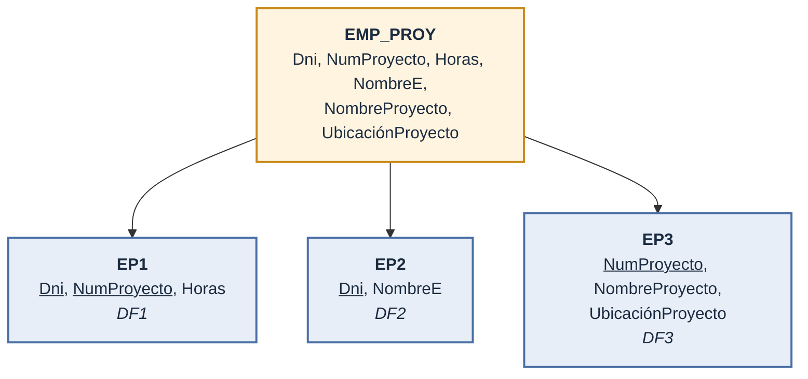
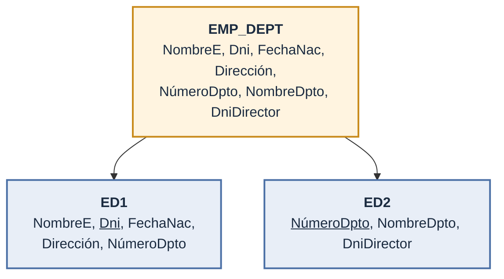
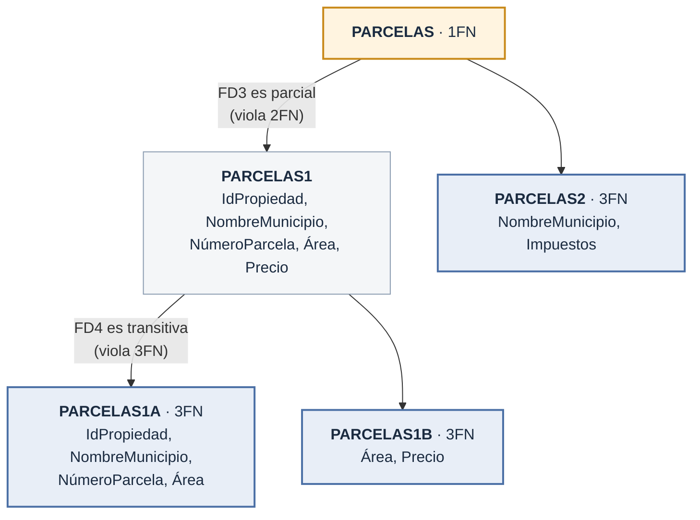

## ¿Por qué normalizar?

- Hasta ahora juzgábamos un diseño por **intuición**
- La normalización da criterios **formales** para decidir si un esquema de relación es bueno
- Se evalúa en dos niveles:
  - **Lógico**: ¿los usuarios entienden qué significa cada atributo?
  - **Implementación**: ¿cómo se almacenan y actualizan las tuplas?
- Hay dos formas de diseñar:
  - **Ascendente** (*bottom-up*, síntesis): se parte de los atributos sueltos y se agrupan
  - **Descendente** (*top-down*, análisis): se parte de agrupaciones naturales (facturas, formularios, informes) y se descomponen

## Esquema de trabajo: EMPRESA simplificada

```text
EMPLEADO(NombreE, Dni, FechaNac, Dirección, NúmeroDpto)
DEPARTAMENTO(NombreDpto, NúmeroDpto, DniDirector)
LOCALIZACIONES_DPTO(NúmeroDpto, UbicaciónDpto)
PROYECTO(NombreProyecto, NumProyecto, UbicaciónProyecto, NumDptoProyecto)
TRABAJA_EN(Dni, NumProyecto, Horas)
```

## Directrices informales de diseño

| # | Directriz | Problema que evita |
| --- | --- | --- |
| 1 | **Semántica clara**: cada relación describe una sola entidad o relación del modelo | Ambigüedad |
| 2 | **Sin anomalías** de inserción, borrado o modificación | Redundancia e inconsistencia |
| 3 | **Pocos NULL** en las relaciones base | Espacio desperdiciado; JOIN y agregados difíciles de interpretar |
| 4 | Concatenar solo por pares **clave principal – clave externa** | Tuplas falsas |

### Directriz 1: semántica clara

- Ejemplo de mal diseño:

```text
EMP_DEPT(NombreE, Dni, FechaNac, Dirección, NúmeroDpto, NombreDpto, DniDirector)
EMP_PROY(Dni, NumProyecto, Horas, NombreE, NombreProyecto, UbicaciónProyecto)
```

- `EMP_DEPT` mezcla empleado **y** departamento; `EMP_PROY` mezcla empleado, proyecto **y** `TRABAJA_EN`
- Están bien como **vistas**, no como relaciones base

### Directriz 2: redundancia y anomalías

En `EMP_DEPT` los datos del departamento se **repiten** por cada empleado:

| NombreE | Dni | NúmeroDpto | NombreDpto | DniDirector |
| --- | --- | --- | --- | --- |
| Pérez Pérez, José | 123456789 | 5 | Investigación | 333445555 |
| Campos Sastre, Alberto | 333445555 | 5 | Investigación | 333445555 |
| Jiménez Celaya, Alicia | 999887777 | 4 | Administración | 987654321 |
| Sainz Oreja, Juana | 987654321 | 4 | Administración | 987654321 |

| Anomalía | Ejemplo en `EMP_DEPT` |
| --- | --- |
| **Inserción** | Cada empleado nuevo obliga a copiar los datos de su departamento, y una errata deja datos contradictorios |
| **Inserción** | Un departamento sin empleados no se puede insertar: quedaría `NULL` en `Dni`, la **clave principal** |
| **Borrado** | Al borrar al último empleado de un departamento **se pierde** el departamento |
| **Modificación** | Cambiar el director del dpto. 5 obliga a actualizar **todas** sus tuplas; si falta una, hay inconsistencia |

- A veces se acepta redundancia a propósito por **rendimiento**; en ese caso se documenta y se controla con triggers o procedimientos almacenados
- Lo habitual: relaciones base sin anomalías y **vistas** para los JOIN frecuentes

### Directriz 3: valores NULL

- `NULL` puede significar:
  - El atributo **no aplica**
  - El valor es **desconocido**
  - Existe pero **aún no se ha registrado**
- Como no se sabe cuál de los tres es, conviene evitarlo. Ej.: si solo el 10 % de los empleados tiene oficina, crear `OFICINAS_EMPS(DniEmpleado, NúmeroOficina)` en vez de agregar `NúmeroOficina` a `EMPLEADO`

### Directriz 4: tuplas falsas

- Descomponer `EMP_PROY` en:
  - `EMP_LOCS(NombreE, UbicaciónProyecto)`
  - `EMP_PROY1(Dni, NumProyecto, Horas, NombreProyecto, UbicaciónProyecto)`
- Al volver a unirlas (`NATURAL JOIN`) por `UbicaciónProyecto` aparecen **tuplas falsas**: tuplas que no estaban en la relación original
- Causa: `UbicaciónProyecto` **no** es clave principal ni clave externa en ninguna de las dos
- Una buena descomposición permite reconstruir la relación original sin tuplas falsas: es la **reunión no aditiva** (capítulo 11)

## Dependencias funcionales

- **Dependencia funcional (DF)** `X → Y`: el valor de `X` determina el valor de `Y`
  - Dos tuplas con el mismo `X` **siempre** tienen el mismo `Y`
  - Ej.: `Dni → NombreE`; a cada `Dni` le corresponde un solo nombre
  - `X` es el lado izquierdo (determinante); `Y`, el lado derecho
- Si `X` es **clave candidata**, entonces `X → Y` para cualquier conjunto de atributos `Y`
- `X → Y` **no** implica `Y → X`
- Una DF sale del **significado** de los datos, no del contenido actual de la tabla
  - Mirar la tabla no la confirma, pero **un solo contraejemplo** la descarta

DF de `EMP_PROY`:

```text
DF1: {Dni, NumProyecto} → Horas
DF2: Dni → NombreE
DF3: NumProyecto → {NombreProyecto, UbicaciónProyecto}
```

### Contraejemplo: IMPARTIR

| Profesor | Curso | Texto |
| --- | --- | --- |
| Smith | Estructuras de datos | Bartram |
| Smith | Administración de datos | Martin |
| Hall | Compiladores | Hoffman |
| Brown | Estructuras de datos | Horowitz |

- `Texto → Curso` **parece** cumplirse, pero este estado de la tabla no basta para confirmarlo
- `Profesor → Curso` **no** se cumple: Smith imparte dos cursos

### Reglas de inferencia

- **F**: las DF que especifica el diseñador
- **Clausura F⁺**: F más todas las DF que se **deducen** de F
  - `NúmeroDpto → DniDirector` y `DniDirector → TeléfonoDirector` ⇒ `NúmeroDpto → TeléfonoDirector`
- Notación: `{X, Y} → Z` se abrevia `XY → Z`

| Regla | Nombre | Enunciado | Ejemplo |
| --- | --- | --- | --- |
| RI1 | **Reflexiva** | Si `X ⊇ Y` ⇒ `X → Y` (DF **trivial**) | `{Dni, NombreE} → NombreE` |
| RI2 | **Aumento** | `X → Y` ⇒ `XZ → YZ` | `Dni → NombreE` ⇒ `{Dni, NumProyecto} → {NombreE, NumProyecto}` |
| RI3 | **Transitiva** | `X → Y`, `Y → Z` ⇒ `X → Z` | `NúmeroDpto → DniDirector`, `DniDirector → TeléfonoDirector` ⇒ `NúmeroDpto → TeléfonoDirector` |
| RI4 | Descomposición | `X → YZ` ⇒ `X → Y` | `NumProyecto → {NombreProyecto, UbicaciónProyecto}` ⇒ `NumProyecto → NombreProyecto` |
| RI5 | Unión | `X → Y`, `X → Z` ⇒ `X → YZ` | `Dni → NombreE`, `Dni → Dirección` ⇒ `Dni → {NombreE, Dirección}` |
| RI6 | Seudotransitiva | `X → Y`, `WY → Z` ⇒ `WX → Z` | `NombreE → Dni`, `{Dni, NumProyecto} → Horas` ⇒ `{NombreE, NumProyecto} → Horas` (si `NombreE` fuera único) |

- **Axiomas de Armstrong** (RI1–RI3): son **sólidos** y **completos**, así que bastan para obtener F⁺
  - **Sólidos**: nunca producen una DF falsa
  - **Completos**: aplicándolos repetidamente se obtienen **todas** las DF de F⁺
  - RI4–RI6 se demuestran a partir de RI1–RI3; son atajos
- ⚠️ `X → A` y `Y → B` **no** implican `XY → AB`; `XY → A` **no** implica `X → A` ni `Y → A`

### Clausura de un conjunto de atributos (X⁺)

- **X⁺**: todos los atributos que `X` determina, directa o indirectamente
- Se calcula agregando atributos hasta que no aparece ninguno nuevo; si X⁺ contiene **todos** los atributos, `X` es superclave

```text
Algoritmo 10.1
X⁺ := X
repetir
    antiguaX⁺ := X⁺
    por cada Y → Z en F:
        si Y ⊆ X⁺ entonces X⁺ := X⁺ ∪ Z
hasta que X⁺ = antiguaX⁺
```

Con las DF de `EMP_PROY`:

| X | X⁺ |
| --- | --- |
| `{Dni}` | `{Dni, NombreE}` |
| `{NumProyecto}` | `{NumProyecto, NombreProyecto, UbicaciónProyecto}` |
| `{Dni, NumProyecto}` | **todos** los atributos, así que es clave |

### Equivalencia y cobertura mínima

- **F cubre a E**: toda DF de E se puede deducir de F
- **E y F equivalentes**: cada uno cubre al otro (`E⁺ = F⁺`), aunque se escriban distinto
- **Conjunto mínimo** de DF:
  1. Un **solo atributo** en el lado derecho
  2. Sin atributos **sobrantes** en el lado izquierdo
  3. Sin DF **redundantes**
- **Cobertura mínima** de E: un conjunto mínimo equivalente a E

Ejemplo: `E = {B → A, D → A, AB → D}`

1. Todas tienen un solo atributo a la derecha
2. `A` sobra en `AB → D`: de `B → A` sale `B → AB` (aumento) y, con `AB → D`, `B → D` (transitiva). Se reemplaza `AB → D` por `B → D`
3. `B → D` y `D → A` ⇒ `B → A` es **redundante**
4. **Cobertura mínima**: `{B → D, D → A}`

## Claves y atributos

- **Superclave**: conjunto de atributos que identifica cada tupla (puede sobrar alguno)
- **Clave**: superclave mínima; si se quita cualquier atributo, deja de identificar
  - `{Dni}` es clave de `EMPLEADO`; `{Dni, NombreE}` es solo superclave
- **Clave candidata**: cualquiera de las claves de la relación; una se elige como **clave principal** y las demás son **secundarias**
- **Atributo primo**: forma parte de **alguna** clave candidata
- **Atributo no primo**: no forma parte de ninguna clave candidata
  - En `TRABAJA_EN`: `Dni` y `NumProyecto` son primos; `Horas` no

## Formas normales

- **Normalización** (Codd, 1972): someter cada relación a una serie de pruebas y **descomponer** las que no las pasan
- Objetivo: **minimizar la redundancia** y las **anomalías**
- La **forma normal** de una relación es la más alta que cumple
- Propiedades de una buena descomposición:
  - **Reunión no aditiva**: al unir las partes no aparecen tuplas falsas. **Obligatoria**
  - **Conservación de dependencias**: cada DF sigue pudiéndose comprobar en alguna de las partes. Deseable; a veces se sacrifica
- **Desnormalización**: volver a unir relaciones normalizadas para acelerar consultas frecuentes


### Primera forma normal (1FN)

- Cada atributo de cada tupla tiene **un solo valor atómico**
- Prohíbe atributos **multivalor** (listas), **compuestos** (valores con partes) y **relaciones anidadas** (tablas dentro de tablas)

No está en 1FN:

| NombreDpto | NúmeroDpto | DniDirector | UbicacionesDpto |
| --- | --- | --- | --- |
| Investigación | 5 | 333445555 | {Valencia, Sevilla, Madrid} |
| Administración | 4 | 987654321 | {Gijón} |
| Sede central | 1 | 888665555 | {Madrid} |

Tres formas de llevarla a 1FN:

| Opción | Resultado | Desventaja |
| --- | --- | --- |
| ✅ **1. Nueva relación** `LOCALIZACIONES_DPTO(NúmeroDpto, UbicaciónDpto)` | Sin redundancia, general | — |
| 2. Expandir la clave a `{NúmeroDpto, UbicaciónDpto}` | Una tupla por ubicación | **Redundancia** |
| 3. Columnas `UbicaciónDpto1`, `UbicaciónDpto2`, `UbicaciónDpto3` | Máximo fijo | **NULL**, orden confuso, consultas difíciles |

#### Relaciones anidadas

```text
EMP_PROY(Dni, NombreE, {PROYS(NumProyecto, Horas)})
```

- La relación anidada pasa a una relación propia que **incluye la clave principal** de la externa:

```text
EMP_PROY1(Dni, NombreE)
EMP_PROY2(Dni, NumProyecto, Horas)
```

- Si hay varios atributos multivalor, se crea **una relación para cada uno**
  - `PERSONA(Dn#, {NumPermisoConducir#}, {Teléfono#})` → `P1(Dn#, NumPermisoConducir#)` y `P2(Dn#, Teléfono#)`
  - Ponerlos juntos en una sola relación genera redundancia (es el problema que resuelve la **4FN**, capítulo 11)

### Segunda forma normal (2FN)

- **Dependencia total** `X → Y`: si se quita cualquier atributo de `X`, la DF deja de cumplirse
- **Dependencia parcial**: una **parte** de `X` ya basta para determinar `Y`
  - `{Dni, NumProyecto} → Horas` es **total**
  - `{Dni, NumProyecto} → NombreE` es **parcial** (basta `Dni`)
- **2FN**: todo atributo no primo depende **totalmente** de la clave principal
- Si la clave principal tiene **un solo atributo**, la relación ya está en 2FN

`EMP_PROY` → 2FN:



### Tercera forma normal (3FN)

- **Dependencia transitiva**: `X → Y` se cumple **a través de** un atributo `Z` que no es clave ni parte de una (`X → Z` y `Z → Y`)
  - `Dni → NúmeroDpto → DniDirector`
- **3FN** (Codd): está en 2FN **y** ningún atributo no primo depende transitivamente de la clave principal

`EMP_DEPT` → 3FN:



- `ED1 NATURAL JOIN ED2` recupera `EMP_DEPT` **sin tuplas falsas**

### Resumen 1FN – 3FN

| Forma normal | Prueba | Remedio |
| --- | --- | --- |
| **1FN** | Sin atributos multivalor ni relaciones anidadas | Nueva relación por cada atributo multivalor o relación anidada |
| **2FN** | (Clave compuesta) ningún atributo no primo depende de **parte** de la clave | Una relación nueva por cada parte de la clave, con sus dependientes; la original conserva lo que depende de la clave completa |
| **3FN** | Ningún atributo no primo depende de **otro atributo no primo** | Una relación nueva con ese atributo y los que determina |

## Definiciones generales de 2FN y 3FN

- Las definiciones anteriores solo miran la **clave principal**; las generales consideran **todas las claves candidatas**
- **2FN general**: ningún atributo no primo depende **parcialmente** de **ninguna** clave
- **3FN general**: para toda DF no trivial `X → A`:
  - **(a)** `X` es **superclave**, o
  - **(b)** `A` es **atributo primo**
- **Definición alternativa de 3FN**: todo atributo no primo
  - depende **totalmente** de **cada** clave, y
  - **no** depende **transitivamente** de ninguna clave
- La definición general de 3FN se puede comprobar **directamente**, sin verificar antes la 2FN

### Ejemplo: PARCELAS

```text
PARCELAS(IdPropiedad, NombreMunicipio, NúmeroParcela, Área, Precio, Impuestos)
```

| DF | Significado |
| --- | --- |
| FD1: `IdPropiedad → resto` | Clave candidata (elegida como principal) |
| FD2: `{NombreMunicipio, NúmeroParcela} → resto` | Otra clave candidata |
| FD3: `NombreMunicipio → Impuestos` | Impuesto fijo por municipio |
| FD4: `Área → Precio` | El precio depende del área |



- Las dependencias parciales y transitivas se pueden eliminar **en cualquier orden**

## Forma normal de Boyce-Codd (BCNF)

- **BCNF**: para toda DF no trivial `X → A`, `X` es **superclave**
  - Dicho de otro modo: todo determinante es superclave
- Es la 3FN general **sin** la condición (b): ya no basta con que `A` sea primo
- Toda relación en BCNF está en 3FN; **no** al revés
- En la práctica, la mayoría de las relaciones en 3FN también están en BCNF

### PARCELAS1A con FD5

- Supongamos que solo hay parcelas en Getafe y Alcorcón, y que los tamaños posibles de parcela no coinciden entre los dos municipios. Entonces el área indica el municipio: **FD5**: `Área → NombreMunicipio`
- La relación sigue en **3FN** (`NombreMunicipio` es primo), pero **no en BCNF** (`Área` no es superclave)
- Descomposición en BCNF:
  - `PARCELAS1AX(IdPropiedad, Área, NúmeroParcela)`
  - `PARCELAS1AY(Área, NombreMunicipio)`
- ⚠️ Se **pierde FD2**: sus atributos quedan en relaciones distintas

### ENSEÑAR

| Estudiante | Curso | Profesor |
| --- | --- | --- |
| Campos | Bases de datos | Marcos |
| Pérez | Bases de datos | María |
| Pérez | Sistemas operativos | Amanda |
| Pérez | Teoría | Sergio |
| Ochoa | Bases de datos | Marcos |
| Ochoa | Sistemas operativos | Aurora |
| Morera | Bases de datos | Eduardo |
| Celaya | Bases de datos | María |
| Campos | Sistemas operativos | Amanda |

- FD1: `{Estudiante, Curso} → Profesor`
- FD2: `Profesor → Curso`
- Está en 3FN (`Curso` es primo), pero **no** en BCNF (`Profesor` no es superclave)

| Descomposición | ¿Tuplas falsas? |
| --- | --- |
| `{Estudiante, Profesor}` y `{Estudiante, Curso}` | Sí |
| `{Curso, Profesor}` y `{Curso, Estudiante}` | Sí |
| ✅ `{Profesor, Curso}` y `{Profesor, Estudiante}` | **No** |

- Las tres pierden **FD1**, así que se elige la que garantiza la **reunión no aditiva**

## Resumen

- Directrices informales: semántica clara, sin anomalías, pocos NULL, sin tuplas falsas
- **DF**: restricción semántica entre atributos; las DF implícitas se deducen con los **axiomas de Armstrong**
- **1FN**: valores atómicos → **2FN**: sin dependencias parciales → **3FN**: sin dependencias transitivas → **BCNF**: todo determinante es superclave
- En la práctica se busca **3FN o BCNF**; 1FN y 2FN son pasos intermedios
- Siguiente paso: propiedades de la descomposición, **4FN** y **5FN** (capítulo 11)

[⬅️ Volver a Unidad III](./index.md)
