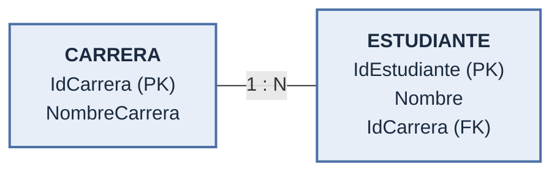
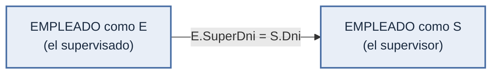
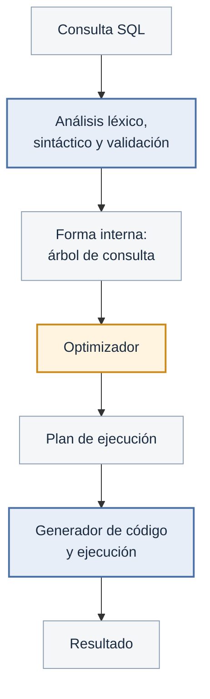
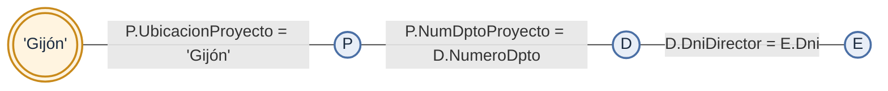
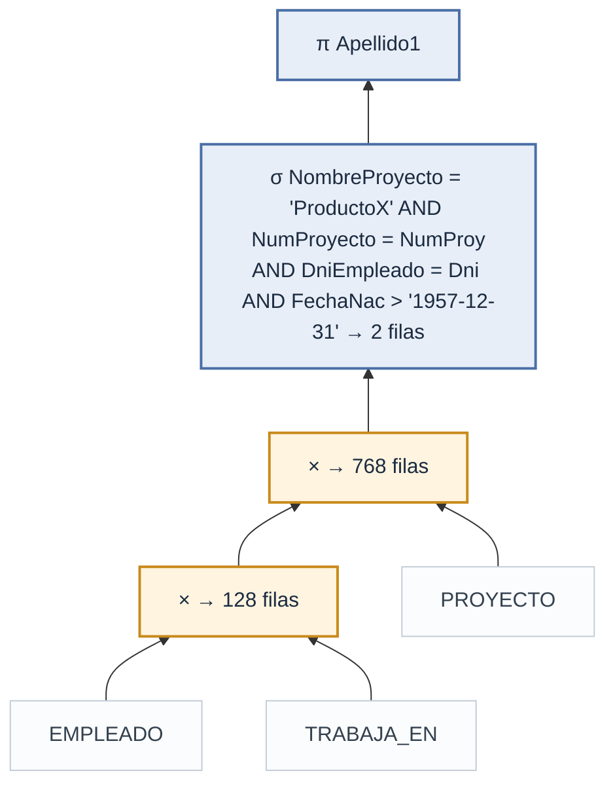
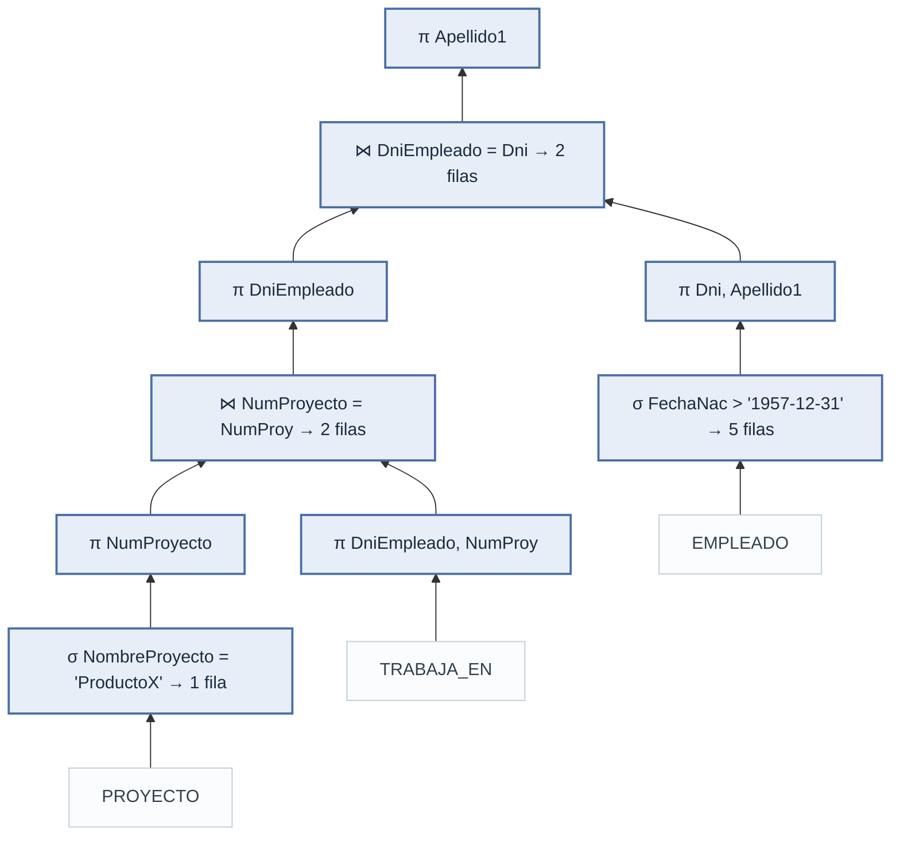
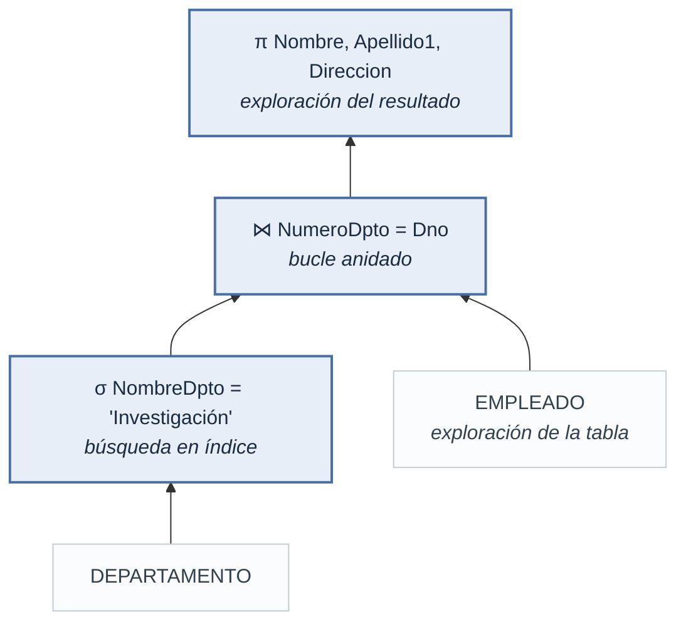

Resumen de las secciones 6.3, 8.4.2, 8.4.3, 8.5.6, 15.1 y 15.7 de Elmasri & Navathe. Continúa la página de la Unidad II sobre [consultas y manipulación de datos](../unidad-2/sql-dml.md).

| Parte | Tema | Secciones del libro |
| --- | --- | --- |
| 1 | Concatenación interna: unir dos tablas | 6.3, 8.5.6 |
| 2 | Alias, unir una tabla consigo misma y concatenación externa | 8.4.2, 8.5.6 |
| 3 | Producto cartesiano y concatenación de varias tablas | 8.4.2–8.4.3, 8.5.6 |
| 4 | Procesamiento y optimización de consultas | 15.1, 15.7 |

- El primer ejemplo usa dos tablas sencillas; los demás usan el esquema **EMPRESA** ([DDL](../unidad-2/sql-ddl.md#create-table), [datos](../unidad-2/algebra-relacional.md#anexo-estado-de-la-base-de-datos-empresa)), salvo que se indique otra cosa
- Las **notas** señalan diferencias entre **SQL Server**, **PostgreSQL**, **Oracle** y **SQLite**

## Un ejemplo sencillo: ESTUDIANTE y CARRERA

Dos entidades y una relación: una **carrera** tiene muchos **estudiantes**; un **estudiante** pertenece a una carrera o todavía a ninguna.



**ESTUDIANTE**

| IdEstudiante | Nombre | IdCarrera |
| --- | --- | --- |
| 101 | Ana | 1 |
| 102 | Luis | 1 |
| 103 | Eva | NULL |

**CARRERA**

| IdCarrera | NombreCarrera |
| --- | --- |
| 1 | Sistemas |
| 2 | Derecho |

- Ana y Luis estudian **la misma** carrera
- Eva todavía **no tiene** carrera
- Derecho todavía **no tiene** estudiantes

**¿Qué estudia cada quien?** El nombre está en una tabla y la carrera en la otra. El `JOIN` las une donde `IdCarrera` coincide:

```sql
SELECT E.Nombre, C.NombreCarrera
FROM   ESTUDIANTE E JOIN CARRERA C ON E.IdCarrera = C.IdCarrera;
```

| Nombre | NombreCarrera |
| --- | --- |
| Ana | Sistemas |
| Luis | Sistemas |

Sistemas sale dos veces, una por cada estudiante. Eva y Derecho no salen porque no tienen pareja. Según la pregunta, se cambia el tipo de `JOIN`:

| Pregunta | Tipo | Respuesta |
| --- | --- | --- |
| ¿Qué estudiantes tienen carrera, y cuál? | `JOIN` | Ana–Sistemas, Luis–Sistemas |
| ¿Qué estudia cada estudiante, **aunque no tenga** carrera? | `LEFT JOIN` | Lo anterior y Eva–`NULL` |
| ¿Quién estudia cada carrera, **aunque no tenga** estudiantes? | `RIGHT JOIN` | Ana–Sistemas, Luis–Sistemas y `NULL`–Derecho |
| ¿Cómo se ven **todos** los estudiantes y **todas** las carreras? | `FULL JOIN` | Ana–Sistemas, Luis–Sistemas, Eva–`NULL` y `NULL`–Derecho |
| ¿Cuáles son todas las combinaciones posibles? | `CROSS JOIN` | 3 × 2 = 6 filas |

Para probarlo:

```sql
CREATE TABLE CARRERA (
  IdCarrera     INT PRIMARY KEY,
  NombreCarrera VARCHAR(30) NOT NULL
);
CREATE TABLE ESTUDIANTE (
  IdEstudiante INT PRIMARY KEY,
  Nombre       VARCHAR(30) NOT NULL,
  IdCarrera    INT REFERENCES CARRERA (IdCarrera)
);
INSERT INTO CARRERA VALUES (1, 'Sistemas');
INSERT INTO CARRERA VALUES (2, 'Derecho');
INSERT INTO ESTUDIANTE VALUES (101, 'Ana', 1);
INSERT INTO ESTUDIANTE VALUES (102, 'Luis', 1);
INSERT INTO ESTUDIANTE VALUES (103, 'Eva', NULL);
```

## 1. Concatenación interna (6.3, 8.5.6)

### Del álgebra a SQL

La **CONCATENACIÓN** combina en una sola fila las filas **relacionadas** de dos tablas. Equivale a un producto cartesiano seguido de una selección: `R ⋈c S ≡ σc(R × S)`. La definición completa y la división (6.3.4) están en [álgebra relacional](../unidad-2/algebra-relacional.md#operaciones-binarias-concatenación-y-división).

| Álgebra (6.3) | Condición | SQL (8.5.6) |
| --- | --- | --- |
| **THETA JOIN** `R ⋈c S` | Cualquier comparación: `=`, `<`, `<=`, `>`, `>=`, `<>` | `R JOIN S ON c` |
| **EQUIJOIN** | Solo igualdades | `R JOIN S ON R.a = S.b` |
| **CONCATENACIÓN NATURAL** `R * S` | Igualdad entre **todas** las columnas con el mismo nombre | `R NATURAL JOIN S` |

### Dos formas de escribirla

Nombre y dirección de los empleados de 'Investigación':

```sql
-- C1. Todo mezclado en WHERE
SELECT Nombre, Apellido1, Direccion
FROM   EMPLEADO, DEPARTAMENTO
WHERE  NombreDpto = 'Investigación' AND NumeroDpto = Dno;
```

```sql
-- C1A (8.5.6). Tabla concatenada en FROM
SELECT Nombre, Apellido1, Direccion
FROM   EMPLEADO JOIN DEPARTAMENTO ON Dno = NumeroDpto
WHERE  NombreDpto = 'Investigación';
```

| Nombre | Apellido1 | Direccion |
| --- | --- | --- |
| José | Pérez | Eloy I, 98 |
| Alberto | Campos | Avda. Ríos, 9 |
| Fernando | Ojeda | Portillo, s/n |
| Aurora | Oliva | Antón, 6 |

- Ambas dan **el mismo resultado**
- En C1A cada cosa está en su lugar: `ON` dice **cómo se unen** las tablas; `WHERE` dice **qué filas interesan**
- `JOIN` es lo mismo que `INNER JOIN`
- La tabla concatenada tiene **todas** las columnas de la primera tabla, seguidas por **todas** las de la segunda

> **Explicación:** si en C1 se olvida `NumeroDpto = Dno`, la consulta se ejecuta y devuelve datos incorrectos **sin avisar**. Si en C1A se olvida el `ON`, casi todos los motores dan error de sintaxis (SQLite no: lo toma como producto cartesiano).

### Theta join, equijoin y natural join

Se diferencian en **qué condición usan** y en **qué columnas dejan**:

| | Theta join | Equijoin | Natural join |
| --- | --- | --- | --- |
| **Condición** | Cualquier comparación | Solo `=` | `=` implícito |
| **Quién elige las columnas** | Quien escribe la consulta | Quien escribe la consulta | Los **nombres**: todas las que se llamen igual |
| **Columna de conexión** | Se conservan ambas; sus valores pueden ser distintos | Se conservan ambas, con el **mismo valor** | Queda **una sola vez** |

Cada uno es un caso particular del anterior: el **equijoin** es un theta join que solo usa `=`; el **natural join** es un equijoin entre las columnas de igual nombre, sin la columna repetida.

Ejemplo con dos tablas pequeñas:

**EMP**

| Nombre | Sueldo | NumDpto |
| --- | --- | --- |
| Ana | 3000 | 1 |
| Luis | 2000 | 1 |
| Eva | 2200 | 2 |

**DPTO**

| NumDpto | SueldoMin |
| --- | --- |
| 1 | 2500 |
| 2 | 1800 |

**Theta join**: compara cada sueldo con el mínimo de **todos** los departamentos, no solo el propio.

```sql
SELECT * FROM EMP JOIN DPTO ON Sueldo > SueldoMin;
```

| Nombre | Sueldo | EMP.NumDpto | DPTO.NumDpto | SueldoMin |
| --- | --- | --- | --- | --- |
| Ana | 3000 | 1 | 1 | 2500 |
| Ana | 3000 | 1 | **2** | 1800 |
| Luis | 2000 | 1 | **2** | 1800 |
| Eva | 2200 | 2 | 2 | 1800 |

**Equijoin**: une cada empleado con su departamento; `NumDpto` sale **dos veces**.

```sql
SELECT * FROM EMP JOIN DPTO ON EMP.NumDpto = DPTO.NumDpto;
```

| Nombre | Sueldo | EMP.NumDpto | DPTO.NumDpto | SueldoMin |
| --- | --- | --- | --- | --- |
| Ana | 3000 | 1 | 1 | 2500 |
| Luis | 2000 | 1 | 1 | 2500 |
| Eva | 2200 | 2 | 2 | 1800 |

**Natural join**: las mismas filas que el equijoin, con `NumDpto` **una sola vez**.

```sql
SELECT * FROM EMP NATURAL JOIN DPTO;
```

| NumDpto | Nombre | Sueldo | SueldoMin |
| --- | --- | --- | --- |
| 1 | Ana | 3000 | 2500 |
| 1 | Luis | 2000 | 2500 |
| 2 | Eva | 2200 | 1800 |

> **Explicación:** en el theta join, Ana sale dos veces porque supera **ambos** mínimos, y Luis sale con un departamento que no es el suyo. La condición no dice nada de `NumDpto`: solo compara sueldos.

> **Nota:** el estándar pone primero la columna común en el natural join. **SQLite** la deja en su posición original, y **SQL Server** no admite `NATURAL JOIN`.

### ¿Por qué columnas se unen?

Normalmente, **clave foránea = clave primaria**. El director de cada departamento:

```sql
SELECT NombreDpto, Apellido1, Nombre
FROM   DEPARTAMENTO JOIN EMPLEADO ON DniDirector = Dni;
```

| NombreDpto | Apellido1 | Nombre |
| --- | --- | --- |
| Investigación | Campos | Alberto |
| Administración | Sainz | Juana |
| Sede Central | Ochoa | Eduardo |

Entre `EMPLEADO` y `DEPARTAMENTO` hay **dos** relaciones, y la condición decide cuál se recorre:

| Condición | Significa | Filas |
| --- | --- | --- |
| `Dno = NumeroDpto` | Cada empleado con el departamento **donde trabaja** | 8 |
| `Dni = DniDirector` | Cada departamento con el empleado **que lo dirige** | 3 |

### Qué filas se pierden

- Solo aparecen las filas que tienen **pareja** en la otra tabla
- Si la columna de conexión es `NULL`, la fila **no aparece**: `NULL = valor` da `UNKNOWN`, no `TRUE`
- El resultado tiene entre **0** y `nR · nS` filas

> **Explicación:** una fila también puede **repetirse**. Si un departamento tiene tres ubicaciones, al unirlo con `LOCALIZACIONES_DPTO` sale tres veces. No es un error: hay una fila por cada pareja.

### NATURAL JOIN y USING

`NATURAL JOIN` no lleva condición: iguala todas las columnas **con el mismo nombre** y deja cada una **una sola vez**.

```sql
-- La columna común es NumeroDpto: 5 filas, una por ubicación
SELECT NombreDpto, UbicacionDpto
FROM   DEPARTAMENTO NATURAL JOIN LOCALIZACIONES_DPTO;
```

| NombreDpto | UbicacionDpto |
| --- | --- |
| Sede Central | Madrid |
| Administración | Gijón |
| Investigación | Valencia |
| Investigación | Sevilla |
| Investigación | Madrid |

Si los nombres no coinciden, hay que **renombrar** antes. El libro lo hace en el `FROM`:

```sql
-- C1B (8.5.6). Solo PostgreSQL entre los cuatro motores
SELECT Nombre, Apellido1, Direccion
FROM   EMPLEADO NATURAL JOIN
       DEPARTAMENTO AS DEPT(NombreDpto, Dno, DniDelDirector, FechaInDirector)
WHERE  NombreDpto = 'Investigación';
```

> **Cuidado**: `NATURAL JOIN` se guía por los nombres, no por las claves foráneas.
>
> | Consulta | Columnas en común | Resultado |
> | --- | --- | --- |
> | `EMPLEADO NATURAL JOIN DEPARTAMENTO` | Ninguna | **Producto cartesiano**: 24 filas |
> | `EMPLEADO NATURAL JOIN SUBORDINADO` | `Sexo` y `FechaNac` (¡no el Dni!) | **0 filas** |
>
> Ninguna da error. Además, agregar una columna a una tabla puede cambiar el resultado de una consulta que ya funcionaba. En la práctica se prefiere `JOIN ... ON`.

`USING` es el punto medio: se indica por cuáles columnas de igual nombre unir.

```sql
SELECT NombreDpto, UbicacionDpto
FROM   DEPARTAMENTO JOIN LOCALIZACIONES_DPTO USING (NumeroDpto);
```

> **Nota:** **SQL Server** no admite `NATURAL JOIN` ni `USING`; solo `ON`. En **Oracle**, la columna común no se puede calificar (`DEPARTAMENTO.NumeroDpto` da error): se escribe solo `NumeroDpto`.

## 2. Alias y concatenación externa (8.4.2, 8.5.6)

### Nombres ambiguos

Dos tablas pueden tener columnas con el mismo nombre. Si la consulta usa una, hay que **calificarla**: `TABLA.columna`.

```sql
-- ERROR: NumeroDpto está en las dos tablas
SELECT NumeroDpto, UbicacionDpto
FROM   DEPARTAMENTO JOIN LOCALIZACIONES_DPTO ON NumeroDpto = NumeroDpto;
```

```sql
-- Correcto
SELECT DEPARTAMENTO.NumeroDpto, UbicacionDpto
FROM   DEPARTAMENTO JOIN LOCALIZACIONES_DPTO
       ON DEPARTAMENTO.NumeroDpto = LOCALIZACIONES_DPTO.NumeroDpto;
```

### Alias de tabla

Un **alias** (o *variable de tupla*) es otro nombre para la tabla dentro de la consulta.

```sql
SELECT D.NumeroDpto, D.NombreDpto, L.UbicacionDpto
FROM   DEPARTAMENTO D JOIN LOCALIZACIONES_DPTO L ON D.NumeroDpto = L.NumeroDpto;
```

- Se escribe `DEPARTAMENTO AS D` o `DEPARTAMENTO D`
- El libro recomienda usarlos **siempre**, aunque no haya ambigüedad: la consulta se entiende mejor
- Una vez definido el alias, se usa **el alias**, no el nombre de la tabla: `DEPARTAMENTO.NumeroDpto` ya daría error

> **Nota:** **Oracle** no acepta `AS` en alias de tabla. Sin `AS` funciona en los cuatro motores.

### Unir una tabla consigo misma (*self join*)

`SuperDni` apunta a otra fila de la **misma** tabla. Para ver a un empleado **junto** a su supervisor se necesitan dos copias, y solo los alias permiten distinguirlas.

```sql
-- C8 (8.4.2)
SELECT E.Nombre, E.Apellido1, S.Nombre, S.Apellido1
FROM   EMPLEADO E, EMPLEADO S
WHERE  E.SuperDni = S.Dni;
```

```sql
-- C8A (8.5.6). La misma idea con JOIN y solo los apellidos
SELECT E.Apellido1 AS NombreDeEmpleado, S.Apellido1 AS NombreDeSupervisor
FROM   EMPLEADO E JOIN EMPLEADO S ON E.SuperDni = S.Dni;
```

| NombreDeEmpleado | NombreDeSupervisor |
| --- | --- |
| Pérez | Campos |
| Campos | Ochoa |
| Jiménez | Sainz |
| Sainz | Ochoa |
| Ojeda | Campos |
| Oliva | Campos |
| Pajares | Sainz |



- No hay dos tablas: es **una** tabla leída en **dos papeles**
- Solo sube **un nivel** de supervisión. Para un número desconocido de niveles hace falta una consulta recursiva
- Son 7 filas, pero hay 8 empleados: falta Eduardo Ochoa, que no tiene supervisor (`SuperDni` es `NULL`)

> **Cuidado:** al invertir la condición se invierten los papeles. `E.Dni = S.SuperDni` haría que `E` fuera el jefe.

> **Explicación**: para formar **parejas** dentro de una tabla se combina con una desigualdad (theta join). `E1.Dni < E2.Dni` evita emparejar a alguien consigo mismo y que cada pareja salga dos veces.

```sql
-- Parejas de compañeros de departamento: 9 filas
SELECT E1.Apellido1 AS Empleado1, E2.Apellido1 AS Empleado2, E1.Dno
FROM   EMPLEADO E1 JOIN EMPLEADO E2 ON E1.Dno = E2.Dno AND E1.Dni < E2.Dni;
```

### Concatenación externa (*outer join*)

Conserva las filas **sin pareja** y rellena con `NULL` lo que falta. Para que Ochoa aparezca:

```sql
-- C8B (8.5.6)
SELECT E.Apellido1 AS NombreDeEmpleado, S.Apellido1 AS NombreDeSupervisor
FROM   EMPLEADO E LEFT OUTER JOIN EMPLEADO S ON E.SuperDni = S.Dni;
```

El resultado son las 7 filas de C8A más esta:

| NombreDeEmpleado | NombreDeSupervisor |
| --- | --- |
| Ochoa | **NULL** |

| Tipo | Conserva las filas sin pareja de |
| --- | --- |
| `[INNER] JOIN` | Ninguna (tipo por defecto) |
| `LEFT [OUTER] JOIN` | La tabla de la **izquierda** |
| `RIGHT [OUTER] JOIN` | La tabla de la **derecha** |
| `FULL [OUTER] JOIN` | **Ambas** |

- La palabra `OUTER` es opcional
- Con columnas de igual nombre también existe la variante natural: `NATURAL LEFT OUTER JOIN`
- `R RIGHT JOIN S` equivale a `S LEFT JOIN R` (salvo el orden de las columnas). Por costumbre se usa `LEFT`

### Comparación con un ejemplo pequeño

Con las tablas [ESTUDIANTE y CARRERA](#un-ejemplo-sencillo-estudiante-y-carrera) del inicio: Eva no tiene carrera y Derecho no tiene estudiantes.

```text
SELECT E.Nombre, C.NombreCarrera
FROM   ESTUDIANTE E <tipo> JOIN CARRERA C ON E.IdCarrera = C.IdCarrera
```

| Nombre | NombreCarrera | INNER | LEFT | RIGHT | FULL |
| --- | --- | --- | --- | --- | --- |
| Ana | Sistemas | Sí | Sí | Sí | Sí |
| Luis | Sistemas | Sí | Sí | Sí | Sí |
| Eva | NULL | — | Sí | — | Sí |
| NULL | Derecho | — | — | Sí | Sí |
| **Total de filas** | | **2** | **3** | **3** | **4** |

### Filas sin pareja

Un `LEFT JOIN` más `IS NULL` encuentra lo que **no** tiene relación. Empleados sin subordinados:

```sql
SELECT E.Nombre, E.Apellido1
FROM   EMPLEADO E LEFT JOIN SUBORDINADO S ON E.Dni = S.DniEmpleado
WHERE  S.DniEmpleado IS NULL;
```

| Nombre | Apellido1 |
| --- | --- |
| Alicia | Jiménez |
| Fernando | Ojeda |
| Aurora | Oliva |
| Luis | Pajares |
| Eduardo | Ochoa |

> **Explicación:** en el `IS NULL` se usa una columna que en `SUBORDINADO` **nunca** es `NULL`, como las de su clave. Así, si sale `NULL`, es porque no hubo pareja.

### Los JOIN como diagramas de Venn

Con las tablas `ESTUDIANTE` y `CARRERA`. Lo **azul** es lo que devuelve cada consulta: a la izquierda Eva (sin carrera), en el centro Ana y Luis (con pareja) y a la derecha Derecho (sin estudiantes).


- Los cuatro primeros son los tipos de JOIN; los marcados **sin pareja** agregan un `IS NULL` para dejar solo esas filas
- `CROSS JOIN` no se puede dibujar así: combina todo con todo, sin condición

> **Cuidado:** el dibujo muestra **qué filas sobreviven**, pero un JOIN **no** es una intersección de conjuntos. Las filas de `ESTUDIANTE` y `CARRERA` son distintas: se **combinan** en una más ancha, y una fila puede salir **varias veces** si tiene varias parejas. La intersección real en SQL es `INTERSECT`.

### ON y WHERE no son lo mismo

En un `INNER JOIN` da igual dónde se ponga la condición. En un `LEFT JOIN`, **no**.

```sql
-- A) Condición en ON: los 8 empleados, con NULL si no tienen un subordinado varón
SELECT E.Apellido1, S.NombSubordinado
FROM   EMPLEADO E LEFT JOIN SUBORDINADO S
       ON E.Dni = S.DniEmpleado AND S.Sexo = 'H';
```

```sql
-- B) Condición en WHERE: solo 3 filas
SELECT E.Apellido1, S.NombSubordinado
FROM   EMPLEADO E LEFT JOIN SUBORDINADO S ON E.Dni = S.DniEmpleado
WHERE  S.Sexo = 'H';
```

> **Explicación:** `ON` se evalúa **al unir**: si no hay pareja, la fila queda con `NULL`. `WHERE` se evalúa **después**: en esas filas `S.Sexo` es `NULL`, la condición da `UNKNOWN` y se descartan. El `LEFT JOIN` de B termina comportándose como un `INNER JOIN`.

> **Nota:**
>
> - **SQLite** admite `RIGHT` y `FULL` desde la versión 3.39; los otros tres motores admiten todos los tipos
> - El libro menciona una sintaxis antigua para la externa izquierda (C8C: `WHERE E.SuperDni += S.Dni`) y la atribuye a Oracle. En realidad, **Oracle** usa `(+)` del lado que se rellena: `WHERE E.SuperDni = S.Dni(+)`. Hoy se usa `LEFT JOIN`

## 3. Producto cartesiano y varias tablas (8.4.2–8.4.3, 8.5.6)

### Sin WHERE

- Con **una** tabla y sin `WHERE`, se devuelven **todas** las filas
- Con **varias** tablas y sin `WHERE`, se devuelven **todas las combinaciones**: el producto cartesiano (o *cruzado*)

```sql
-- C9. Todos los Dni: 8 filas
SELECT Dni FROM EMPLEADO;

-- C10. Cada empleado con cada departamento: 8 × 3 = 24 filas
SELECT Dni, NombreDpto FROM EMPLEADO, DEPARTAMENTO;
```

### CROSS JOIN

Es la forma explícita de pedirlo (8.5.6):

```sql
SELECT Dni, NombreDpto FROM EMPLEADO CROSS JOIN DEPARTAMENTO;
```

- Da lo mismo que C10, pero deja claro que es **a propósito**
- El libro pide usarlo con **sumo cuidado**: 10 000 clientes × 5 000 productos = 50 millones de filas
- Sirve cuando sí se quieren todas las combinaciones: tallas × colores, estudiantes × fechas de asistencia

### El asterisco

| Expresión | Devuelve |
| --- | --- |
| `*` | Todas las columnas de **todas** las tablas del `FROM` |
| `E.*` | Todas las columnas solo de `E` |

```sql
-- C1C. Todo sobre los empleados del departamento 5
SELECT * FROM EMPLEADO WHERE Dno = 5;

-- C1D. Todo sobre los empleados de 'Investigación' y su departamento
SELECT *
FROM   EMPLEADO, DEPARTAMENTO
WHERE  NombreDpto = 'Investigación' AND Dno = NumeroDpto;

-- C10A. Producto cartesiano completo: 24 filas y 14 columnas (10 + 4)
SELECT * FROM EMPLEADO, DEPARTAMENTO;
```

> **Explicación:** con `SELECT *` sobre un equijoin la columna de conexión sale **dos veces** (`Dno` y `NumeroDpto`). En una aplicación conviene listar las columnas: el resultado no cambia si alguien modifica la tabla.

### Concatenar tres o más tablas

Una de las tablas de una concatenación puede ser, a su vez, una **tabla concatenada**. Proyectos de Gijón con los datos del director de su departamento:

```sql
-- C2A (8.5.6)
SELECT NumProyecto, NumDptoProyecto, Apellido1, Direccion, FechaNac
FROM   (PROYECTO JOIN DEPARTAMENTO ON NumDptoProyecto = NumeroDpto)
       JOIN EMPLEADO ON DniDirector = Dni
WHERE  UbicacionProyecto = 'Gijón';
```

| NumProyecto | NumDptoProyecto | Apellido1 | Direccion | FechaNac |
| --- | --- | --- | --- | --- |
| 10 | 4 | Sainz | Cerquillas, 67 | 1941-06-20 |
| 30 | 4 | Sainz | Cerquillas, 67 | 1941-06-20 |

En álgebra es la **concatenación de 3 vías** de la sección 6.3.2:

```text
((PROYECTO ⋈NumDptoProyecto=NumeroDpto DEPARTAMENTO) ⋈DniDirector=Dni EMPLEADO)
```

Los paréntesis son opcionales: se une de izquierda a derecha. La forma habitual es un `JOIN` por línea y con alias:

```sql
-- Empleados y sus proyectos, con el departamento que controla el proyecto: 16 filas
SELECT E.Apellido1, P.NombreProyecto, D.NombreDpto
FROM   EMPLEADO E
JOIN   TRABAJA_EN T   ON E.Dni = T.DniEmpleado
JOIN   PROYECTO P     ON T.NumProy = P.NumProyecto
JOIN   DEPARTAMENTO D ON P.NumDptoProyecto = D.NumeroDpto;
```


- `TRABAJA_EN` es el **puente** de la relación muchos a muchos: hay que pasar por ella aunque no se muestre ninguna de sus columnas
- Para unir *n* tablas hacen falta, como mínimo, **n − 1** condiciones de concatenación

### Cuando falta una condición

```sql
-- MAL: PROYECTO no está unido con nada. 16 × 6 = 96 filas
SELECT E.Apellido1, P.NombreProyecto
FROM   EMPLEADO E, TRABAJA_EN T, PROYECTO P
WHERE  E.Dni = T.DniEmpleado;
```

```sql
-- BIEN: 3 tablas, 2 condiciones. 16 filas
SELECT E.Apellido1, P.NombreProyecto
FROM   EMPLEADO E, TRABAJA_EN T, PROYECTO P
WHERE  E.Dni = T.DniEmpleado AND T.NumProy = P.NumProyecto;
```

> **Cuidado:** `DISTINCT` **no** arregla una condición olvidada. Solo esconde las repeticiones: en el ejemplo MAL quedarían 48 filas (8 empleados × 6 proyectos), como si todos trabajaran en todo.

> **Cuidado**: un `INNER JOIN` después de un `LEFT JOIN` puede eliminar las filas que el `LEFT` había conservado. Si debe quedar todo lo de la primera tabla, el resto de la cadena suele ir también con `LEFT`.

## ¿Cuál usar?

| Se necesita | Usar |
| --- | --- |
| Solo filas con pareja | `JOIN ... ON` |
| Todas las filas de una tabla, tengan pareja o no | `LEFT JOIN` |
| Todas las filas de ambas tablas | `FULL JOIN` |
| Filas que **no** tienen pareja | `LEFT JOIN` + `IS NULL` |
| Relacionar filas de la misma tabla | *Self join* con alias |
| Todas las combinaciones | `CROSS JOIN` |

## 4. Procesamiento y optimización de consultas (15.1, 15.7)

SQL dice **qué** se quiere, no **cómo** obtenerlo. Decidir el *cómo* es trabajo del DBMS.



El optimizador combina dos técnicas:

| Técnica | Idea |
| --- | --- |
| **Reglas heurísticas** (15.7) | Reordenar las operaciones con reglas que funcionan bien en **la mayoría** de los casos |
| **Estimación de costes** (15.8) | Calcular el coste de varias estrategias y elegir la menor |

> **Explicación:** *optimizar* es un término exagerado. Buscar el mejor plan posible tomaría demasiado tiempo, así que el DBMS se conforma con uno **razonablemente eficiente**.

### De SQL al álgebra relacional (15.1)

1. La consulta se divide en **bloques de consulta**: un solo `SELECT-FROM-WHERE`, con su `GROUP BY` y `HAVING` si los tiene
2. Cada bloque se traduce a **álgebra relacional extendida** (incluye `MAX`, `MIN`, `SUM`, `COUNT`)
3. El optimizador elige un plan de ejecución **para cada bloque**

Una consulta **anidada** es un bloque aparte:

```sql
-- Empleados que ganan más que todos los del departamento 5
SELECT Apellido1, Nombre
FROM   EMPLEADO
WHERE  Sueldo > (SELECT MAX(Sueldo)
                 FROM   EMPLEADO
                 WHERE  Dno = 5);
```

| Bloque | SQL | Álgebra |
| --- | --- | --- |
| **Interno** | `SELECT MAX(Sueldo) FROM EMPLEADO WHERE Dno = 5` | `ℑMAX Sueldo(σDno=5(EMPLEADO))` |
| **Externo** | `SELECT Apellido1, Nombre FROM EMPLEADO WHERE Sueldo > c` | `πApellido1, Nombre(σSueldo>c(EMPLEADO))` |

`c` es el resultado del bloque interno. Con los datos de EMPRESA, `c` = 40000 y el resultado es Sainz y Ochoa.

| Consulta anidada | Característica | Optimización |
| --- | --- | --- |
| **No correlacionada** | El bloque interno no depende del externo: se evalúa **una sola vez** | Fácil |
| **Correlacionada** | El bloque interno usa una variable de tupla del externo | Mucho más difícil |

### Árbol y grafo de consulta (15.7.1)

| | Árbol de consulta | Grafo de consulta |
| --- | --- | --- |
| **Representa** | Álgebra relacional | Cálculo relacional |
| **Relaciones** | Hojas | Nodos (círculos) |
| **Constantes** | — | Nodos (círculos dobles) |
| **Operaciones** | Nodos internos | Las condiciones son las líneas |
| **¿Indica el orden?** | **Sí**: de las hojas a la raíz | No |
| **¿Cuántos por consulta?** | Muchos equivalentes | Uno solo |

Grafo de C2 (los proyectos de Gijón y el director de su departamento):



- En el grafo, los atributos a obtener se anotan entre corchetes sobre cada relación: `[P.NumProyecto, P.NumDptoProyecto]` y `[E.Apellido1, E.Direccion, E.FechaNac]`
- Se prefieren los **árboles**, porque el optimizador necesita conocer el orden. El de C2 está en [álgebra relacional](../unidad-2/algebra-relacional.md#árboles-de-consulta)

### El árbol inicial es muy ineficiente (15.7.2)

El analizador genera primero un árbol **inicial** o **canónico**, sin optimizar, en este orden:

1. **Producto cartesiano** de todas las tablas del `FROM`
2. **Selección** con todas las condiciones del `WHERE`
3. **Proyección** de las columnas del `SELECT`

Ejemplo del libro para C2:

| Relación | Tuplas | Bytes por tupla |
| --- | --- | --- |
| `PROYECTO` | 100 | 100 |
| `DEPARTAMENTO` | 20 | 50 |
| `EMPLEADO` | 5 000 | 150 |
| **Producto cartesiano** | **10 000 000** | **300** |

> **Explicación:** son unos 3 GB intermedios para una consulta que devuelve unas pocas filas. Nadie ejecuta este árbol: es solo el punto de partida, fácil de construir. El optimizador lo transforma en otro **equivalente** (mismo resultado) y más rápido.

### Ejemplo de optimización paso a paso

Apellidos de los empleados nacidos después de 1957 que trabajan en un proyecto. El libro usa 'Aquarius'; aquí se usa 'ProductoX', que sí está en los datos de EMPRESA.

```sql
SELECT Apellido1
FROM   EMPLEADO, TRABAJA_EN, PROYECTO
WHERE  NombreProyecto = 'ProductoX' AND NumProyecto = NumProy
  AND  DniEmpleado = Dni AND FechaNac > '1957-12-31';
```

Resultado: Pérez y Oliva.

**(a) Árbol inicial**



**(b) a (e) Transformaciones**

| Árbol | Qué cambia | Filas del mayor resultado intermedio con × o ⋈ |
| --- | --- | --- |
| **(a)** | Nada: árbol inicial | 8 × 16 × 6 = **768** |
| **(b)** | Se **bajan las selecciones** (σ) hacia las hojas | 5 empleados × 16 = **80** |
| **(c)** | Primero la selección **más restrictiva**: `PROYECTO` da 1 sola fila | 1 proyecto × 16 = **16** |
| **(d)** | Cada × seguido de su condición se vuelve un **⋈** | **2** |
| **(e)** | Se **bajan las proyecciones** (π): solo las columnas necesarias | **2**, con menos columnas |

**(e) Árbol final**



> **Explicación:** las **selecciones** reducen **filas**; las **proyecciones** reducen **columnas**. Por eso se hacen antes del JOIN: su tamaño depende de multiplicar los tamaños de las dos entradas.

### Reglas de transformación

Cada paso debe conducir a un árbol **equivalente**. Estas reglas lo garantizan:

| # | Regla | Expresión |
| --- | --- | --- |
| 1 | Cascada de σ | `σc1 AND c2(R) ≡ σc1(σc2(R))` |
| 2 | Conmutatividad de σ | `σc1(σc2(R)) ≡ σc2(σc1(R))` |
| 3 | Cascada de π (solo cuenta la última en aplicarse) | `πL1(πL2(R)) ≡ πL1(R)` |
| 4 | Conmutar σ con π, si c usa solo atributos de L | `πL(σc(R)) ≡ σc(πL(R))` |
| 5 | Conmutatividad de ⋈ y × | `R ⋈c S ≡ S ⋈c R` |
| 6 | Conmutar σ con ⋈ o ×, si c1 es solo de R y c2 solo de S | `σc1 AND c2(R ⋈ S) ≡ σc1(R) ⋈ σc2(S)` |
| 7 | Conmutar π con ⋈ o ×, conservando los atributos de conexión | `πL(R ⋈c S) ≡ πA(R) ⋈c πB(S)` |
| 8 | Conmutatividad de ∪ e ∩ (la diferencia **no**) | `R ∪ S ≡ S ∪ R` |
| 9 | Asociatividad de ⋈, ×, ∪ e ∩ | `(R ⋈ S) ⋈ T ≡ R ⋈ (S ⋈ T)` |
| 10 | Conmutar σ con ∪, ∩ y − | `σc(R ∪ S) ≡ σc(R) ∪ σc(S)` |
| 11 | Conmutar π con ∪ | `πL(R ∪ S) ≡ πL(R) ∪ πL(S)` |
| 12 | Convertir σ y × en ⋈ | `σc(R × S) ≡ R ⋈c S` |

En la regla 7, `A` y `B` son los atributos de `L` que pertenecen a R y a S. Si `c` usa atributos que no están en `L`, se agregan a `A` y `B`, y se deja una última `πL` al final.

> **Explicación:** la regla 12 es la razón de que C1 (`FROM` y `WHERE`) y C1A (`JOIN ... ON`) de la parte 1 sean equivalentes: aunque se escriban distinto, el optimizador puede llevar ambas al mismo árbol.

### Algoritmo de optimización heurística

| Paso | Qué hacer | Reglas | Árbol del ejemplo |
| --- | --- | --- | --- |
| 1 | **Separar** las condiciones unidas con AND en varias σ | 1 | (b) |
| 2 | **Bajar** cada σ tanto como se pueda | 2, 4, 6, 10 | (b) |
| 3 | **Reordenar las hojas**: primero la σ más restrictiva, sin provocar productos cartesianos | 5, 9 | (c) |
| 4 | **Convertir** cada × seguido de su condición de concatenación en ⋈ | 12 | (d) |
| 5 | **Bajar** cada π y conservar solo los atributos necesarios | 3, 4, 7, 11 | (e) |
| 6 | **Agrupar** en subárboles las operaciones que puede ejecutar un solo algoritmo | — | — |

- *Más restrictiva*: la que deja menos tuplas, la que deja el menor tamaño o la de menor selectividad. Cualquiera de las tres sirve, porque es una heurística
- **Regla principal**: aplicar primero las operaciones que **reducen el tamaño** de los resultados intermedios

### Del árbol al plan de ejecución (15.7.3)

El árbol dice **qué** operaciones y en qué orden. El **plan de ejecución** agrega **cómo** acceder a cada tabla y **qué algoritmo** usar. Un plan posible para C1:



El plan también indica cómo pasan los datos de una operación a la siguiente:

| Evaluación | Cómo funciona |
| --- | --- |
| **Materializada** | El resultado completo se guarda como relación temporal y la siguiente operación lo lee |
| **En secuencia** (*pipelining*) | Cada tupla pasa a la siguiente operación en cuanto se genera |

La evaluación en secuencia **ahorra** escribir los resultados intermedios en disco y volver a leerlos.

[⬅️ Volver a Unidad III](./index.md)
